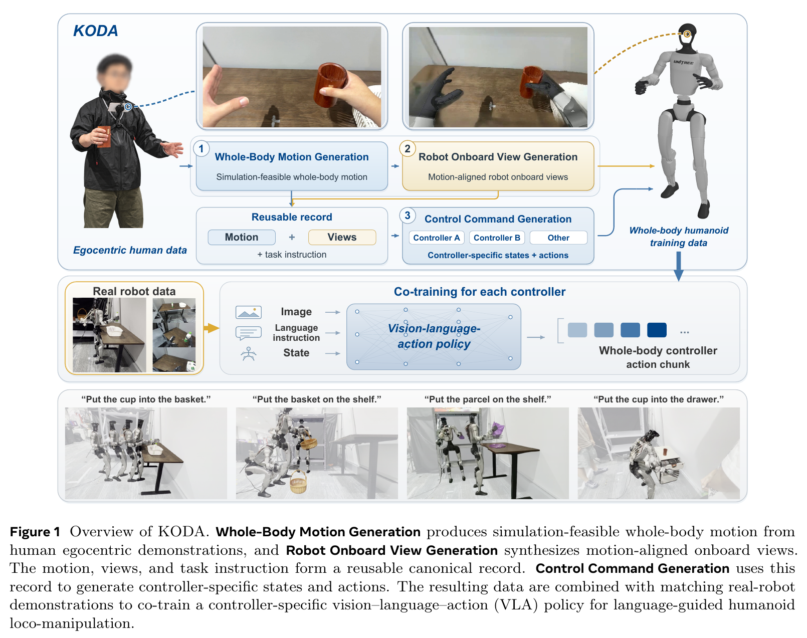
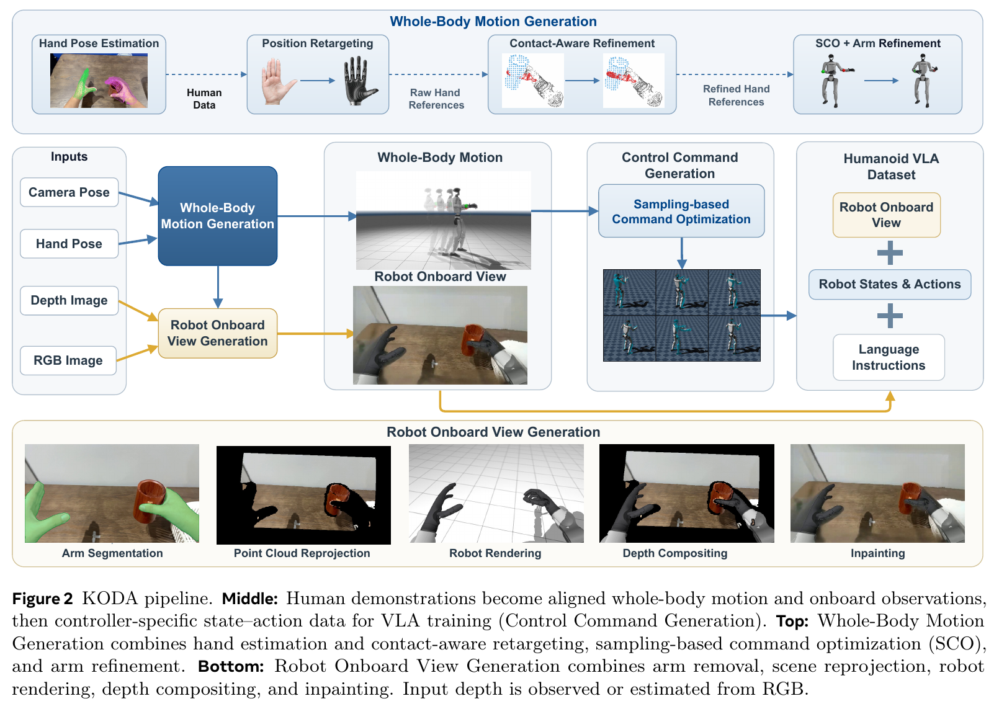
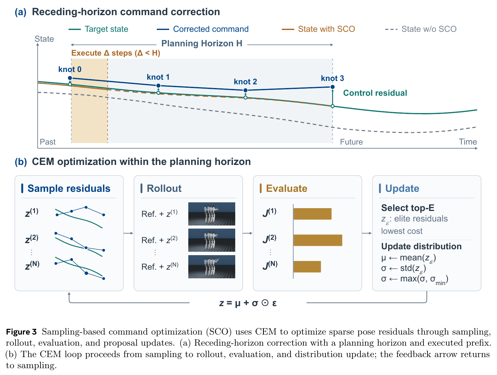

# 002 · KODA

**KODA: Kinematics–Observation Data Alignment for Humanoid Learning from Human Egocentric Demonstration**

- **作者**：Zibo Zhou、Yueru Chen、Junsong Wu、Weiji Xie、Qingyao Xu、Sheng Yin、Jiyuan Shi、Siheng Chen、Chenjia Bai、Xuelong Li。
- **机构**：Gamma Robotics、中国电信人工智能研究院 TeleAI、上海交通大学。
- **版本依据**：Zotero 中保存的 32 页 PDF，正文日期为 **2026-10-08**。未从该附件核实 arXiv 编号、修订号或会议录用信息，不作推定。
- **阅读状态**：2026-10-08；已阅读正文及相关方法、评估附录，未运行代码或复现。
- **来源**：[原论文](https://koda-humanoid.github.io/koda/assets/KODA.pdf) · [作者提供的 PDF 地址](https://koda-humanoid.github.io/koda/assets/KODA.pdf) · [项目地址](https://koda-humanoid.github.io/koda/)。总结依据 Zotero 附件，不依赖网页摘要；代码公开状态未独立核实。
- **关键词**：人类第一视角示范、数据转换、运动—观测对齐、控制器适配、VLA、SCO、CEM。

## 一句话理解

先把人类示范转成一份 **“机器人全身运动 + 与该运动对齐的机器人视角图像 + 任务指令”**，再为不同全身控制器生成相应的状态和动作标签，与真实机器人数据共同训练 VLA。重点是可复用的数据转换过程。（正文 §1、§3）

## 1. Motivation

全身 VLA 需要互相对应的机器人图像、身体状态、语言指令和可供部署控制器执行的动作标签。直接采集这些机器人示范成本高，数据覆盖有限。人类第一视角数据更容易扩充，但不能直接当作机器人训练数据使用：

1. **运动信息稀疏**：相机和双手轨迹不足以直接给出机器人的全身运动。
2. **视觉与运动不匹配**：人类相机看到的画面，与机器人执行转换后运动时应看到的画面不同。仅给相机施加固定偏移，不能反映机器人轨迹的实际变化。
3. **标签受控制器接口约束**：给某一控制器生成的命令，不能自然地作为另一控制器的监督；同一几何轨迹通过不同控制器执行，也会产生不同的身体状态。

KODA 的核心假设是：把可保留的运动—观测记录，与需要重新生成的控制器状态—动作字段分开，就能复用同一批人类数据，补足不同机器人控制数据集的覆盖范围。（正文 §1–3）

**我的理解**：它把“一个动作看起来像人”推进到“图像、运动、状态、命令在训练和部署中是否对应”。这是数据质量与接口适配问题。

## 2. 方法

### 2.1 总览：先生成标准记录，再适配控制器

**Fig. 1 怎么读**：先完成全身运动生成和机器人视角生成，保留两者及任务指令作为 canonical record；然后分别生成 SONIC、HEFT 等控制器需要的监督。转换数据与相应控制器采集的真实示范共同训练 VLA。

输入并不只是未经处理的 RGB：还需要时间对齐、统一米制坐标下的深度、源相机位姿和双手几何。它们可来自数据标注或离线恢复；缺失深度时，框架可用 Depth Anything 3 估计。**论文实际评估的 400 段人类示范全部包含手机采集的深度。**（正文 §3.1、§4.1）

标准记录可以写成：机器人图像 I、全身配置 q、任务指令 ℓ。其中 q 包括浮动基座、身体与手部关节；记录本身不含某个部署控制器专属的状态 s 与动作 a。它独立于控制器接口，但仍属于目标机器人 G1 的运动与观测空间。（正文 §3.1）

### 2.2 完整方法流程

**Fig. 2 怎么读**：上方展示运动生成，中间展示三阶段的数据流，下方展示机器人视角合成。最终输出是图像、控制器对应的状态与动作、语言指令。

### 2.3 阶段一：从稀疏人类参考生成全身运动

先用 HAWOR 恢复世界坐标系中的 MANO 手部运动，经 AnyTeleop 式映射得到机器人腕部与手指初值。针对可靠接触帧，再利用手部关键点、邻近物体表面深度和交互网格，优化腕部、手指，使人手与机器人手相对于物体的几何关系尽量一致。没有可靠接触证据时保留初值。（正文 §3.2；附录 A.1）

接着把源相机位姿通过机器人的相机—躯干标定转换成躯干参考，与双腕参考组成三个 SE(3) 轨迹。Kimodo 提供初始全身姿态，扩展并微调的 ScaleBFM 跟踪器在 MuJoCo/MJX 中把稀疏命令转换成全身运动。

直接跟踪仍有误差，因此 **SCO（sampling-based command optimization）优化输入命令，使实际仿真运动更接近不变的参考目标**。这里不是任意修改目标来降低误差，而是在“参考 → 控制器 → 仿真执行”的链条上寻找更合适的输入。（正文 §3.2；附录 A.2）

**Fig. 3 怎么读**：CEM 反复采样命令残差、并行仿真、按跟踪成本评分、用精英候选更新采样分布；每次只保留最优轨迹的一小段，再从实际仿真终态继续规划。阶段一每个窗口 40 步、80 个候选、8 轮更新，保留前 10 步；在 50 Hz 下分别是 0.8 秒窗口和 0.2 秒执行前缀。

最后用带时间约束的 Mink IK 修正残余腕部误差，只优化手臂链；浮动基座、躯干、下肢轨迹固定，手指保留接触感知结果，并约束关节范围、相邻步变化和自碰撞。（正文 §3.2；附录 A.3）

### 2.4 阶段二：用生成的机器人运动决定相机视角

从全身配置 q 计算机器人胸前相机的真实目标位姿，而不是给人类相机套一个固定偏移。每帧依次进行：

1. 分割并移除人类手臂、手部像素及其深度。
2. 根据深度与源相机参数把场景反投影到三维，再投影到该时刻的机器人相机。
3. 在相同机器人姿态、相机位置下渲染机器人身体。
4. 按深度合成真实场景与机器人，处理物体和机器人之间的遮挡。
5. 用 DiffuEraser 只补剩余空洞，冻结已有有效场景和机器人像素。

这样得到与 canonical motion 对应的机器人视角。它与运动、语言指令一起被保留，供不同控制器复用。（正文 §3.3；附录 B）

### 2.5 阶段三：生成控制器对应的状态—动作监督

对固定 canonical motion，再执行一次 SCO。这一次优化的是骨盆姿态与 29 个身体关节的参考残差，经选定的 SONIC 或 HEFT 执行并仿真，得到相应状态和动作；阶段三每次保留 20 步，即 0.4 秒。**两次 SCO 的目标和搜索空间不同**：第一次从人类稀疏参考生成机器人运动，第二次寻找能让指定部署控制器复现该运动的命令。（正文 §3.4；附录 C）

- **SONIC 动作**：64 维运动 token，加 12 维手部目标，共 76 维。
- **HEFT 动作**：29 维身体关节目标，加 9 维骨盆编码、12 维手部目标，共 50 维。
- **状态格式**：29 维仿真执行后的身体关节角、3 维投影重力、12 维连续手部几何估计，共 44 维。手部状态不是抓握命令，也不是力传感器测量。
- **VLA**：GR00T N1.7，根据图像、状态和语言输出 40 步动作片段；每个控制器配置在四个任务上联合训练。

更换 SONIC/HEFT 时，保留 canonical motion、合成图像、语言；重新优化控制命令、编码动作、记录状态，再训练对应策略。**这是同一机器人上的跨控制器数据复用，不是同一策略零样本切换控制器，也不是跨机器人形态迁移。**

## 3. 实验

### 3.1 平台、任务与数据

- **平台**：Unitree G1 + BrainCo 灵巧手；对 SONIC 与 HEFT 分别评估。
- **四个任务**：cup-to-basket、parcel-to-shelf、basket-to-shelf、cup-to-drawer。虽然任务名写 cup，部分实验物体实际是瓶子。
- **机器人数据**：每个控制器、每个任务固定 50 段示范，经对应 PICO 遥操作流程采集。
- **人类数据**：每任务 100 段，总共 400 段，胸前 iPhone + MobileEgo Anywhere，全部带深度。每任务完整人类池中有 80 段 shifted、20 段 robot-matched 条件。
- **训练**：每个配置一次训练；四任务联合，20,000 iterations，batch size 160。
- **真机评估**：每控制器配置、每任务、每条件 20 次。成功要求完成放置，且没有跌倒或未恢复的操作失败；四任务等权平均。（正文 §4.1；附录 D.1–D.2）

### 3.2 Robot-OOD 的确切含义

Robot-ID 条件出现在机器人示范中；Robot-OOD 条件不在机器人示范中，但在人类训练池中出现过。具体包括绿瓶换棕瓶、紫色包裹换白色包裹、篮子把手倾斜约 30°。

因此，本文测试的是 **人类数据能否补足机器人示范缺失的物体外观、姿态覆盖**。这不是对两种训练来源都完全未见条件的零样本泛化测试，也不能等同于广泛跨场景泛化。（正文 §4.1；附录 D.1）

### 3.3 主结果：固定机器人数据，增加人类数据

每任务从 0 增加到 100 段转换人类示范后，真机四任务宏平均成功率为：

- **SONIC / Robot-OOD：3.75% → 48.75%，增加 45.00 个百分点。**
- **HEFT / Robot-OOD：5.00% → 51.25%，增加 46.25 个百分点。**
- SONIC / Robot-ID：62.50% → 72.50%，增加 10.00 个百分点。
- HEFT / Robot-ID：68.75% → 76.25%，增加 7.50 个百分点。

人类数据预算为每任务 0 / 25 / 50 / 75 / 100 段时，Robot-OOD 宏平均分别为：SONIC **3.75 / 16.25 / 23.75 / 41.25 / 48.75%**；HEFT **5.00 / 20.00 / 31.25 / 45.00 / 51.25%**。这是已测试预算上的上升趋势。（正文 Table 1）

满预算下，各任务 Robot-OOD 成功率按上述四任务顺序为：SONIC **40 / 75 / 45 / 35%**，HEFT **50 / 75 / 40 / 40%**。仍有相当多失败，平均值不能代替单任务表现。

**统计边界**：每个配置只有一次训练，没有多训练种子均值。每任务 20 次实验，一个成功样本就是 5 个百分点；四任务宏平均分辨率是 1.25 个百分点。不同预算独立抽样、不是嵌套子集，而且机器人/人类采样比例随段数变化；因此不能把曲线解释成已经证明了稳定的 scaling law。（正文 §4.2；附录 D.2）

### 3.4 消融：观测是否对齐

在 SONIC、每任务 50 段机器人 + 100 段人类示范下，保留相同状态—动作监督等设置，仅更换人类数据图像生成方式，Robot-OOD 宏平均为：

- 原始人类图像，无对齐：**18.75%**。
- 固定相机偏移：**23.75%**。
- 相机跟随 canonical motion 重投影：**37.50%**。
- 完整对齐，额外移除人臂并渲染、合成机器人：**48.75%**。

这支持了运动决定视角以及完整外观转换的价值。完整对齐同时改变移除人臂与机器人渲染，不能单独归因给其中一步。固定偏移组是对 EgoHumanoid 视角策略的适配对照，不是完整复现 EgoHumanoid 系统的排名。（正文 Table 2；附录 D.3）

### 3.5 消融：控制器监督是否匹配

固定 canonical motion 与图像，仅去掉阶段三命令优化：SONIC 的 Robot-ID 宏平均 **48.75% → 72.50%**，Robot-OOD **7.50% → 48.75%**。未经优化的转换数据甚至使 ID 结果低于 robot-only 的 62.50%。（正文 Table 3）

**解释边界**：这个消融只取消阶段三 SCO，不是取消全部 SCO；状态取自控制器 rollout，所以变化同时影响动作标签和身体状态。它支持状态—动作监督整体的一致性，不能解释成仅改变动作标签的因果效果。（正文 §4.4；附录 D.3）

### 3.6 运动与控制器跟踪误差

- 运动生成的腕部位置误差：直接跟踪 **15.02 cm** → SCO **3.03 cm** → SCO + Mink IK **0.33 cm**。
- 对固定 canonical motion 的部署控制器 rollout，SCO 后腕部误差为 SONIC **2.88 cm**、HEFT **2.94 cm**；相机位置误差为 **3.20 cm**、**2.84 cm**。
- SONIC 相机朝向误差并未改善：**0.0784 → 0.0808 rad**。

这些误差的参照物不同，不能把 0.33 cm 当作真机末端执行精度；也不能说所有位置、姿态指标都改善了。（正文 Table 4；附录 D.4）

## 4. 结论与局限

**作者结论**：对齐运动、机器人观测、控制器状态—动作监督后，同一批转换人类示范能在 SONIC 与 HEFT 上补充固定机器人数据，提高四个 G1 任务的真机成功率；收益在机器人数据未覆盖、但人类数据覆盖的条件上更大。（正文 §6）

**证据支持的范围**：一个机器人形态、两个控制器、四个放置任务；需要现有机器人示范共同训练；跨控制器复用标准记录，但仍要重新生成监督并训练策略。

**需要保留的局限**：

1. **接触与物理可行性没有完全解决**：作者指出细粒度手—物交互尚不能完整复现，希望未来引入场景重建与接触建模。（正文 §5）
2. **“仿真检查”不是严格可行性认证**：附录 A.2 明确实现通过大代价压制非有限仿真值，并非通用运动学、接触或物理约束的硬认证。主文的可行性表述应结合这一实现边界理解。
3. **图像—状态对应仍有残差**：图像由 canonical motion 渲染，身体状态来自各控制器的实际 rollout；两者跟踪不完美时不完全一致，附录 C.5 明确承认这一点。
4. **输入恢复与规模证据有限**：真实实验全部带深度，没有在此单独验证大规模 RGB-only 自动恢复；单次训练和有限数据预算不足以证明普遍的规模规律。

**我的结论**：最有价值的是把运动—观测记录与控制器专属监督分开，并实验证明观测对齐、控制器匹配都影响训练收益。阅读时应把“能扩充特定覆盖条件”和“已解决广泛泛化、真实接触动力学”分开判断。

## 5. 与第一篇 Workhorse 的联系（阅读者比较）

- **共同点**：都要处理人类数据与机器人执行之间的差异，都修改人类视角图像以接近机器人观测。
- **问题层次**：Workhorse 围绕五部位接口组织视觉规划与全身跟踪，并强调闭环扰动恢复；KODA 围绕 canonical motion—view record 组织训练数据转换，再适配已有控制器接口。
- **复用对象**：Workhorse 在 G1/H2 上复用示范并重训练两模块；KODA 在 G1 的 SONIC/HEFT 间复用标准记录，重新生成监督、训练各自 VLA。
- **证据不可直接排名**：Workhorse 定量成功率来自仿真；KODA 本文主任务成功率来自真机，任务和协议也不同。不能直接比较百分比得出哪篇“更好”。

## 6. 研究启发与后续问题（阅读者判断）

1. 能否在保留标准记录的同时，根据控制器 rollout 的相机轨迹少量重生成图像，降低剩余图像—状态错位？收益是否值得额外成本？
2. 固定人类/机器人采样比例、使用嵌套人类子集，并重复多个训练种子后，数据预算趋势是否仍成立？
3. 对两类训练数据都未出现的物体、场景与接触条件，收益还能保留多少？
4. 如果用预测深度、相机轨迹与手部估计替代采集深度和可靠标注，转换成功率和下游策略性能分别如何变化？
5. 转换一段示范的算力、时长、失败或筛除比例是多少？正文未报告足够信息，不能仅据采集便宜推断端到端成本低。

## 原图与来源记录

- **Fig. 1 总览**：PDF 第 2 页；保存为 `fig-01-overview.png`。
- **Fig. 2 方法流程**：PDF 第 3 页；保存为 `fig-02-method-pipeline.png`。
- **Fig. 3 SCO 细节**：PDF 第 6 页；保存为 `fig-03-SCO-command-optimization.png`。

以上均从 Zotero 原 PDF 以 240 DPI 渲染、裁取，保留原图与原英文图注；没有重新绘制或改写图内内容。另存完整来源快照，裁剪坐标、来源、文件校验值见 [图像溯源记录](../assets/002-koda/manifest.json)。

主要依据：正文 §1–6、Figures 1–3、Tables 1–4，及附录 A.2–A.3、B、C.2–C.5、D.1–D.4。来源页码均按 PDF 的 1 起始页码。

- **2026-10-08**：收录第二篇；保存 3 张原图及来源快照；建立实验数据索引；补充与 Workhorse 的联系及证据边界。
