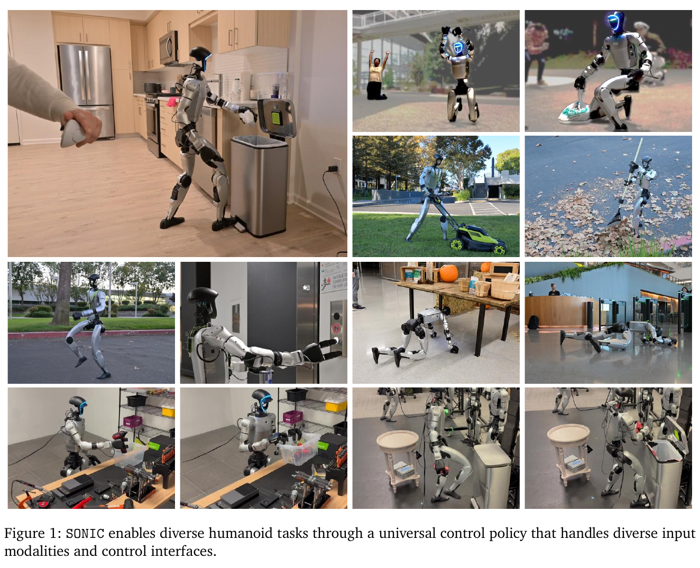
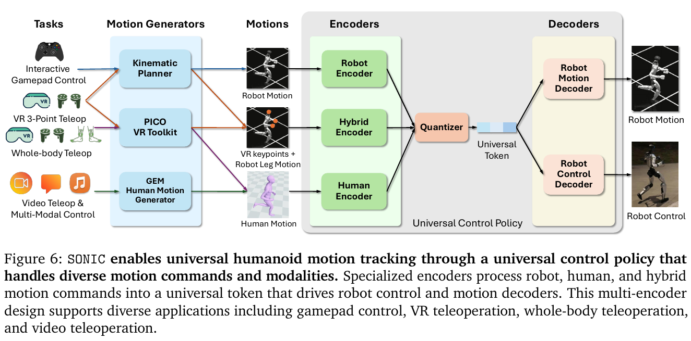

# 003 · SONIC

## 基本信息

- **完整标题**：SONIC: Supersizing Motion Tracking for Natural Humanoid Whole-Body Control
- **作者**：Zhengyi Luo；Ye Yuan；Tingwu Wang；Chenran Li；Fernando Castañeda；Sirui Chen；Zi-Ang Cao；Jiefeng Li；David Minor；Qingwei Ben；Jinhyung Park；David Sami；Zi Wang；Xingye Da；Runyu Ding；Cyrus Hogg；Lina Song；Edy Lim；Eugene Jeong；Tairan He；Haoru Xue；Wenli Xiao；Simon Yuen；Jan Kautz；Yan Chang；Umar Iqbal；Linxi "Jim" Fan；Yuke Zhu
- **阅读版本**：arXiv:2511.07820v4 [cs.RO] 13 Aug 2026；39 页。
- **来源**：[原论文](https://arxiv.org/abs/2511.07820v4) · [论文来源](https://arxiv.org/abs/2511.07820v4)。
- **阅读日期与状态**：2026-10-08，已总结，未复现。

## 一句话理解

把大规模人体运动跟踪作为人形控制的基础任务，用共享量化动作 token 接入机器人运动、人体姿态、遥操作和 VLA；重点证据是控制器的规模效应、未见动作跟踪及真机全身操作。

## Motivation

- 传统控制器通常用小网络、少量动作和任务专属奖励，增加一种能力就要重新设计训练目标。人体动捕提供逐帧、密集监督，适合统一训练。
- 单纯获得一个跟踪器还不够：导航、VR、视频、文本和 VLA 的指令格式不同，需要统一接口把高层意图转成可执行动作。
- 核心假设：同时扩大数据、模型和计算，并构建共享动作表示，可以得到能泛化到未见运动的通用低层控制器。

## 方法

1. **数据与跟踪训练**：约 700 小时原始动捕，经 GMR / PyRoki 重定向、过滤后保留 611 小时、317,189 段、超过 1 亿帧，50 Hz。用 PPO 训练 G1 跟踪器；actor 接收 10 步本体历史和运动命令，输出关节位置目标，底层 PD 执行。训练扰动物理参数、根部速度和参考命令。
2. **统一 token**：机器人运动、人体关节位置、上身稀疏关键点加下肢参考分别经过三个编码器，进入共享 FSQ 量化空间。控制解码器结合 token 与本体状态输出动作；辅助运动解码器重建机器人参考。
3. **联合目标**：PPO + 运动重建 + 编码器间 token 一致性 + 循环一致性。作用是让同一动作的不同输入格式落在相近表示中，同时让表示保留控制价值。它不是仅靠预训练后冻结的动作压缩器。
4. **高层接入**：运动学规划器根据当前状态与目标关键帧生成 0.8–2.4 秒动作段，以约 10 Hz 重规划；GEM 提供视频、文本、音乐运动输入。GR00T N1.5 经机器人遥操作数据微调后，直接预测 64 维运动 token 加 14 维手部动作。
5. **部署**：控制策略 50 Hz，命令发送 500 Hz。42M 参数是最大控制模型的规模；高层任务模型仍需对应数据训练，不能把统一低层控制等同于无训练的通用任务智能。

## 总览图与方法图

原图按 200 dpi 从所存 PDF 提取，仅裁切，保留原英文图注。[图号、页码和来源记录](../assets/003-sonic/manifest.json)。

读图：Fig. 1 看支持的输入与能力；Fig. 6 看三个编码器怎样共享一个控制解码器，以及运动重建分支如何提供辅助监督。

## 实验

- **评估划分**：test-content 7,016 段、182 个训练未见子类；test-repetition 9,395 段、动作类别已见但片段不重合；外部 PHUMA 68,326 段。失败定义为根部或末端高度偏离参考超过 0.25 m，属于局部跟踪评估，不是全局轨迹定位成功率。
- **规模效应**：模型从 1.2M 扩到 42M，Isaac Lab 的 test-content 成功率由 98.0% 到 99.6%，局部 MPJPE 从 27.7 到 23.8 mm。最大训练预算约 21k GPU 小时、128 GPU。规模曲线的 6 次评估不应直接当成 6 个独立训练种子。
- **跨方法比较**：统一 MuJoCo 测试下，SONIC 在 content / repetition / PHUMA 上为 98.5 / 99.2 / 97.2%，BeyondMimic 为 82.0 / 85.4 / 73.8%。但各基线的训练数据、重定向管线不同，结果同时反映数据规模和方法差异，不是完全等数据消融。
- **真机跟踪**：124 个动作各一次，123 次成功（99.2%）；仿真同集合 124/124。真机整体 MPJPE 25.7 mm，仿真 22.3 mm，脚部误差明显大于上身（§2.1，Fig. 2）。
- **真机 VLA**：Table 1 的五类任务平均 75%，每任务 10–20 次。包括苹果放盘 90%、踩踏板开垃圾桶 70%、拿罐并踩踏板投放 60%、钻机与盒子搬运 70%；物体拾取的两个变体为 75% / 95%，作为一类任务取平均。训练用了机器人遥操作数据。
- **动作表示消融**：三项全身任务中，token 比显式 SMPL 更易学；拿罐投垃圾桶为 60% 对 0%。FSQ、量化设置与跨编码器一致性也有单独消融（Table 3）。

## 结论与边界

作者证明了运动跟踪在这组数据与计算范围内具有有利的规模趋势，统一 token 能把低层控制器用于多种输入和全身任务。真机跟踪和 VLA 操作均有定量证据。

边界：仅测试 G1；VLA 仍依赖任务数据；跟踪成功不等于完成接触操作。对照存在数据不匹配，不能把所有增益归因于架构。论文未提供长期部署的形式安全保证或能效优化；极端动态动作仍会失衡。指令范围到 6 m/s 不等于真机实际达到 6 m/s。

## 我的理解与研究启发

阅读者判断：它最有价值的贡献是把“可规模化训练的控制任务”和“高层可学习的动作接口”一起设计。对 KODA 而言，SONIC 是执行后端；对 HumanoidArena 而言，必须进一步测试这个后端改变后，高层监督是否仍然有效。

## 后续问题 / 关联论文

- 固定同一批数据和重定向管线后，模型规模与 FSQ 对 OOD 跟踪各贡献多少？
- 增加物体接触和外力时，局部动作跟踪指标能否预测实际任务成功？
- 关联：[KODA](002-koda.md)、[HumanoidArena](004-humanoidarena.md)。

## 来源与修订记录

正文 §2–3、Tables 1–3、Supplementary Methods；所读 PDF 为 arXiv:2511.07820v4（2026-08-13），PDF 页首另标 2026-08-14。2026-10-08 从 wholebody 收录，未复现。
