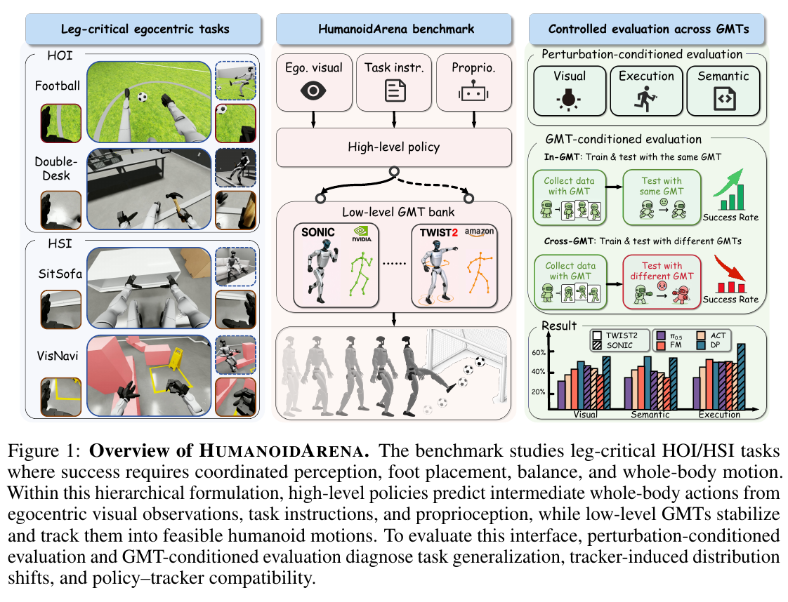

# 004 · HumanoidArena

## 基本信息

- **完整标题**：HumanoidArena: Benchmarking Egocentric Hierarchical Whole-body Learning
- **作者**：Taowen Wang；Zikang Xie；Bin Yang；Yunheng Wang；Zizhao Yuan；Yuetong Fang；Yixiao Feng；Yichi Wang；Xingyu Chen；Haodong Chen；Qiwei Wu；Weisheng Xu；Lihan Chen；Lusong Li；Zecui Zeng；Renjing Xu
- **阅读版本**：arXiv:2606.17833v1 [cs.RO] 16 Jun 2026；28 页。
- **来源**：[原论文](https://arxiv.org/abs/2606.17833v1) · [论文来源](https://arxiv.org/abs/2606.17833v1)。
- **阅读日期与状态**：2026-10-08，已总结，未复现。

## 一句话理解

一个把“高层视觉策略—低层运动跟踪器”接口作为评估对象的仿真基准：不仅看任务成功，还替换跟踪器，检查同一动作表示是否真的可以迁移。

## Motivation

- 许多系统把低层控制器隐藏在整体成功率后，无法判断失败来自视觉策略、动作接口还是控制器。
- 常见移动操作只让腿负责平面运输，不能检验踢球、坐下、跨台面等必须协调腿与全身的交互。
- 核心问题：相同高层策略和动作语义，在不同 GMT 执行后端及视觉、语义、执行扰动下，是否仍有效？

## 方法

1. **七项 leg-critical 任务**：HOI 为 Football、DoubleDesk、P&PBox；HSI 为 OpenDoor、SitSofa、Boxing、VisNavi。目标是让支撑转换、身体朝向和脚位实际参与任务。
2. **共享接口**：高层接收第一视角 RGB、指令和 64 维本体状态，预测 40 维动作，包含平面根部运动、根部高度与姿态、29 维身体关节目标及双手开合。
3. **执行后端**：GMT 专属适配器把共享动作转换成 TWIST2 或 SONIC 的参考格式。SONIC 使用 robot motion encoder；相同接口维度并不使两个执行系统的闭环动力学相同。
4. **数据与基线**：Isaac Lab 内用 VR、GMR 和选定 GMT 闭环采集第一视角示范。ACT、Diffusion Policy、Flow Matching、π0.5 使用相同接口、示范划分和 100k 梯度步预算。
5. **评估轴**：in-GMT 保持采集和部署后端一致；cross-GMT 更换部署后端。另设视觉、语义、执行扰动，分别检查外观、目标辨识及空间执行变化。

## 总览图与方法图

原图按 200 dpi 从所存 PDF 提取，仅裁切，保留原英文图注。[图号、页码和来源记录](../assets/004-humanoidarena/manifest.json)。

Fig. 1 同时给出任务、层级方法和评估协议，是本文总览与方法结构图。Fig. 2 是成功轨迹展示，不作为独立算法流程图替代品。

## 实验

- **平台与协议**：全部为仿真 G1；每配置 3 个随机种子，每种子 20 次，共 60 rollouts。主要指标为任务成功率 SR、平均跌倒率 AFR，以及跨 GMT 绝对下降和相对保留率。
- **匹配后端**：TWIST2 下 FM 的 HOI / HSI 平均为 36.11 / 58.75%；SONIC 下 DP 最强，分别 52.22 / 65.83%（Table 1）。优势依赖策略与后端组合，不能只给某个高层模型全局排名。
- **换后端**：TWIST2→SONIC 的平均成功率下降约 39.9 个百分点，反向约 36.0 个百分点；大量任务保留率为 0。反向平均跌倒率 7.56%，正向 1.36%（Table 2，§4.2）。
- **具体例子**：SONIC→TWIST2 的 DoubleDesk 平均跌倒率达 32.08%；另一些任务换后端后不跌倒但仍无法完成，说明稳定性与任务意图保持是两个指标。
- **扰动**：视觉变化带来较一致下降，例如 TWIST2-HOI 的 ACT 从 28.33% 到 14.44%。语义与执行扰动的影响随模型和后端改变（Fig. 3），不适合合成一个“通用鲁棒性分数”。

## 结论与边界

层级控制使若干腿部关键任务可学，但共享动作格式没有自动带来控制器无关的语义。本文贡献主要是诊断协议和基准，未证明真实机器人迁移效果。

边界：仅七项任务、两个跟踪器与有限策略家族；同样训练步数不等于同样算力或预训练数据。较低跌倒率也可能对应保守而无效的行为，须同时看成功率和保留率。

## 我的理解与研究启发

阅读者判断：它为 KODA 的“控制器专属监督”提供了直接研究动机。换低层控制器会改变状态访问分布和命令实现方式，数据层面的重新标注或多后端训练比仅统一张量维度更关键。

## 后续问题 / 关联论文

- 若用 KODA 式闭环命令优化重新生成每个后端的监督，cross-GMT 下降能否缩小？
- 用相同参考轨迹测试适配器和跟踪器，可否把表示误差与执行误差分开？
- 关联：[SONIC](003-sonic.md)、[KODA](002-koda.md)。

## 来源与修订记录

arXiv:2606.17833v1，2026-06-16；正文 §3–4、Tables 1–2、附录任务与协议说明。2026-10-08 从 Zotero PDF 整理，未复现。
