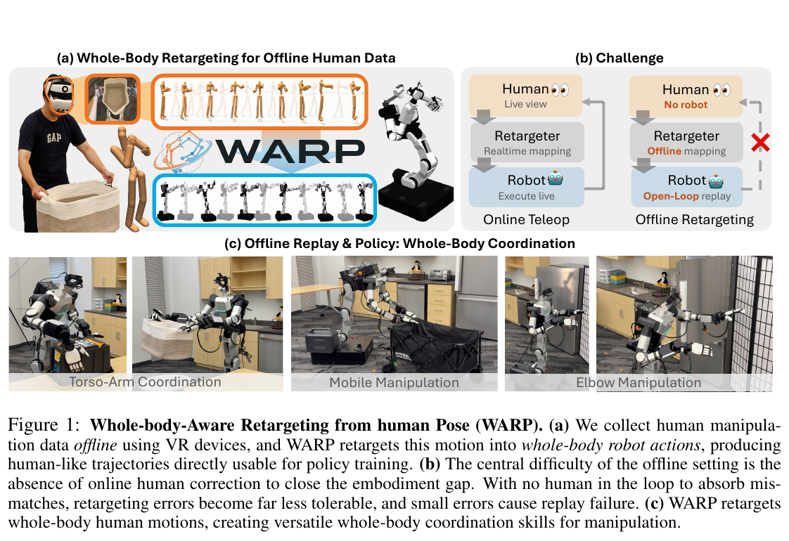
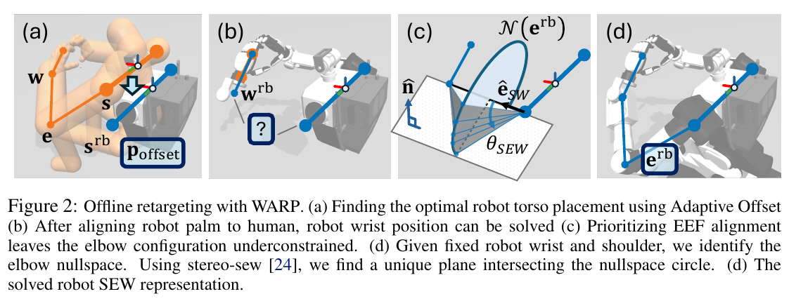

# 005 · WARP

## 基本信息

- **完整标题**：WARP: Whole-Body Retargeting for Learning from Offline Human Demonstrations
- **作者**：Zhenyang Chen；Chuizheng Kong；Chuye Zhang；Yuanshao Yang；Lawrence Y. Zhu；Shreyas Kousik；Danfei Xu
- **阅读版本**：arXiv:2606.29940v2 [cs.RO] 19 Aug 2026；23 页。
- **来源**：[原论文](https://arxiv.org/abs/2606.29940v2) · [论文来源](https://arxiv.org/abs/2606.29940v2)。
- **阅读日期与状态**：2026-10-08，已总结，未复现。

## 一句话理解

面向准静态轮式全身操作，用闭式几何重定向同时保证末端精度与解的一致性，从离线人体示范学习机器人策略；关键区别是“能回放的数据”未必同样“容易被策略学会”。

## Motivation

- 离线人体示范没有操作者在线纠偏，手掌偏移会直接污染训练标签；仅匹配身体方向无法保证接触点正确。
- 冗余关节优化可能给同一目标不同解，造成多模态、互相冲突的行为克隆监督。
- 末端位置相同，身体姿态不同，也会影响避碰、抓握和推车；因此需要保留躯干、肘部与移动底盘协调。

## 方法

1. **c-SEW 几何重定向**：先构造 Shoulder–Elbow–Wrist 骨架，再闭式求关节角，避免直接在冗余关节空间迭代优化。
2. **Adaptive Offset**：根据双掌目标与机器人骨长计算躯干平移，使两掌中心对齐；然后把手掌匹配作为硬约束，而不是与姿态相似性加权折中。
3. **肘部唯一解**：固定肩、腕和骨长后，使用人体 SEW 肘角、Stereo-sew / SP3 解剩余肘部自由度；躯干使用闭式 IK 并选膝向前分支。唯一性和精确性依赖非退化、可达的几何条件。
4. **Lazy base**：细微位移由 6-DoF 躯干吸收，轮式底盘只处理较大搬移，减少基座高惯性造成的追赶、超调。
5. **采集与学习**：Meta Quest 以 60 Hz 记录人体全身和手部；RB-Y1 用全向轮底盘、双 7-DoF 手臂、6-DoF 躯干和 XHands，以 100 Hz 关节阻抗执行。hierarchy-masked flow 策略从重定向数据学习。
6. **观测条件**：真实实验用 AprilTag 追踪物体、Vicon 定位底盘以隔离感知误差。本文不是 RGB 端到端第一视角策略，也不是双足动态行走控制系统。

## 总览图与方法图

原图按 200 dpi 从所存 PDF 提取，仅裁切，保留原英文图注。[图号、页码和来源记录](../assets/005-warp/manifest.json)。

Fig. 1 看离线人体数据到机器人学习的整体过程；Fig. 2 看躯干偏置、手掌匹配和肘部零空间的闭式几何处理。

## 实验

- **运动质量**：从 BONES-SEED-SOMA 选 514 段操作示范，比较 SEW-M、MINK-EF、增加身体约束的 MINK-TE。检查掌位姿误差、关节限位、自碰撞、解的一致性和计算速度。
- **条件非常重要**：不启用关节限位时，WARP 掌位置均值误差 0.0046 mm，MINK-EF 0.701 mm；启用限位后 WARP 为 24.048 mm，MINK-EF 0.751 mm，但 WARP 的碰撞比例为 0.017，对方为 0.222（Fig. 5）。几何精确匹配不能外推到所有受限姿态。
- **仿真策略**：三项 DexMimicGen 任务，每项 200 段源数据，训练使用两种重定向都回放成功的交集。平均回放成功率接近（80.0% 对 79.5%），策略成功率为 71% 对 59%，提高 12 个百分点（Table 1）。
- **真机**：每任务采 50 段人体示范。旋转盒子策略 65% 对 40%，推车 75% 对 25%，提洗衣篮 37.5% 对 7.5%；用肘关冰箱门仅评估回放，WARP 90%，没有对应学习策略。
- **报告一致性问题**：Fig. 7 图注称每项 10 trials，但若干柱值以 2.5 个百分点变化，正文未在该处解释分母或聚合方式。保留作者数值，不反推成功次数或置信区间。

## 结论与边界

高质量、确定的全身重定向可提升离线数据的学习价值，回放成功率不足以评价标签质量。真机证据限于受控定位条件下的轮式全身操作；图像策略、动态双足、复杂接触安全性均未由本文证实。

## 我的理解与研究启发

阅读者判断：WARP 主要解决几何标签的精度和一致性；KODA 进一步处理闭环控制器下状态、动作和相机的一致性。二者针对的是不同层次的监督误差，不能把几何上精确当成动态上可执行。

## 后续问题 / 关联论文

- 固定人体示范与成功回放交集，解的一致性对学习性能的独立影响有多大？
- 取消外部定位，加入相机和接触状态误差后，优势是否保持？
- 关联：[KODA](002-koda.md)、[EgoHumanoid](012-egohumanoid.md)。

## 来源与修订记录

arXiv:2606.29940；以当前 Zotero PDF 正文 §3–5、Figs. 5–7、Table 1 为准。2026-10-08 整理，未复现。
