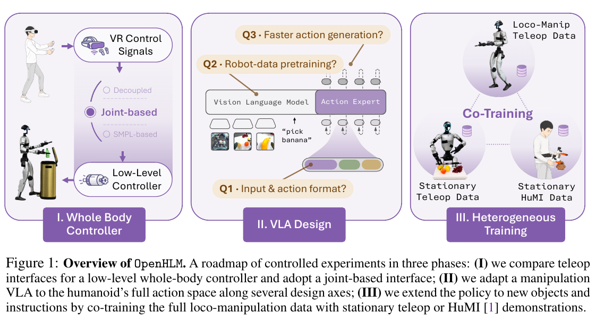

# 006 · OpenHLM

## 基本信息

- **完整标题**：OpenHLM: An Empirical Recipe for Whole-Body Humanoid Loco-Manipulation
- **作者**：Yingdong Hu；Haodong Zhu；Boyuan Zheng；Yihang Hu；Tong Zhang；Zunhao Chen；Junming Zhao；Ruiqian Nai；Yang Gao
- **阅读版本**：arXiv:2606.22174v1 [cs.RO] 20 Jun 2026；30 页。
- **来源**：[原论文](https://arxiv.org/abs/2606.22174v1) · [论文来源](https://arxiv.org/abs/2606.22174v1)。
- **阅读日期与状态**：2026-10-08，已总结，未复现。

## 一句话理解

通过一系列真机控制变量实验，提出“全身关节遥操作 + 机器人数据预训练 VLA + 异构数据共训练”的 G1 全身移动操作配方，而不是依赖一种全新的网络结构。

## Motivation

- 上下身分离的接口限制了腿、脚作为操作器的能力，也限制了示范能覆盖的动作空间。
- 静态或轮式双臂 VLA 能否迁移到人形全身动作，以及哪些改动真正重要，缺少系统实验。
- 全身遥操作昂贵，希望用更便宜的静止机器人数据或 robot-free HuMI 数据扩展物体与语言覆盖。

## 方法

1. **三阶段研究路线**：先选择低层控制器与遥操作接口，再适配 VLA，最后进行异构数据共训练。每阶段尽量一次改变一个因素。
2. **全身接口**：选择关节式全身遥操作，低层跟踪器约 50 Hz，高层参考约 10 Hz；前瞻时延默认 0.2 秒，兼顾跟踪稳定性与操作者反馈。相较 3 点和上下身分离接口，它直接暴露更完整的身体自由度。
3. **VLA**：以 π0.5 初始化，保留主体架构，将动作投影扩展到 34 维，保留已有权重并初始化新增部分；默认双臂预训练排序、绝对关节目标、完整本体输入和 10 步 flow matching。输入包含头部、腕部图像与语言。
4. **异构训练**：八项任务提供全身遥操作；额外四项提供 stationary teleop 或 HuMI。stationary teleop 保留机器人操作动作，HuMI 通过便宜的手持装置记录机器人外部示范。
5. **HLM-12**：12 个任务分为移动取放、扩展可达空间、非手部操作、环境约束下移动操作四类，另设长时序组合任务。

## 总览图与方法图

原图按 200 dpi 从所存 PDF 提取，仅裁切，保留原英文图注。[图号、页码和来源记录](../assets/006-openhlm/manifest.json)。

Fig. 1 同时展示三阶段系统与实验路线；本文主要是经验设计研究，没有额外的统一新算法流程图。

## 实验

- **指标**：真机 G1，每策略—任务通常 5 次，使用相同五种布局；按子阶段给部分分数，报告平均任务进度及标准误。下述百分数是 progress，不能写成完整任务成功率。长时序比较单独使用 10 种配对、各一次。
- **遥操作与时延**：全身关节接口是所测对照中唯一完成三类能力任务的接口；过大预览时延会拖慢操作者并降低数据质量。0.2 秒是本系统中的折中，不是普适控制常数。
- **预训练**：四任务子集，π0.5 初始化平均进度 91%，仅 PaliGemma 为 60%，随机初始化为 42%。验证动作 MSE 接近，并不能预测真机抓握和失败重试能力（Fig. 5）。
- **推理步数**：一步 flow matching 和 drifting 模型约快 30 ms，但真机平均进度低约 20 个百分点，尽管验证 MSE 更低。论文将时序平滑性作为可能解释，尚未通过机制实验确认。
- **共训练**：八训练任务平均进度 89%；额外四任务中 stationary co-training 使平均进度由 33% 到 87%，12 任务全遥操作 oracle 为 94%。HuMI 能教新物体与指令，但在需要新倾倒动作的 Pouring 上失败，不能泛称廉价人体数据能教会新运动。
- **长时序**：HuMI 共训练 87.5 ± 3.7%，示范总时长 1.14 h；Ψ0 为 48.8 ± 4.4%、2.70 h；GR00T N1.6 为 57.5 ± 4.6%、2.70 h；全遥操作 oracle 为 97.5 ± 1.7%、2.73 h（Table 2）。这些是完整系统比较，数据配方和初始化均有差异。

## 结论与边界

本系统中，全身接口与机器人预训练的价值明显大于单项动作格式小改动；便宜数据能扩展语义，但新动作迁移仍受观测和动作域差异限制。

边界：单一 G1、少量真机 rollouts、受控任务；一次改变一个因素不能排除交互效应。移除本体并改用相对动作的组合就会导致严重失败。不能用验证 MSE 或 demo 时长单独给方法优劣排名。

## 我的理解与研究启发

阅读者判断：这篇最适合作为系统搭建和消融设计参考。应区分“已有动作的新语义组合”和“真正的新动作学习”，并将动作误差、闭环恢复、时间效率作为不同评价量。

## 后续问题 / 关联论文

- 能否通过 KODA 式状态—动作与视角对齐，让 HuMI 对新动作也提供有效监督？
- 增加独立训练重复后，哪些小幅接口改动仍显著？
- 关联：[SONIC](003-sonic.md)、[KODA](002-koda.md)。

## 来源与修订记录

arXiv:2606.22174v1，2026-06-20；正文 §2–4、§6、Tables 1–2、Fig. 5–7 与评估附录。2026-10-08 整理，未复现；开源状态仅记录论文中的声明，未额外核查在线仓库。
