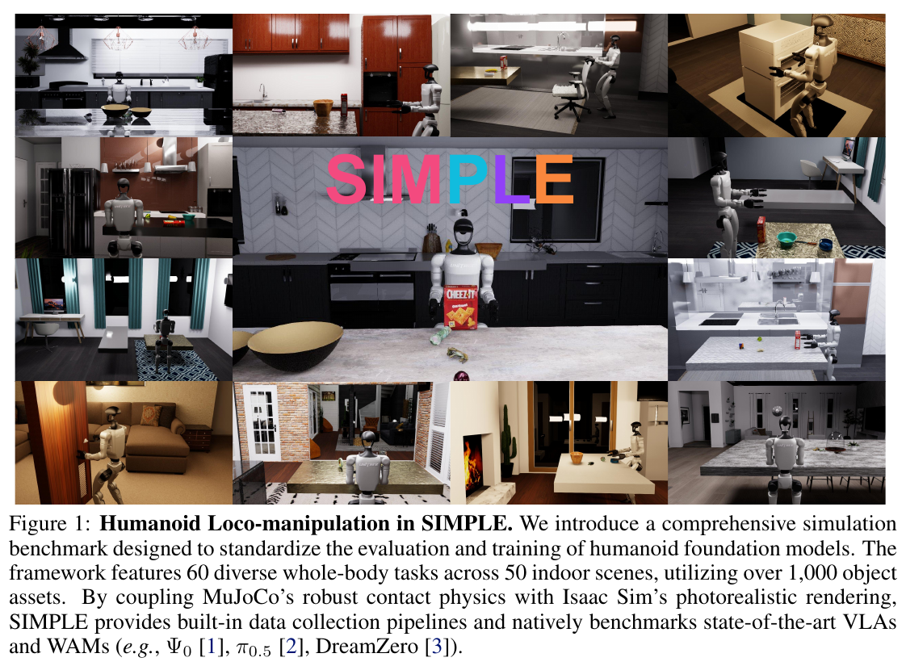
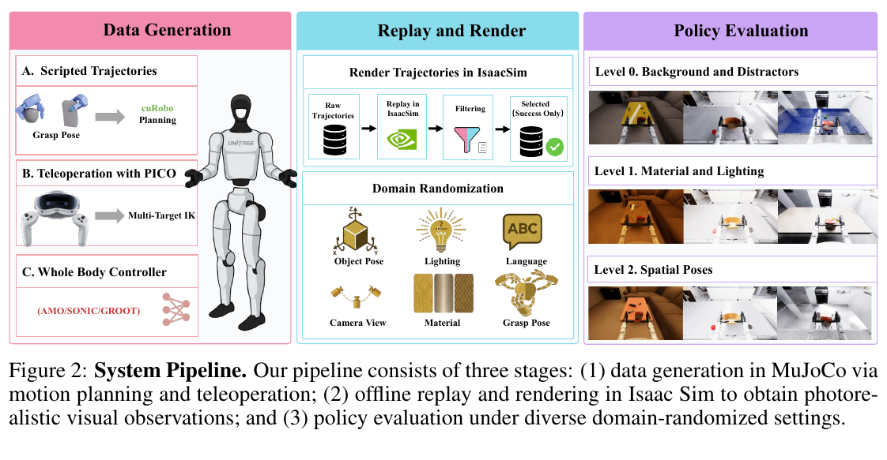

# 007 · SIMPLE

## 基本信息

- **完整标题**：SIMPLE: Simulation-Based Policy Learning and Evaluation for Humanoid Loco-manipulation
- **作者**：Songlin Wei；Zhenhao Ni；Jie Liu；Zhenyu Zhao；Junjie Ye；Hongyi Jing；Junkai Xia；Xiawei Liu；Michael Leong；Liang Heng；Di Huang；Yue Wang
- **阅读版本**：arXiv:2606.08278v1 [cs.RO] 6 Jun 2026；18 页。
- **来源**：[原论文](https://arxiv.org/abs/2606.08278v1) · [论文来源](https://arxiv.org/abs/2606.08278v1)。
- **阅读日期与状态**：2026-10-08，已总结，未复现。

## 一句话理解

把 MuJoCo 的接触动力学与 Isaac Sim 的视觉渲染分开组合，提供人形移动操作的数据生成、策略训练与评估基础设施，并在少量相似真机场景验证纯仿真训练的迁移。

## Motivation

- 真机评估昂贵、重置困难，缺少可复现的人形全身操作测试平台。
- 单独偏物理或偏视觉的仿真器难同时覆盖稳定双足接触与复杂图像分布。
- 希望在统一动作接口下比较 VLA、WAM 和轻量模仿学习模型，并减少采集与工程成本。

## 方法

1. **双仿真器**：MuJoCo 负责动力学、碰撞与控制；状态同步到 Isaac Sim 做光线追踪。物理只在 MuJoCo 中推进，不能理解为两个引擎同时计算并平均接触结果。
2. **任务资产**：60 项任务、50 个 HSSD 室内场景、超过 1,000 个物体；导入 GraspNet / Objaverse 资产，经 CoACD 凸分解并生成物理与视觉两类表示。
3. **数据生成**：脚本分解任务，BoDex 生成抓握，cuRobo 规划上肢、脚本协调移动；困难接触任务由 PICO VR 遥操作补充。采集时用 MuJoCo 原生视觉降低延迟，以 50 Hz 记录、导出 LeRobot。
4. **离线渲染**：对成功轨迹回放，随机化物体、位姿、纹理、光照、相机和指令，得到约 6,000 episodes。
5. **控制接口**：32 维本体状态，36 维动作，包括上身、手部及基座移动命令，由低层控制器维持步行和平衡。该接口偏上下身分解，不能默认覆盖 HumanoidArena 的所有 leg-critical 能力。

## 总览图与方法图

原图按 200 dpi 从所存 PDF 提取，仅裁切，保留原英文图注。[图号、页码和来源记录](../assets/007-simple/manifest.json)。

Fig. 1 看任务范围；Fig. 2 看“物理采集→视觉回放→扰动评估”的数据流。

## 实验

- **主基准范围**：虽然环境提供 60 项任务，Table 1 实际比较 6 项代表任务；每格为三种扰动条件下 10 次试验的成功次数。包含 Ψ0、GR00T N1.6、π0.5、DreamZero、ACT、DP 等，采用单任务微调。
- **结果特征**：Ψ0 和 ACT 在多项任务表现较强；DreamZero 在 XMovePick 为 10/10、10/10、10/10，但在 XMoveBendPick 为 0/10、0/10、1/10。模型优势明显受任务制约。
- **随机化消融**：BendHandover 中，10 段 Level 0 训练在困难 Set 2 为 5/10；改为 5 段 Level 0 + 5 段 Level 1 为 8/10。XmoveBendPick 从 10 段示范扩到 100 段，三个评估集由 5/10、6/10、3/10 到 10/10、9/10、9/10（Table 3）。
- **采集效率**：仿真遥操作的 whole-body pick-place 为 310.3 demos/h，真机遥操作 206.8，自动规划 58.9（Table 2）。规划吞吐低但无需操作者，不能只按 episodes/h 比人工成本。
- **真机迁移**：纯仿真数据微调后的 Ψ0，在相似真实环境的 Pick&Place 和 Handover 均为 8/10；仿真分别 9/10、10/10（Table 5）。这里 zero-shot 指下游没有真实数据微调，不表示基础模型从未使用真实机器人数据。
- **文中编号不一致**：§3.5 叫 Level 1–3，Fig. 2 与 Table 1 叫 Level 0–2。阅读时应按“干扰物→材质光照→空间位姿”的内容匹配，不混淆编号。

## 结论与边界

双引擎基础设施支持规模化人形操作研究，少量相似真机场景验证了仿真数据的训练价值。作者称模拟排名与真机相关，但正文主要援引既有真实实验趋势，未给出大规模配对的相关系数或跨场景校准证据。

局限：光线追踪约 4 frames/s/GPU，渲染成本高；刚体假设不适用于布料、绳索等。主定量评估只有六项任务，真实迁移仅两项、各 10 次，不能外推到全部 60 任务或任意家庭。

## 我的理解与研究启发

阅读者判断：SIMPLE 解决的是测试与数据生产设施，HumanoidArena 解决的是策略—跟踪器接口诊断，两者互补。评估时应把视觉域变化、空间初始化变化和控制后端变化分别记录。

## 后续问题 / 关联论文

- 同一批策略在匹配与不匹配真实场景下的模拟排名相关性有多强？
- 视觉随机化收益能否与更丰富的动作示范收益分开？
- 关联：[HumanoidArena](004-humanoidarena.md)、[HumanoidMimicGen](013-humanoidmimicgen.md)。

## 来源与修订记录

arXiv:2606.08278v1，2026-06-06；正文 §3–5、Tables 1–5、限制及系统附录。2026-10-08 从 Zotero PDF 整理，未复现。
