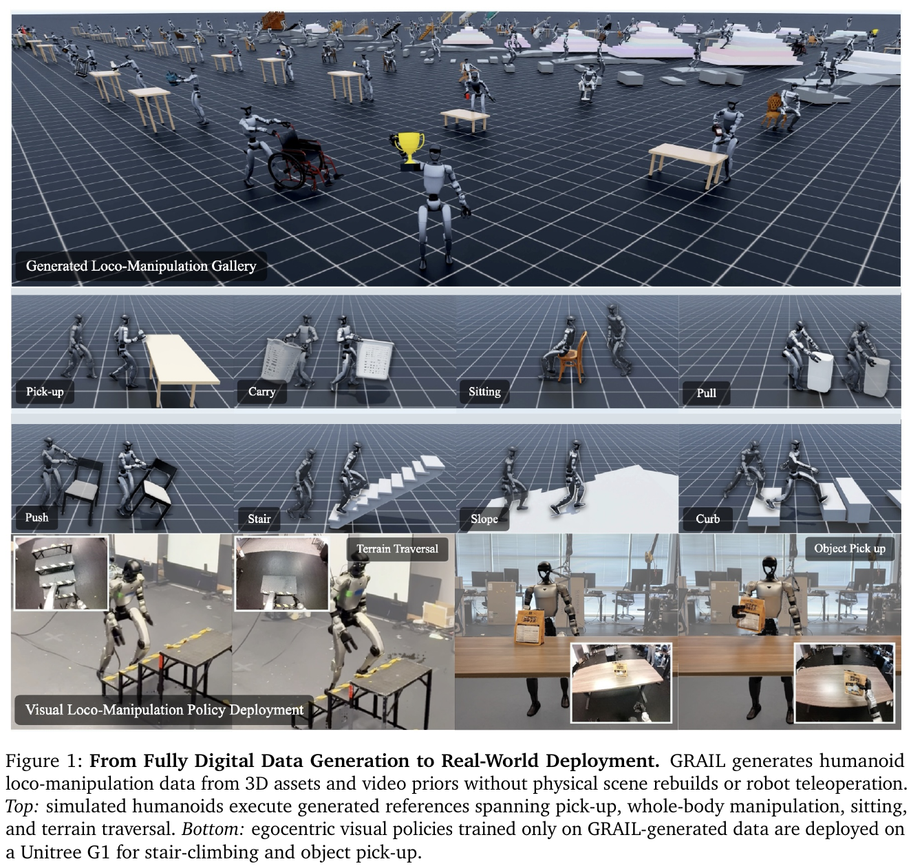
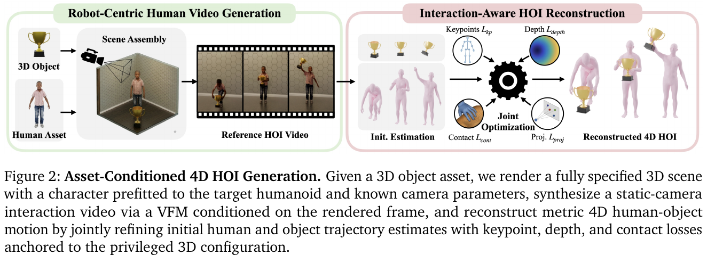
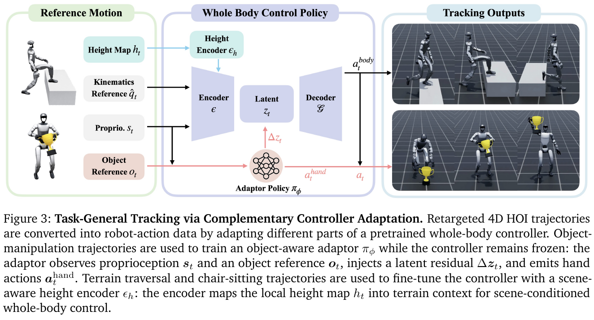

# 008 · GRAIL

## 基本信息

- **完整标题**：GRAIL: Generating Humanoid Loco-Manipulation from 3D Assets and Video Priors
- **作者**：Tianyi Xie；Haotian Zhang；Jinhyung Park；Zi Wang；Bowen Wen；Jiefeng Li；Xueting Li；Qingwei Ben；Haoyang Weng；Yufei Ye；David Minor；Tingwu Wang；Chenfanfu Jiang；Sanja Fidler；Jan Kautz；Linxi Fan；Yuke Zhu；Zhengyi Luo；Umar Iqbal；Ye Yuan
- **阅读版本**：arXiv:2606.05160v1 [cs.RO] 3 Jun 2026；24 页。
- **来源**：[原论文](https://arxiv.org/abs/2606.05160v1) · [论文来源](https://arxiv.org/abs/2606.05160v1)。
- **阅读日期与状态**：2026-10-08，已总结，未复现。

## 一句话理解

先规定完整 3D 场景，再让视频模型生成交互，借助已知几何重建 4D 人—物运动，最后通过适配跟踪器生成机器人数据；用纯生成数据训练的视觉策略完成真机拾取与爬楼。

## Motivation

- 遥操作和动捕依赖真实场景、设备与操作者，扩展物体和地形成本高。
- 从任意网络视频重建运动时，相机、尺度、人体比例、物体几何都未知，容易出现深度歧义、接触漂浮与重定向失真。
- 核心思路是把难以推断的量变成生成前的已知条件，让视频基础模型只提供行为先验。

## 方法

1. **场景先于视频**：组合物体与室内/地形资产，用刚体仿真放稳物体，预设相机、真实尺度和接近 G1 比例的人体；Blender 渲染首帧，VLM 提供提示，VFM（如 Kling）生成固定相机交互视频。
2. **4D 重建**：GENMO 估计身体，WiLoR 补充手部，FoundationPose 追踪已知几何物体；相机和物体初始姿态已知。MoGe-2 深度与已知背景深度配准，恢复尺度。
3. **交互优化**：联合优化人体与物体残差，使用关键点、物体投影、深度、接触及平滑正则。VLM 接触标签选择约束帧，脚接触与速度正则减少滑步和漂移；这是近似重建约束，不是物理可行性证明。
4. **两类跟踪器**：GMR 重定向到 G1。操作任务冻结 SONIC 主体，学习物体感知 latent adaptor 调节 token 并输出手部动作；地形/坐下任务则微调控制器并加入高度图编码器。按任务家族共享训练，不是每条示范各训一个策略。
5. **视觉蒸馏与部署**：从跟踪器生成仿真数据，训练分别用于拾取与爬楼的第一视角 RGB 策略，做视觉随机化和相机对齐。真机使用 OAK-D W，桌面 RTX 5090 远程计算，视觉策略约 10 Hz。

## 总览图与方法图

原图按 200 dpi 从所存 PDF 提取，仅裁切，保留原英文图注。[图号、页码和来源记录](../assets/008-grail/manifest.json)。

Fig. 1 看生成数据到真机的范围；Fig. 2 看已知几何如何约束视频重建；Fig. 3 看物体适配与地形适配的不同训练方式。

## 实验

- **数据规模**：超过 20,000 条序列，涵盖拾取、全身操作、坐下和地形；使用约 1,000 物体资产及 1,000 程序地形配置。
- **生成质量**：20 个共享物体上，GRAIL 的物理跟踪 SR 为 88.9%，DAViD 24.0%、HOIDiff 15.8%、CHOIS 10.5%（Table 1）。这里 SR 是 SMPL-X 物理跟踪中满足归一化身体和物体偏差阈值的帧比例，不是真机 G1 任务成功率。
- **G1 仿真跟踪**：124 条运动、43 个物体，成功定义为 episode 平均物体位置误差小于 20 cm。完整方法 81.4%，去掉 latent adaptor 为 39.7%，从头训练去掉 SONIC 为 45.0%（Table 2）。仅身体跟踪更准的模型并不一定物体操作更好。
- **真机拾取**：五个训练物体各 10 次，平均 84%；五个未见物体各 10 次，平均 80%（Table 3）。这些未见物体结果是有限对象集合泛化，不是任意类别泛化。
- **真机爬楼**：正文报告 90%，但该处未给与拾取同样清楚的试验分母，不推算成功次数。两项真机任务分别训练视觉策略，不是一个策略统一执行全部生成任务。

## 结论与边界

已知资产和相机条件显著降低了生成视频重建的歧义；任务家族跟踪器和纯生成视觉数据具有真实控制价值。数据生成过程可完全数字化，但依赖已有视频/运动基础模型、3D 资产和仿真设置。

局限：遮挡、快动作、视频物体外观漂移会使重建失败，过滤丢弃不可忽略比例的候选；运动家族变化仍需训练或微调。真机仅验证拾取和爬楼，不能由模拟坐下或推物演示推出同等真机性能。

## 我的理解与研究启发

阅读者判断：比起“视频生成机器人动作”，更准确的理解是“受控几何降低重建难度 + 控制器把运动转换为执行数据”。生成、几何、动力学与视觉四个阶段均有误差，应该分别评估产出率和最终收益。

## 后续问题 / 关联论文

- 把被过滤候选计入后，每条可用示范的生成成本是多少？
- 接触损失与 SONIC 适配器的收益能否在同一参考池中分离？
- 关联：[SONIC](003-sonic.md)、[VIRAL](014-viral.md)。

## 来源与修订记录

arXiv:2606.05160v1，2026-06-03；正文 §3–6、Tables 1–3。2026-10-08 从 Zotero PDF 整理，未复现。
