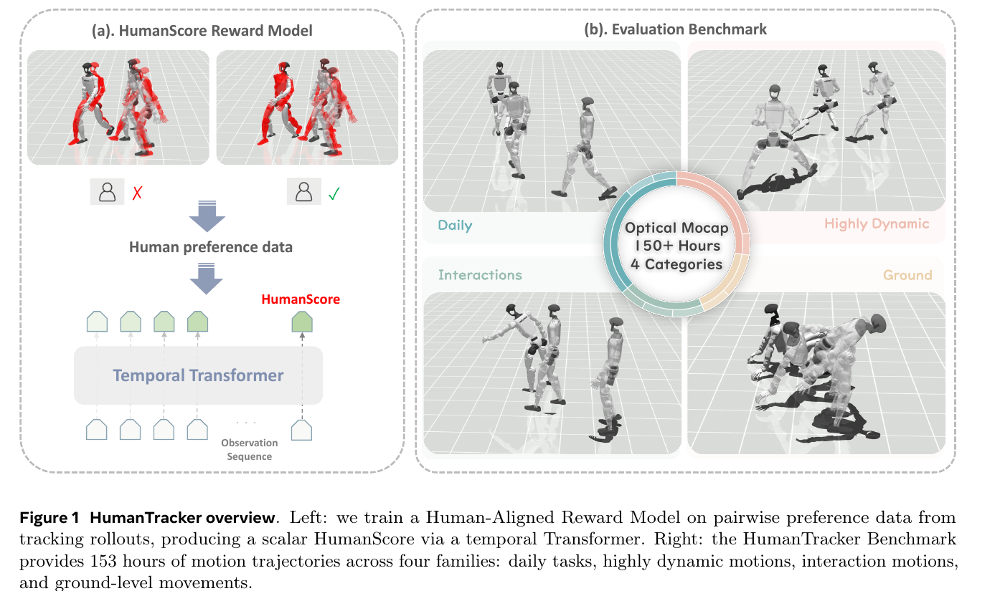
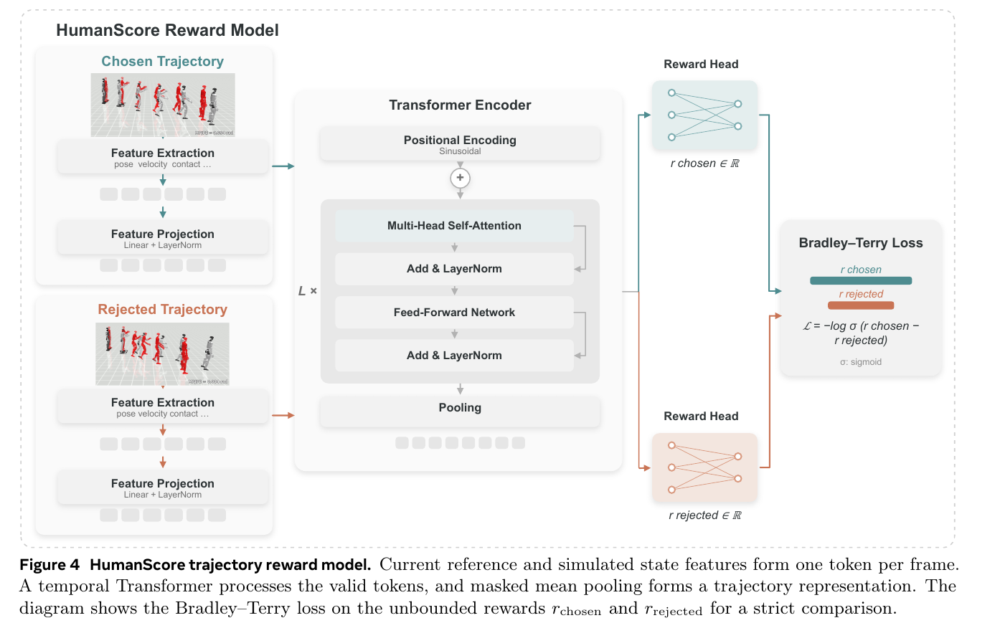

# 009 · HumanTracker / HumanScore

## 基本信息

- **完整标题**：HumanTracker: Towards Comprehensive and Human-Aligned Motion Tracking Benchmark
- **作者**：Dairu Liu；Zekun Qi；Jiayu Zeng；Ruixi Yu；Yu Guan；Yintianrun Zhang；Xuchuan Chen；Sikai Liang；Zekai Li；Chenghuai Lin；Xinqiang Yu；Wenyao Zhang；He Wang；Li Yi
- **阅读版本**：arXiv:2608.13555v1 [cs.RO] 13 Aug 2026；15 页。
- **来源**：[原论文](https://arxiv.org/abs/2608.13555v1) · [论文来源](https://arxiv.org/abs/2608.13555v1)。
- **阅读日期与状态**：2026-10-08，已总结，未复现。

## 一句话理解

提供 153 小时分类动捕基准，并从专家对跟踪视频的成对偏好学习时序评分 HumanScore，补充姿态误差无法充分反映的滑步、接触、抖动和稳定性。

## Motivation

- 逐帧平均关节误差可能很低，但视频看起来脚在滑、支撑不稳；传统单一指标与人的判断不完全一致。
- 少量动作和一个总分容易掩盖地面、多接触、高动态等长尾失败。
- 需要把测试数据、终止规则和指标统一，并按动作类别诊断，而不只按一个数字给控制器排名。

## 方法

1. **基准数据**：24 位专业表演者的光学动捕，约 25K clips、153 h，按 Daily 89 h、Highly Dynamic 11 h、Interaction 48 h、Ground 5 h 分类；GMR 重定向到共同 29-DoF qpos，人工剔除明显处理伪影，9:1 划分并约束重复不跨集合。
2. **统一执行评估**：MuJoCo 中保留每个控制器的原生观测和动作栈，但固定机器人、参考轨迹和统计逻辑；50 Hz 记录状态、接触、力、速度和关键点。
3. **偏好采集**：GMT、TWIST2、SONIC、Humanoid-GPT 在训练参考上生成对齐轨迹，以 5 秒分窗；六位人形机器人方向博士评审，约 12K pairs / 24K motions，选择更好、相似或无法比较。各控制器配对平衡，按 source motion 分组做 80/20 划分。
4. **HumanScore**：每帧 539 维当前参考与仿真状态、接触和控制特征，经 temporal Transformer、有效帧均值池化与标量 reward head。严格偏好用 Bradley–Terry 损失，相似对用对称约束，无法比较对不训练。
5. **轨迹分数**：每窗 reward 经 sigmoid，再按有效帧数加权映射为 0–100。训练标签来自视频，但模型输入是仿真状态，不是直接评分任意现实视频的视觉模型。

## 总览图与方法图

原图按 200 dpi 从所存 PDF 提取，仅裁切，保留原英文图注。[图号、页码和来源记录](../assets/009-humantracker/manifest.json)。

Fig. 1 同时展示数据基准与偏好评分；Fig. 4 展示成对轨迹输入、时间聚合和训练损失。

## 实验

- **共同失败条件**：骨盆/腕/踝高度误差超过 0.25 m，骨盆旋转误差超过 1 rad，或状态非有限。本文名为 MPJPE 的量是 29 个驱动关节的平均绝对角误差，单位 rad，不能和 SONIC 的 mm 关键点 MPJPE 直接比较。
- **控制器测试**：四个控制器不在 HumanTracker 上训练或微调。SONIC 的 Interaction 完成率 97.6%，Humanoid-GPT 97.2%；Ground 完成率后者更高（32.9% 对 20.1%），但 HumanScore 前者更高（26.5 对 24.9）（Table 3）。说明完成率、误差和感知质量测的是不同方面。
- **偏好一致率**：对严格偏好测试对，先在四类内计算再等权平均；HumanScore 0.9083，关节角 MPJPE 0.8049，关键点误差 0.8405，足部接触准确率 0.7882（Table 4）。不是在所有样本上计算的全局加权准确率。
- **消融**：去掉接触特征，平均一致率约从 0.908 降到 0.867，Ground 尤其受影响；增加未来参考未改善，增加可见时间上下文通常有帮助（Fig. 5）。

## 结论与边界

人体偏好学习能补充解析误差指标，大规模分类测试暴露了低姿态和多接触动作的弱点。它是评估工具，本文没有证明用该 reward 训练控制器会提高真机能力。

边界：偏好来自六位领域专家与四种控制器，不能代表所有用户和控制系统；Interaction 分类是身体协调评估，不等于完整物体任务。无真机评估。0–100 是学习奖励的数值映射，不是校准的成功概率或具有固定物理单位的质量尺度。

## 我的理解与研究启发

阅读者判断：HumanScore 应与任务成功、跌倒、接触诊断并列报告。未来若直接用它优化策略，需用未见控制器和独立人工盲评检查奖励漏洞，避免指标被优化后失去解释力。

## 后续问题 / 关联论文

- 对训练偏好池之外的新控制器和新机器人，偏好排序是否稳定？
- 真机中无法准确测量接触力时，评分如何适配？
- 关联：[SONIC](003-sonic.md)、[HumanoidArena](004-humanoidarena.md)。

## 来源与修订记录

arXiv:2608.13555v1，2026-08-13；PDF 日期 August 14, 2026。正文 §3–4、Tables 2–4、Fig. 5。2026-10-08 整理，未复现。
