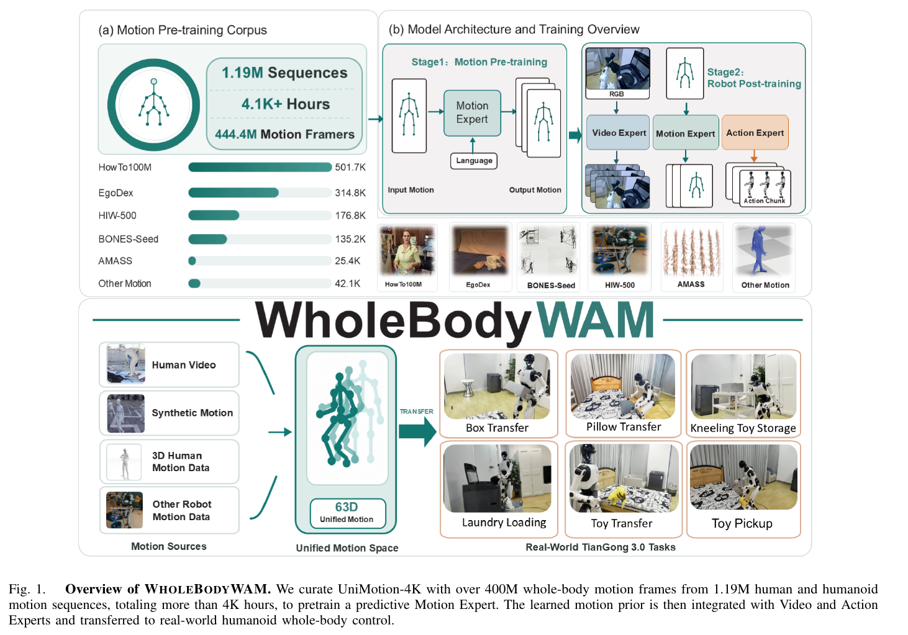
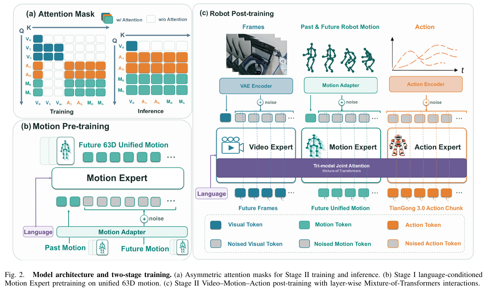

# 010 · WholeBodyWAM

## 基本信息

- **完整标题**：WholeBodyWAM: Learning Whole-Body World Action Models with Scalable Motion Priors
- **作者**：所存 PDF 为匿名稿，作者未核实
- **阅读版本**：匿名 PDF；修订号、作者与日期未核实；8 页。
- **来源**：论文全文（仅本地归档，未记录公开地址）。
- **阅读日期与状态**：2026-10-08，已总结，未复现。

## 一句话理解

把大量异构人体/机器人运动转成统一身体姿态表示，先训练预测未来运动的 Motion Expert，再和视频、动作专家联合训练，使身体未来演化为机器人控制提供先验。

## Motivation

- 目标机器人示范昂贵，人体视频和运动数据很多，但不是可以直接执行的机器人动作。
- 世界动作模型通常着重未来场景视觉，忽略了人形自身身体也是需要预测和协调的动态系统。
- 希望先从便宜的异构运动学会预测，再用少量目标机器人数据把预测先验落地到动作生成。

## 方法

1. **UniMotion-4K**：11 类异构来源，原始超过 30K h，过滤后约 1.19M 序列、444M 帧、4.1K h。来源含 HowTo100M、EgoDex、Ego-Exo4D、AMASS、BONES-SEED 和人形机器人数据。
2. **统一 63D 空间**：21 个身体关节的局部 axis-angle，排除全局根部平移、朝向和身体形状。机器人原生关节通过配对重定向数据训练的 MLP adapter 转换；adapter 在 Stage II 冻结。根部移动仍由原生动作负责，这个表示本身不完整描述空间轨迹或接触动力学。
3. **Stage I**：语言条件 Motion Expert 用 16 帧历史预测 32 帧未来，30 层 Transformer，以 flow matching 学运动分布，不需要目标机器人动作标签。
4. **Stage II**：Video Expert 由 Wan2.2-TI2V-5B 初始化、Action Expert 来自 FastWAM，与 Motion Expert 通过逐层 MoT 共享注意力；三种未来预测损失联合优化。运动与动作只看当前视觉、彼此表示，禁止访问未来视觉 token，减少训练时未来信息泄漏。
5. **部署**：移除未来视觉 token 与视频解码，保留当前视觉条件，同时预测未来身体运动和 34 维原生动作。四步 Euler 采样，32 步动作块以 30 Hz 执行并重新观测；运动预测是辅助表示，并非直接送给电机的控制命令。

## 总览图与方法图

原图按 200 dpi 从所存 PDF 提取，仅裁切，保留原英文图注。[图号、页码和来源记录](../assets/010-wholebodywam/manifest.json)。

Fig. 1 看跨来源数据到目标机器人；Fig. 2 重点看训练与推理的注意力掩码差别，以及三个专家的连接方式。

## 实验

- **真机协议**：TianGong 3.0，六任务，每任务 100 段真实示范。Toy Pickup 20 次测试，另五任务各 10 次；所有方法共用动作接口、低层 RL 控制器和目标示范。
- **指标必须澄清**：Table I 标题写 success rates，但 §IV-A 明确按任务里程碑计算归一化进度、跨六任务等权平均。故这里将其解释为“归一化任务分数”，不按完整二值成功率引用。
- **主结果**：完整模型平均 72.2%，GR00T N1.7 60.8%、π0.5 58.1%、FastWAM 41.5%；去掉运动预训练为 59.1%，屏蔽 Motion→Action 注意力为 46.3%（Table I）。
- **跨架构使用先验**：给 τ0-WM 加同一 Motion Expert，平均分数从 39.4% 到 62.7%，支持运动预训练的价值不完全依赖本架构。
- **规模实验**：0 / 1K / 2K / 4K+ h 的嵌套数据，固定 Stage I 100K 步、Stage II 20K 步。在三代表任务中，平均未来关节旋转误差从 1.127° 降到 0.817°，任务分数从 57.1% 到 67.6%。
- **数据效率**：三个代表任务只用 50% 目标示范时为 46.9%，超过全数据 FastWAM 的 42.9%。这是不同模型的数据效率比较，不意味着目标机器人示范完全不需要。

## 结论与边界

预测身体运动可作为可迁移的控制先验，预训练、运动—动作交互均有消融支持，且在单一目标机器人上有真机定量结果。

边界：仅 TianGong 3.0 和六任务；来源动作的覆盖与恢复误差受原始数据影响；root-free 姿态不能独自表达全局运动和接触。本文为 Zotero 中 8 页匿名稿，没有可核实的作者、日期、版本号与公开项目地址，按本地快照归档，不推断发表状态。正文没有独立的系统性限制实验或多训练种子统计。

## 我的理解与研究启发

阅读者判断：这是“预测身体状态帮助动作学习”，与 SONIC 的“运动跟踪学控制先验”互补。需要进一步区分收益来自更多预训练数据、辅助预测监督，还是推理阶段显式未来运动表示。

## 后续问题 / 关联论文

- 控制参数量和预训练预算，换成仅历史运动编码是否仍有同等收益？
- 保持局部姿态表示，加入根部轨迹与接触状态会怎样？
- 关联：[SONIC](003-sonic.md)、[人体数据预训练 λ0](017-human-pretraining.md)。

## 来源与修订记录

本机 Zotero 独立 PDF“WholebodyWAM”；正文 §III–IV、Table I、Fig. 4。2026-10-08 整理，未复现。特别记录表格标题与指标定义的差异。
