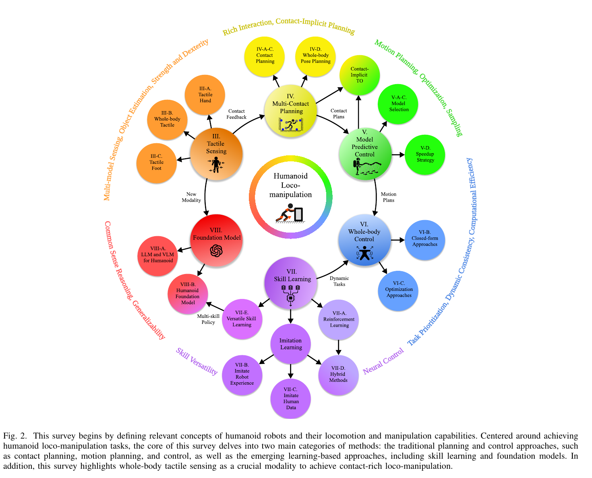

# 011 · Humanoid Locomotion and Manipulation 综述

## 基本信息

- **完整标题**：Humanoid Locomotion and Manipulation: Current Progress and Challenges in Control, Planning, and Learning
- **作者**：Zhaoyuan Gu；Junheng Li；Wenlan Shen；Wenhao Yu；Zhaoming Xie；Stephen McCrory；Xianyi Cheng；Abdulaziz Shamsah；Robert Griffin；C. Karen Liu；Abderrahmane Kheddar；Xue Bin Peng；Yuke Zhu；Guanya Shi；Quan Nguyen；Gordon Cheng；Huijun Gao；Ye Zhao
- **阅读版本**：arXiv:2501.02116v2 [cs.RO] 19 Apr 2025；39 页。
- **来源**：[原论文](https://arxiv.org/abs/2501.02116v2) · [论文来源](https://arxiv.org/abs/2501.02116v2)。
- **阅读日期与状态**：2026-10-08，已总结，未复现。

## 一句话理解

以“感知接触—规划接触与运动—预测与反馈控制—技能学习—基础模型”为主线梳理人形移动操作，强调模型方法和学习方法可以互补，而非必须二选一。

## Motivation

- 行走与操作常分别研究，真实任务却要求同时处理平衡、受力、接触切换和物体运动。
- 机器人形态、触觉、规划、控制和学习之间高度耦合，单一方法脉络不足以解释整个系统。
- 需要统一术语和分类，明确不同方法在计算成本、模型误差、数据需求、泛化及约束处理上的取舍。

## 方法：综述的组织框架

1. **范围与定义**：重点是双足人形的全身移动操作，涵盖约三十年的工作；多指灵巧操作不是主线。区分 locomotion、manipulation 及两者耦合的 loco-manipulation。
2. **触觉（§III）**：手、脚及全身触觉用于接触检测、力估计、滑移判断和人体协作；瓶颈包括传感器覆盖、标定、耐久性以及多接触信号融合。
3. **多接触规划（§IV）**：搜索式方法离散寻找接触序列；优化式方法求连续位姿/轨迹；contact-implicit 优化将接触模式一起纳入，但求解困难。学习可提供候选、启发式或先验。
4. **MPC（§V）**：简化模型更快但忽略部分全身动力学；完整动力学更精细但计算更重；混合精度模型和求解加速在实时性与准确性间折中。
5. **WBC（§VI）**：闭式与优化式控制协调任务、动力学与约束；严格任务优先级与加权目标分别有可行性和权重调节问题。WBC 侧重即时反馈，MPC 侧重预测，两者常组成层级系统。
6. **技能学习（§VII）**：从零 RL、机器人经验模仿、人体数据模仿、混合训练和多技能表示。人体轨迹缺动作、接触力与完整观测，常需重定向加仿真跟踪把运动转换成控制。
7. **基础模型（§VIII）**：一条路线用 LLM/VLM 选择技能、生成程序或奖励，另一条用机器人数据训练/适配 VLA。高层语义与低层快速平衡反馈之间的接口是关键。

## 总览图与方法图

原图按 200 dpi 从所存 PDF 提取，仅裁切，保留原英文图注。[图号、页码和来源记录](../assets/011-humanoid-survey/manifest.json)。

Fig. 2 是全文技术路线与各模块关系。本文是综述，没有一个作者新提出、可单独评估的方法流程；不把分类图写成新控制算法。

## 实验与证据性质

本文没有自己的统一机器人实验、数据集消融或新算法成功率；证据来自文献整理、示例和方法分类。各论文的任务、机器人和测试协议不同，不适合将引述结果拼接为统一排行榜。

- **模型与学习的比较**：Table VI 按多维特征讨论两类方法，属于作者综合判断，不是同预算控制实验。
- **人体数据的瓶颈**：形态、关节和质量分布不匹配；缺少触觉/力、物体运动和意图信息（§VII-C/H）。仅复制人体姿态无法保证任务作用和泛化。
- **基准不足**：§VII-G 指出模拟任务覆盖有限，真实评估难复现，模拟表现与真实部署的对应关系尚需检验。
- **数值优化限制**：接触模式组合、高维非线性、局部极值、计算延迟、不可行问题与权重选择共同制约可靠性，单纯加速求解并不消除建模误差。

## 结论与边界

作者主张将物理结构、学习先验、丰富观测及基础模型结合，发展能理解任务目的的全身智能。轨迹、接触、物体和环境应联合考虑，数据规模之外还要关注信息内容。

版本边界非常重要：所读为 2025-04-19 的 v2，关于“当前能力”和基础模型部署的描述应放回这一时间点；不能用它评价 2026 年 SONIC、Workhorse 等结果。综述中的未来预测和社会应用判断也不等于已经实验实现。

## 我的理解与研究启发

阅读者判断：这篇适合作为整库的技术地图。后续论文可逐一标注它解决了哪一层：WARP 是几何重定向，KODA 是数据与执行对齐，SONIC 是低层控制，GRAIL / MimicGen 是数据生产，Arena / SIMPLE / HumanTracker 是不同维度的评估。

## 后续问题 / 关联论文

- 新方法的改善来自规划、控制、感知、数据还是评价变化？
- 哪些任务必须测接触力和物体状态，姿态误差又在哪些场景足够？
- 关联：本库其余论文；将综述的技术分类用作检索标签，不作为性能排名。

## 来源与修订记录

arXiv:2501.02116v2，2025-04-19；全文框架、§III–IX、Table VI。2026-10-08 从 Zotero 39 页 PDF 整理，未复现；未将综述观点当作新实验结果。
