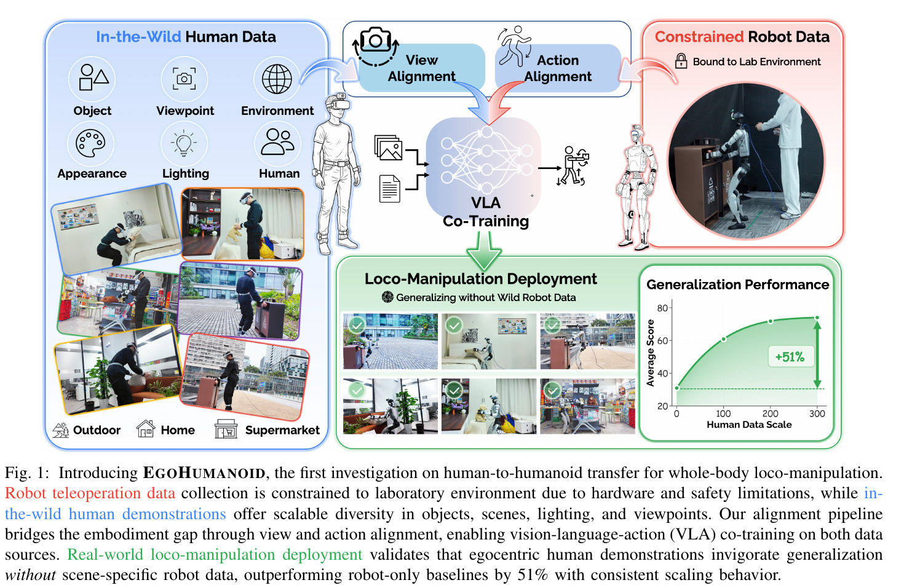
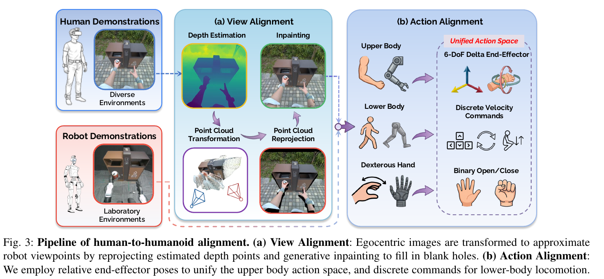

# 012 · EgoHumanoid

## 基本信息

- **完整标题**：EgoHumanoid: Unlocking In-the-Wild Loco-Manipulation with Robot-Free Egocentric Demonstration
- **作者**：Modi Shi；Shijia Peng；Jin Chen；Haoran Jiang；Tianyu Li；Di Huang；Ping Luo；Hongyang Li；Li Chen
- **阅读版本**：arXiv:2602.10106v2 [cs.RO] 4 Jun 2026；17 页。
- **来源**：[原论文](https://arxiv.org/abs/2602.10106v2) · [论文来源](https://arxiv.org/abs/2602.10106v2)。
- **阅读日期与状态**：2026-10-08，已总结，未复现。

## 一句话理解

通过视角转换和统一高层动作，把多场景人体第一视角示范与少量机器人数据共训练，让 G1 获得更好的导航和移动操作泛化；精细操作仍需要机器人监督。

## Motivation

- 机器人遥操作昂贵且集中在实验室，难以采集家庭、商店、户外的视觉与布局变化。
- 人体数据容易扩充，但相机高度、手部外观、身体比例及动作动力学与 G1 不同。
- 作者认为，高层路线、接近策略和任务结构比低层关节动作更容易跨形态迁移，应先对齐观测与高层行为。

## 方法

1. **便携采集**：人体佩戴 PICO 4 Ultra、五个追踪器和 ZED X Mini，记录全身与手部运动及 RGB；机器人通过相同 VR 系统遥操作，IK 控制手臂、低层策略负责移动与平衡。
2. **视角对齐**：MoGe 恢复深度/点图，将人体相机图像重投影到近似机器人视角；对目标相机姿态加扰动，利用 diffusion inpainting 填补反遮挡和无效深度造成的空洞。
3. **动作对齐**：上肢用骨盆坐标中的双手 6-DoF 相邻帧增量；身体路径转成前后、左右、转向及站立/下蹲离散原语；手指曲率推导二值开合。信号平滑后由 100 Hz 下采样到 20 Hz。
4. **VLA 共训练**：微调 π0.5，输入第一视角图像与指令，不输入本体状态，以免人体和机器人状态分布不兼容。通过采样比保证机器人精细操作示范仍有足够权重。
5. **whole-body 的含义**：文中明确是任务层面的移动与操作协同，不是预测全部腿部关节；下肢仍使用离散导航接口。

## 总览图与方法图

原图按 200 dpi 从所存 PDF 提取，仅裁切，保留原英文图注。[图号、页码和来源记录](../assets/012-egohumanoid/manifest.json)。

Fig. 1 看人体场景覆盖与机器人数据的互补；Fig. 3 看重投影视角处理和动作转换。

## 实验

- **平台与数据**：G1 + Dex3，四任务 Pillow Placement、Trash Disposal、Toy Transfer、Cart Stowing，移动距离约 1–5 m。主比较每任务 100 段机器人 + 300 段人体示范，各设置 20 次真机试验。
- **主要指标**：按子阶段给分的 normalized task score。实验室平均由 58.8% 到 78.4%；泛化环境由 30.9% 到 82.2%（Fig. 5），约提升 51.3 个百分点，不是相对增长 51%，也不是 82.2% 完整任务成功率。
- **泛化范围**：主泛化场景在人类训练示范中出现、机器人示范中未出现。另有单独 Trash Disposal 场景多样性实验，测试场景对所有训练数据未见；固定总量后，0/1/2/3 人体场景分数为 57.5/75/75/82.5%（Table II）。两种设置需要分开解释。
- **技能迁移**：人体数据单独训练可较好提供导航和粗操作；Cart Stowing 的精细抓取阶段 human-only 5%，robot-only 15%，共训练 60%（Table I）。子步骤存在前序依赖，不能当作彼此独立的条件成功概率。
- **消融**：视角对齐提升各任务，目标高度变化大的任务受益明显。增加人体量通常改善分数，但最优 Robot:Human 比例依任务而变：精细操作偏机器人，导航和粗操作偏人体。
- **采集时间**：平均每段机器人 62.1 s、人体 39.7 s，按表中均值计算约快 1.56 倍；论文使用“约 2×”概括，不应将各任务速度比与平均时长比混用。

## 结论与边界

人类多场景数据和机器人精细操作数据互补，显式视角、动作对齐有实际价值。主结果验证的是机器人未采集场景中的迁移，不等同所有训练源都未见的环境泛化。

局限：增量末端姿态在无本体输入时存在旋转歧义；离散下肢接口表达力有限；生成补图可能改变视觉细节；小范围任务不能支持任意全身新技能结论。仍使用机器人共训练，robot-free 描述人体采集方式。

## 我的理解与研究启发

阅读者判断：它清楚展示“人体负责广覆盖、机器人负责精细控制”的互补；KODA 则尝试把对齐推进到实际控制器状态与动作层，可重点比较两者在精细操作误差上的收益。

## 后续问题 / 关联论文

- 将二值导航原语换成连续全身命令后，数据转换误差是否上升？
- 视角补图的收益来自正确几何，还是单纯图像增强？
- 关联：[KODA](002-koda.md)、[Workhorse](001-workhorse.md)、[OpenHLM](006-openhlm.md)。

## 来源与修订记录

arXiv:2602.10106v2，2026-06-04；正文 §III–V、Figs. 5–8、Tables I–III、评分附录。2026-10-08 整理，未复现。
