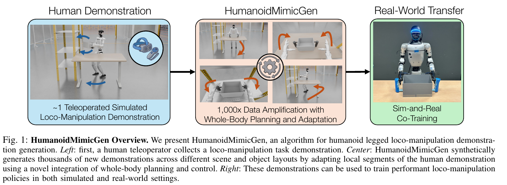
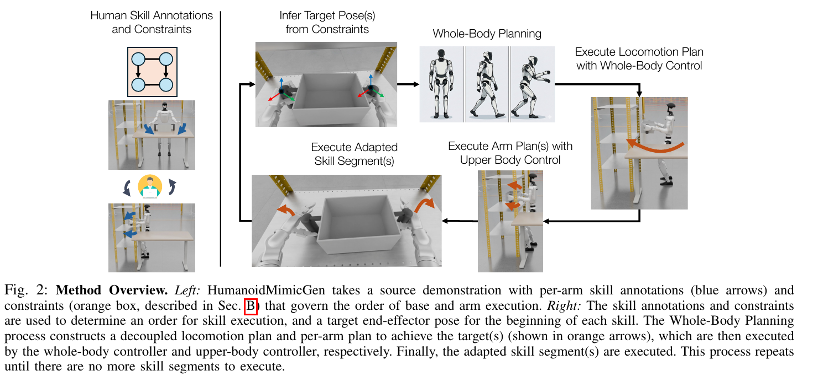

# 013 · HumanoidMimicGen（双版本核对）

## 基本信息

- **完整标题**：HumanoidMimicGen: Data Generation for Loco-Manipulation via Whole-Body Planning and Adaptation
- **作者**：所存 PDF 为匿名稿，作者未核实
- **阅读版本**：匿名 PDF；修订号、作者与日期未核实；12 页。
- **来源**：[原论文](https://openreview.net/pdf?id=ekzk7TSLKr) · [论文来源](https://openreview.net/pdf?id=ekzk7TSLKr)。
- **阅读日期与状态**：2026-10-08，已总结，未复现。
- **版本核对**：[有作者 arXiv v1](https://arxiv.org/abs/2605.27724)，正文实验以该版本为主；下列原图来自匿名 PDF，两版差异单列。

## 一句话理解

从少量仿真遥操作种子示范出发，把对象中心技能重放与全身规划结合，扩增不同物体和机器人初始位置下的移动操作数据，并用仿真—真实共训练改善真机表现。

## Motivation

- VLA 需要大量示范，人形全身遥操作和场景重置成本高。
- 固定机械臂的 MimicGen 直接平移技能，不足以处理双足平衡、基座误差、避碰和双臂同步。
- 希望只用少量接触技能示范，自动规划技能之间的移动过程，生成更多可执行数据。

## 方法

1. **混合控制空间**：上身、手和躯干用关节位置控制；下身由 Homie RL 控制器跟踪平面速度、偏航速度和身体高度，处理平衡与脚部协调。
2. **人工技能标注**：将种子示范切成对象中心片段，标注所用末端、参考对象、先后约束及双臂同步约束。技能轨迹按新物体 SE(3) 变换，保留接触操作的局部结构。
3. **全身规划与执行**：先求能到达技能起点的全身 IK 候选，再分成基座移动和静止上肢规划；实际移动不精确，所以用到达后的真实仿真状态重新规划手臂，随后执行适配技能。
4. **自动扩增**：随机化机器人与物体初始状态、加入运动扰动，检查任务是否成功，只保留成功序列，反复生成到目标数据量。生成器可以使用仿真特权状态，最终视觉策略只使用图像和本体观测。
5. **学习与迁移**：有作者 arXiv v1 的主仿真实验使用 GR00T N1.6 微调；真机使用从头训练的 flow-matching policy，与有限真实示范共训练。不是把人体自然示范直接映射为机器人标签。

## 总览图与方法图

原图按 200 dpi 从所存 PDF 提取，仅裁切，保留原英文图注。[图号、页码和来源记录](../assets/013-humanoidmimicgen/manifest.json)。

保存的是库内匿名版本的 Fig. 1 / Fig. 2，图注明确描述示范扩增和分阶段规划；同一笔记另外保留完整 arXiv v1 PDF，避免两个 Zotero 条目重复收录。

## 实验：以有作者 arXiv v1 为主

- **仿真**：robosuite / MuJoCo 的九任务 G1 基准，每任务一个种子生成 1,000 条成功示范。训练 25K 步，每 5K 步用 100 episodes 评估并选最佳 checkpoint；因此不是一次固定终点模型的独立盲测。
- **结果**：平均二值成功率 0.89，DexMimicGen+ 为 0.33，单种子 0.26，100 人工示范 0.48（Table 1）。前两者使用相同种子与扩增预算，能够更直接比较生成方式。
- **消融**：去掉运动噪声平均从 0.89 降到 0.49，固定初始机器人位置降到 0.51。相同生成数据下 VLA / flow matching / DP 为 0.89 / 0.86 / 0.51（Fig. 4）。
- **真机**：四任务，各 20 episodes。ThrowBottle 和 BoxToCart 用 30 真实 + 500 生成示范；两个 PickCanister 变体共享策略，包含各 50 真实示范与 1,000 生成示范。平均任务分数从 0.51 到 0.71（Fig. 5）。分数有部分奖励，不是完整任务成功率。
- **真机分项**：ThrowBottle 0.60→0.75，BoxToCart 0.35→0.60，PickCanister 0.50→0.75，带障碍变体 0.60→0.75。

## 版本差异与数据核对

- **独立附件 **：12 页匿名 OpenReview 稿，标题增加“and Adaptation”，只有两项真机任务、各 10 episodes。
- **文献条目 **：20 页、作者署名、arXiv:2605.27724v1，四项真机任务、各 20 episodes。两份版本先后关系未从本地材料确认，不按更新时间猜测。
- 匿名稿 Table I 的 Ours 平均列为 0.63，正文却说 58.7%；其 DexMimicGen+ 平均列 0.16 与九行值的均值约 0.288 也不一致。匿名正文说 BoxToCart 增益 0.3，但图中 0.35→0.60 是 0.25。以上冲突单独保留，不和 arXiv v1 的 0.89 或四任务结果混写。

## 结论与边界

局部接触技能复用加全身规划能高效生成任务内多样性，合成示范能补充真机数据。收益来自对象位置与执行轨迹变化，并未证明自动发现新任务结构。

局限：需人工技能和约束标注、手工环境与成功条件；技能库和序列结构固定；刚体对象变换难处理大形状差异或模糊接触位置；平衡主要由预训练下身控制器承担。生成数量是成功样本数，不包括失败尝试成本。

## 我的理解与研究启发

阅读者判断：这是结构化、可控的数据放大器，和 GRAIL 的生成式行为先验互补。比“扩增倍数”更值得关注的是生成成功率、所覆盖初始化范围，以及每种技能模式是否仍受种子示范限制。

## 后续问题 / 关联论文

- 单独改变技能、路径与视觉分布，哪一类覆盖对闭环控制最有用？
- 如何从人体数据自动提出技能约束，并用物理回放筛选？
- 关联：[SIMPLE](007-simple.md)、[GRAIL](008-grail.md)。

## 来源与修订记录

两份 Zotero PDF 合并阅读：匿名 OpenReview 稿（正文 III–IV、Table I），arXiv:2605.27724v1（2026-05-26，正文 §4–7、Tables/Figs. 1/4/5、附录 I）。2026-10-08 收录并记录版本冲突，未复现。
