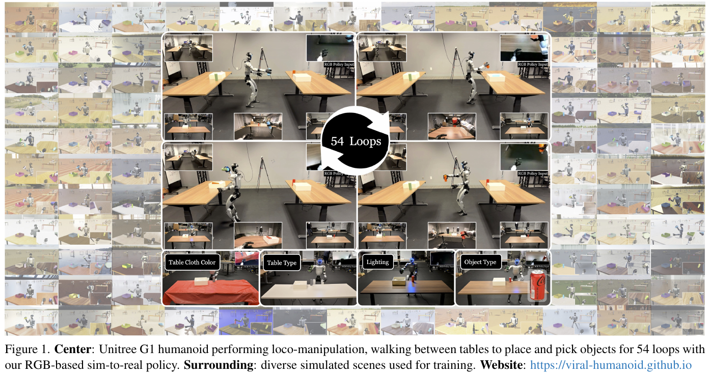
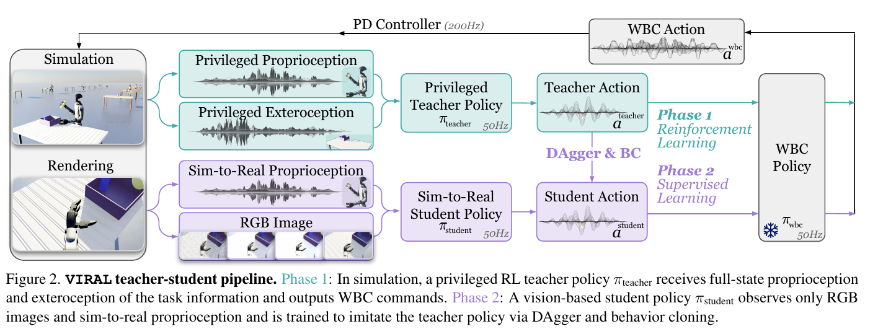

# 014 · VIRAL

## 基本信息

- **完整标题**：VIRAL: Visual Sim-to-Real at Scale for Humanoid Loco-Manipulation
- **作者**：Tairan He；Zi Wang；Haoru Xue；Qingwei Ben；Zhengyi Luo；Wenli Xiao；Ye Yuan；Xingye Da；Fernando Castañeda；Shankar Sastry；Changliu Liu；Guanya Shi；Linxi Fan；Yuke Zhu
- **阅读版本**：arXiv:2511.15200v2 [cs.RO] 27 Nov 2025；17 页。
- **来源**：[原论文](https://arxiv.org/abs/2511.15200v2) · [论文来源](https://arxiv.org/abs/2511.15200v2)。
- **阅读日期与状态**：2026-10-08，已总结，未复现。

## 一句话理解

用大规模仿真训练特权状态 RL 教师，再通过混合 DAgger / BC 蒸馏为 RGB 学生，配合视觉随机化、手部系统辨识与相机对齐，实现 G1 的持续移动取放。

## Motivation

- 移动操作的场景、视角和动力学变化比固定桌面更大，仅依赖真实遥操作数据成本高。
- 已有仿真到真实多集中于盲行走或固定机械臂，缺少使用机载 RGB 的长时序双足移动操作。
- 本文目标是总结让完整视觉 sim-to-real 系统实际工作所需的技术配方，并检验计算规模的作用。

## 方法

1. **RL 教师**：在 Isaac Lab 中使用阶段、目标、物体位姿、接触力等特权状态，PPO 优化行走、放置、抓取、转向阶段奖励。教师输出累积的增量 WBC 命令，由 Homie 处理下身平衡。
2. **Reference State Initialization**：用 200 段仿真遥操作示范建立状态缓冲，重置到不同中间阶段，避免只能从起点探索稀疏长任务奖励。
3. **视觉学生**：DINOv3 RGB 特征与可在真机获取的本体观测融合，拟合教师动作；一半环境执行教师、一半执行学生，用学生偏离状态补足 BC 的分布缺口。策略与 WBC 约 50 Hz，PD 约 200 Hz。
4. **计算规模**：教师最多 16 L40S GPU，学生视觉蒸馏最多 64 GPU，使用 tiled rendering。更多并行环境同时改变批量与经验覆盖，不是单纯把相同训练加速。
5. **迁移工程**：随机化材质、光照、相机参数、图像质量和传感延迟；辨识高减速比灵巧手，校准真实与仿真相机。真实推理使用桌面 RTX 4090 和 RealSense D435i。

## 总览图与方法图

原图按 200 dpi 从所存 PDF 提取，仅裁切，保留原英文图注。[图号、页码和来源记录](../assets/014-viral/manifest.json)。

Fig. 1 看连续任务与仿真视觉变化；Fig. 2 看特权教师、可部署学生与 WBC 的接口。

## 实验

- **真机任务**：G1 在两桌之间反复行走、放物、取新物、转身。§3.1 报告 59 次连续真实试验中 54 次成功，约 91.5%；不能改写成“54 个独立任务”或“54 次无失败”。
- **人类对比**：共用 Homie；专家为超过 1,000 h 遥操作经验，成功 100%、周期 21.4 s；VIRAL 周期 20.2 s；约 1 h 经验的新手成功 73%。只覆盖这一周期任务，不代表整体机器人能力达到专家。
- **真实泛化**：改变托盘/物体位置、起点、桌高、桌型、桌布、光照和物体类别，给出成功展示；正文没有为每种变化分别给足试验分母，不能据视频生成泛化成功率。
- **教师消融**：去掉示范状态重置，仿真成功率平台低于 10%，完整方案接近 95%；绝对动作代替增量也难达到高成功（Fig. 9）。
- **学生消融**：纯 BC 训练误差下降快，但跨模拟器与真机纠错差；混入学生 rollouts 改善部署。去掉全部视觉随机化后，仿真归一化成功为 0.649，评估 200 episodes（Fig. 13），这是相对完整模型归一值，不是 64.9% 真机成功率。
- **规模与物体**：增加 GPU 改善收敛和最终性能；十物体训练改善测试物体表现，但测试集合包含训练对象，不能作为全未见类别的泛化证明。

## 结论与边界

大规模视觉仿真与明确的迁移工程能支持真实持续移动操作，无需真实策略微调。仍需仿真人类示范、手工任务奖励、手部辨识和相机校准；“zero-shot sim-to-real”不等于零人工先验或零硬件工作。

边界：任务和场景设计相对集中；扩展新接触技能仍需资产、奖励与仿真工程。定量长期证据来自一类循环任务，视觉泛化展示缺少逐条件统计，不能外推为家庭通用操作。

## 我的理解与研究启发

阅读者判断：对 Workhorse 的人体示范路线而言，VIRAL 提供了另一种数据来源，但共同点是必须处理闭环误差。DAgger 与规划器扰动增强都在让高层见到自己会造成的偏离状态。

## 后续问题 / 关联论文

- 固定环境交互总量而不是 GPU 数，规模收益还保留多少？
- 扩到接触模式不同的新任务时，迁移工程的新增成本是多少？
- 关联：[Workhorse](001-workhorse.md)、[GRAIL](008-grail.md)、[FetchMan](015-fetchman.md)。

## 来源与修订记录

arXiv:2511.15200v2，2025-11-27；正文 §2–4、§6、Figs. 7/9/11/13–16。2026-10-08 从 Zotero PDF 整理，未复现。
