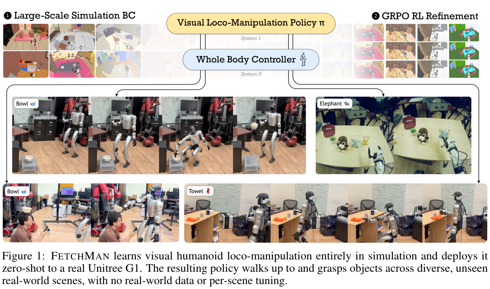
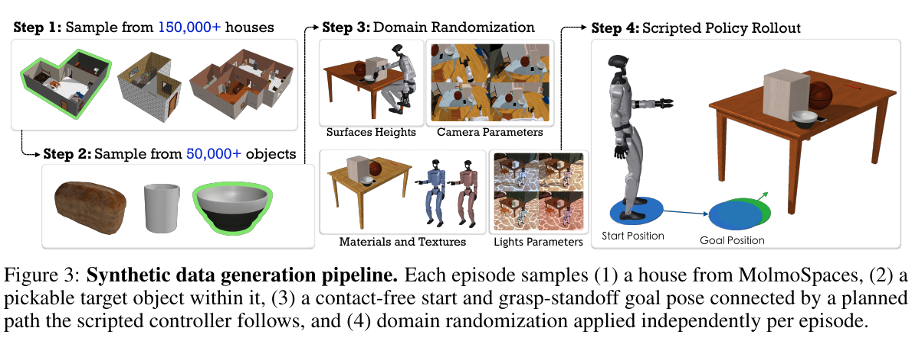
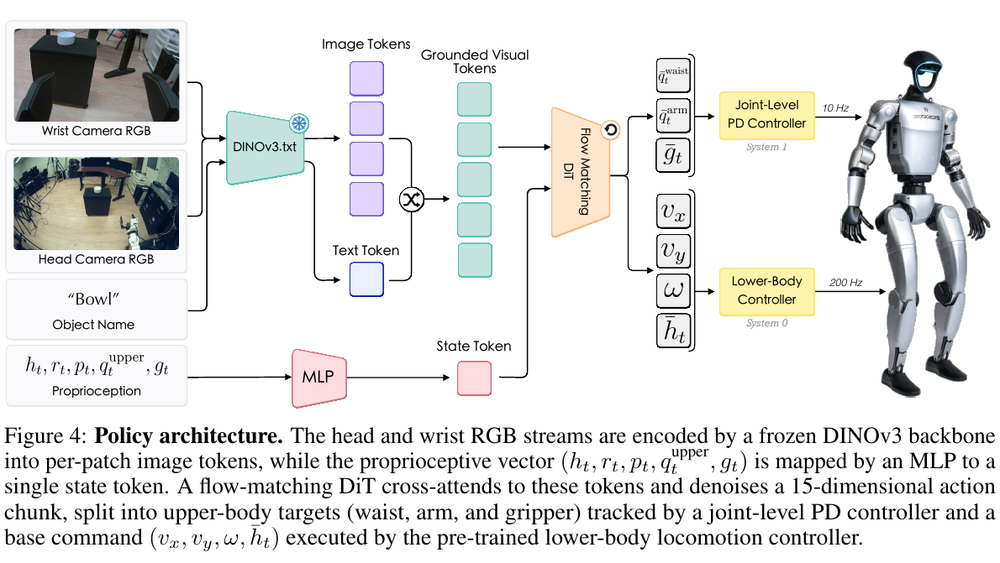
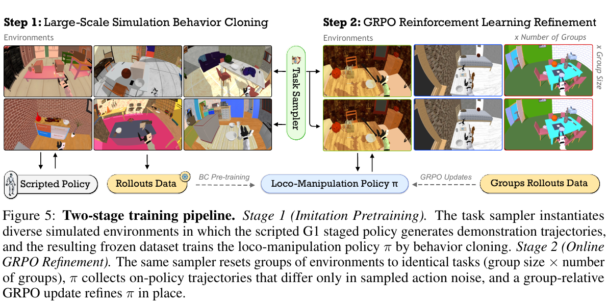

# 015 · FetchMan

## 基本信息

- **完整标题**：FetchMan: Learning Visual Humanoid Loco-Manipulation Policies from Simulated Experiences
- **作者**：Omar Rayyan；Zhi Li；Max Argus；Yuxin Jiang；Chang Yu；Chenfanfu Jiang；Yuchen Cui
- **阅读版本**：arXiv:2608.17027v2 [cs.RO] 29 Aug 2026；14 页。
- **来源**：[原论文](https://arxiv.org/abs/2608.17027v2) · [论文来源](https://arxiv.org/abs/2608.17027v2)。
- **阅读日期与状态**：2026-10-08，已总结，未复现。

**一句话总结：**先用程序化仿真生成大量“走过去并拿起物体”的示范，再用稀疏成功奖励优化视觉策略，补上行为克隆在导航与操作衔接处的缺口，最后直接部署到 G1。

## Motivation：为什么做

全身操作需要视觉感知、走路、调整身体和抓取连续配合，但真实机器人遥操作成本高。仿真可以自动生成大量示范，不过示范控制器知道物体精确位置和当前任务阶段，视觉策略只能看到图像与自身状态：即使把数据扩大，也可能学不好“什么时候停止走路、开始伸手”等切换。

论文的核心问题是：**仿真行为克隆遇到瓶颈后，能否用任务成功信号，让策略学到更适合自身观测的信息利用和纠错行为？**

## 方法：怎么做

### 1. 程序化生成多样化示范

利用 MolmoSpaces 场景和物体资源，用 A* 生成导航路径、Mink 逆运动学生成手臂动作，按接近、下降、闭合、抬起等阶段执行。碗抓取设置生成约 **15 万条、650 小时**示范，覆盖约 15 万个场景配置，生成成本约为单张 L40S 的 40 GPU 小时。

示范混合约 80% 完整 fetch 和 20% 只抓取片段，并随机化初始手臂状态，增加操作阶段和恢复状态的覆盖。资源库规模与实际训练使用的任务、物体规模要分开看。

### 2. 分层视觉策略

机器人为 Unitree G1，使用头部鱼眼相机、腕部相机和本体状态；本文操作配置主要使用右臂。冻结 DINOv3 ViT-B/16 提取视觉特征，流匹配 Transformer 输出动作块。

高层动作是 15 维，包括底盘速度、身体高度、腰部、右臂和夹爪。每次预测 16 步、执行前 8 步，再重规划；动作指令频率为 10 Hz。关节目标使用相对动作块起始状态的增量，底盘速度和夹爪使用绝对表示。低层使用适配的 SONIC 控制器，在平衡与行走模式之间切换。

### 3. 行为克隆后做 Flow-GRPO

先对合成示范做行为克隆，再把流匹配采样过程写成可计算动作概率的随机过程，采用 GRPO 风格的组内相对优势与 PPO 裁剪更新。

同一初始场景采样 8 个不同噪声的回合，奖励只有成功 1、失败 0；全成功或全失败的组不提供有效相对优势。无需训练价值网络，也无需人工设计每个任务阶段的稠密奖励。**它依赖足够强的行为克隆起点：较弱先验很难通过稀疏奖励自行补齐技能。**

## 实验：证据是什么

### 仿真与真实完整任务

在 100 个保留仿真初始配置上，完整 loco-manipulation 成功率从行为克隆的 **67% 提升至 83%**；只操作任务从 75% 提升至 79%。这些结果来自验证中表现最好的检查点。

真实 G1 上，完整任务每种策略评估 30 次，成功率从 **56.7% 提升至 73.3%**，即 17/30 到 22/30；只操作任务每种策略评估 22 次，从 72.7% 提升至 77.2%。完整任务的收益更大，支持改进主要发生在导航、身体调整和抓取的衔接处，而非仅仅提升静态抓取。

### 数据扩展与消融

- 行为克隆完整任务：5 千条示范约 40%，5 万条约 67%，15 万条仍约 67%，出现该设置下的数据扩展平台期。
- 5 千条示范起点做强化学习仅从约 40% 到 42%，说明 Flow-GRPO 需要较强初始策略。
- 把 DINOv3 换成 SigLIP，或改用绝对关节目标，仿真和真实迁移明显变差；部分真实消融只用 10 或 12 次试验，样本量小于主结果。
- 多物体版本使用约 35 万条示范，并引入视觉—文本对齐特征；仿真成功率从 40% 到 62%。真实多物体主要是定性展示，不能据此填写真实成功率。

## 结论与局限

**作者结论：**大量仿真示范提供可迁移起点，而策略自身的强化学习经验能突破单纯模仿脚本的瓶颈；视觉编码器和动作表示对 sim-to-real 同样关键。

**阅读判断：**本文更有价值的证据是“强先验 + 稀疏奖励”改善任务衔接，而不是证明行为克隆普遍存在不可突破的上限。更好的历史观测或示范设计也可能改变该平台期。

策略主要使用当前帧，低层控制器在本文配置中固定，难以主动改变支撑方式或利用环境借力。任务聚焦接近与取物，尚未验证关节物体操作、复杂双手协作或长时任务；真实样本规模有限。所谓不使用真实训练数据，也不等于视觉模型与低层控制器没有既有训练资源。

## 与已有论文的联系

VIRAL 用特权状态教师和 DAgger 蒸馏视觉学生；FetchMan 先模仿程序示范，再让视觉策略直接接受任务成功奖励。两者都处理仿真监督到真实视觉控制的差距，但监督来源和策略纠错路径不同。可结合 HumanoidMimicGen 思考：如何让规划生成数据覆盖策略真正会访问的失败恢复状态。

## 原论文图与来源

原图按 200 dpi 从所存 PDF 提取，仅裁切，保留原英文图注。[图号、页码和来源记录](../assets/015-fetchman/manifest.json)。

## 证据定位

方法与数据见 PDF 第 3–7 页，主结果和消融见 Table 1–2，第 8–10 页，多物体扩展与讨论见第 10–11 页。版本：arXiv:2608.17027v2，2026-08-29。
