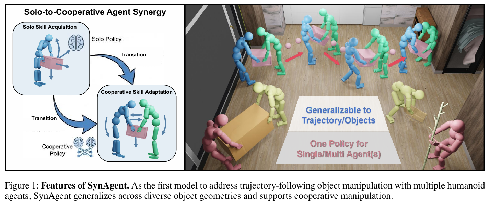
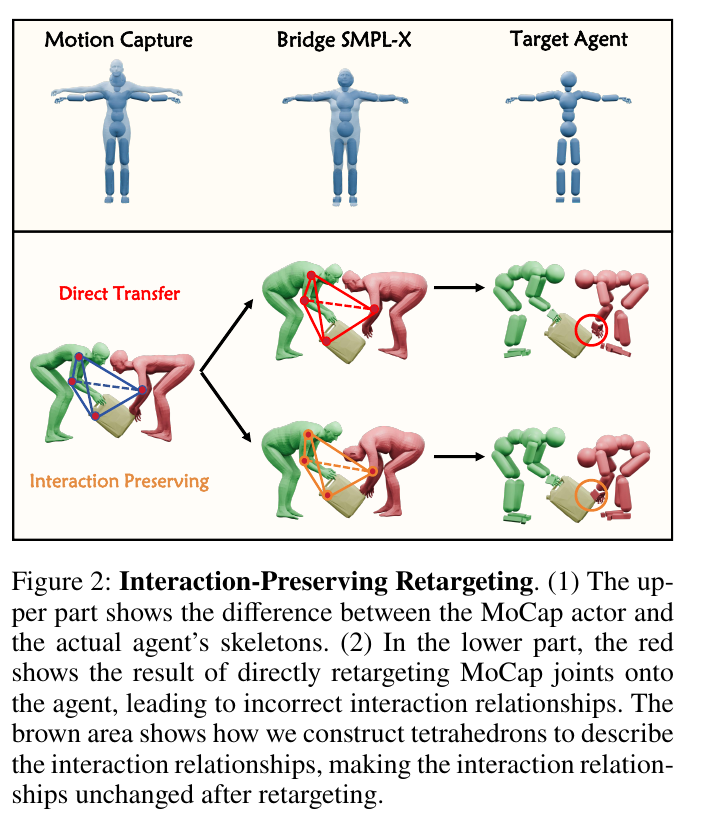
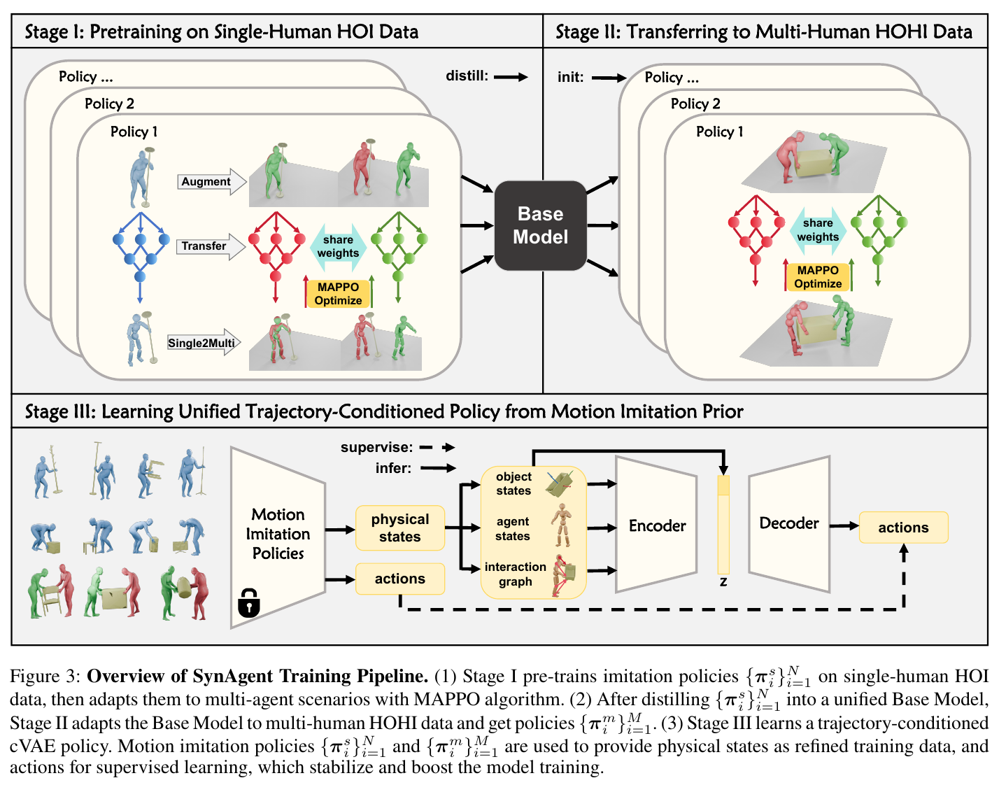

# 016 · SynAgent

## 基本信息

- **完整标题**：SynAgent: Generalizable Cooperative Humanoid Manipulation via Solo-to-Cooperative Agent Synergy
- **作者**：Wei Yao；Haohan Ma；Hongwen Zhang；Liangjun Xing；Zhile Yang；Yuanjun Guo；Yunlian Sun；Yebin Liu
- **阅读版本**：arXiv:2604.18557v2 [cs.CV] 2 Aug 2026；14 页。
- **来源**：[原论文](https://arxiv.org/abs/2604.18557v2) · [论文来源](https://arxiv.org/abs/2604.18557v2)。
- **阅读日期与状态**：2026-10-08，已总结，未复现。

**一句话总结：**把单人搬物技能转化为多主体共享策略，再用交互保持重定向和多教师蒸馏，训练由物体轨迹驱动的协作人体控制；实验在物理仿真人体上完成。

## Motivation：为什么做

单人动作和人—物交互数据相对丰富，两个人共同搬运物体的高质量数据却少得多。直接把两个单人策略放在一起，会因为彼此通过物体施加的扰动而失败；把两人的全部动作放入一个大策略，又增加了联合控制难度。

另一个问题是形态改变：人体骨架变了，如果只匹配单个关节位置，手与物体、人与人之间的交互关系会被破坏。论文希望用丰富的单人经验支持双人协作，同时让用户只指定物体运动轨迹，而不必给出每个人的完整动作。

## 方法：怎么做

### 1. 保持交互的动作重定向

先拟合与目标仿真人体比例一致的 Bridge SMPL-X，作为可微运动学代理。再用人体关节、物体顶点和另一人的关节构建 Delaunay 四面体交互网格，通过保持局部拉普拉斯坐标约束相对空间关系，并加入时间平滑、关节位置与速度限制、支撑脚防滑等约束。

论文还采用 train-to-filter：先训练策略，移除表现差的动作，再训练和筛选。它提升可学习数据质量，也使最终数据集带有“当前方法能够成功跟踪”的选择倾向，需要与原始数据规模区别。

### 2. 从单人到多人协作的技能迁移

Stage I 先在 OMOMO 单人交互子集上训练模仿专家，然后复制人物形成双人场景。两个执行器共享策略权重，各自输出自身动作，用 MAPPO 联合训练；另一人的影响主要通过共同物体的动力学传递。

复制人物可能重叠，因此**只在 Stage I 关闭人物之间的碰撞**，人物与物体仍碰撞；后续训练与推理恢复全部碰撞。随后将这些专家蒸馏为 Base Model，在 Stage II 用真实双人动捕 CORE4D 子集适配多人交互。

### 3. 从动作模仿到物体轨迹控制

Stage III 用条件 VAE 整合多个模仿教师。输入当前人体、物体状态、几何交互图及目标物体轨迹，移除对参考人体动作的依赖；输出关节 PD 目标。论文动作是每个仿真人体 51×3 的指数映射表示，**并非 G1 等真实机器人的关节接口**。

训练采用渐进 DAgger 风格调度：从教师执行过渡到学生自行执行，并逐步减少动作模仿损失；先用完整模仿奖励稳定行为，再转向主要约束物体轨迹的奖励，允许不同身体动作实现同一目标。

## 实验：证据是什么

### 数据与设置

最终使用 **2,960 条物理验证后的动作、9 大类物体、25 种物体几何**，训练 17 个 OMOMO 专家和 3 个 CORE4D 专家。补充材料说明 OMOMO 原始处理得到 6,435 条，成功重跟踪后保留 2,888 条；不能把这些不同阶段数量直接相加。

评估包括双人动作模仿，以及给定物体轨迹的目标控制。全部属于物理仿真，未报告真实多机器人实验。

### 主结果

- OMOMO 扩展双人场景的模仿成功率：独立使用 InterMimic 为 **7.26%**，联合训练的共享策略为 **45.00%**。
- 物体控制总体成功率：CooHOI 为 **7.28%**，SynAgent 为 **19.16%**；平均终点距离误差从 1.3074 降到 0.7939。公平比较只计算平面终点距离，不能把它解释成完整三维轨迹的精确跟踪率。
- 在箱子类别上 SynAgent 为 11.88%，低于 CooHOI 的 14.14%；收益主要体现在桶、椅子等更多样几何上，并非所有类别都领先。

### 消融

CORE4D 完整组件的模仿成功率为 **21.82%（72/330）**；去掉单人先验初始化为 3.33%，去掉交互保持重定向为 2.42%。去掉过滤时为 1.43%（11/770），**过滤前后评估分母变化**，这一消融不宜当成完全相同样本上的纯组件增益。

共享的分散策略在 Base Model 消融中为 19.92%，集中式策略为 12.61%，支持该设置下缩小单个执行器动作空间的选择。

## 结论与局限

**作者结论：**单人经验可以支持协作控制，但需要显式维护交互关系、处理多人动力学扰动，并通过教师帮助轨迹控制训练。

**阅读判断：**最值得借鉴的是“把协作视为带物体介导扰动的已有技能适配”，以及不只对齐人体姿态的重定向。当前总体控制成功率仍约 19%，双人真实动捕模仿也只有约 22%，说明任务远未解决。

模拟器提供精确人体、物体和网格状态；未验证真实感知误差、真实多机器人通信、硬件约束或部署。论文的“humanoid”主要指可物理模拟的人形角色，不能直接等同于实机全身机器人。跨主体数量和未见物体的泛化主张应与具体划分、有限类别和定性结果一起理解。

## 与已有论文的联系

GRAIL 与本文都保留人—物关系并利用跟踪策略校正动作。SynAgent 将对象扩展到多主体协作；WARP 和 KODA 则更关注人类示范到机器人接口与观测的对齐。可持续记录的问题是：重定向是否保留接触、相对几何与可执行性，而不只是降低关节误差。

## 原论文图与来源

原图按 200 dpi 从所存 PDF 提取，仅裁切，保留原英文图注。[图号、页码和来源记录](../assets/016-synagent/manifest.json)。

## 证据定位

重定向与三阶段训练见 PDF 第 3–5 页、Figure 2–3；主结果见第 6–7 页 Table 1–4；数据筛选与分母见补充材料 Table 7。版本：arXiv:2604.18557v2，2026-08-02。
