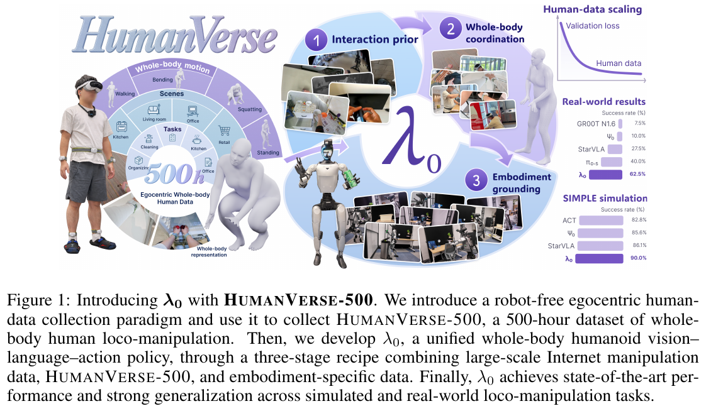
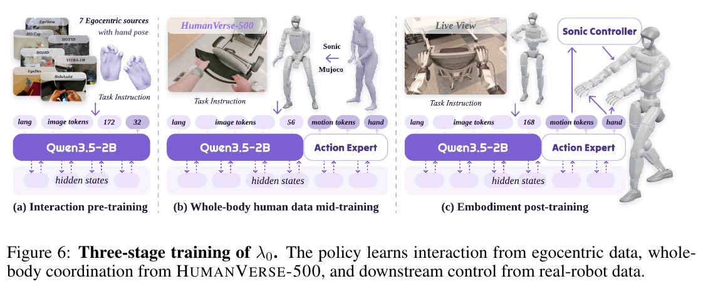

# 017 · λ0 / HumanVerse-500

## 基本信息

- **完整标题**：Towards a General Humanoid Loco-Manipulation Model via Egocentric Whole-Body Human Data Pretraining
- **作者**：Chongyang Xu；Zhao Wu；Jin Chen；Yiming Jiang；Jinhui Ye；Yuming Jiang；Shifeng Zhang；Ziliang Feng；Mu Xu；Yilun Chen；Li Lu；Steven C. H. Hoi
- **阅读版本**：arXiv:2610.00438v1 [cs.RO] 30 Sep 2026；15 页。
- **来源**：[原论文](https://arxiv.org/abs/2610.00438v1) · [论文来源](https://arxiv.org/abs/2610.00438v1)。
- **阅读日期与状态**：2026-10-08，已总结，未复现。

**一句话总结：**采集 500 小时同步第一视角视频、身体与手部运动，用“手部交互预训练 → 全身人类数据中训练 → 机器人后训练”把人类活动迁移到 G1 的全身视觉语言动作策略。

## Motivation：为什么做

人形机器人遥操作难以大规模采集。普通第一视角视频虽然丰富，但仅有手腕和手指轨迹，无法充分描述走近物体、弯腰、持续抓握搬运等身体—手部协调。

论文希望回答两个问题：如何获得可扩展、时间同步的全身人类监督；以及在固定机器人示范条件下，这类数据是否确实改善下游控制，而不仅仅降低训练误差。

## 方法：怎么做

### 1. HumanVerse-500：同步全身交互数据

数据包含 **500 小时、32,993 个 episode、8,700 万姿态帧、827 种任务类型**。GoPro HERO13 采集第一视角，PICO 4 Ultra 与身体追踪器提供 24 关节身体运动；ViPE 估计相机运动，Dyn-HaMR 从视频重建每手 21 个关节。

时间戳与坐标变换统一视频、身体和手部数据；手部遮挡时用有效性掩码保留仍可用的身体监督。人类相机高度向 G1 相机对齐，但这不能完全消除人机视角和形态差异。

通过冻结的 SONIC 编码器获得身体运动 latent，并在 MuJoCo 跟踪得到 G1 状态；手部重定向为 BrainCo Revo2 指令。这样把人类活动转换为与下游机器人兼容的数据表示。

### 2. 共享模型与分域动作接口

λ0 使用 Qwen3.5-2B 视觉语言骨干和共享流匹配动作专家。输入图像、语言与量化到 256 档的当前状态，预测 50 步动作块；部署用 10 次 Euler 去噪。

人类手部、重定向人类全身和机器人数据共享骨干，但保留不同域标识与输入、输出投影，避免把不同动作语义和数值尺度硬塞进同一接口。

### 3. 三阶段训练

- **Stage I：交互预训练。**使用 EgoDex、EgoVerse、HO-Cap、HOI4D、HoloAssist、HOT3D、VITRA-1M 七个来源，预测 138 维双手相对运动与局部关键点。按有效帧数量的平方根采样，增加小数据源相对权重。
- **Stage II：全身中训练。**只使用 HumanVerse-500 的重定向数据，动作是 64 维 SONIC latent 加两只手各 6 维，共 76 维。保留共享迁移核心，使用人类数据域的接口；此阶段不加入机器人示范。
- **Stage III：机器人后训练。**用机器人示范适配具体任务、机器人状态和可执行控制。部署时身体 latent 交给 SONIC，手部指令交给 Revo2。

各阶段采用有效性掩码下的速度场损失，并从前一阶段 EMA 检查点初始化。**这是人类数据支持下的机器人学习，不是完全无需机器人训练数据。**

## 实验：证据是什么

### 仿真与真实任务

SIMPLE 评估 6 个核心任务、3 个难度，每个任务—难度组合 10 次，整体成功率 **90.0%**，高于 StarVLA 的 86.1%。部分基线来自公开榜单并沿用其协议，不能视为所有训练条件都严格相同。

真实 G1 评估扔瓶、玩具收纳、搬箱和摆椅，固定每任务 10 个初始配置，共 40 次。λ0 完成 **25/40（62.5%）**，平均里程碑进度 **80.4%**；π0.5 完成 16/40（40.0%），进度 54.0%，StarVLA 进度为 54.6%。因此成功率提升 22.5 个百分点，进度相对最高外部基线提升 25.8 个百分点。

两种指标不能混用：摆椅任务 λ0 完成 6/10，高于 StarVLA 的 3/10，但进度 77.0% 低于其 82.5%；部分完成程度不等于完整任务成功。

### 人类数据与阶段消融

固定机器人监督时，完整方案真实成功率 62.5%；去掉 Stage I 为 50.0%，去掉 Stage II 为 22.5%，两个人类阶段都去掉为 15.0%。这支持全身中训练在当前设置中的贡献大于仅手部交互预训练。

Stage II 数据从 0% 增加到 100%，真实任务进度依次为 **59.9%、64.2%、67.3%、72.1%、76.4%、80.4%**。验证损失实验固定 2B 模型与 10 万更新，在 5%–100% 数据上呈下降趋势，但只跑固定种子；拟合描述测量范围，不能外推为普遍 scaling law。

### 机器人未见物体

机器人示范只含物体 A，人类示范含 A 与 B。在 B 上，λ0 的 human-guided 平均进度为 **55.8%**，机器人数据训练的 zero-shot 变体为 48.4%，提升 7.4 个百分点。这里的 B **在人类训练中出现过**，不属于所有数据都未见的对象。

## 结论与局限

**作者结论：**同步身体、手部与第一视角交互数据，可以通过共享策略与分域接口改善全身机器人控制；固定机器人数据的消融支持全身人类中训练的价值。

**阅读判断：**它把“人类数据是否有效”拆成了阶段贡献、数据量与对象迁移三个可检查问题，比单一平均分更有说服力。不过真实测试只有 40 次固定配置，缺少多训练种子和更多平台的验证；手部重建与人机对齐仍有误差，完整尺寸人形机器人迁移尚未验证。

数据集任务类型多，并不意味着机器人已能执行 827 种任务。上述数据规模、方法和结果对应本文保存的预印本版本，不代表发布状态或后续修订。

## 与已有论文的联系

与 KODA 一样，它关注第一视角与运动监督的对齐；与 WholeBodyWAM 一样，它让全身人类数据进入动作预训练。其执行接口直接建立在 SONIC latent 上，因而适合对比“通用低层运动表示 + 高层交互学习”路线。EgoHumanoid 的人类场景覆盖与本文 human-guided 对象迁移也有共同点：应明确“机器人未见”和“所有训练数据未见”。

## 原论文图与来源

原图按 200 dpi 从所存 PDF 提取，仅裁切，保留原英文图注。[图号、页码和来源记录](../assets/017-human-pretraining/manifest.json)。

## 证据定位

数据见 PDF 第 3–5 页；架构和训练见第 5–6 页、Figure 6；评估、阶段与数据量消融见第 7–9 页 Table 1–3、Figure 8–9；对象迁移和局限见第 9–10 页。版本：arXiv:2610.00438v1，PDF 标注 2026-09-30。
