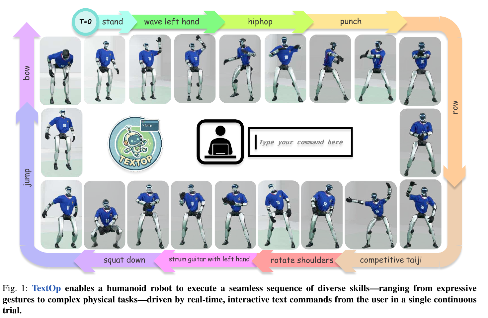
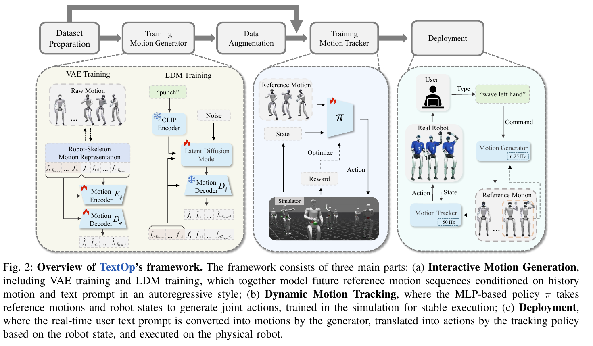

# 018 · TextOp

## 基本信息

- **完整标题**：TextOp: Real-time Interactive Text-Driven Humanoid Robot Motion Generation and Control。
- **作者**：Weiji Xie、Jiakun Zheng、Jinrui Han、Jiyuan Shi、Weinan Zhang、Chenjia Bai、Xuelong Li。
- **机构**：中国电信人工智能研究院 TeleAI、上海交通大学、华东理工大学。
- **阅读版本**：arXiv:2602.07439v1，2026-02-07，Zotero 中保存的 20 页 PDF。未核实后续修订或会议录用信息。
- **来源**：[原论文](https://arxiv.org/abs/2602.07439v1) · [论文 v1](https://arxiv.org/abs/2602.07439v1) · [论文列出的项目页](https://text-op.github.io/)。总结依据本地全文；项目与代码当前发布状态未另行核查。
- **阅读日期与状态**：2026-10-09，已总结，未复现。
- **主题标签**：流式语言指令、自回归动作扩散、机器人骨架表示、生成数据增强、全身动作跟踪。

## 一句话理解

把可随时修改的文字指令转换成连续的短时全身参考动作，用 PPO 跟踪器在 G1 上执行；机器人骨架表示改善生成质量，生成动作增强让跟踪器适应高层输出。证据覆盖动作生成与全身跟踪，尚未支持环境感知和真实物体操作。

## Motivation

1. 通用全身跟踪器已经能执行丰富动作，但预录轨迹难在运行中修改，持续遥操作又需要人一直参与。
2. 文字可以表达“挥手、跳跃、跳舞”等意图，但一次性生成完整动作限制交互；动画中的流式生成也不自动满足机器人执行约束。
3. 作者希望检验：将语言视为随时间更新的控制信号，结合短时生成与全身跟踪，能否平滑切换行为并在真实 G1 上连续执行。

## 方法

### 1. 数据准备：先获得可跟踪的机器人动作

从 AMASS 人体动捕出发，补充少量私有舞蹈、武术动作，用 GMR 将 SMPL 重定向为 29 自由度 G1，并重采样到 50 Hz、提取双脚接触标记。先训练带特权状态的跟踪器，筛除不能可靠跟踪的动作；这使数据更适合实机，但也意味着测试能力建立在筛选后的动作范围上。

跟踪训练的公开数据包含 **12,296 段、40.67 小时**，私有数据为 **403 段、3.12 小时**。生成训练使用 BABEL 的分段文字标注，镜像增强同时修改动作和文字，得到 **83,478 个 segment–text 配对**。私有长动作使用 `〈hiphop 1〉` 等专门标签；附录指出它们主要表达对应动作风格，不是精确重放整段示范。

离线对照实验仅使用公开数据；真机系统使用额外私有动作，并采用更长的跟踪训练，两个设置不能混为完全相同的模型。

### 2. 机器人骨架的局部增量表示

每帧使用 **69 维**特征：根部 roll/pitch 的 4 维三角编码、1 维 yaw 增量、2 维脚接触、3 维局部根部位移增量、1 维根部高度，以及 29 维关节角和 29 维关节增量。

这保留单自由度机器人关节结构，并对全局平移与 yaw 不变。给定初始根部位姿，可将局部增量积分回完整运动轨迹。它提供与机器人运动学一致的表示，但不等于生成结果已经通过动力学或环境碰撞认证。（正文 III-C；附录 A-B、Algorithms 1–2）

### 3. 流式动作生成：参考历史＋当前文字 → 未来 8 帧

采用 DART 式 Transformer VAE 与 latent diffusion model。VAE 学习动作 latent，随后冻结；CLIP 编码当前文字，扩散模型结合最近 **2 帧参考动作**预测未来 **8 帧**，用 5 步去噪、classifier-free guidance 系数 5。下一段使用上一段生成结果作为历史，形成自回归流。

训练加入动作、latent 与前向运动学几何损失，并采用 self-rollout：逐渐把真实历史替换为模型自己的预测，LDM 替换概率上限 0.8，缓解连续生成的分布偏移。高层的历史来自参考动作；正文公式没有将实时机器人状态或环境图像直接作为生成器输入。

在 50 Hz 的动作时间轴上，8 帧对应 0.16 秒；生成器以 **6.25 Hz**更新。新文字进入后续短段的生成，不必重新生成整条长轨迹。

### 4. 动态跟踪：实际状态＋未来参考 → 关节目标

低层为 MLP 策略，用 Isaac Lab 中的 PPO 训练。Actor 输入实际本体状态、上一动作与未来 **5 帧**参考，包括关节角/速度和相对骨盆位姿，共 431 维；critic 额外读取关键身体状态，共 557 维。

奖励兼顾骨盆与身体跟踪、速度跟踪、动作平滑、关节限位、脚滑、落地冲击与力矩约束。训练加入摩擦、身体质心、关节偏移及推扰动随机化。低层依据机器人实际状态闭环跟踪，承担生成参考的物理执行。

### 5. 让跟踪器见到生成器自己的输出

从 BABEL 训练集构造约 20 秒文字流，再生成 **5,368 段、31.48 小时**动作，用于增强跟踪训练。原因是在线生成动作与动捕重定向动作的分布不同，单纯跟踪干净动捕数据可能不够。

部署时，跟踪器在 G1 机载电脑以 **50 Hz**运行，生成器在外部 **RTX 4090**工作站运行；二者通过网络与动作缓冲同步。因此并非整个系统只在机器人机载计算机上执行。

## 总览图与方法图

Fig. 1 看文字如何在一次连续执行中切换动作。图中弹奏乐器等名称表示相应身体动作，不能据此认定机器人操作了真实乐器或物体。

Fig. 2 左侧区分 VAE 与 LDM 训练，中间展示生成动作增强跟踪训练，右侧是 6.25 Hz 高层和 50 Hz 低层的接口。[原图与来源记录](../assets/018-textop/manifest.json)保留图号、页码、原英文图注、提取参数与来源校验值。

## 实验

### 1. 真机能力与 30 秒连续执行

Unitree G1 上展示连续跳舞、跳跃、下蹲、手势和武术动作，允许运行中修改文字；推拉扰动恢复主要为定性展示，没有逐扰动条件的成功统计。

Table I 的每次试验为 30 秒。成功定义是完整执行且没有跌倒、硬件故障或越出预定场地边界，**并非每个文字指令都被正确理解或物体任务完成**。

- 随机文字流：**16/20（80%）**；全局平均身体 link 位置误差 337.169 mm，去除根部平移后的误差 153.920 mm。
- 循环 punch：10/10；wave right hand：8/10；strum guitar with left hand：10/10；play the violin：10/10。每种循环指令评估 10 次。

**协议边界：**附录 B-A 说明随机流的参考轨迹提前离线生成，且先丢弃相对初始位置最大位移超过 2 m 的轨迹，再在实机执行。因此 16/20 支持筛选后参考的连续执行稳定性，不是任意文字在线切换的成功率。场地筛选也限制了该结果的覆盖。

### 2. 交互延迟

Table II 报告文字编码 **7.64±2.56 ms**、动作生成 **29.63±3.56 ms**、跟踪推理 **2.15±0.11 ms**；用户输入到感知机器人开始动作的交互延迟为 **0.73±0.10 s**。

模块测时关闭了实际电机命令执行：编码和生成各 100 次、跟踪 1,000 次。交互延迟则在真实机器人上重复“stand → wave left hand”10 次，由人工记录输入到察觉动作开始的时间。不能把 29.63 ms 当成端到端响应，也不能将这些测量视作所有技能的统一响应时间。（附录 B-A）

### 3. 生成表示对照

BABEL validation 上，TextOp 的片段 FID 为 **3.072±0.199**，DART+Retarget 为 4.837±0.070；R@1 为 **0.300±0.007**，对照为 0.230±0.007。这些是学习到的动作—文字特征空间指标，R@1 不是实机任务成功率。

过渡 FID 为 3.238，低于 DART+Retarget 的 5.249；但过渡平滑指标 PJ/AUJ 并非全部更好：TextOp 为 0.015/0.125，DART+Retarget 为 0.007/0.123，数据参考 PJ 为 0.005。应说整体生成与语义指标改善，不能写“所有过渡指标领先”。（Table III）

### 4. 生成动作增强的收益与代价

跟踪器在 Isaac Lab 训练，以下在 **MuJoCo sim-to-sim**评估。仿真成功定义为整段轨迹各时刻的 root-relative 平均 link 位置误差最大值不超过 **0.3 m**，与真机成功定义不同。

- **生成器输出上（Table IV）**：混合动捕与生成数据的 M+G 成功率 0.993±0.003，只用动捕的 M 为 0.992±0.005，只用生成的 G 为 0.991±0.002。成功率差很小；M+G 的全局误差从 M 的 130.532 mm 降为 113.552 mm，而 root-relative 误差没有同时改善（34.526 → 34.665 mm）。
- **未见 SnapMoGen test 上（Table V）**：M 成功率 **0.823**，M+G 为 **0.814**，G 为 **0.772**。增强适配高层输出，但不能据此说所有未见动作泛化都提升；纯生成数据的分布覆盖不足。
- TWIST2、GMT、Any2Track 使用公开预训练检查点，数据与训练平台不同，跨方法差距不是完全匹配训练条件的组件消融。

Tables III、IV、XIII 的误差条来自 **三个生成 rollout 种子**，不是三次独立模型训练。主表未给完整测试序列总数，Table V 也未给同样的均值与方差，不能自行补置信区间。

## 结论与边界

**作者结论：**短时自回归文字动作生成与全身跟踪结合，支持真实 G1 的连续交互动作；机器人骨架表示和生成数据增强有助于连接生成与控制。

**证据支持的范围：**G1 的身体动作生成、跟踪、特定切换延迟与有限连续执行实验。动作表示和短段历史支持流式拼接，但没有单独的环境感知、物体状态或接触任务规划。

**作者明确局限：**缺少环境感知和交互物理推理，不能根据障碍物、物体或周围环境变化主动调整运动；需要加入环境感知与规划。

**阅读边界：**自然语言自由输入不等于无限语义覆盖；训练主要来自 BABEL 动作标签及私有技能标签。展示中的乐器、投球等动作不能自动算作真实操作任务。生成器使用参考历史，身体实际偏离主要由低层处理；未报告高层根据真实场景重新规划的机制。

## 我的理解与研究启发

阅读者判断：本文的价值是把文字指令从一次性动作选择变成运行中的持续控制输入。对生成—跟踪接口而言，更关键的工程选择是让控制器在训练时见到生成器产生的偏差。

数据增强的结果也提醒：部署分布适配与通用运动覆盖是两个目标。混合数据改善部分生成动作误差，但在未见动捕上略低于纯动捕模型；值得记录这个取舍，而不是只摘取最高平均分。

## 后续问题 / 关联论文

1. 将高层参考历史换成实际执行历史或加入偏差反馈后，长时间根部漂移和切换稳定性会怎样变化？
2. 固定训练步数与总数据量，控制生成数据比例，多次独立训练后，分布适配与未见动作覆盖的取舍是否仍成立？
3. 不预生成、不过滤随机轨迹，在线注入指令变化时，失败率、语义一致性与动作开始延迟分别是多少？
4. [Workhorse](001-workhorse.md) 同样采用高层参考与低层跟踪，但高层以视觉任务交互为目标；可对比两者如何让高层适应实际闭环误差。
5. [KODA](002-koda.md) 用稀疏人类参考、SCO 与 IK 构建离线 canonical motion；TextOp 用文字生成完整短时运动并在线跟踪。两者生成的对象与优化发生的位置不同。
6. [SONIC](003-sonic.md) 提供多种输入接口的通用跟踪；TextOp 展示了文字流作为高层驱动方式，并训练自身跟踪器，不能视作使用 SONIC 的同一系统。

## 来源与修订记录

- **2026-10-09**：从 Zotero wholebody 新增条目读取 arXiv:2602.07439v1，保存原 PDF、Fig. 1 和 Fig. 2，新增第 018 篇笔记，未复现。
- 方法依据正文 III、附录 A；真机结果与延迟依据正文 IV-B、Tables I–II、附录 B-A/B-B；离线生成与跟踪依据正文 IV-C、Tables III–V；局限见正文 V。
- 图像以 200 dpi 从源 PDF 提取，仅裁切，保留作者图注；原 PDF 与 Zotero 文献保持不变。
