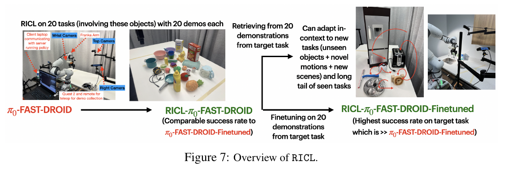
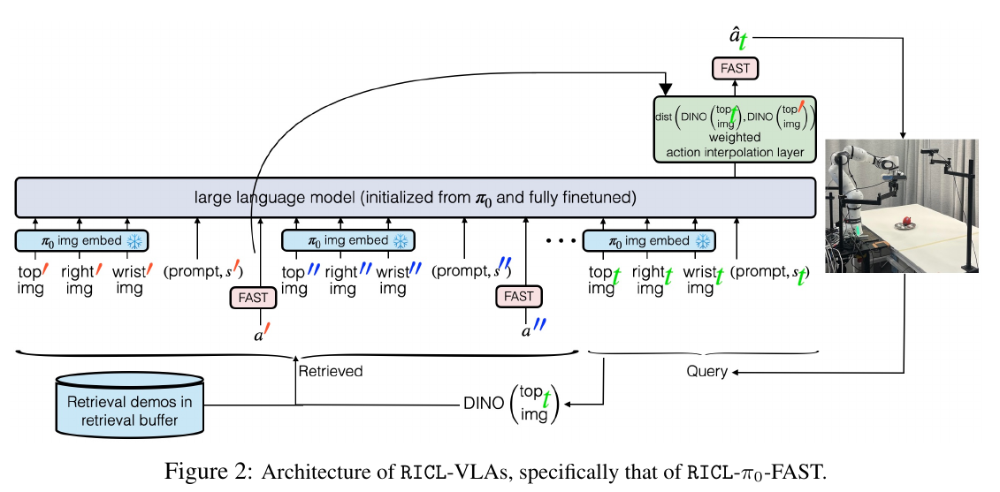

# 019 · RICL

## 基本信息

- **完整标题**：RICL: Adding In-Context Adaptability to Pre-Trained Vision-Language-Action Models。
- **作者 / 机构**：Kaustubh Sridhar、Souradeep Dutta、Dinesh Jayaraman、Insup Lee；University of Pennsylvania、University of British Columbia。
- **年份 / 版本**：2025；本笔记依据 arXiv:2508.02062v1，2025-08-04，PDF 共 17 页；作者标注 CoRL 2025。
- **入口**：[论文 v1](https://arxiv.org/abs/2508.02062v1) · [作者项目页](https://ricl-vla.github.io/) · [代码、模型与数据入口](https://github.com/ricl-vla/ricl_openpi) · [原论文](https://arxiv.org/abs/2508.02062v1)。
- **阅读日期 / 状态**：2026-10-09；已阅读正文与有关训练、部署和失败分析的附录，未复现。来源为公开论文，未向 Zotero 写入条目或笔记。
- **主题标签**：ICL、检索增强、π0-FAST、离线后训练、机器人示范、Franka 操作。

## 一句话理解

先用 **400 条机器人示范**把 π0-FAST-DROID 后训练成会使用示范上下文的策略，再把新任务的 **20 条示范放进检索库**，每步检索局部观测—状态—动作，固定参数执行新任务；八项真机任务完整成功率为 **31.25%**，基础模型为 **2.5%**，但能力仍依赖基础策略、示范覆盖和视觉匹配。

## Motivation

VLA 能在一些新场景中执行动作，但普通行为克隆并不会自然教会模型“读取一条新示范，再改变行为”。遇到不熟悉的对象或动作，模型可能拿起训练中熟悉的干扰物，也可能重复原有运动。

作者希望把模型适应变成普通使用者可以完成的操作：提供少量目标任务示范，立即改善执行，而不为每个目标任务重新优化参数。核心假设是：**少量跨任务后训练可以教会已有 VLA 使用外部上下文，同时保留其已有动作先验。**

RICL 全称是 Re-training for In-Context Learning。“不微调”指新任务部署阶段；获得 ICL 的初始过程确实需要训练。

## 方法

### 1. 基础策略与动作接口

具体实现基于 **π0-FAST-DROID**，使用视觉编码、语言骨干和 FAST 动作 token；它是自回归动作 token 路线。观测含顶部、侧面、腕部三路图像，任务文字，以及七个关节角和夹爪位置。图像调整到 224×224。

动作块大小为 **15×8**：未来 15 步的七个关节速度与夹爪位置。先生成 FAST token，再解码为机器人动作。数据采集动作频率为 **15 Hz**；这个数字不能直接当成模型推理频率。

### 2. 离线 priming：学会读示范

作者用 Franka / DROID 装置采集 **20 个训练任务，每任务 20 条示范，共 400 条**。针对一条查询轨迹，从其他示范中检索上下文，排除查询示范本身，降低直接读取相同轨迹目标的风险。

每次输入 **四组检索片段**，每组包含三路图像、任务文字、本体状态和已知动作块；当前查询只提供观测、文字和状态。序列将检索内容作为前缀，最近邻排在较早位置。训练只监督查询动作，不把检索动作当成另外的预测目标。

离线后训练冻结图像编码器，完整微调语言模型。附录 C 报告三轮训练、batch size 16、两张 A100、峰值学习率 2.5×10⁻⁵。因此收益来自专门学习上下文的训练配方，不能解释为原始 π0-FAST 直接具备同等 ICL。

### 3. 检索与动作生成怎样结合

检索使用预训练 **DINOv2** 提取顶部相机图像特征，以 L2 距离寻找局部近邻。虽然策略读取三路图像，检索器只使用顶部图像；这里没有学习一个动作对齐的检索器。

除了把示范送入语言骨干，RICL 还在输出端加入距离加权插值。对每个动作 token，最终分布为：

`p = exp(-λd) × one_hot(最近邻动作 token) + [1-exp(-λd)] × softmax(模型 logits)`

其中 d 是查询与最近邻的 DINO 特征距离，本文 λ=10。越接近检索示范，越信任示范动作；距离较大时更多依赖模型。

**原始 RICL 插值的是 token 概率分布**。RA-VLA 为 flow matching 改写的 RICL 对照使用连续动作混合，属于适配实现，不能反过来替代本文算法定义。

### 4. 新任务部署与额外微调

部署前采集目标任务 20 条机器人示范，建立外部检索库。执行时每步读取当前观测，检索四组局部片段，生成新动作；**这一适应阶段不更新策略参数**。20 条是库规模，四组是每次上下文规模。

附录 C 的执行策略通常只执行预测 15 步中的三步，预测到夹持后改为执行八步。另一个“目标任务进一步微调”的变体在夹持后执行五步。这些执行设置与后训练状态都应在复现时分开。

作者也研究了用同一组目标任务数据进一步微调 RICL，约 1,000 步。它仍可使用检索，但已经不是纯部署 ICL 的对照。

## 总览图与方法图

Fig. 7 将三个阶段画在一起：基础 VLA → 学会使用上下文 → 新任务检索适应；最右还有可选的目标任务微调。读结果时应对应这三种模型状态。

Fig. 2 中 DINO 用于近邻搜索，绿色模块用于动作输出插值；示范前缀和输出插值是两个不同的作用路径。

两图均从保存的 v1 PDF 以 **200 dpi** 提取，保留英文图注；页码、裁剪范围、来源和图片校验值见[原图记录](../assets/019-ricl/manifest.json)。

## 实验

### 真机任务与评估协议

八项任务涵盖 Poké Ball 取放、idli plate 移动、刮水器操作、把盘子或刮水器移到水槽、按烤面包机拨杆、开柜门及贝果取放。每任务提供 **20 条目标示范、10 次测试执行**。有些测试更换了物体、抓取方式或场景；烤面包机、柜门也包含已有任务的长尾变体，不能把八项都描述为基础模型从未接触过的全新技能。

论文用 **完整任务成功**和若干阶段检查点完成率区分“完成”和“部分进展”。正文 §5.2 / Fig. 4 报告：

- 不做目标任务微调：基础模型完整成功率 **2.5%**，RICL **31.25%**。
- 阶段检查点完成率最高分别为 **21.25%** 与 **83.75%**。这是部分任务进展指标，不能替换完整成功率。
- 目标任务进一步微调的另一组比较：普通微调 **31.67%**，RICL 后再微调 **61.67%**。按论文对应的评估任务计算，不能把这组平均数当成八任务统一分母的结果。

纯 ICL 的 31.25% 接近普通目标微调的 31.67%，是本文设置下的描述性比较；样本量小且协议需对应，不能据此声称两种方法普遍等效。

### 消融与失败

目标示范数量实验在 idli-plate 任务上观察到五条示范效果较弱，十条以上有改善；这不等于所有任务都以十条为必要或充分条件。对三个 priming 任务的抽样测试中，两者均为 **80%**，只支持有限范围的能力保留。

Fig. 5 与附录 Fig. 9 展示人手移动对象后重新反应的能力，但图注明确是 **目标任务进一步微调的 RICL**。因此这组扰动展示不能直接用作纯 ICL 鲁棒性的定量证明。

附录讨论较大的相机视角变化仍会破坏匹配；网球正手等远离基础模型动作能力的任务也没有被少量示范解决。论文没有提供人形行走、全身平衡或跨机器人零训练迁移的证据。

## 结论与边界

作者证明了一种可行配方：少量离线后训练可以给现有 VLA 增加上下文接口，目标任务示范之后作为外部记忆使用，避免每次任务适应都更新权重。

实验支持 **单个平台、有限操作任务内，检索示范可以改善未熟悉对象或动作的执行**。其平均完整成功率仍为 31.25%，且需要目标机器人示范；不能扩展为任意动作学习、纯人类视频学习或开放环境中的可靠通用控制。

## 我的理解与研究启发

**以下为阅读者判断。** RICL 的重要性在于把“模型权重里的技能”与“使用者后来提供的示范”连接起来。方法也暴露一个需要拆开的问题：收益有多少来自理解上下文，有多少来自输出端的近邻插值？两者都可能改善成功率，却对应不同的泛化机制。

结合现有全身笔记，值得考虑把上下文放在身体参考、末端轨迹或视觉子目标层，由低层跟踪器提供动态执行。本文没有检验这一组合，机械臂的成功不能直接推导出人形移动操作有效。

## 后续问题 / 关联论文

- 固定同一检查点，分别关闭上下文前缀、关闭 token 插值、替换为错误动作示范，能否区分检索复制和任务适应？
- 在语义相同但位置、视角和初始关节状态不同的测试中，近邻距离能否反映动作可执行性？
- [RA-VLA](../ra-vla.html)学习动作相关的检索和上下文遵循；[ICI-VLA](../ici-vla.html)学习阶段匹配及目标动作前缀去依赖；[StellaVLA](../stellavla.html)改为结构化示范。
- [KODA](../koda.html)的人类—机器人对齐数据能否作为检索库？需另外验证机器人状态与高层动作接口一致性。

## 来源与修订记录

- **主来源**：[arXiv v1](https://arxiv.org/abs/2508.02062v1)；方法 §4 / Eq. 1，实验 §5 / Fig. 4–5，讨论 §6，附录 C–D。
- **作者材料**：[项目页](https://ricl-vla.github.io/)与[公开实现](https://github.com/ricl-vla/ricl_openpi)，用于核对实现入口，不替代 PDF 实验协议。
- **2026-10-09**：首次正式入库为 019；保存全文与两张原图，区分纯 ICL、额外微调、完整成功和阶段完成。全文来源及哈希见[来源记录](../assets/019-ricl/source-record.json)，原图来源见[manifest](../assets/019-ricl/manifest.json)。
