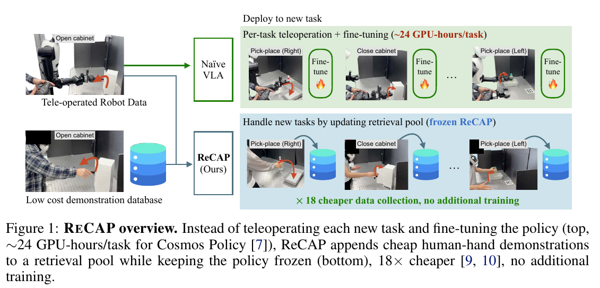
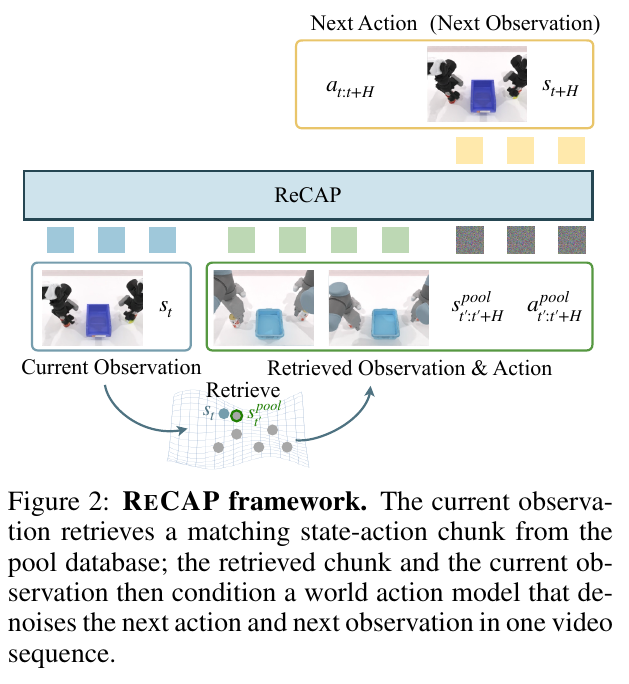

# 020 · ReCAP

## 基本信息

- **完整标题**：Retrieve, Don’t Retrain: Extending Vision-Language-Action Models to New Tasks at Test Time；方法名称 ReCAP，Retrieval-Conditioned Action Policy。
- **作者 / 机构**：Jeongeun Park、Juhan Park、Taekyung Kim、Sungjoon Choi、Dongyoon Han、Sangdoo Yun；NAVER AI Lab、Korea University。
- **年份 / 版本**：2026；arXiv:2606.15631v1，2026-06-14，PDF 共 20 页。本笔记按预印本记录。
- **入口**：[论文 v1](https://arxiv.org/abs/2606.15631v1) · [作者项目与实现入口](https://recap-robot.github.io/) · [原论文](https://arxiv.org/abs/2606.15631v1)。
- **阅读日期 / 状态**：2026-10-09；已阅读正文与相关检索、消融和实验附录，未复现。公开来源入库，未向 Zotero 写回。
- **主题标签**：ICL、跨具身、检索、残差动作、World-Action Model、人手轨迹。

## 一句话理解

先用目标机器人与另一种具身的配对示范训练“**检索轨迹＋具身修正**”策略，部署后固定权重，把新任务的廉价源具身轨迹加入库，每步重新检索即可扩展任务；真机实验以带 VR 手腕位姿的人手示范适应两个保留任务，但要求可对齐的状态—动作空间。

## Motivation

新任务通常同时带来目标机器人遥操作成本与策略微调成本。人手或另一种易采集具身能够提供同样任务的大致过程，但其几何、接触和动力学与目标机器人不同，直接回放不一定可执行。

作者把问题拆为两层：示范说明任务该如何推进，目标策略负责当前机器人该如何完成。核心假设是：**如果模型已经学会在同一动作表示下修正具身差异，之后新任务可以通过更新外部示范库获得，而不必重新收集目标机器人数据并训练。**

“Don’t Retrain”指已有目标具身上的新任务扩展。论文摘要明确说明：接入一个未见的新具身仍需要微调。

## 方法

### 1. Query 与 Pool 的共同接口

Query 是实际部署的目标机器人；Pool 是只提供示范的源具身，例如人手。两者需要共享状态 / 动作表示，本文主要使用 **SE(3) 末端位姿和适用时的夹爪信号**，并假设语义相近的任务具有可对应的运动过程。

初始训练提供目标具身与源具身的配对任务数据，教会模型如何用源轨迹指导目标执行。新增任务之后只加入源具身示范，策略保持冻结。

这里的人手示范不是任意 RGB 视频：真机 Pool 有 **VR 跟踪的手腕位姿**。原始视频需要先转成可用的状态—动作轨迹，才能进入本文接口。

### 2. 从当前观测检索局部运动

检索先用初始场景描述预筛轨迹，再在候选轨迹中匹配局部时刻。特征包括任务语言、SAM3 提取的任务相关物体位置 / 几何、本体状态，以及 DINOv3 图像特征。

轨迹预筛保留 top-5；局部匹配按不同特征的加权距离评分。训练时还可使用标注的未来动作块帮助匹配，**部署时没有查询的未来动作，相关评分项会关闭**。检索每步重新运行，源库也可在运行过程中增长。

因此，Pool 中的示范总数、预筛候选轨迹数和实际条件化的动作块是不同概念，不能把“库包含 35 个任务”理解为一次输入 35 条长示范。

### 3. 检索条件化的 WAM

主要实现基于 **Cosmos Policy / Cosmos Predict2.5 2B**。当前观测和检索到的源具身状态—动作片段编码为干净 latent，沿时间轴放在前面；目标动作与未来图像一起通过 flow matching 去噪，语言经交叉注意力进入。

动作不从零直接预测，而采用：

`目标动作块 = 检索源动作块 + 模型预测的修正 Δ`

源轨迹提供运动先验，Δ 学习当前观测下的目标具身差异。未来图像监督为动作的视觉后果提供额外约束。例如相似的抓取轨迹，仍需要不同夹爪姿态才能避免撞倒物体。

附录 F 的 RoboTwin 配置为动作 horizon **16 帧**、AdamW、20,000 次迭代、全局 batch 512。属于离线成本，并非未经训练就能直接进行跨具身 ICL。

### 4. 为什么联合预测未来图像

论文不仅认为世界模型先验有用，还检验了其作用是否依赖检索。PushT 的二维消融表明：预测未来状态与残差动作组合最好，单独给没有检索的策略增加未来状态预测反而没有改善。本文证据支持的是特定组合的相互作用。

## 总览图与方法图

Fig. 1 的下半部表示部署时模型固定、示范库更新。图中“18× 更便宜”引用人类数据采集相关工作，“约 24 GPU-hours/task”对应 Cosmos Policy 的成本背景，不是本文在所有任务上统一实测的收益。

Fig. 2 来自原文右栏：当前目标观测检索源轨迹，源观测 / 动作与当前观测一起条件化 WAM，联合输出目标动作和未来观测。

两图以 **200 dpi** 从 v1 PDF 提取，保留英文图注；复核页码、裁剪范围及哈希见[原图记录](../assets/020-recap/manifest.json)。

## 实验

### PushT：目标角度与具身接触差异

Target 为三角形推手，Pool 为圆盘推手。训练使用目标角度 **±45° 的 100 组配对示范**；测试目标为 −60° 至 +60°、每 15° 一个，共九个角度，其中七个训练未见。部署示范库提供 5° 间隔的源具身轨迹。

正文 §5.2 / 附录 A Table 2：七个未见角度的平均成功率，**无检索 Cosmos Policy 6.0%**，直接回放检索 **16.9%**，混合具身共训练 **19.1%**，ReCAP **34.9%**。34.9% 与 6.0% 是同骨干无检索比较，6.0% 并非所有对照中的最高值。

正文 Fig. 5：标准 π0.5 加检索由 **6.6% → 25.1%**，说明检索效果不限于 WAM。附录 A Table 3 中，有检索、残差参数化但不预测未来状态为 **27.4%**，完整组合为 **34.9%**；绝对动作＋未来状态为 **27.4%**。无检索时，加入未来状态目标反而由 **8.3% → 6.0%**。

随着源角度覆盖增长，冻结模型可利用相邻示范改善表现，支持一定程度的插值泛化；不等于任意外推角度都可靠。

### RoboTwin 2.0：五个保留任务

Target 为 **Aloha-Agilex**，Pool 为 **UR5 仿真示范**。五个训练任务共有 **246 组配对训练轨迹**，另有五个保留任务：药瓶移动、面包放入煎锅、按铃、递麦克风、提锅。这里的源库不是人手视频。

正文 Table 1：ReCAP 已见 / 未见任务平均成功率 **43.5% / 31.5%**；已见任务最强对照为无检索 **32.5%**，未见任务最强对照为直接回放检索 **26.0%**。不同 split 的最强对照不同。

冻结策略、使用严格嵌套的源库扩展时，库覆盖任务数 **11 / 17 / 23 / 29 / 35**，未见任务成功率依次 **9.0 / 18.5 / 19.5 / 22.0 / 31.5%**（Fig. 7）。这比“最后整体分数较高”更直接地证明更新外部库能改变能力覆盖。

### 真机：人手示范扩展任务

先以 **25 组开柜门配对示范**微调，再冻结模型。为两个保留任务分别加入 **10 条带位姿的人手示范**，每任务 **10 次真机测试**（§5.1、Fig. 8）：

- 已见的开柜门：基线与 ReCAP 均为 **90%**。
- 把瓶子放入塑料盒：**10% → 80%**。
- 关柜门：**0% → 30%**。

这支持人手运动可指导固定策略执行新任务，但测试样本小，两个未见任务差异很大。全文没有统一报告充足的跨场景置信区间；也未给出人形行走与全身操作的定量验证。

### 机制分析与失败

附录分析动作槽对检索轨迹和预测未来状态的注意力，并通过屏蔽对应连接检验其作用。屏蔽检索既可破坏成功执行，也可救回部分失败，表明检索可能成为有用先验，也可能过度锚定错误计划。

本文未清楚给出与真机一样易核对的全部仿真 rollout 数说明，笔记不根据表格步长倒推出样本量。原始表格及完整协议保存在全文中。

## 结论与边界

作者提出并验证了一条有意义的任务扩展方式：**既有目标具身适配一次，新任务通过增长源示范库进入固定策略**。WAM 的未来图像监督与残差动作联合支持了跨具身执行。

明确边界包括共享末端动作空间、状态—动作轨迹可获取、源与目标运动语义接近。不同速度 / 时间尺度会使残差修正不可靠；灵巧手与平行夹爪等结构差异需要额外接口，任意网络视频不能直接接入。新具身仍需要训练。

## 我的理解与研究启发

**以下为阅读者判断。** 五篇中，ReCAP 对“减少目标机器人新增数据”最直接：新任务示范可以来自人手，且实验分开了源库增长和策略更新。其成功仍依赖初始配对数据学会具身修正。

与 [KODA](../koda.html)关联时，可把 KODA 看作构建一致机器人数据接口的方向，把 ReCAP 看作让一致表示进入外部记忆的方向。但将 SE(3) 末端残差扩展到身体接触、平衡和足步，还需要独立的动态控制与验证。

## 后续问题 / 关联论文

- 当检索内容来自同一语义任务但速度不同，时间重采样与学习残差谁更重要？
- 固定库规模，比较“覆盖更多任务”和“同任务更多轨迹”，能否识别收益主要来自覆盖还是精度？
- [RICL](../ricl.html)需要目标机器人示范；[StellaVLA](../stellavla.html)用语言化结构减轻来源差异；[RA-VLA](../ra-vla.html)学习动作一致的检索。可在统一平台区分三种迁移接口。

## 来源与修订记录

- **主来源**：[arXiv v1](https://arxiv.org/abs/2606.15631v1)；§3–4 / Eq. 1–3，§5 / Table 1 / Fig. 5、7、8，§6，附录 A、D–F。
- **作者材料**：[项目页](https://recap-robot.github.io/)，用于核对示范、任务展示与实现入口。
- **2026-10-09**：首次正式入库为 020；保存全文与两张原图，区分真机人手 Pool、仿真 UR5 Pool、背景成本引用和本文实测结果。版本及校验值见[来源记录](../assets/020-recap/source-record.json)与[原图记录](../assets/020-recap/manifest.json)。
