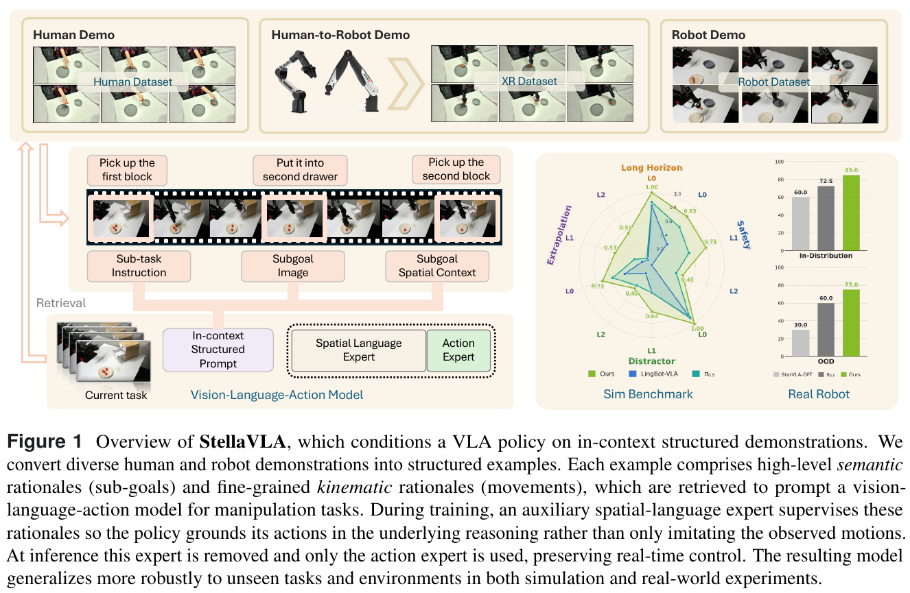
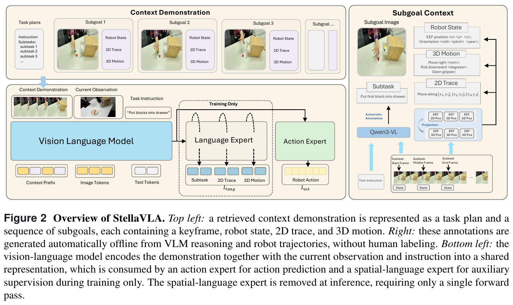

# 021 · StellaVLA

## 基本信息

- **完整标题**：StellaVLA: In-Context Structured Demonstration for Generalizable Vision-Language-Action Models。
- **作者署名**：保存的 PDF 为 **StellarEdge AI Technical Team**。arXiv 元数据列 Siyu Xu、Yunke Wang、Zijian Wang、Dihao Zhu、Chenghao Xia、Chengbin Du、Daochang Liu、Tao Huang、Chang Xu；两处署名形式不同，分别保留。
- **年份 / 版本**：arXiv:2608.11671v1，2026-08-12，PDF 共 21 页；PDF 内文日期为 2026-08-01。本笔记按预印本记录。
- **入口**：[论文 v1](https://arxiv.org/abs/2608.11671v1) · [PDF 所列官方页面](https://stelledge.com/blog/stellavla) · [原论文](https://arxiv.org/abs/2608.11671v1)。官方网页本次读取超时；方法与数字以保存的 PDF 为准，未确认独立公开代码入口。
- **阅读日期 / 状态**：2026-10-09；已阅读正文及实现、真机、消融和限制附录，未复现。公开来源入库，未写回 Zotero。
- **主题标签**：ICL、结构化示范、空间语言、跨具身上下文、KV cache、Qwen3-VL。

## 一句话理解

把一条示范压缩为任务计划、子目标图像、状态与 2D/3D 运动文字，用 **Qwen3-VL＋连续动作头**读取上下文；训练时再用空间语言监督共享表示，部署时只输出动作。固定检查点的正确 / 缺失 / 错误示范实验表明上下文确实影响策略，但真机完全未见任务仍未成功。

## Motivation

裸示范含图像和数值动作，模型可能难以抽取任务顺序，也可能只匹配外观而忽略任务意图。跨人手、XR 与机器人来源时，原始坐标与具身外观还不相同。

作者希望上下文显式说明“当前任务分几步、每一步如何运动”，并使模型在训练中学习这些说明与控制动作的关系。另一个现实约束是推理延迟：如果每个控制周期先生成长篇推理文本，再生成动作，机器人控制会变慢。

核心设计是将结构化示范作为任务条件，将空间语言作为离线辅助监督，将动作输出作为部署时的直接通路。

## 方法

### 1. 离线结构化示范

原始轨迹来自机器人遥操作、人手追踪或 XR 重定向。离线 VLM 根据视频和全局指令切分语义子任务，提取子目标描述与关键帧。

随后用确定性的运动描述器将每段动作转成 **3D 位移 / 姿态 / 夹爪文字**，并借助相机内外参投影得到 **2D 轨迹文字**。每个子目标包含图像、本体状态、子任务语义、2D 轨迹和 3D 运动，整条示范组织成计划序列。

“零人工标注成本”指这些附加标签自动生成；原始示范采集、运动追踪、相机标定和离线计算仍有成本。VLM 从行为推断的描述也不等于经过验证的专家真实思维过程。

### 2. 一条示范作为静态前缀

检索只依据 **任务指令语言嵌入的余弦相似度**，不使用当前图像。训练排除目标轨迹本身，检索另一条同任务示范；模拟环境任务指令集合封闭时，基本等价于精确任务匹配。

策略输入为“结构化示范前缀＋当前任务指令＋当前图像与文字化状态”。本文所有主要设置使用 **一条示范**。部署时示范前缀在整次 rollout 中固定，可以一次编码并缓存 KV。

### 3. 动作与空间语言并行训练

骨干为 **Qwen3-VL-4B-Instruct**，动作专家为 OpenVLA-OFT 风格的 MLP，回归连续动作块；空间语言专家使用原生语言输出，预测当前子任务及同一动作块的 2D/3D 运动描述。

损失为 `L = L1(动作) + λ × CE(空间语言)`，主要设置 λ=0.3。两条输出通路共享骨干表示，**动作不依赖当步生成的推理文字**。

各匹配模型全参数微调 **30,000 步、全局 batch 128**。上下文可用性不同，示范 dropout 也不同：LIBERO / LIBERO-Plus 为 0，VLA-Arena / 真机为 0.5。离线训练是获得上下文能力的一部分。

### 4. 部署只走动作分支

部署移除空间语言生成通路，动作头一次前向预测连续动作；缓存固定示范前缀，降低重复编码成本。模型仍读取完整上下文语义，并没有在部署时运行一个显式逐步文本规划器。

异具身数据只提供上下文，**执行动作始终在目标机器人空间监督和预测**。因此跨来源迁移的目标是共享程序性说明，而不是把人手关节动作直接当机器人指令。

## 总览图与方法图

Fig. 1 展示不同来源先进入共同的子目标 / 运动描述，再作为模型上下文。右侧结果展示应结合正文的任务划分阅读。

Fig. 2 的空间语言分支标记为 Training Only；结构化示范是部署时仍保留的输入，空间语言输出则是训练监督。

两图从 v1 PDF 以 **200 dpi** 提取并保留英文图注，页码、裁剪范围及校验值见[原图记录](../assets/021-stellavla/manifest.json)。

## 实验

### 仿真性能与任务划分

标准 LIBERO 每个 suite **500 次 rollout**，四个 suite 平均成功率 **98.8%**；同骨干、动作头和训练数据的 StarVLA-OFT 对照为 **96.6%**（Table 1）。但该对照同时没有示范上下文与空间语言监督，测量的是整体设计，不能单独归因于 ICL。

LIBERO-Plus 使用 LIBERO 训练检查点，在七类扰动上不再训练，按任务数加权的平均成功率 **85.1%**，StarVLA-OFT **75.0%**（Table 3）。85.1% 的平均不包含原始任务列。视角、噪声、机器人初始状态等变化收益明显，但物体布局仅 **79.2% → 79.3%**；背景与光照的部分分数略低于对照。

VLA-Arena 使用 L0 训练、L1 / L2 测试，并提供目标任务的一条示范。L0 / L1 / L2 平均分数 **0.84 / 0.62 / 0.43**，总体 **0.63**（Table 2）。作者对比 π0.5 的 0.44；这是 **2026-08-01** 的排行榜 / 论文记录，不代表当前实时排名。极长时程 suite 的 L1 / L2 仍接近零。

### 固定检查点的上下文证据

Table 5 只改变测试时提供的示范：

- 正确任务示范：LIBERO 平均 **98.8%**。
- 不提供示范：**62.4%**。
- 提供错误任务示范：**44.9%**。

错误示范比缺失示范更差，支持策略实际使用上下文决定任务。不过标准 LIBERO 本身主要是已见任务验证，不能把 98.8% 一概称为全新技能学习。

### 结构化信息与语言监督消融

固定检查点中，仅文字示范的 LIBERO / Plus 为 **98.8% / 84.4%**，图像＋文字为 **98.8% / 85.1%**，仅图像为 **92.9% / 75.7%**（Table 7）。文字化结构承载大量有用信息，但这不是所有任务都可以舍弃图像的证明。

训练 λ=0 的 LIBERO / Plus 为 **97.6% / 86.9%**；λ=0.3 为 **98.8% / 85.1%**（Table 6）。辅助语言目标改善选定设置的分布内表现，**并未单调改善 OOD**。整体模型优于无上下文对照，也不能说明所有收益都来自语言辅助目标。

### 真机与跨来源证据

使用 **6-DoF AgileX Piper**，第三人称及腕部 RGB。四项任务为笔放入杯子、胡萝卜放入碗、积木放抽屉并关门、叠三个碗；收集 **125 条机器人轨迹、71,702 帧**。示范库另含 **26 条 XR 录制的人手示范**及 **26 条时间对齐的 Piper 重定向示范**。

每个任务 / 条件 **10 次 rollout**。四项分布内平均成功率 **85%**，两个 OOD-L1 物体属性变化任务平均 **75%**（Fig. 4）。这些是混合来源库执行，不能分别归因于人手、XR 或机器人示范。

OOD-L2 为未见的“积木放入第一层抽屉”：**所有比较方法都为零完整成功**。StellaVLA 平均进展 **1.9 / 4**，π0.5 为 1.5，StarVLA-OFT 为 1.1。进展不能写成任务成功。

跨来源分析固定当前观测，仅替换示范来源，在 **1,780 个 ID、1,719 个 OOD 帧**测量预测动作差异。三种来源的差异很小（Table 4），支持单步预测的一致性；它不是固定单一来源做完整闭环的成功率比较。

### 延迟与控制边界

Table 8 中：无示范 **64 ms**；图文示范不缓存 **183 ms**、缓存 **91 ms**。另一组配对测量，动作直接输出 **88 ms**，额外生成 83 个空间语言 token 为 **3,177 ms**。移除语言解码确实减少开销，但缓存示范仍比无示范慢，不能将摘要“no added latency”理解为绝对零额外成本。

88–91 ms 是模型路径时间；附录 B 的真机完整观测—控制管线约 **205 ms / 动作块**。动作块时间也不能直接当成底层电机控制频率。

## 结论与边界

作者验证结构化示范有助于 OOD 稳健性，并用固定检查点的内容干预证明策略依赖上下文。训练时语言监督、部署时动作直出兼顾表示学习和延迟。

当前边界包括错误示范会误导、静态前缀无法在执行偏离后重新规划、文字化运动离散较粗。跨具身结论主要基于混合库真机执行与单步一致性分析；尚未证明任意人类视频、任意机器人或未见长任务都能完成。

## 我的理解与研究启发

**以下为阅读者判断。** StellaVLA 最值得借鉴的是把示范中的“程序顺序”和“局部空间运动”显式拆开，并让辅助语言描述与动作监督指向同一运动。它并不证明模型在部署时进行可验证的因果推理。

对全身机器人，子目标与末端运动描述可能比原始人体关节轨迹更便于迁移；仍要保留接触、足步与平衡等身体约束。本文机械臂评估未覆盖这些约束。

## 后续问题 / 关联论文

- 固定同一示范，打乱子目标顺序、保留动作数值、替换运动文字，分别会造成什么错误？
- 在真机中固定机器人、人手、XR 三种来源分别做闭环 rollout，单步一致性是否还能保持？
- [ReCAP](../recap.html)每步检索、预测残差；[ICI-VLA](../ici-vla.html)按子任务阶段刷新微示范。静态计划与动态局部上下文能否互补？
- [KODA](../koda.html)与 [EgoHumanoid](../egohumanoid.html)提供人类数据对齐思路；是否能保留语义上下文并把执行交给全身跟踪器，需要新实验。

## 来源与修订记录

- **主来源**：[arXiv v1](https://arxiv.org/abs/2608.11671v1)；§3，§4 / Tables 1–8，附录 A–D。
- **2026-10-09**：首次正式入库为 021；记录 PDF 与 arXiv 署名 / 日期差异，保存全文及两张原图，核对错误上下文、OOD-L2 零成功与缓存延迟条件。[来源记录](../assets/021-stellavla/source-record.json) · [原图记录](../assets/021-stellavla/manifest.json)。
