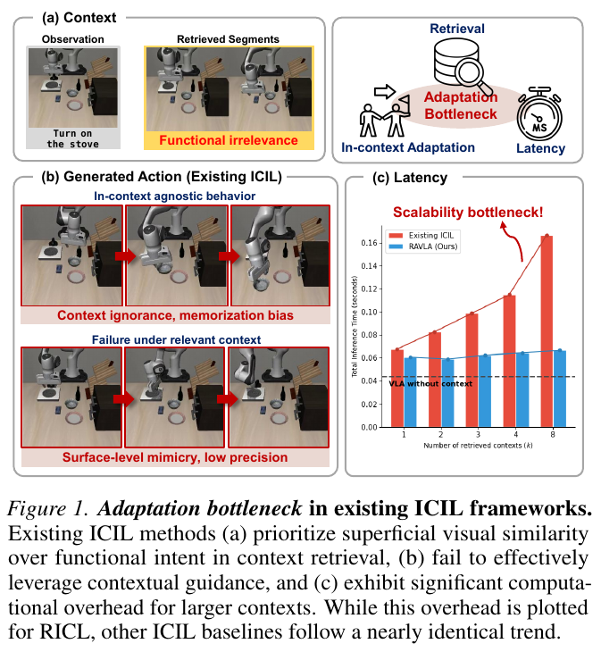
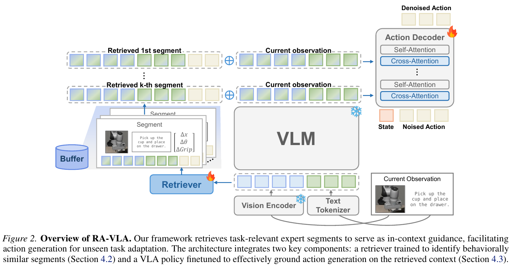

# 022 · RA-VLA

## 基本信息

- **完整标题**：RA-VLA: Retrieval-Augmented VLA for Test-Time Adaptation。
- **作者 / 机构**：Sanghwan Jang、Minjin Jeon、Minsoo Kim、Seongjin Choi、Dongha Kim、Hwanjo Yu；POSTECH 计算机科学与工程系、人工智能研究生院。
- **年份 / 版本 / 发表**：ICML 2026，PMLR 306；本笔记依据 **arXiv:2608.25585v2，2026-10-07**，PDF 共 18 页。初稿 v1 为 2026-08-26，专题检索阶段使用的 v1 链接已更新。
- **入口**：[论文 v2](https://arxiv.org/abs/2608.25585v2) · [正式会议记录](https://proceedings.mlr.press/v306/jang26c.html) · [论文 v2](https://arxiv.org/abs/2608.25585v2)。本次未确认独立公开实现入口。
- **阅读日期 / 状态**：2026-10-09；已阅读 v2 正文及架构、真机、对照实现附录，未复现。公开来源入库，未向 Zotero 写回。
- **主题标签**：ICL、行为对齐检索、上下文遵循、GR00T N1.5、flow matching、缓存、UR5e。

## 一句话理解

用离线动作 DTW 教检索器找行为相关的片段，再用“相关上下文预测应优于无关上下文”的训练约束迫使动作头读取示范；冻结 VLM 的缓存特征按层进入 flow-matching 动作头，固定参数适应保留任务，平均成功率为 **LIBERO 38.45%、UR5e 56.25%**。

## Motivation

作者提出三个相互关联的瓶颈：图像相似不代表所需动作相似；拿到正确示范后，策略仍可能沿用训练时熟悉的行为；把多条示范直接拼进大 VLM 会增加推理成本。

这意味着“加一个检索模块”并不足够，还需检验检索是否符合动作意图、策略是否依赖检索内容、上下文规模能否扩展。RA-VLA 同时处理这三项问题。

“training-free adaptation”描述目标任务的部署适应。检索器和动作生成接口都先离线训练，并不是原始 GR00T 无需训练就具备全部能力。

## 方法

### 1. 示范库和独立缓存

骨干为 **GR00T N1.5**，视觉语言部分冻结，动作头为 flow-matching Diffusion Transformer。每条专家轨迹按 **16 步窗口、stride 4**切为片段，记录图像、语言、本体状态与动作块。

片段独立编码：检索 key 是低维嵌入，value 是冻结 VLM 的多模态特征及状态 / 动作。新示范加入库时预计算这些信息，不必在每次推理中重新把全部示范送进 VLM。缓存降低计算，也引入特征存储与新增数据编码成本。

主要实验默认只使用 **一个检索片段**。LIBERO 每个保留任务的库有三条示范，真机有四条；示范库数量不等于每次模型读取的上下文数量。

### 2. 动作感知检索器怎样学习

检索器是两层 Transformer，读取视觉编码器的图像 token 与文字 token，平均池化后得到嵌入，以余弦相似度检索。它不是直接拿查询未来动作作为部署输入。

离线随机取同任务的两条专家轨迹，在**动作序列上做 DTW 对齐**。对齐路径上的局部片段作为正样本，未对齐或不同任务片段作为负样本，使用对比学习训练检索器。

动作标签仅用于离线构造行为相近的监督。部署只能观察当前图像和文字，检索器从这些输入预测行为相关性。DTW 可以处理不同执行节奏，但不能据此认为所有空间 / 动力学变化已自动对齐。

### 3. 在动作专家中接入示范

当前观测只需编码一次。动作头每个交叉注意力层读取“当前特征＋一个专家片段”，不同检索片段分配到不同层；更相关的片段放在较高层。附录 B 的八层分配中，检索两段时为 **[2,2,2,2,1,1,1,1]**。

这把大规模的上下文混合放到动作专家，而不是完整 VLM 的长序列中。训练与推理主要设置为 **16 步动作 horizon、四次去噪**。

论文还有一个重要动作先验：flow matching 的初始动作块使用**检索专家动作块的经验均值**，而不是通常的标准高斯初始化。输出收益不能完全归因于检索器或注意力结构。

### 4. Contextual adherence loss

对同一查询，分别给动作头相关检索片段与随机无关片段，计算针对目标向量场的 MSE：`L_rel`、`L_irrel`。训练要求前者至少比后者小一个 margin：

`L_adhere = max(0, m - [L_irrel - L_rel])`

`L_overall = L_rel + λ × L_adhere`

主要设置 **m=0.01、λ=0.1**。如果动作头忽略上下文，两种误差趋于相同，便受到额外惩罚；模型必须学习区分相关与无关示范。这里监督的是 flow-matching 向量场，不是明确的语言推理或相对于专家动作的残差。

检索器温度为 0.01、hidden size 512、八个 attention heads。新增目标任务只更新外部库，相关参数保持冻结。

## 总览图与方法图

Fig. 1 是问题总览：视觉近邻可能无动作相关性，正确上下文也可能被忽略，直接拼接上下文会增加延迟。

Fig. 2 中冰晶表示冻结视觉语言编码，火焰表示训练检索器和动作接口；上下文在动作解码器按层进入。

两图从 **v2 PDF**以 **200 dpi** 提取，保留英文图注；页码、裁剪范围、版本和哈希见[原图记录](../assets/022-ra-vla/manifest.json)。

## 实验

### LIBERO：按 suite 保留测试

采用四个 suite：Spatial、Object、Goal、Long。每次用其中三个训练上下文能力，另一个完全保留，轮流报告各个保留 suite 的表现。**每个测试任务三条专家示范作为外部库，50 次测试**（§5.1）。“未见”指没有用于本论文的上下文后训练，不保证基础模型预训练中绝无相似内容。

Table 1 用 0–1 小数列值，换成百分数后 RA-VLA 的 Spatial / Object / Goal / Long 为 **32.0 / 55.6 / 53.2 / 13.0%**，平均 **38.45%**。最强比较项为使用作者动作感知检索器的 RICL_R，平均 **20.85%**，差 **17.60 个百分点**。

本文的 Vanilla VLA 仅为 **1.70%**；这是严格保留任务设置，不能拿该值与通常已见任务的 LIBERO 高成功率直接比较。Long 的 13% 也说明长任务仍困难。

### UR5e：四个任务的保留测试

平台为 **UR5e＋Robotiq 2F-85**，两台 RealSense D435 提供第三人称与腕部 RGB；GELLO 遥操作，每任务采集 **30 条示范**。数据采集 / 指令执行同步为 **10 Hz**，模型训练与服务使用单张 A100（附录 C）。

四项任务为叠盒、扔垃圾、关抽屉、踩踏板开垃圾桶。每轮用三个任务及辅助 LIBERO 数据训练，另一个保留；测试每个保留任务库中 **四条示范、12 次执行**。

Table 2 完整成功率为 **41.7 / 75.0 / 66.7 / 41.7%**，平均 **56.25%**；RICL_R 平均 **35.42%**，差 **20.83 个百分点**。拾起、触碰等子目标分数另列，不能当作完整任务成功。

平均数汇总的是四项保留任务评估，而非一个检查点同时在四个从未训练过的任务上完成全部测试；单任务 12 次执行，也不足以形成精细可靠的跨场景成功率估计。

### 对照实现与机制消融

所有比较方法使用 **同一 GR00T N1.5 骨干**。RAEA 与 RICL 是作者为此架构适配的实现；特别是 RICL 的输出混合被改写为连续动作 / flow-matching 形式。不能把它们当作原论文 π0-FAST 检查点的直接评测。

在 LIBERO-Goal，关闭 contextual adherence loss 时成功率为 **9.8%**，完整方法为 **53.2%**；对应上下文敏感度 **0.0353 → 0.3639**（Table 3）。把动作感知检索换为现成检索器，完整方法从 **53.2% 降至 10.2%**（§5.4）。两者分别支持训练检索质量与策略遵循的重要性。

但 sensitivity 是内部动作响应指标，不等于真实任务成功；相关性与消融结合更有解释力。原文没有对全部模块给出充分的多随机种子误差条。

### 库规模与延迟

LIBERO-Goal 的库示范数 N 从 1 到 4 时，成功率 **48.2 / 51.8 / 53.2 / 55.2%**；固定库、上下文片段 K 从 1 到 4 时为 **53.2 / 54.0 / 54.8 / 54.6%**（Table 4）。扩大库与增加每次上下文是不同实验，收益不能互换。

Fig. 5 的延迟对每种设置生成一个动作块平均 **1,000 次推理**，动作头四步去噪；RA-VLA 随检索片段增长较平缓，直接拼接对照增长更明显。它证明测量范围内的扩展性，不能解释为任意无限库 / 无限上下文没有额外成本。

## 结论与边界

论文在明确保留任务设置中证明：行为相关检索、迫使策略读取上下文的训练目标，以及动作专家中的高效接入，可以共同改善固定参数的任务适应。

限制包括仍需少量目标机器人专家示范、基础模型动作先验和检索覆盖、有限真机任务 / 样本，以及长时程表现较低。GR00T 的“humanoid”背景不意味着本论文评估了人形全身移动操作；实际真机证据是 UR5e 机械臂。

## 我的理解与研究启发

**以下为阅读者判断。** RA-VLA 把“找到好示范”和“真正使用好示范”拆成两个可检验环节，比单纯增加外部记忆更清楚。上下文遵循目标值得用于高层身体参考生成：相关参考应比无关参考更能改善任务预测，同时不能破坏低层闭环的稳定性。

检索均值初始化提供了很强的动作先验，应与 adherence loss、按层注意力分别消融。若只有结果变好，仍无法确定主要收益来自任务理解还是更好的动作初始化。

## 后续问题 / 关联论文

- 固定检索器和动作头，改回高斯初始化后，未见任务收益剩下多少？
- 改变对象相对位置与接触模式时，DTW 正样本是否仍表示可执行的同类行为？
- [RICL](../ricl.html)是原始 token 插值路线；[ICI-VLA](../ici-vla.html)在局部阶段检索后生成数值动作文字；[StellaVLA](../stellavla.html)主要使用语义结构，适合在相同任务划分下比较。
- [SONIC](../sonic.html)等低层跟踪器能否与上下文参考生成组合？本文尚未提供身体平衡或多接触验证。

## 来源与修订记录

- **主来源**：[arXiv v2](https://arxiv.org/abs/2608.25585v2)；§4 / Eq. 4–7，§5 / Tables 1–4 / Fig. 5，附录 B–E。
- **发表信息**：[PMLR 正式记录](https://proceedings.mlr.press/v306/jang26c.html)，与本次归档的 arXiv v2 分开记录。
- **2026-10-09**：首次正式入库为 022；采用 10 月 7 日最新 v2，保存全文及两张原图，注明保留任务轮换、基线适配及专家动作均值初始化。[来源记录](../assets/022-ra-vla/source-record.json) · [原图记录](../assets/022-ra-vla/manifest.json)。
