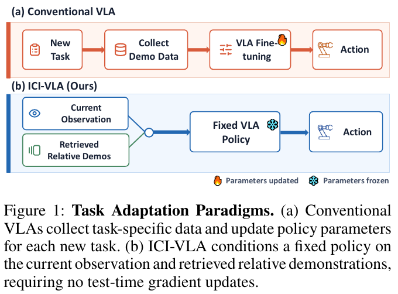
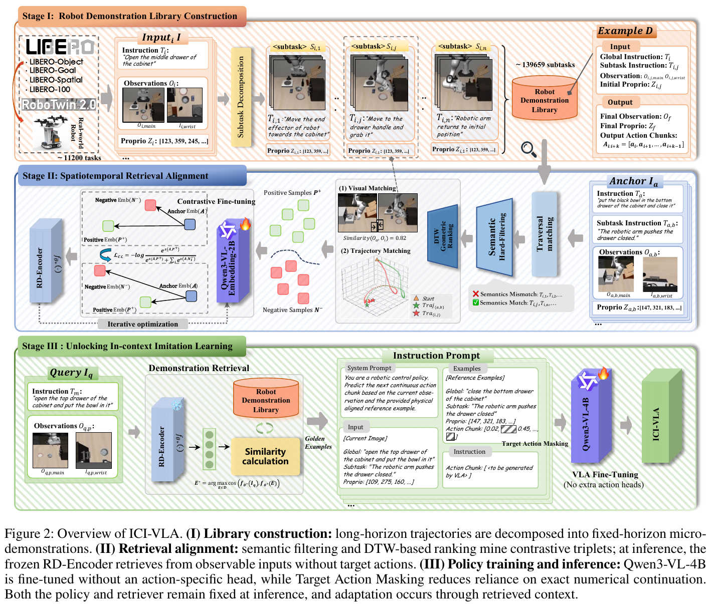

# 023 · ICI-VLA

## 基本信息

- **完整标题**：ICI-VLA: In-Context Imitation with Spatiotemporally Aligned Demonstrations for Vision-Language-Action Models。
- **作者 / 机构**：Songhua Yang、Ziyu Liu、Xuetao Li、Ruqi Xiao、Kangxin Zhu、Miao Li；Wuhan University、Institute of Technological Sciences, Wuhan University。
- **年份 / 版本**：2026；arXiv:2609.07581v1，2026-09-07，PDF 共 9 页。本笔记按预印本记录。
- **入口**：[论文 v1](https://arxiv.org/abs/2609.07581v1) · [原论文](https://arxiv.org/abs/2609.07581v1)。本次未确认公开代码或独立项目页，不将“未确认”写成作者未发布。
- **阅读日期 / 状态**：2026-10-09；已阅读全文方法、实验和限制，未复现。公开论文入库，未向 Zotero 写回。
- **主题标签**：ICL、微示范、阶段对齐、DTW、Qwen3-VL、数值动作文本、Aloha。

## 一句话理解

把长机器人轨迹切成短微示范，以语义过滤和离线轨迹 DTW 训练阶段感知检索器，再让 **Qwen3-VL-4B 直接输出数值动作文本**；推理时固定策略和检索器，默认读取三条示例。结果支持上下文对齐与目标前缀遮蔽的作用，不能把轨迹独立划分等同于所有任务语义完全未见。

## Motivation

长示范与当前短动作块不在同一时间尺度：同样是抽屉任务，开门、伸手、放物和关门需要不同局部运动。仅按视觉或文字相似检索，可能给出阶段错误的动作。策略也可能沿着输入的数值动作前缀机械续写，忽略当前真实观测。

作者想保留 VLM 原生文本接口，避免专用动作头，同时解决“检索到正确执行阶段”和“当前观测真正影响动作”两个问题。目标是部署时使用少量示范进行条件化预测，无需为当前任务更新权重。

## 方法

### 1. 文本动作策略与在线查询

策略基于 **Qwen3-VL-4B**，不新增动作专用预测头，用原有词表输出数值动作字符串，本体状态也表示为文字。策略仍需离线全参数微调，“无结构修改”不意味着没有动作训练。

高层视觉规划器先将全局任务分成有序子任务，根据观察到的完成进度选择当前子任务。查询包含全局指令、当前子任务、主相机 / 腕部图像与本体状态。策略输出未来 **25 步动作块**，转换成机器人可执行命令。

### 2. 由长轨迹构建微示范库

来源包括 LIBERO、RoboTwin 2.0 与约 **1,000 条双臂 Aloha 真机示范**，合计约 **11,200 条长轨迹**。VLM 启发式切分并标注子任务，再组织成固定 horizon 的局部示例，产生约 **139,659 个库条目**。

每条微示范包含全局指令、子任务指令、观测、初始状态和对应动作块。11,200 是轨迹规模，不是新任务或技能种类数；139,659 是可检索局部示例数。

论文区分策略训练、检索器训练、建库、验证与评估轨迹，互不重叠；但模拟任务的语义、对象、布局或语言模板可以跨轨迹划分出现。因此其所有仿真分数不能一概描述为保留全新技能。

### 3. Semantic filtering＋DTW 的离线检索监督

检索器为 **Qwen3-VL-Embedding-2B / RD-Encoder**。离线先根据语义相似度保留 **64 个候选**，再使用标注轨迹的 DTW 距离确定正样本；同一子任务但阶段不匹配的候选构成 **15 个难负样本**，用对比学习更新编码器。

DTW waypoint 为机器人基坐标中的各活动机械臂 **3D 末端位置**，按训练数据工作空间边界归一化；距离对各臂取均值。它处理的是局部运动几何与节奏，不是完整接触或动力学等价性。

迭代挖掘在正样本变化少于 **5%** 或最多 **五轮**时停止。离线可以读取查询的标注动作来监督检索器；**部署时不做依赖未知目标动作的 DTW**，冻结 RD-Encoder 从可观察查询检索已有微示范。

### 4. Target Action Masking 究竟遮蔽什么

策略训练时，将查询目标动作 token 序列的部分位置替换为 `[MASK]`。只在未遮蔽位置计算交叉熵，而这些位置的自回归条件中可能包含之前被破坏的目标动作 token。

这一目标直接减弱对 **精确查询动作前缀续写**的依赖，要求模型利用当前观测与示范。它不是把检索示范的全部动作删掉，也不是明确监督“预测动作减检索动作”的残差；本文的公式没有这样的残差目标。

遮蔽只发生在离线训练；部署正常自回归生成动作，策略和检索器参数不变。作者把它促进观测 / 上下文利用的作用作为假设，再通过性能消融检验，不能从消融直接断言内部已实现某种特定推理算法。

### 5. 配置与部署条件

训练使用 **八张 A100 80 GB**，检索器 InfoNCE 温度 0.07、batch 128；策略 AdamW、峰值学习率 2×10⁻⁵、weight decay 0.01。动作 horizon 为 25，默认检索 **三条微示范**。

当策略置信度低于 **0.65** 时刷新示范上下文。三示例、五轮挖掘、0.65 阈值在验证集选择。正文没有提供完整的端到端控制延迟结果，不能仅凭模型没有专用动作头就推断部署更快。

## 总览图与方法图

Fig. 1 比较新任务到来后的处理方式；下图策略冻结，但这之前仍进行了离线策略与检索器训练。

Fig. 2 的第二阶段用有标签轨迹构造离线监督，第三阶段将检索结果和当前查询放进数值动作生成提示。图中 DTW 不应被理解为测试时可访问未来查询动作。

两图从 v1 PDF 以 **200 dpi** 提取，保留英文图注；页码、裁剪范围及哈希见[原图记录](../assets/023-ici-vla/manifest.json)。

## 实验

### LIBERO 与 RoboTwin 2.0

论文每个模拟任务进行 **10 次不同初始状态 / 随机种子的 rollout**，再按 suite 汇总。Table 1：LIBERO 平均 **97.7%**，四个 suite 为 **98.5 / 98.7 / 98.0 / 96.8%**；RoboTwin Easy / Hard 为 **72.4 / 46.3%**，平均 **60.4%**。

表中外部方法多采用各自已发表训练和测试协议，因此相对于 OpenVLA-OFT 的 LIBERO **+1.3 个百分点**、RoboTwin **+19.3 个百分点**属于基准层面的参考差异，不是统一骨干、统一数据和统一计算预算的配对实验。

该文最接近的受控比较为 **VLA-0 with Naive ICL**：使用同样骨干、轨迹划分、优化设置与检索上下文，但关闭 Target Action Masking。此时 LIBERO / RoboTwin 只有 **71.5% / 10.7%**；说明把示范直接加入文本动作策略，并不必然带来有用适应。

### 组件消融与检索质量

Table 2 的 LIBERO / RoboTwin 平均分别为：

- 完整方法：**97.7% / 60.4%**。
- 关闭 Target Action Masking：**71.5% / 10.7%**。
- 去掉 DTW 排序：**92.5% / 31.4%**。
- 去掉语义过滤：**88.4% / 38.1%**。

这些消融说明全部组件在报告协议下都有效，但不证明遮蔽机制已经诱导了显式残差计算，也不证明每次失败都来自同一种“复制捷径”。

Fig. 5 对保留查询评估检索本身，以离线 DTW 定义的正样本为标签：基础 embedding 的 Recall@1 / @5 为 **27.8 / 52.4%**；语义过滤后 **41.6 / 67.9%**；一轮 DTW 监督后 **56.9 / 80.7%**；五轮完整模型为 **70.8 / 90.1%**。测试检索不输入查询未来动作。

检索 Recall 的“正确”由 DTW 标签定义，和闭环任务成功是不同指标；它不直接评估碰撞、抓取或接触可行性。

### 上下文规模并非越大越好

RoboTwin 验证集上，检索示例数 **1 / 2 / 3 / 5 / 10**，成功率 **50.1 / 56.5 / 60.4 / 54.8 / 45.2%**（Fig. 4）。三条是本文测试范围的最佳值，不是所有 VLA 的通用最佳值。

挖掘轮数从零轮的 **34.6%** 增至五轮 **60.4%**，再增至六 / 七轮约 **60.3 / 60.1%**。更多示范可能引入冲突或无关信息，但论文没有直接测量“注意力过载”，不能把解释当成已证实原因。

### 双臂 Aloha 真机

四项任务为单臂抓取、双臂抓取、抽屉放置、物体分类，每项 **250 次执行，共 1,000 次**（Table 3）。包含光照变化、桌面干扰、传感器噪声和接触动态变化。

作者明确称评估对象、布局、指令与轨迹和策略训练 / 检索库不重叠；但这些仍是给定操作任务族的测试，不能推导为任意新运动原语学习。

ICI-VLA 四项成功率为 **89.6 / 76.8 / 81.2 / 85.2%**，平均 **83.2%**，汇总 1,000 次试验的 95% Wilson 区间 **[80.8%,85.4%]**。π0 为 **66.4% [63.4%,69.3%]**，VLA-0 为 **63.0% [60.0%,65.9%]**。

统计区间描述报告任务 / 试验汇总的不确定性，不能直接覆盖新的机器人、场景或任务类型。本文没有人形行走、全身平衡或部署于全新具身的定量结果。

## 结论与边界

作者证明原生文本动作策略可以通过局部示范进行部署条件化，阶段与几何对齐、目标动作前缀遮蔽对报告任务有效；推理时不更新权重。

作者也指出示范覆盖、高层规划覆盖及离线训练 / 检索成本的限制。跨具身扩展是未来方向。公开实现尚未确认，复现仍需核对遮蔽配置、置信度计算、子任务切分质量及控制接口。

## 我的理解与研究启发

**以下为阅读者判断。** ICI-VLA 把 ICL 的时间尺度降到短动作块，较适合研究长任务中上下文应该随阶段如何变化。方法依赖高层子任务选择，若选择阶段错误，即使局部检索器很好也可能给出错误动作。

和 [RA-VLA](../ra-vla.html)相比，两者都用离线动作信号教检索器，但本文通过数值文本与目标前缀去依赖来连接动作，RA-VLA 通过动作专家注意力与相关 / 无关误差间隔连接。两种接口需要在统一任务划分下比较，当前分数不可直接排名。

## 后续问题 / 关联论文

- 单独扰动当前子任务标签、保持观察与库不变，能否量化高层阶段选择对成功率的影响？
- 只按位置 DTW 得到的正样本，在夹爪开合、朝向或接触不同的情形下是否仍适合执行？
- Target Action Masking 和相关 / 无关上下文对比目标能否互补？应固定其他训练设置再比较。
- [RICL](../ricl.html)、[StellaVLA](../stellavla.html)、[ReCAP](../recap.html)可用于比较原始片段、结构化计划和源具身残差。将微示范改为 [KODA](../koda.html)的一致身体接口，还需验证动态跟踪与接触。

## 来源与修订记录

- **主来源**：[arXiv v1](https://arxiv.org/abs/2609.07581v1)；§3.2–3.3，§4 / Tables 1–3 / Fig. 4–5，§5。
- **2026-10-09**：首次正式入库为 023；保存全文及两张原图，按原公式解释目标前缀遮蔽，区分轨迹独立与任务语义独立、受控消融与跨论文基准对照。[来源记录](../assets/023-ici-vla/source-record.json) · [原图记录](../assets/023-ici-vla/manifest.json)。
