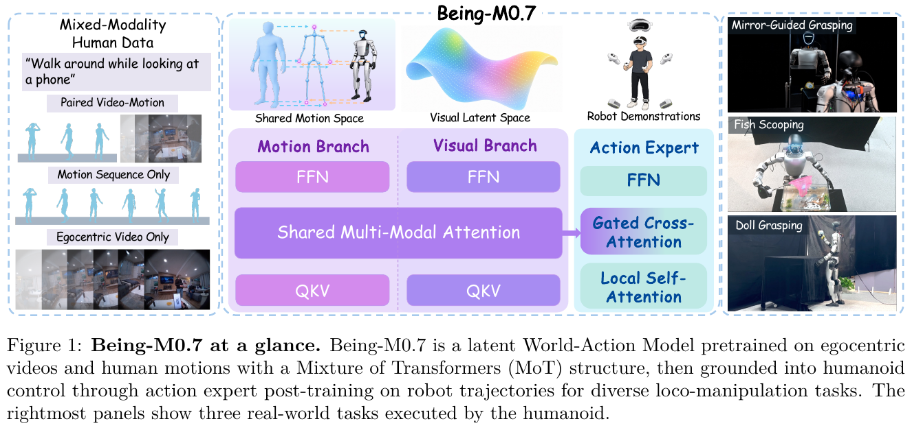
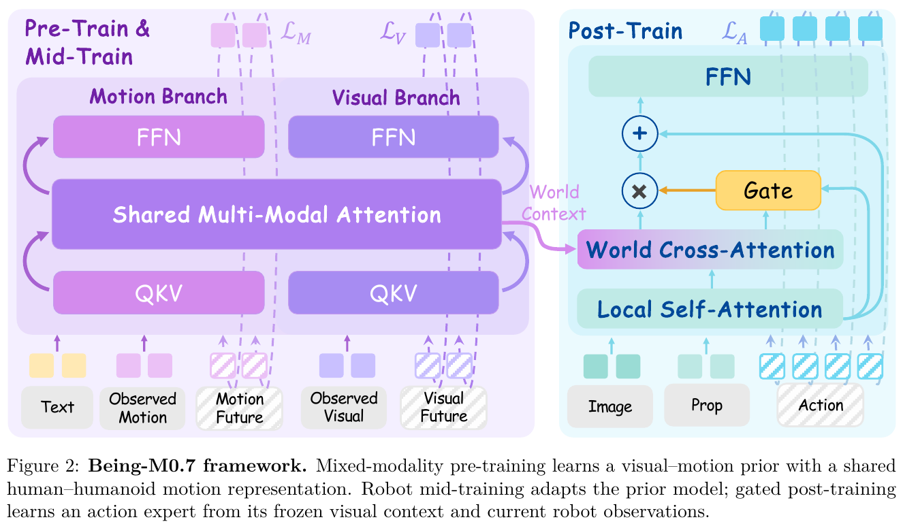
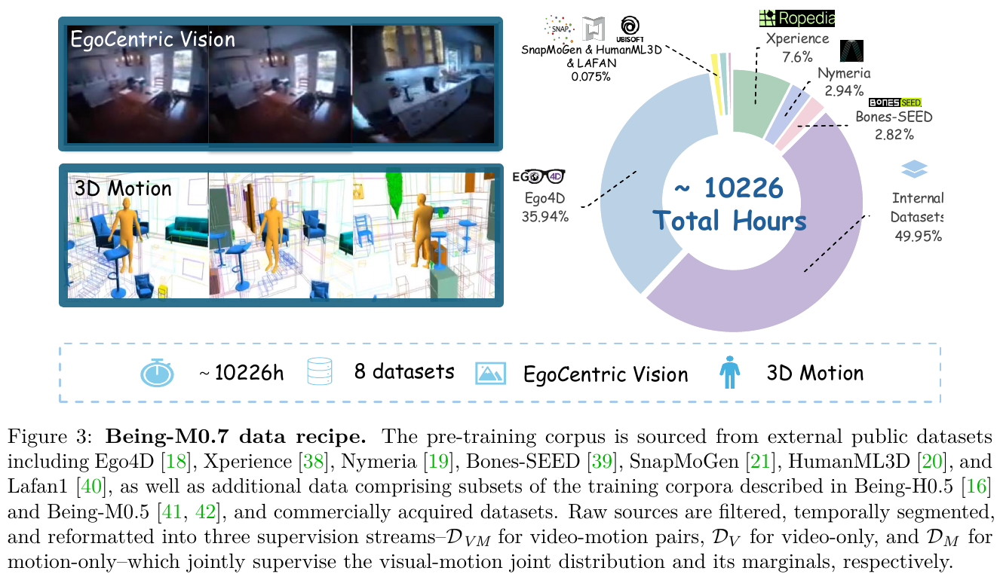
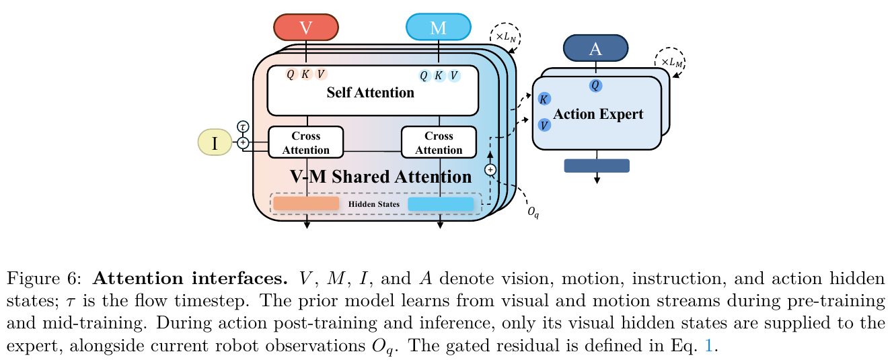

# 024 · Being-M0.7

## 基本信息

- **完整标题**：Being-M0.7: A Latent World-Action Model for Humanoid Robots。
- **作者 / 机构**：BeingBeyond Team；论文附录列 Junpeng Yue、Boyuan Li、Yuxuan Wang 为共同第一作者，Zongqing Lu 为通讯作者，其他贡献者见原文作者表。
- **年份 / 版本**：2026；arXiv:2610.11283v1，2026-10-08，PDF 共 **27 页**；按预印本记录，未复现。
- **所属类目**：Wholebody Intelligence。
- **入口**：[arXiv v1](https://arxiv.org/abs/2610.11283v1) · [10 月版原论文](https://arxiv.org/abs/2610.11283v1)。本次未确认 M0.7 专用公开代码和权重，不将“未确认”写成作者未发布。
- **阅读日期 / 状态**：2026-10-10；已阅读 10 月版正文、方法与实验附录。
- **主题标签**：latent WAM、混合模态人类数据、head-root motion、MoT、robot mid-training、gated cross-attention、SONIC、G1。

**来源约定**：本笔记只依据 **2026-10-08 的 arXiv v1**；方法、配置、实验结果及四张原图均来自该版本。图号和附录编号按本地 PDF，HTML 转换版编号存在差异。

## 一句话理解

先从视频、人体运动及两者配对的数据学习 **未来视觉—运动先验**，用机器人轨迹中训练适配该先验，再冻结它，让动作专家通过门控交叉注意力结合未来视觉特征与当前机器人观测，输出 **SONIC 控制 token＋双手开合**。新版部署时不显式生成身体运动；人体运动监督的作用是塑造可供控制使用的预测表征。

## Motivation

人形移动操作同时需要协调行走、姿态与双手，并判断未来场景怎样变化。只看当前画面不足以描述后续身体与环境的演化，而大量采集高质量机器人示范又很昂贵。

可扩展的人类数据有两层缺口。第一，很多数据只有视频或只有人体运动，若限定成对视频—运动，会丢掉大量监督。第二，人类运动不能直接当成 G1 的可执行命令；即使身体意图相似，机器人视角、形态和控制器接口也不同。

作者的假设是：**用共同的视觉—运动预测任务吸收异构人类数据，将运动学结构学进视觉未来表征，再通过机器人适配和动作监督完成落地**。预测 DINO 特征而非未来像素，可以避开像素重建目标，但论文没有给出足以量化这种选择节省多少端到端算力的受控对照。

## 方法

### 1. 数据：三种监督流共同训练一个先验

原始数据超过 **10,000 小时**，Fig. 3 标为约 **10,226 小时**。这是过滤、切段之前的来源规模，不能当成最终有效配对训练时长。来源包括 Ego4D、Xperience、Nymeria、Bones-SEED、SnapMoGen、HumanML3D、Lafan1，以及 Being-H0.5 / Being-M0.5 的部分训练数据和商业购买数据。

图中约 **49.95%** 来自内部 / 补充数据来源；这些与公开来源混合使用，不能把整套训练集描述为完全公开可复现。正文和附录未明确给出过滤后各监督流的有效时长、全部机器人示范条数或小时数。

同一网络读取三种流：

- **配对视频—运动**：学习视觉与运动未来的联合分布。
- **仅视频**：只监督未来视觉特征。
- **仅运动**：只监督身体运动及几何辅助目标。

缺失模态以占位 token 保持固定布局，但有效 token 不能注意到缺失模态，占位输出也不参与监督。不能把“混合数据”理解成每条视频都经过算法补全为运动真值。数据加载器合并并打乱有效样本，没有显式来源重加权；比例由过滤后的有效样本数决定，并非三种模态等量采样。（§3.2，Appendix A.2 / B.2）

### 2. 跨人体与机器人共享的 22D 运动表示

统一表示以 **头部为 root**，保留头部姿态、两手和两脚的位置。头部 root 便于与第一视角观测联系，但该表示本身不包含完整关节角、手指姿态或接触力。

每帧 22 个量依次为：

- 头部平移 **3D**；原始存储为逐帧位移，模型输入先累积为窗口内相对位置，再降采样到 5 Hz。
- 头部朝向 **6D** 连续旋转表示。
- 初始头高 **1D**。
- 左手、右手、左脚、右脚相对于头部的 **4×3D** 位置。

坐标系与地面对齐、以 y 轴为竖直方向，原点位于初始头部下方。局部末端位置满足 `local_e = R_head^T × (p_e − p_head)`。人体与机器人采用相同分量顺序和坐标约定，无需共享关节角参数化。

这是一种 **运动学监督接口**，并不是“把人的 22D 向量直接发给 G1”。真机最终命令来自机器人动作专家和 SONIC。人体数据有统计量时做按通道标准化；机器人中训练读取未标准化的预处理 22D 轨迹，后训练本体状态 / 动作使用机器人训练划分统计量另行标准化。（Appendix A.1）

### 3. 视觉—运动先验：MoT＋Flow Matching

冻结 **DINO** 编码第一视角图像，视觉输入与生成目标都在其特征空间；冻结 **DistilBERT** 编码任务文字。先验用 **Mixture of Transformers / MoT**：视觉与运动分别拥有投影、归一化、QKV 与前馈网络，通过共享多模态注意力交换信息，并各自读取文字条件。

训练时历史 token 保持干净，未来 token 加高斯噪声；模型预测从噪声到未来样本的 flow velocity。历史只能关注已观察历史，未来 token 可以同时关注历史及其他未来 token，因此一次去噪完整未来块，而不是逐帧自回归生成。

三种数据对应不同损失：配对样本用视觉＋运动 flow loss，视频样本只用视觉 loss，运动样本用运动 loss；运动可用时另加全局头部轨迹及局部手脚速度辅助项，预训练权重为 **0.1 / 1.0**。这些项约束预测几何误差，不提供平衡、接触或碰撞可行性的硬保证。（§3.3–3.4，Appendix A.2 / B.3）

### 4. 三阶段训练：机器人适配先于动作落地

**预训练**：在上述混合人类数据上更新视觉—运动先验，DINO 与语言编码器冻结。

**机器人中训练**：用机器人视频、任务文字与同一 22D 运动表示继续更新先验，训练目标为视觉＋运动预测；使它适应机器人相机与身体演化。中训练和动作后训练使用同一机器人轨迹数据集及同一训练 / 留出 episode 列表，不是另外证明了一种无机器人监督的迁移。

**动作后训练**：冻结中训练后的先验，仅训练动作专家及其观测 / 上下文投影。一个重要细节是，此时先验从高斯噪声 **真正采样自己的未来视觉预测**，然后提取中间层状态供动作专家使用；不是把真实未来图像编码后直接作为专家条件。动作目标依然是示范动作块，加噪并用 flow matching 学习去噪。

后训练先验用 **3 步采样**，为动作 flow timestep 选择最近的已采样先验状态；部署先验与动作专家各用 **10 步**。因此“使用自身预测”减少了条件来源差异，但训练 / 推理的采样步数仍不同。动作损失不反传至先验。（§3.4，Appendix B.2 / B.4–B.5）

### 5. 当前反馈与未来上下文如何合成动作

动作专家先用 local self-attention 合并 **当前图像、本体状态、带噪动作 token**，再在部分层以动作 token 为 query、先验未来视觉隐藏状态为 key/value 做交叉注意力。先验的已观察历史 token 不进入这一缓存；当前观测有独立输入通道。

门控由当前动作状态 x 与拟注入的未来更新 r 共同计算：`gate = sigmoid(w^T [LN(x); LN(r)] + b)`；注入量为 `gate × flow_time_scale × r`。门控按动作 token、按连接层调整未来特征的影响。它不是显式检测“未来预测是否正确”的置信度模型，也不会关闭当前图像 / 本体反馈。

信息单向流动：**先验 → 动作专家**，动作 token 不进入先验。先验和专家均为 **30 层**，宽度分别 **768 / 1024**，在第 **3、6、9、…、30** 层接入未来特征。（Appendix A.2 / B.1）

真机后训练以 **0.1 概率**对整个样本的未来上下文做 dropout，所有专家层共用同一决策，鼓励保留当前观测通路；仿真实验不使用该项。论文没有单独提供关闭门控、关闭这一 dropout 的成功率消融。（Appendix B.4）

### 6. 从动作预测到全身执行

真机策略每步输出 **66D**：**64D SONIC universal control token＋左右手各一个开合标量**。本体输入为 **63D**，包含 roll / pitch、角速度、关节位置及速度；图像用 DINO 的 patch token。手命令在示范中为二值，不能把“灵巧手硬件”理解成策略独立控制所有手指关节。执行进度计数器用于调度，但新版未把可选 progress token 输入策略。

SONIC 提供低层全身控制，论文没有以本文的高层模型重新证明任意运动 token 都稳定可行。采集时，操作者使用 PICO 头显、两个脚踝 tracker 和两个手柄，XRoboToolkit 估计 SMPL，SONIC 驱动 G1 的 29-DoF 全身运动，并同步记录第一视角、本体状态和命令。

部署的时间尺度要分清：

- 先验用 **1 个观察帧＋24 个未来帧**，预测帧间隔为 **0.2 秒 / 5 Hz**，表示 **4.8 秒**未来。5 Hz 是预测序列的采样率，不是明确报告的整模型重规划频率。
- 每次动作查询输出 **30 步**命令，以 **50 Hz** 执行，对应 **0.6 秒**；执行完整块后再查询，名义查询频率约 **1.67 Hz**。
- 多次查询复用同一未来缓存，但每次读取最新图像和本体状态。预测窗口耗尽前重新生成未来并替换缓存；论文未给出固定的精确刷新间隔或完整端到端延迟。

**新版明确关闭显式运动预测**：后训练 / 部署中运动模态 presence flag 为 false，不使用当前 22D 运动作为先验条件，不对未来运动状态做 flow 更新，只缓存未来视觉状态。共享 MoT 仍执行部分被遮蔽的运动分支计算，其输出丢弃；因此不能说部署时整个运动分支已经被物理删除。（Appendix A.2 / B.4–B.5）

平台为 **Unitree G1＋双 7-DoF 手臂＋Linker Hand O6＋头部 D435i**；策略在外部单张 **RTX 4090** 工作站推理，通过 ZMQ 与机器人闭环通信。训练三个阶段均使用八张 GPU，有效 batch 为 **2048 / 512 / 512**，学习率为 **2×10⁻⁴ / 10⁻⁴ / 10⁻⁴**；后训练使用中训练 50,000 次更新的 checkpoint。GPU 型号与完整总训练耗时未在该配置表明确给出。

## 总览图与方法图

Fig. 1 把人类数据中的身体运动监督和最终机器人命令分开；两者连接还需要机器人中训练与动作后训练。

Fig. 2 左侧在预训练 / 中训练时预测视觉和运动；右侧动作后训练读取冻结先验的视觉上下文，并保留当前图像、本体通路。

Fig. 3 的约 10,226 小时为原始来源时长；不是全部成对视频—运动、也不是过滤后有效训练时长。

Fig. 6 的视觉 / 运动联合学习发生在前两阶段；控制时提供给专家的是视觉隐藏状态。四图从 **10 月 v1 PDF** 以 **200 dpi** 渲染裁剪，保留原英文图注；没有重绘。[原图和来源记录](../assets/024-being-m07/manifest.json)。

## 实验

### 协议：训练过的多任务控制，不是新任务 ICL

仿真中，每种方法和消融变体均用 **六个 SIMPLE 任务的示范联合训练一个模型**；真机中每种方法用 **三个真机任务的示范联合训练一个模型**。测试时文字选择对应任务，论文没有评估向冻结策略输入新示范进行 ICL，也没有通过该协议证明完全未见任务零样本适应。（§4.1.3）

### SIMPLE 主对照

六任务 × 三随机化等级 × 每格十次，合计每方法 **180 次试验**。Level 0 改变桌面材质、干扰物种类与位置；Level 1 增加显著光照变化；Level 2 再增加目标初始位置变化。使用官方任务成功判定和默认 seed 设置；作者用基线各自官方实现自行训练 / 评估，所有方法在同一机器测试。（Table 1，Appendix C.1）

总体成功数为：

- **Being-M0.7：128/180，71.1%**。
- **Ψ0：116/180，64.4%**。
- **π0.5：95/180，52.8%**。
- **GR00T-N1.6：61/180，33.9%**。

Being-M0.7 六任务的 Easy / Medium / Hard 成功数，各数字分母均为十：

- BendPick：**7 / 7 / 8**，合计 **22/30**；低桌弯腰抓取并抬高。
- Handover：**9 / 9 / 10**，合计 **28/30**；双手交接并放入容器。
- Mobile P&P：**7 / 4 / 2**，合计 **13/30**；跨桌行走搬运并放置。
- Grasp：**10 / 10 / 8**，合计 **28/30**；桌面抓取并抬高。
- XMoveBendPick：**2 / 4 / 3**，合计 **9/30**；侧向移动后弯腰抓取。
- XMovePick：**10 / 10 / 8**，合计 **28/30**；侧向移动后抓取。

“总体最好”不等于逐任务领先：Ψ0 在 BendPick 为 **27/30**；π0.5 在 Mobile P&P / XMoveBendPick 为 **19/30 / 26/30**。不同难度成功数也不必单调变化；每格仅十次，不能把某一格 Hard 高于 Easy 解释成难场景本身更容易。（Table 1，Appendix C.2）

### 消融：支持训练阶段与未来上下文，但收益有任务差异

Table 2 采用相同六任务、三级随机化和每格十次：

- 完整模型：**128/180，71.1%**。
- 去掉混合人类数据预训练：**88/180，48.9%**，下降 **22.2 个百分点**。
- 去掉机器人中训练：**107/180，59.4%**，下降 **11.7 个百分点**。
- 以任务语言特征替换先验预测上下文：**105/180，58.3%**，下降 **12.8 个百分点**。此变体仍读取当前图像和本体状态，不能称为“只看语言的策略”。

未来上下文相对语言上下文在 XMovePick 为 **28/30 对 8/30**，但在 XMoveBendPick 反而为 **9/30 对 21/30**；Grasp 都为 **28/30**。作者认为视觉相似任务在联合训练时可能干扰，并提出增加容量的方向；没有实验直接证明这就是失败原因。（§4.3，Appendix C.3）

这些结果支持“人类预训练、机器人适配、预测上下文总体有用”。它们尚未分别隔离 **motion-only 数据、成对运动监督、几何辅助项和门控**的独立贡献，也未提供多训练 seed 的方差 / 置信区间。

### G1 真机：完整行走—操作，15 次 / 方法

三个任务各 **五次**，同方法合计 **十五次**。物理标记固定机器人和桌子的起始位置；物体在工作区左、中、右区域随机初始化。每次最多 **30 秒**，由人判断是否成功抓到玩偶或用网捞起玩具鱼，超时计失败。（Table 3，Appendix D.1）

- **Walk to Fish / W2F**：走到鱼缸并用手持网捞玩具鱼。Being / GR00T / Ψ0 / π0.5 分别为 **3/5、3/5、0/5、2/5**。
- **Walk to Mirror / W2M**：走到桌前，通过镜中反射定位初始不可直接看到的玩偶并抓取。分别为 **5/5、5/5、1/5、2/5**。
- **Walk to Doll / W2D**：走到桌前，抓取可直接看到的玩偶。分别为 **5/5、5/5、2/5、3/5**。

汇总 **Being-M0.7 与 GR00T-N1.6 都为 13/15，86.7%**；π0.5 为 **7/15**，Ψ0 为 **3/15**。真机结果为 **与最强基线并列**。W2F 的定量协议包含走近鱼缸与捞鱼操作的完整序列。

每项五次不足以稳定估计泛化成功率，论文没有报告跨训练 seed、置信区间、统一跌倒率、碰撞率或接触力指标。镜面任务展示间接视觉条件下的控制，但不单独证明抽象几何推理机制。该真机协议也不等于开放环境长时自主部署。

## 结论与边界

作者认为，混合人类视频与运动数据可以学到有用的视觉—运动先验，机器人中训练和门控动作专家能将其接入全身控制。报告证据支持 **六个已训练仿真任务的总体提升**及 **三个已训练 G1 真机任务上达到强基线水平**。

正文报告的局限包括任务时域较有限，长时移动操作性能仍待建立；SONIC 末端跟踪精度限制了示范采集，未来需要改善控制器。本文的几何监督和成功率没有独立证明物理世界模型准确性、任意接触可行性或“通用物理直觉”。

**机器人自由的是先验预训练阶段**。机器人中训练、动作后训练与 SONIC 控制器都参与最终系统。论文未证实跨新机器人即插即用、无机器人动作监督、新任务 ICL 或开放场景零样本通用操作。

## 我的理解与研究启发

**以下为阅读者判断。** 本文更有价值的问题是：身体运动能否作为预训练监督，让仅视觉部署的预测表征更有利于全身控制？新版显示“训练时需要的运动模态”和“部署时需要的输入模态”可以不同，但目前尚缺纯视觉预训练与视觉—运动预训练在等数据 / 等预算下的直接对照。

另一个值得研究的点是 **未来先验与当前反馈的冲突**。门控、当前观测独立通路、真机 world-context dropout 都指向这个问题；XMoveBendPick 的消融说明未来预测并非对每项任务都有效。应在相同当前状态下改变预测未来、缓存年龄或预测误差，检查策略是否真的会抑制不可靠上下文。

与 [KODA](../koda.html)对照时，可关注“一致的运动—观测—控制数据”与“预测表征＋机器人动作落地”的不同接口；与 [WholeBodyWAM](../wholebodywam.html)、[λ0 / HumanVerse-500](../human-pretraining.html)对照时，可关注身体运动监督进入哪个阶段、部署是否仍读取运动、动作损失是否更新先验。相比只比较最终成功率，这些接口差异更容易形成可检验的研究假设。

## 后续问题 / 关联论文

- 固定数据和计算预算，分别去掉 motion-only、paired motion、几何项，能否确认收益来自身体结构监督，而非更多来源 / 更大训练量？
- 固定专家与当前输入，对未来上下文加可控错误；门控是否随误差下降？关闭门控、关闭真机 dropout，任务成功和碰撞 / 跌倒指标如何变化？
- 固定缓存生成方式，比较刷新间隔与延迟，是否存在未来上下文变旧导致的接触控制问题？需要报告真实推理耗时，不用 50 Hz 命令执行率代替策略速度。
- 从单任务与多任务训练对照开始，检验 XMoveBendPick 的退化是否源于任务干扰；增加容量、改变语言区分度或改善低层跟踪分别能解决什么？
- [SONIC](../sonic.html)用于理解 64D token 到全身执行的接口；[SIMPLE](../simple.html)用于理解评估任务 / 随机化；[Workhorse](../workhorse.html)可用于比较明确运动规划接口与预测隐藏状态接口。

## 来源与修订记录

- **主来源**：[arXiv:2610.11283v1](https://arxiv.org/abs/2610.11283v1)，2026-10-08；本地 27 页 PDF。方法 §3 / Appendix A–B，实验 §4 / Tables 1–3 / Appendix C–D，局限 §5。数字与图号直接核对 PDF。
- **2026-10-10**：正式入库为 024，归入 Wholebody Intelligence；按用户要求仅采用 10 月 arXiv v1，保存该版全文和四张原图。已总结，未复现，未写回 Zotero。[来源记录](../assets/024-being-m07/source-record.json) · [原图记录](../assets/024-being-m07/manifest.json) · 本次完成记录（本地处理记录）。
