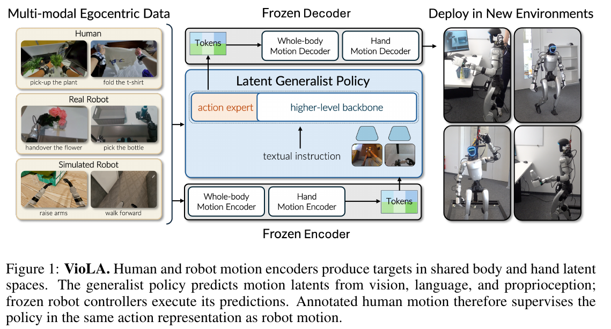
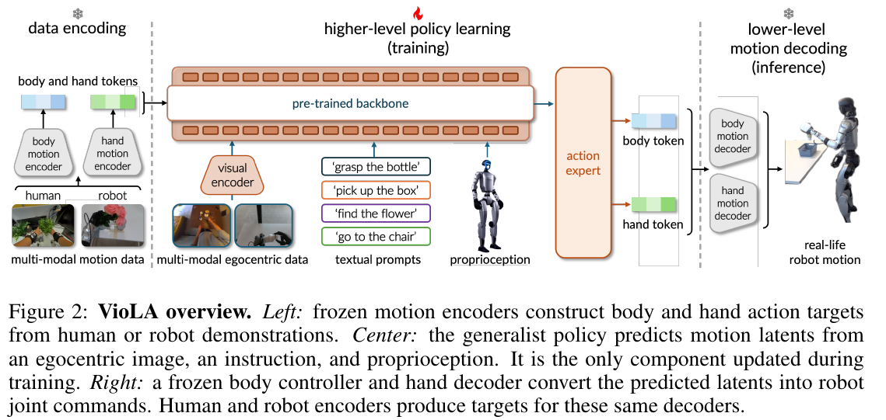
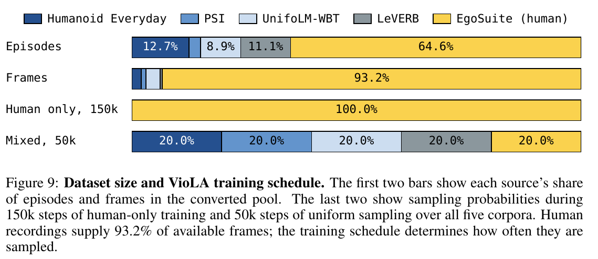
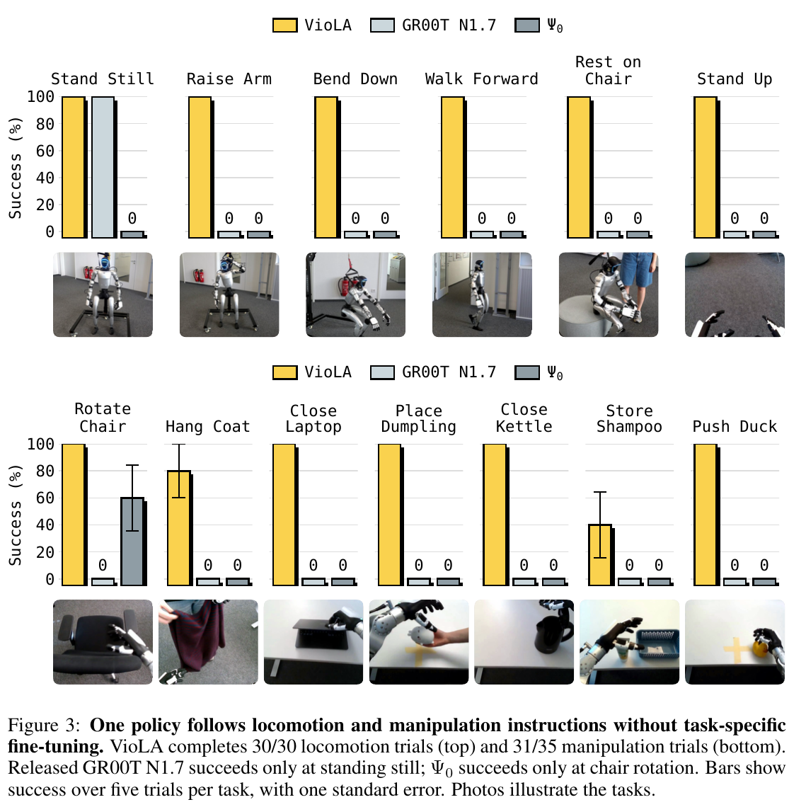

# 025 · VioLA

## 基本信息

- **完整标题**：VioLA: Learning Generalist Humanoid Control Policies from Human Data。
- **作者 / 机构**：Mert Albaba、Jens Beißwenger、Anna Manasyan 等；Vesoma、ETH Zürich、MPI-IS、University of Tübingen、ELLIS Institute。前三位为共同第一作者。
- **年份 / 版本**：2026；arXiv:2610.12435v1，2026-10-08，PDF 共 **24 页**；按预印本记录。
- **所属类目 / 主子类**：Wholebody Intelligence → **大脑模型与任务策略**；关联运动控制、数据对齐。主要贡献是通用策略的可执行动作表示和人类监督，身体控制器复用 SONIC。
- **入口**：[论文 v1](https://arxiv.org/abs/2610.12435v1) · [作者项目页](https://viola.is.tue.mpg.de/) · [原论文](https://arxiv.org/abs/2610.12435v1)。截至 2026-10-13，作者项目页仍将代码与 checkpoint 标为 coming soon。
- **阅读日期 / 状态**：2026-10-13；已阅读正文及实现、评估、失败分析附录，未复现。
- **标签**：generalist humanoid、executable motion latent、human–robot shared action space、GR00T N1.7、SONIC、hand prior、flow matching、RTC。

## 一句话理解

把**人类和机器人身体 / 双手运动编码到控制器能够执行的共享 latent 空间**，用原始第一视角图像、指令和对齐的机器人状态训练通用策略预测这些 latent，再由冻结的 SONIC 与手部解码器驱动 G1。人类动作标签与部署动作输出使用同一个接口。

## Motivation

人形机器人要同时决定“完成什么动作”和“怎样协调腿、躯干、手臂、手指且保持平衡”。直接从视觉语言预测关节命令，需要通用模型同时学习任务语义和身体协调，训练数据又受昂贵的人形遥操作限制。

人类示范更丰富，但人体运动与机器人关节命令之间缺少共同接口。逐条物理跟随采集仍需要机器人；纯运动学标签也不能自动保证执行时的平衡和关节协调。

作者的核心假设是：**已预训练的运动编码器—控制器同时提供动作先验和跨具身监督接口**。让大脑预测其共享运动 latent，可以复用底层协调能力，并把带运动标注的人类示范直接转成部署动作的监督目标。（§1–3）

## 方法

### 1. 总流程：离线生成标签，在线预测可执行运动

**数据侧**：人类 / 机器人示范 → 冻结的身体与手部编码器 → 共享身体 64D＋双手 64D latent 标签；仿真跟踪补齐人类示范的机器人本体状态。

**策略侧**：当前第一视角图像＋语言指令＋本体状态 → 预训练视觉语言骨干与 flow-matching 动作专家 → 连续运动 latent 块。

**执行侧**：身体 latent＋最新机器人状态历史 → SONIC → 29 个身体关节目标；双手 latent → Inspire 手部解码器 → 12 个手指执行关节目标。RTC 约束新旧动作块交接。通用策略训练期间，所有运动编码器和解码器冻结。（§3，Appendix A.1–A.5）

### 2. 身体与双手共享动作空间

身体模块采用 **SONIC v1.1** 的人类 / 机器人编码器与全身控制器；手部模块另行预训练，包含人类 / 机器人手部编码器以及 **Dex3 / Inspire** 硬件解码器。每个模态输出 64 个坐标，拼接为 `z_t = [z_body; z_hand] ∈ R^128`。双手合计 64D，并非每只手各 64D。

每个 64D code 是两个 32D FSQ code 的展平结果，编码器目标坐标位于 `k/16, k = −16,…,15` 的网格。动作专家仍以**连续坐标回归和采样**这些目标，不是用语言模型分类一个命名技能 ID；部署执行连续预测，不能把它写成全路径均先四舍五入为离散码。

单个 latent 代表一个短运动窗口。在 50 Hz 时间轴上，机器人身体编码器和手部编码器读取偏移 **0、5、…、45** 的十帧；人类身体编码器读取 **0、1、…、9** 的十帧。这个窗口长度与策略一次输出多少个 latent 的动作块长度是两回事。

“更容易学习”来自运动语义和预训练协调先验，不能简单解释成减少输出坐标数：128D latent 本身甚至多于 G1 的 29D 身体＋12D 手部目标。（§3.1，Appendix A.1 / A.5；最后一句为阅读者解释）

### 3. 人类数据具体怎样变成机器人策略训练样本

输入是**带身体 / 手部运动标注的示范**。人类身体编码器读取 **SMPL**；双手由标注关键点拟合 **MANO** 后编码。原始人类图像和指令保留，不把它们全替换成机器人渲染图。本文没有提出从任意原始 ego RGB 独立恢复这些运动标注的新模型。

人类记录缺少机器人本体状态，而身体 latent 又依赖执行者的当前朝向。作者因此离线进行闭环仿真：

1. 用参考人体运动与**当前仿真机器人朝向**生成身体 latent。
2. 将同一时刻的人类图像、指令、仿真机器人状态和 latent 配对。
3. 冻结 SONIC 解码 latent，推进模拟器，再用更新后的机器人朝向编码下一帧。

可写成 `z_body,t = E_body(m_t; heading(s_sim,t))`，随后 `s_sim,t+1 = Sim(s_sim,t, D_body(z_body,t, history_t))`。这样在机器人转身落后于人时，下一标签仍表示机器人尚需完成的转向；一直用示范者朝向会隐含“机器人完全跟上参考”的假设。

机器人示范的身体标签也经过上述仿真流程，但策略输入保留**记录到的真实机器人本体状态**。手部标签直接编码运动：Humanoid Everyday / UnifoLM-WBT 尽量用 commanded finger motion，PSI 因缺少命令轨迹而使用 measured motion。抓物时二者不同：手指命令可能继续闭合，但实测运动被物体阻挡。手部状态输入采用数据中保存的对应值。

最终两类样本统一为 **图像、指令、机器人状态、运动 latent 块**，共享动作专家，不向它显式提供人 / 机器人来源标签。缺少手标注的样本只监督身体损失。标签预先计算，通用策略训练过程中不再跑仿真，也不更新运动模块。（§3.2，Appendix A.1 / A.4）

这里的仿真补齐的是**状态和朝向相关动作标签**。论文没有声称它同时解决人类相机外观、机器人视角、物体接触和全部场景运动学的一致性。手部先验的预训练数据、损失和完整训练配置在本文 A.2 中披露有限。（最后两句为来源边界）

### 4. 数据规模与采样配方

Table 1 记录的是转换后、训练 / 评估划分前的可用池，统一到 **50 Hz**：

- **EgoSuite，源自 EgoStandard**：20,680 个 episode；131,010,575 帧；727.84 小时；人类身体与手部标签。
- **Humanoid Everyday**：4,064 个 episode；2,962,764 帧；16.46 小时；真实 G1，身体与手部。
- **PSI**：835 个 episode；1,431,454 帧；7.95 小时；真实 G1，身体与手部。
- **UnifoLM-WBT**：2,854 个 episode；4,454,240 帧；24.75 小时；真实 G1，身体与手部。
- **LeVERB**：3,555 个 episode；713,279 帧；3.96 小时；仿真 G1，仅身体。

合计 **31,988 个 episode、140,572,312 帧、780.96 小时**。人类占 episode 的 **64.6%**、帧数的 **93.2%**；小时数由帧数除以 50 Hz 得到，不能当成独立曝光帧数或原生采集频率的说明。

EgoSuite 原始 26,382 个 episode 中有 **5,702** 个在转换 / 过滤中移除；加载器保留 **338 个 Humanoid Everyday episode** 用于评估，还排除不足完整动作块的记录。例如 `H=50` 时 46 个 LeVERB episode 不提供训练窗口。上述总池规模不能直接当成最终有效训练集规模。

主模型先在人类数据上训练 **150k 步**，再混合训练 **50k 步**，第二阶段五个语料各以 **20%** 概率采样。batch 大小不变时，预计 **80% 的训练样本曝光**来自人类；**93.2% 是可用池的帧数比例，不是训练采样比例**。机器人单训变体四个机器人语料贯穿训练，并在 50k / 200k 检查点评估。（§4.1，Appendix A.1，Table 1 / Fig. 9）

### 5. 通用策略：以 Flow Matching 预测动作块

主实现使用 **GR00T N1.7**，保留 Cosmos-Reason2 视觉语言骨干和 flow-matching 动作专家，动作头改成每步 128D。当前本体状态为 **46D**：29 个身体关节偏移、14 个 Dex3 表示的手指位置、3 个重力坐标；输入按训练统计量标准化，state dropout 为 0.2。人类与机器人使用同一个 embodiment tag，动作目标不额外归一化。

把真实 latent 块 `Z` 与高斯噪声混合：`X_τ = (1−τ)Z + τϵ`，训练预测 `ϵ−Z`；部署从噪声向动作积分。GR00T 原实现采用相反时间方向，符号变换后等价。缺失手标注、无效帧不参与相应坐标损失。

也在 **π0.5 VLA** 和 **DiT4DiT WAM** 上测试同一运动接口。三者使用相同数据和训练预算，但并非所有配置完全相同：

- GR00T：动作块 **H=40**，46D 状态，50 Hz 下表示 0.8 秒。
- π0.5：**H=50**，110D 状态，额外含延迟一秒的手部 code，防止其参考窗口暴露未来目标；训练时该 code 以 0.5 概率清零。
- DiT4DiT：**H=50**，32D 状态；保留视频＋动作联合 flow loss，以当前和偏移 12、24、36、48 ticks 的未来图像监督视频预测。动作损失也更新视频骨干，部署未来视频特征由模型预测。

因此，这个实验比较三种**完整骨干集成方案**，其状态输入、窗口和视频目标均有差异，不足以仅把结果归因于 VLA / WAM 类别。（Appendix A.3–A.4，Table 2）

### 6. 执行与 Real-Time Chunking

身体控制器每 **20 ms / 50 Hz** 读取新的状态历史并更新关节命令，在大脑计算下一块时仍保持身体反馈。它的输入含当前身体 code 与十帧状态历史，总计 994D；仿真每个控制步执行四个 200 Hz 物理步。

手部解码器从每个 latent 重建十帧，执行取**零基第 5 帧**，再做五 tick 移动平均。G1 配五指 Inspire 手，每手六个执行关节，共 12 个目标；策略所需的 14D Dex3 状态通过编码实测 Inspire 运动、再用 Dex3 解码转换，执行输出仍走 Inspire 解码器。手部解码不接触觉 / 接触力反馈。

**RTC** 在运动 latent 空间工作：预测新块时，把推理期间已承诺执行的旧块前缀作为条件，帮助新块接续正在进行的动作。50 Hz 是底层更新率，不是大脑生成新块的频率。实测 GR00T **推理延迟 160.2±1.8 ms**，新块到达间隔 **559.9±1.8 ms**，平均约 1.79 Hz；π0.5 / DiT4DiT 延迟为 208.6 / 248.5 ms。

时间统计按 episode 等权，来自 **161 / 83 / 57** 段记录，包含额外运行；这些数量不能充当主成功率的试验数。论文未完整报告通用训练和部署计算硬件、总耗时，也没有给出所有模块预训练成本。（§3.3，Appendix A.5 / A.8，Table 3）

## 总览图与方法图

已保存并在上文 / 下文嵌入作者 **Fig. 1 总览、Fig. 2 方法框架、Fig. 3 主结果、Fig. 9 数据配方**，分别来自 v1 PDF 第 **1、4、7、19 页**。原 PDF 以 **200 dpi** 渲染裁剪，图中的完整英文图注保留；没有重绘。[原图版本、页码、裁剪范围与 SHA-256 记录](../assets/025-viola/manifest.json)。

## 实验

### 1. 协议与“zero-shot”的范围

平台为**一台 Unitree G1＋五指 Inspire 手**，作者实验室的新环境和本地物体实例。六个运动 / 姿态指令来自 LeVERB，七个主操作任务来自 Humanoid Everyday，**这些任务家族也参与训练**。具体评估 episode、实验室环境和物体实例留出；这里 zero-shot 指部署前**没有任务专用微调**，不能写成训练从未见过任务语义。

每方法每任务 **5 次**，按完整完成指令判成功；progress 可计部分完成，但只有 1 分算成功。除起立任务从坐姿开始，均从站立 idle 开始。运动任务限时 **5 秒**，弯腰为 **10 秒**；操作任务**没有固定超时**，但也评价动作是否正确结束 / 收回。误差条为 trial 标准误，样本量较小；论文未报告多训练 seed 成功率或跨机器人评估。（§4.1，Appendix A.6）

### 2. 主结果：六类运动、七类操作

**运动 / 姿态**：站立、抬臂、弯腰、向前走、坐椅子、从椅子起立，VioLA 各 **5/5**，合计 **30/30，100%**。发布版 GR00T N1.7 为 **5/30，16.7%**，仅站立成功；发布版 Ψ0 为 **0/30**。

**操作**：转椅子、关笔记本、把饺子玩具放桌上、关水壶盖、把鸭子推到桌中央，各 **5/5**；接过、折叠并返回外套 **4/5**；将洗发水放入容器 **2/5**。合计 **31/35，88.6%**。发布版 GR00T 为 **0/35**，Ψ0 为 **3/35，8.6%**，其成功均来自转椅子。

这些基线使用发布模型、不做任务适配；并不是在相同转换后数据上重新训练的“直接关节输出 vs latent 输出”受控消融。主图支持端到端系统在此部署协议下更有效，不能单独量化动作接口改变的因果收益。（§4.2–4.3；最后两句为阅读者判断）

### 3. 人类数据消融：运动有收益，操作没有一致收益

同为 GR00T 骨干、共享冻结运动模块：

- **人类→混合，200k 更新**：运动 **30/30，100%**；操作 **31/35，88.6%**。
- **仅机器人，200k 更新**：运动 **24/30，80%**；操作 **33/35，94.3%**。
- **仅人类策略训练**：运动 **12/30，40%**；弯腰 4/5、走路 3/5、坐下 2/5、起立 3/5，站立 / 抬臂各 0/5。没有同样的主操作成功率评估。

人类监督补足机器人单训的弯腰等身体行为，但主模型多失败两次操作，差异主要在洗发水抓取。不能概括为“人类数据全面优于机器人数据”。匹配更新步数也不等于匹配唯一数据量、模态曝光或计算耗时。

“仅人类”限定**本文通用策略训练的示范来源**，仍使用预训练的视觉语言骨干、SONIC 和手部模块；不是整个系统从零训练且从未使用机器人相关先验。正文 / 附录没有像两个 200k 对照那样明确标出 human-only 最终检查点步数。（§4.5，Fig. 6，Appendix A.1）

### 4. 更换骨干

每种方法仍是运动 30 次、操作 35 次，使用相同运动执行模块：

- **VioLA–GR00T**：运动 **30/30，100%**；操作 **31/35，88.6%**。
- **VioLA–π0.5**：运动 **20/30，66.7%**；操作 **16/35，45.7%**。
- **VioLA–DiT4DiT**：运动 **30/30，100%**；操作 **9/35，25.7%**。

DiT4DiT 能选出有效全身行为，但操作中的抓取时机、持物和收尾较差；π0.5 的外套四次抓后掉落。WAM 的未来预测在本协议中没有带来最强操作结果。共享控制器使差异落在高层预测及其集成，但各方法状态 / 窗口并不一致。（§4.6，Fig. 7，Table 2）

### 5. RTC 与“少量 motion token”的证据

开 / 关 RTC 的站立和抬臂各选择一段记录，取共同 **5.1 秒**窗口。最大相邻身体 latent L2 变化：站立 **0.332→0.064**，抬臂 **0.455→0.070**。它支持所选记录中块交接更平滑；不是多次试验的均值，也不是任务成功率、关节冲击或跌倒概率统计，开 / 关运行的推理时序也略有不同。（§4.7，Appendix A.9）

作者还事后按相近预测分组计数：约十秒的转椅 / 关电脑平均用 **60.4 / 82.2 个不同身体代表**和 **31.4 / 43.2 个手部代表**。分组阈值以解码姿态误差校准；机器人仍逐步执行原连续预测。这个统计描述运动表示的重复性，不意味着只推理几十次、只在这些点更新控制，或技能词表只有几十项。（§4.4，Appendix A.10）

### 6. 失败与主结果分母

主操作失败包括三次洗发水触倒、一次外套抓后掉落。另一个完整移动操作任务要求**从人手接瓶→走到桌边→直立放下**，VioLA 为 **0/5**；π0.5、DiT4DiT 和 200k 机器人单训变体也均 0/5。

该任务单列在 Appendix A.7 / Fig. 10，没有进入 Fig. 3 的七任务平均。若合并，VioLA 操作为 **31/40，77.5%**。失败阶段包括抓取与行走衔接、过早闭手、倾斜释放；不能用主图 88.6% 宣称已经可靠解决携物行走与放置。

## 结论与边界

**作者结论**：共享且可执行的身体 / 手部 latent 能连接大量人类示范与通用人形策略，冻结运动模块使高层学习任务所需动作，在此 G1 协议下获得无任务微调的运动及操作能力。

**证据支持的范围**：13 个主任务家族、1 台 G1、每任务 5 次、新实验室及物体实例；人类动作对真实机器人运动有直接监督价值，纯人类策略训练达到 40% 运动成功率，混合训练较机器人单训改善运动表现。

**主要边界**：

- 依赖已有运动标注与运动模块；原始未标注视频扩展仍需要可靠 SMPL / 手部估计。
- 没有展示完全新任务家族、跨机器人平台或广泛自然环境泛化；已有 Dex3 / Inspire 解码器不等于已验证策略跨平台零样本。
- 手部无接触力反馈，抓取 / 持物 / 放置仍是显著失败源；纯人类数据和混合训练都未证明普遍改善精细操作。
- 没有严格匹配训练的直接关节动作消融；不能把全部主图优势归因于 latent 接口。
- 运动能力受冻结模块覆盖限制；数值平滑、共享空间和仿真跟踪不构成任意 latent 的稳定性或接触安全保证。
- 代码 / 权重尚待作者发布，手部模块预训练披露有限，复现成本尚不能完整评估。（§5 与上述附录）

## 我的理解与研究启发

**阅读者判断**：VioLA 最有价值的是把一个预训练运控系统的表示提升成**可直接监督、可直接部署的公共动作接口**。身体运动数据不只用于塑造视觉特征，人类动作标签本身就训练最终动作专家；仿真还提供了与控制器执行状态相容的监督。

与笔记库已有工作的联系：

- **[SONIC](003-sonic.md)**：VioLA 大脑侧复用其身体编码器 / 控制器，再补双手 prior。需要把底层模块的覆盖与上层语义泛化分别评估。
- **[KODA](002-koda.md)**：两者都处理人类示范与机器人反馈的对齐，但 VioLA 保留原人类图像，通过闭环仿真补本体状态和动作标签；这个设计仍留下视觉具身偏差与接触差异。
- **[Being-M0.7，10 月版](024-being-m07.md)**：Being 用异构视频 / 运动训练视觉—运动先验，经机器人适配后把未来视觉特征供动作专家使用；VioLA 要求可用运动标注，将其直接编码为最终可执行 latent 标签。它们利用人体 motion 的监督位置不同，训练数据条件也不同。

对你关注的 **ego / exo 视频→motion→机器人学习**，VioLA 提供了后半段范式：运动恢复先给出可靠人体 / 双手运动，编码器再把它变成控制 latent。本文尚未验证整条链在低质量 RGB 重建运动、全局 heading 漂移或手指估计误差下的鲁棒性。

## 后续问题 / 关联论文

- 相同 GR00T、数据、训练预算和任务协议下，分别预测关节目标、几何参考运动、可执行 latent，收益究竟来自哪一层？
- 改变人类 / 机器人采样比例，能否保留运动提升，同时消除洗发水抓取退化？应在更多物体和多 seed 下检验。
- 将人体标注替换为 ego / exo RGB 估计结果后，根朝向、手部和时间同步误差如何传导到策略标签与真机表现？
- 人类图像＋仿真本体状态的组合与真实机器人相机 / 接触状态是否冲突？能否用闭环视觉重渲染或接触反馈改善？
- 手部先验在缺少 commanded motion 的来源上，怎样区分“手指停止是因为碰到物体”与“本来就不继续闭合”？
- **待选相关阅读**：MotionWAM、LeVERB、EgoVLA、EgoScale、UniT；本次仅核对 VioLA 中的引用关系，未将它们当成新的正式全文笔记。

## 来源与修订记录

- **主来源**：[arXiv:2610.12435v1 PDF](https://arxiv.org/pdf/2610.12435v1)，2026-10-08，24 页；全文、数字和原图均依据此版本。
- **作者材料**：[VioLA 项目页](https://viola.is.tue.mpg.de/)，2026-10-13 核对任务范围、human-only 定义、失败分母与代码状态。
- **方法定位**：§3；Appendix A.1 数据 / 状态构造、A.2 手部接口、A.3–A.5 骨干 / 损失 / 执行。
- **实验定位**：§4；Tables 1–3；Figs. 3、6–9；Appendix A.6–A.10 协议、额外失败、时序及 token 统计。
- **归档**：[来源与版本记录](../assets/025-viola/source-record.json) · [四张原图 manifest](../assets/025-viola/manifest.json)。PDF 与原图记录 SHA-256，便于后续版本比较。
- **2026-10-13**：首次正式总结，重点区分未做任务微调与未见任务、人类池比例与训练曝光、纯人类策略训练与模块预训练；记录 robot-only 操作更高及额外瓶子任务 0/5。没有修改旧论文笔记或 Zotero 文献。
