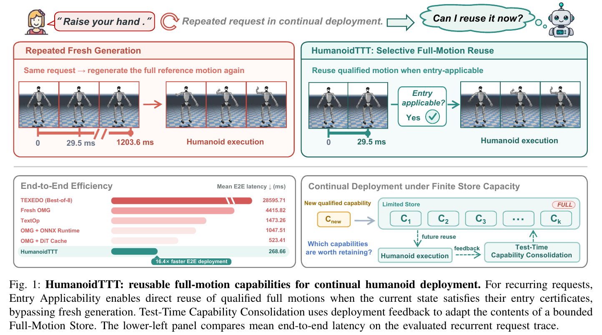
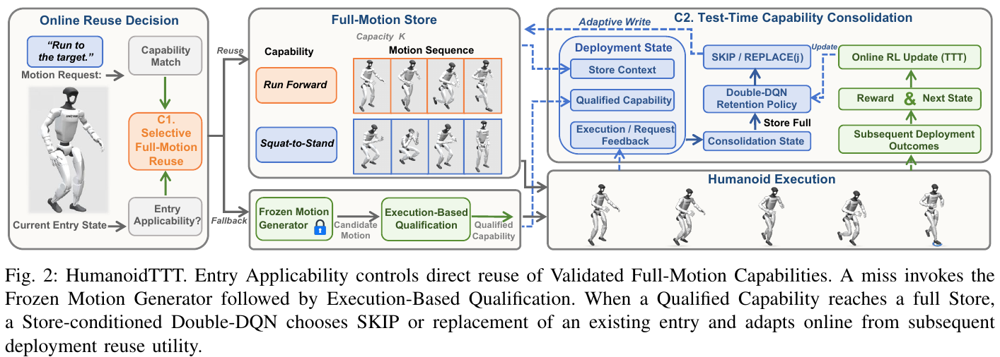
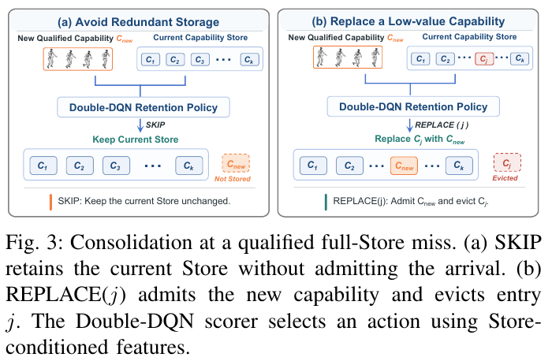
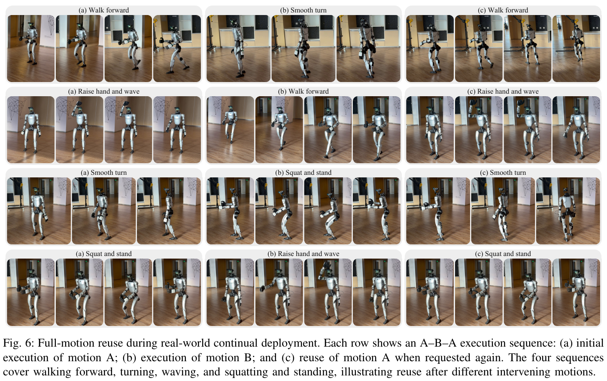

# 026 · HumanoidTTT

## 基本信息

- **完整标题**：HumanoidTTT: Test-Time Capability Reuse for Efficient Humanoid Control。
- **作者 / 机构**：Jingtai Yang、Yining Wu、Yanjun Li、Zeyu Zhang、Hao Tang；北京大学计算机学院。PDF 将前四位标为共同贡献，Zeyu Zhang 为项目负责人，Hao Tang 为通讯作者。
- **年份 / 版本**：2026；arXiv:2610.00198v1；本次 arXiv 元数据和 PDF 标注日期均为 **2026-09-18**，全文 **8 页**；按预印本记录。
- **所属类目 / 主子类**：Wholebody Intelligence → **运动控制与重定向**；关联大脑模型与任务策略。按主要贡献归到运控部署与运动能力复用：核心是参考动作的适用性判定和有限动作库管理，底层复用已有生成器 / 跟踪器。
- **入口**：[论文 v1](https://arxiv.org/abs/2610.00198v1) · [官方代码](https://github.com/AIGeeksGroup/HumanoidTTT) · [作者项目页](https://aigeeksgroup.github.io/HumanoidTTT/) · [原论文](https://arxiv.org/abs/2610.00198v1)。
- **阅读日期 / 状态**：2026-10-15；已读全文，核对官方 README、状态特征、适用性证书和在线 RL 组件；未运行作者代码或复现机器人实验。
- **标签**：full-motion reuse、entry applicability、bounded capability store、online Double-DQN、motion caching、OMG、HoloMotion、G1。

## 一句话理解

给已有 **OMG 运动生成器＋HoloMotion 跟踪器**增加一个会管理的完整动作库：同一动作再次被请求时，先检查机器人当前状态能否复用旧参考轨迹，能复用就跳过生成；库满后用在线 Double-DQN 学习保留哪些合格动作，以减少未来生成器调用。

**通俗例子**：机器人先挥手 A，再转身 B，之后又被要求挥手 A。系统检查转身后的身体状态是否仍在 A 的适用范围；满足就取出原来完整的挥手轨迹交给跟踪器。若库只容纳十个动作，新动作入库时，小网络决定跳过新动作，还是淘汰一个旧动作。

## Motivation

持续部署会反复收到相同运动请求，每次都重新运行扩散生成器存在重复计算。保存完整参考运动看似简单，但在 A–B–A 序列中，B 已经改变关节姿态、根部运动、双脚接触与控制器历史，过去执行成功的 A 未必能从当前状态安全开始。

另一方面，可执行动作会越积越多，而动作库存储容量有限。“已经执行合格”只说明它有资格留下，不能说明它在未来需求中值得占用一个槽位。

作者把问题拆成两件事：**读取时判定当前能否复用；写入时学习以后值得保留什么**。核心假设是固定执行适用性规则、用未来成功复用反馈更新保留策略，可以同时减少重复生成并应对需求变化。（§I–III）

## 方法

### 1. 系统输入、记忆内容与两个执行分支

每个请求时刻输入为 **运动请求 q、机器人状态 s、必要执行历史 H**。请求可以来自运动生成栈所支持的条件，本文复用层按精确 capability / signature 匹配处理；它没有展示任意语义相似指令之间的泛化检索。

容量为 K 的 **Full-Motion Store** 中，每个条目保存三项：动作身份 d、完整已验证 G1 参考轨迹 τ、该动作的固定适用性证书 C。缓存的是可供跟踪器执行的完整参考运动，跟踪器仍读取身体反馈计算关节命令。

- **命中且适用**：完整取回旧轨迹，直接交给执行栈，跳过新运动生成。
- **未命中或不适用**：运行冻结 OMG 生成候选轨迹，经过执行检验。失败不入库；合格后，有空位就直接 INSERT，库满再由学习的保留策略决定 SKIP 或 REPLACE。

接受复用并不意味着删除全身跟踪反馈，也不意味着直接回放旧电机控制信号。省下的是参考运动生成计算。（§III-A–C）

### 2. Selective Full-Motion Reuse：同一动作，还要适合当前状态

复用需要同时满足：**请求 / 运行配置匹配、固定物理检查通过、当前相对状态落在该动作的适用集合内**。物理检查覆盖状态有效性、稳定性、接触、穿透、关节限位与执行历史。

对候选动作 τ，构造 **45D、相对于该动作的 entry descriptor**。论文给出特征类型，官方 `entry_features.py` 进一步列出顺序：

- 29 个相对参考初始关节位置偏移。
- 上 / 下身关节速度 RMS，共 2D。
- 根部高度、roll / pitch / yaw 偏移，共 4D；根部线速度 / 角速度范数，共 2D。
- 左右脚接触状态，共 2D。
- 支撑、关节限位、滑动与穿透余量，共 4D。
- 历史步数、最近动作 RMS，共 2D。

论文 Eq. 4 的局部适用域以首次成功执行前的描述符 μ 为中心。共享逐维尺度 σ 来自独立规则开发划分的鲁棒统计，归一化半径固定为 **r=2.35**。42 个非精确维度均需满足 `|x_k−μ_k| ≤ 2.35 σ_k`；另要求**双脚接触均为 1，历史计数为 32**。

公开代码将历史计数饱和到 32，因此其含义是已有至少 32 个 tracker 步的历史，并非仅在第 32 步能够复用。这个条件允许局部状态变化，但并非从任意姿态接入任意旧动作。例如缺少足够控制历史或支撑条件不符，就应走生成回退。2.35 是乘在各特征尺度上的无量纲系数，不能直接理解为厘米或角度。

新候选在执行前记录 entry descriptor，执行满足固定成功 / 物理条件后，该描述符用于构建适用证书；证书取得后冻结。本文不会通过在线 RL 放宽这个门槛。（§III-B–C）

**证据边界**：作者称其为 certificate；论文给出基于固定规则和执行验证的适用集合及留出测试，没有给出“局部范围内所有状态必然安全”的一般动力学证明。零 unsafe accept 是所测样本结果。

### 3. Test-Time Capability Consolidation：真正更新的是保留策略

学习只在 **未命中＋新候选合格＋动作库已满**时触发。若 K=10，动作空间为 **11 个选择**：SKIP 新动作，或 REPLACE 第 1 到第 10 个旧动作。库有空位时无需小网络决策。

模型为共享评分网络 **71→128→64→1**。每个候选写入动作形成一条 71D 特征，网络输出它的 Q 值，选择评分最高者。官方实现中 K=10 时输入矩阵为 **11×71**，输出 **11 个标量**，不是人体动作、关节角或语言 token。

71D 的代码组成是：新动作描述 16D、当前库描述均值 16D、最大值 16D、准备淘汰条目的描述 16D、五个上下文量，以及 SKIP 标志 / 淘汰对象近期频率 2D。上下文使用库占用、近期请求多样性、新动作频率、动作冗余度和决策进度；近期请求队列长度为 16。（本段为官方实现补充，不是论文正文完整展开的特征表）

**这里的 TTT 有参数更新**：论文从预训练保留策略检查点开始，测试部署期间使用 Double-DQN 更新在线评分网络；生成器、跟踪器、状态表示、适用性规则和已取得证书保持固定。它学习的是让有限库更好地服务未来请求。（§III-D）

### 4. 奖励来自下一段真实可观察的复用结果

做完一次 SKIP / REPLACE 后，不能立刻知道这次选择好不好。系统统计后续请求中**执行成功的动作库复用次数 / 观察到的请求数**。到下一次“合格新候选遇到满库”时，关闭上一决策区间，将这个比例作为上一动作的奖励，再做 Double-DQN 更新。

例如替换后，接下来十个请求有七个通过动作库成功执行，那么该区间奖励为 0.7；这是说明算法的假设例子，不是论文某条实验轨迹。奖励既要求复用，也要求执行成功，不能用“检索命中”替代。

在线网络选择下一动作，目标网络评估其 Q 值；TD 目标为 `r + γ Q_target(next_state, argmax Q_online)`，采用 Huber loss 和 Adam。官方公开实现默认学习率 **3×10⁻⁵**、γ=**0.95**，目标网络每 **50 次梯度更新**同步，并在历史 transition 足够时附加经验回放；这些为代码默认值。

因此，学习反馈发生在两次满库合格 miss 之间的请求区间，并非每个机器人控制步，也不是拿整段未来请求的预知答案直接选淘汰对象。（§III-D，官方 `consolidation.py`）

### 5. 部署：高频小操作留在 CPU，生成 miss 再使用 GPU

动作库查询、适用性判定、轨迹读取、写入和小型保留网络在 **CPU FP32** 执行；Double-DQN 只在触发事件发生时调用。未命中路径才启用 GPU 生成：文字编码、运动 / 历史处理和解码走 PyTorch CUDA，扩散去噪通过 **ONNX Runtime CUDA Execution Provider**，注册 CPU fallback。

这种安排同时利用了**避免生成调用**与**优化未命中生成路径**，所以整系统加速不能只归因于神经网络缓存策略。全身执行器在真机为 **Unitree G1＋HoloMotion**。论文没有完整给出所有计时实验的 CPU / GPU 型号、控制频率、时钟同步和全部复现实验配置。（§III-E–IV-A）

### 6. 代码与论文的对应关系

截至 2026-10-15，官方 GitHub 已公开状态特征、证书、记忆与在线巩固组件，README 明确要求使用者提供生成器、HoloMotion runtime、运动档案、资格观测和执行循环。README 链接初始保留权重到 [Hugging Face](https://huggingface.co/AIGeeksGroup/HumanoidTTT)，但本次网络未能取得该权重 / 配置，不能将下载与复现状态写为已验证。

核对代码版本为 **3903b473697d8b05b4e4f6758a6a4f6aa4405e74**。代码与论文需要分层阅读：

- 正文用首次成功入口周围的单个局部集合说明证书；公开 `build_certificate()` 支持由多个“三次 replay 全成功”的入口构建**局部 cell 并集**，需应用侧提供 replay 证据与几何尺度。不能把这两种构建描述直接视为完全相同的实验流程。
- 公开保留策略当前硬性要求 **capacity=10**，并断言 11×71 的特征形状；论文 K=5 / 20 曲线的对应运行配置并未由该接口直接提供。
- 论文称保留策略从预训练检查点初始化，但正文没有完整展开预训练请求分布、更新预算和检查点选择。README 的权重入口不能替代这些训练协议。

作者项目页本次访问超时，未使用其中未取得的演示或文字补充技术结论。以上核对属于来源和复现范围记录，没有运行作者代码。

## 总览图与方法图

已保存 **Fig. 1 总览、Fig. 2 系统方法、Fig. 3 保留决策、Fig. 6 真机 A–B–A 展示**，对应 PDF 第 **1、3、4、7 页**；200 dpi 原 PDF 渲染裁剪，完整英文图注保留，没有重绘。[原图与版本记录](../assets/026-humanoidttt/manifest.json)。图像权利归作者，来源论文采用 [CC BY-NC-SA 4.0](https://creativecommons.org/licenses/by-nc-sa/4.0/) 许可。

## 实验

### 1. 先区分四套协议

- **执行质量**：共同的固定 200 请求流，比较 OMG、DiT Cache、TextOp 的 G1 适配、TEXEDO 及本文；见 Table I。
- **复用可靠性**：独立规则开发集固定尺度 / 半径 / 判定规则；在 **200 个留出 motion endpoint＋887 个 OOD 入口条件**上测试，安全结果由冻结的 **MuJoCo replay** 协议产生；每个接受 endpoint 运行三次。
- **效率**：Table III 只计确认命中路径；Table IV 另外使用预先固定、所有方法共享的 **200 请求高重复率轨迹**，并非 Table V 的保留策略请求流。
- **保留策略**：**15 条匹配的 200 请求流**，采用 identity-level 受控回放；共享初始库、合格候选账本、冻结的资格 / 适用性 / fallback 结果，只改变保留策略。统计单位为整条请求流，默认 **K=10**。

真机另展示四组连续执行序列，不能将其当成上述 15×200 次在线真机学习试验。Table I 报告共同 G1 部署协议下的物理执行质量，但正文 / 表注未像 Table II 那样清楚拆分该表全部执行的仿真 / 真机来源；不将 200 个请求统称为真机统计。（§IV-A–F）

### 2. 执行质量：总体仍会失败

Table I 的请求级物理成功率、跟踪 MPJPE、执行请求上的关节限位违反率依次为：

- **HumanoidTTT**：**83.0% / 20.94 mm / 3.08%**。
- **Fresh OMG**：**80.5% / 21.24 mm / 5.15%**。
- **OMG＋DiT Cache**：**82.0% / 20.62 mm / 5.15%**。
- **TextOp，G1 适配**：**62.0% / 23.07 mm / 26.94%**。
- **TEXEDO＋HoloMotion，N=32**：**53.0% / 43.31 mm / 15.96%**。
- **TEXEDO＋SONIC，N=32**：**58.5% / 32.46 mm / 1.59%**。

MPJPE 包含失败执行已观察到的前缀，安全终止可能早于跌倒；成功率分母为全部请求，关节违反率的分母为已执行请求。执行请求总数与多 seed 误差条没有在表内完整提供，因此不能据此作显著性或“完全安全”的判断。（Table I）

### 3. 接受可靠性：0 unsafe accept 的具体分母

某 endpoint 只有在其接受路径的 **三次 replay 全部满足固定标准**时才算安全；OOD false accept 用另外 887 条入口条件衡量。

- **HumanoidTTT**：接受 **180/200**；安全接受 **180/200**；unsafe accept **0**；OOD false accept **0/887**；接受后 replay **540/540 成功**，灾难 rollout 为 0。
- **仅 Task-ID 回放**：接受 **200/200**，unsafe accept **142**；OOD **887/887** 误接受；接受后 **249/600** 成功，灾难 rollout 为 1。
- **全局最近入口检索**：接受 **178/200**，unsafe accept **124**；OOD **274/887**；replay **232/534** 成功。
- **按动作最近入口检索**：接受 **172/200**，unsafe accept **120**；OOD **277/887**；replay **222/516** 成功。

这支持在所测入口范围内，显式适用性门控比仅匹配身份 / 最近邻可靠。180 个 endpoint 各三次形成 540 个 rollout，不能把它们写成 540 个独立新任务；零 unsafe accept 也不表示整个系统所有新生成与回退执行均成功。（Table II）

### 4. 171.4×：仅确认命中的准备延迟

Table III 的计时边界是**入口门控＋读取已存完整运动**，排除第一次获取、miss、fallback、完整巩固生命周期和物理动作执行。

- Fresh generator：P50 **5057.996 ms**，P95 **5491.174 ms**。
- Generator＋ONNX Runtime：P50 **1123.820 ms**，P95 **1235.144 ms**。
- Generator＋DiT Cache：P50 **543.084 ms**，P95 **629.073 ms**。
- HumanoidTTT 命中路径：P50 **29.514 ms**，P95 **63.115 ms**，均值 **38.409 ms**。

相对 Fresh 的 P50 加速为 **171.4×**；相对 DiT Cache 为 **18.4×**。不能把命中路径速度直接套到包含未见动作和低重复率请求的完整运行。（Table III）

### 5. 16.4×：高重复率请求流的完整推理路径

Table IV 为 FP32、从**请求到达→得到可执行 G1 参考轨迹**的端到端推理延迟；包含该协议下命中 / miss 路径，不包含机器人完成物理运动的时间：

- Fresh generator：**4415.82 ms**。
- Generator＋ONNX Runtime：**1047.51 ms**。
- Generator＋DiT Cache：**523.41 ms**。
- TextOp：**1473.26 ms**。
- TEXEDO，Best-of-8：**28595.71 ms**。
- **HumanoidTTT：268.66 ms**，相对 Fresh **16.4×**，相对 ONNX **3.90×**，相对 DiT Cache **1.95×**。

平均计算 **75.46 GFLOPs / 请求**，Fresh 为 **685.97**，DiT Cache 为 **277.44**；峰值显存 **1.595 GB**，Fresh 为 **1.529 GB**。省计算不等于消除生成器权重显存。

TEXEDO 在执行质量表使用 N=32，在此效率表使用 Best-of-8；两个数字不能拼成同一候选预算下的质量—速度点。论文没有逐项披露此高重复率流的完整频率、命中率和时延方差，跨硬件结果也未展示。（Table IV）

### 6. 在线保留策略的受控收益

K=10，15 条共享的 200 请求流。平均避免生成器调用数为：

- **LRU：97.800**，跨流 SD **22.904**。
- **LFU：110.467**，SD **21.709**。
- **One-Step Greedy：112.933**，SD **21.697**。
- **Contextual Bandit：109.867**，SD **23.130**。
- **同一预训练 RL，冻结更新：118.200**，SD **20.232**。
- **HumanoidTTT 在线更新：131.400**，SD **16.017**；平均仍调用生成器 **68.600** 次。

在线更新比相同冻结检查点每 200 请求多避免 **13.2 次**调用，即总请求数的 **6.6 个百分点**，不是“提高 13.2% 的机器人成功率”。比 LRU 多避免 **33.6 次**，比一步贪心多 **18.467 次**。

K=5 / 10 / 20 时，相对冻结策略平均多避免 **10.867 / 13.2 / 1.0** 次调用；空间充裕时管理策略的边际价值下降。Stationary Zipf、Phase Shift、Bursty Rotating 三类请求上均有正的平均在线收益；Fig. 4 使用流级 95% bootstrap CI，Table V 本身报告的是 SD。（§IV-E–F，Table V / Fig. 4）

### 7. 真机：四组 A–B–A 展示

四组分别为：**向前走→转身→向前走；挥手→向前走→挥手；转身→下蹲起立→转身；下蹲起立→挥手→下蹲起立**。它们展示在中间动作改变身体状态后，满足入口条件仍可复用完整参考运动。

这是硬件能力展示。论文没有为四组给出大量重复试验的成功率、真实任务流上的长期在线 RL 消融，或接触操作 / 新物体条件下的复用统计。（§IV-B，Fig. 6）

## 结论与边界

**作者结论**：通过状态相关的完整动作复用与部署反馈驱动的保留策略，可将验证过的运动能力积累为持久库，减少重复生成，在有限容量下适应请求需求。

**证据支持**：固定生成 / 执行栈下，所测 MuJoCo 入口测试的接受路径可靠；确认命中时准备开销低；高重复率推理流显著加速；受控 identity-level 请求回放中，在线更新优于同一冻结保留策略；G1 展示了连续动作之间的复用。

**主要边界**：

- 证书取得后固定，长期动力学变化、摩擦 / 地形变化和适用区域漂移不在当前适应范围。
- 需要请求重复、精确身份 / 配置匹配和入口适用；未见动作仍依赖原生成器，机器人基础运动能力上限也受固定生成器 / 跟踪器限制。
- 正确接入已有动作不等于广泛的动作组合、携物操作、视觉闭环任务规划或新任务 ICL。
- 每个动作的入口域有双脚支撑与历史条件，缺少对任意动态入口的泛化证明；0 unsafe accept 是有限经验测试。
- 在线巩固的主要定量证据是记录结果固定的请求回放；更长、更复杂的真机部署学习尚待评估。
- 代码已公开组件，但预训练策略协议、全部实验材料、K=5 / 20 适配与完整系统集成披露仍有限；本次没有完成端到端复现。（§V 与来源核对）

## 我的理解与研究启发

**阅读者判断**：这篇的价值是把“用过的动作”提升成**带入口适用条件的可复用完整参考轨迹**，再把动作库竞争建成有延迟反馈的学习问题。安全门控与存储效用分开，使在线保留策略的探索不直接修改接受规则。

训练模型的输入输出值得记住：**11 条 71D 写入动作特征 → 11 个 Q 值 → SKIP / 淘汰槽位**。学习信号是后续一段请求中成功复用的比例。这与让 VLA 根据视觉直接输出身体 / 手部动作的训练任务不同。

与已有笔记关联：

- **[TextOp](018-textop.md)**：TextOp 关注交互式文字生成运动；HumanoidTTT 关注已经生成、执行合格后的整段复用，可在生成器外增加一层记忆管理。
- **[SONIC](003-sonic.md)**：两者涉及参考运动与身体执行接口，HumanoidTTT 真机主栈采用 HoloMotion；不能把其结果直接当成 SONIC 上已验证的缓存学习收益。
- **[VioLA](025-viola.md)**：VioLA 学习视觉 / 语言 / 状态到运动 latent 的映射；HumanoidTTT 在线学习动作库保留。两者的动作表示、学习对象和测试协议不同。
- **ICL-VLA 类目**：这里通过部署反馈更新小网络参数，并没有向冻结 VLA 放入新示范来适应动作，因此保留在全身智能的运控部署方向。

对持续人形智能，一个值得检验的组合是：高层策略提出运动需求，可复用能力层判断已有轨迹是否适用，底层跟踪器负责执行。但接入视觉场景、物体接触和人机交互后，适用证书需要描述环境与任务状态，本文的身体入口规则还不够。

## 后续问题 / 关联论文

- 在不同重复率、全新动作比例和入口状态变化下，计入首次资格获取 / 证书构建成本后的加速转折点在哪里？
- 将 identity-level 固定回放换成真正连续物理交互后，前一次保留选择是否会改变后续身体状态和执行结果，从而改变策略收益？
- 证书如何随动力学漂移更新，并保持物理接受规则与在线学习的边界可审计？
- 在充分多的真机任务流、多随机种子和长时间运行中，是否仍能同时获得较低错误接受与更高复用率？
- 若请求只是语义近似、动作速度或幅度改变，怎样支持适配 / 拼接而不重新生成？
- **待选相关阅读**：OMG、HoloMotion、TEXEDO、TTT-VLA、RoboTTT、CacheMPC；本次仅核对它们在本文中的角色，未新增为正式全文笔记。

## 来源与修订记录

- **主论文**：[arXiv:2610.00198v1 PDF](https://arxiv.org/pdf/2610.00198v1)，8 页；正文 §III 方法、§IV 实验、§V 局限；Figs. 1–6、Tables I–V。
- **官方代码**：[GitHub](https://github.com/AIGeeksGroup/HumanoidTTT)，本次核对版本 `3903b473697d8b05b4e4f6758a6a4f6aa4405e74`；[README](https://github.com/AIGeeksGroup/HumanoidTTT/blob/3903b473697d8b05b4e4f6758a6a4f6aa4405e74/README.md)、[状态特征](https://github.com/AIGeeksGroup/HumanoidTTT/blob/3903b473697d8b05b4e4f6758a6a4f6aa4405e74/src/humanoid_ttt/entry_features.py)、[证书](https://github.com/AIGeeksGroup/HumanoidTTT/blob/3903b473697d8b05b4e4f6758a6a4f6aa4405e74/src/humanoid_ttt/certificates.py)、[在线巩固](https://github.com/AIGeeksGroup/HumanoidTTT/blob/3903b473697d8b05b4e4f6758a6a4f6aa4405e74/src/humanoid_ttt/consolidation.py)。
- **材料可达性**：官方仓库内容已读；作者项目页和 Hugging Face 本次连接超时，未据此宣称缺失内容不存在。
- **归档**：[版本与来源记录](../assets/026-humanoidttt/source-record.json) · [原图 manifest](../assets/026-humanoidttt/manifest.json)。PDF 与四张原图保存 SHA-256。
- **2026-10-15**：首次正式总结。明确在线学习对象、局部证书边界、三套不同效率 / 保留协议、仿真与真机证据及公开组件范围；已总结，未复现。
