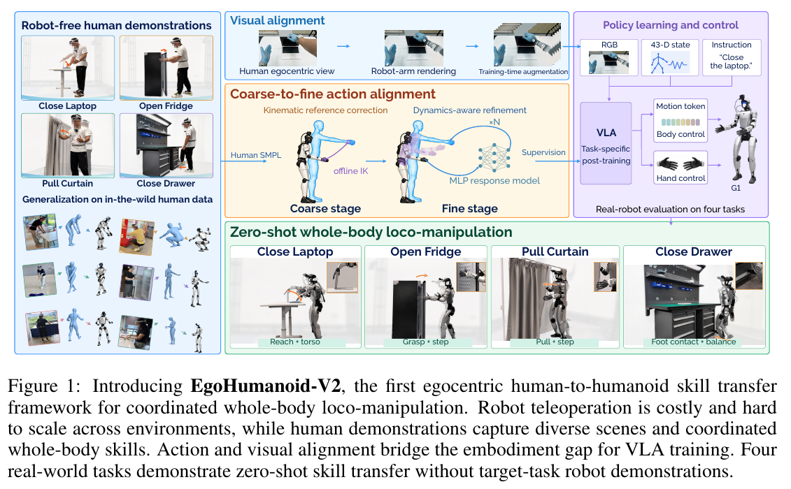
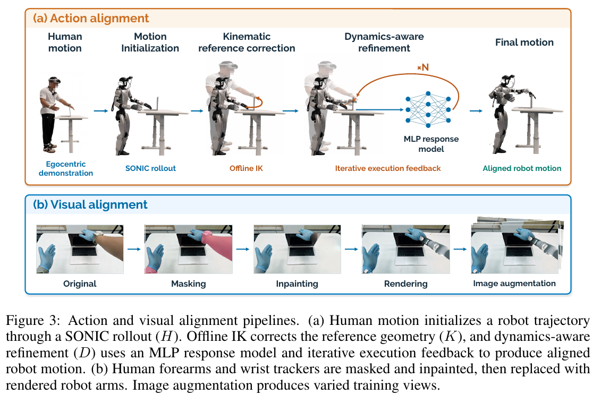
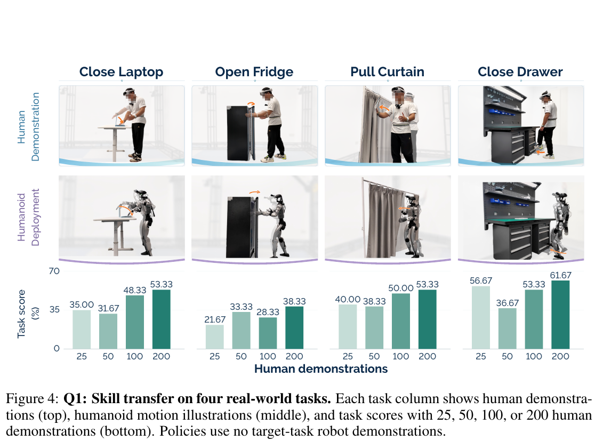
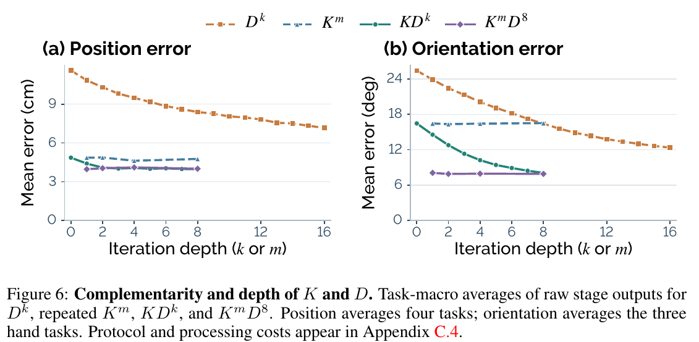

# 027 · EgoHumanoid-V2

## 基本信息

- **完整标题**：EgoHumanoid-V2: Human-to-Humanoid Transfer of Coordinated Whole-Body Skills for Loco-Manipulation。
- **作者 / 机构**：Jin Chen、Yiming Jiang、Chongyang Xu、Modi Shi、Shijia Peng、Li Chen、Tianyu Li、Mu Xu、Yilun Chen、Steven Hoi、Hongyang Li；香港大学 OpenDriveLab、阿里巴巴、上海创智学院、复旦大学、北京航空航天大学、四川大学、Archon Robotics。
- **年份 / 版本**：2026；arXiv:2609.37181v1，2026-09-29，**24 页**，按预印本记录。这是独立的 V2 论文，不覆盖第 012 篇 EgoHumanoid 的原笔记。
- **所属类目 / 主子类**：Wholebody Intelligence → **数据、基准与综述**；关联大脑模型与运动控制。主要新方法是离线动作 / 视觉对齐与训练监督构造，策略采用 π0.5，控制器复用 SONIC。
- **入口**：[论文 v1](https://arxiv.org/abs/2609.37181v1) · [作者项目页](https://opendrivelab.com/EgoHumanoid-V2/) · [官方仓库](https://github.com/OpenDriveLab/EgoHumanoid-V2) · [原论文](https://arxiv.org/abs/2609.37181v1)。
- **阅读日期 / 状态**：2026-10-21；已阅读正文、方法 / 训练 / 评分附录和补充实验，核对官方发布范围；未复现。
- **标签**：human-to-humanoid skill transfer、coarse-to-fine alignment、offline IK、execution-response model、SONIC、π0.5、robot-arm rendering、G1。

## 一句话理解

先把人类全身示范变成 SONIC 能执行的参考运动，再用**离线 IK 修正几何误差＋响应模型辅助的 token 优化修正实际执行误差**，同时把人类手臂外观替换为机器人手臂，得到图像—机器人状态—动作配对数据，为每个任务后训练一个 π0.5 策略。

**zero-shot 的限定**：目标任务有对应的人类示范，并用它们后训练任务专用 VLA；“零样本”指没有目标任务机器人示范便直接上机，不表示一个冻结通用策略从未见过任务，也不表示整个系统未使用机器人相关预训练。

## Motivation

上一代 EgoHumanoid 主要通过多场景人体数据改善移动操作泛化，但采用手臂 IK 与下肢移动 / 平衡解耦的接口，人体数据对精细操作的监督仍不足。V2 进一步希望从人类示范迁移**手、脚、躯干共同参与的交互技能**，例如一边调整身体一边拉门，或保持平衡用脚推抽屉。

难点是“人手轨迹几何上对齐”与“机器人真的按要求接触物体”之间仍有差距。直接让全身控制器跟踪人体参考，会留下末端误差；在执行时用 IK 覆写部分关节命令，又可能破坏控制器原有的身体协调。

作者的假设是：**把精度修正放到训练数据的参考动作和运动 token 上，并离线评估控制器的真实响应**，可以在保持固定全身控制器的同时改善交互精度。视觉侧则通过手臂外观替换与增强缩小具身、视角差异。（§1–3）

## 方法

### 1. 数据采集与整体路径

人佩戴 **PICO 4 Ultra＋五个 tracker**采身体 / 手部运动，用**颈部 GoPro**拍第一视角。机器人平台为 **Unitree G1＋BrainCo Revo2 双手＋头部 GoPro**，人和机器人相机尽量保持相似高度。

RGB、身体与手部信号整理为 **50 Hz** 配对序列。输入已有全身 / 手部运动捕捉，不是仅靠任意 ego RGB 视频推断全身动作。作者也说明，在没有外部同步脉冲时，PICO–GoPro 的时序一致性只能评估重复性，不能当成绝对同步误差真值。

完整训练数据流程是：**人类运动 → SONIC 仿真初始化 H → 离线运动学修正 K → 执行响应辅助细化 D → 历史候选选择与独立验证 → 对齐图像、机器人状态和动作标签 → VLA 后训练**。

控制器 rollout 同时提供机器人状态和渲染手臂所需的关节位置。通过验证的 replay 生成最终状态—动作样本。四任务共用同一 SONIC checkpoint，底层控制器不为目标任务重新训练。（§3.2，Appendix A.1 / A.4）

### 2. H：先取得有全身协调性的机器人初始轨迹

将人体 SMPL 运动通过 SONIC 在仿真中执行，保留得到的 **29D 身体关节轨迹**及运动 token，称为 H。它给后续优化提供身体协调与平衡方面的初始参考，但末端未必到得准。

手 / 脚目标来自人类记录。目标坐标以骨盆为中心，水平随骨盆 yaw 旋转，z 轴始终竖直，不随身体倾斜旋转。手掌平面位置与姿态保留，高度用初始 rollout 中逐帧人机骨盆高度差修正；目标在后续细化期间固定。

脚底中心由脚踝与脚部关键点的中点近似，用整段记录估计地面后做固定垂直修正，再执行同样的骨盆高度配准。它是足底中心代理，不是直接测量的接触点。手任务默认优化双掌位姿；Close Drawer 优化双脚位置，不设足部朝向损失。（§3.3，Appendix A.2）

### 3. K：先修正参考运动的几何误差

用受约束的**离线 IK**调整机器人参考关节轨迹，让其末端接近固定人类目标，同时限制相对于初始动作的偏离并保持时间连续。手任务的这一阶段优化手臂与腰部。

把修正后的机器人参考轨迹再送入 SONIC **机器人运动编码器**，得到新的 64D token 序列，然后实际 replay，测量仍然存在的末端误差。

举个说明性例子：几何上让手掌参考点碰到电脑盖，可以先消除人机臂长 / 姿态造成的偏差；但控制器实际执行时仍可能没有完全跟上，因此还需要 D。K 改的是参考，部署时全身关节命令仍由 SONIC 统一生成。（§3.3.1）

### 4. D：针对“实际执行还差多少”优化 token

第 k 轮先用当前 token 序列做一次完整 rollout，记录控制器状态历史，以及末端到固定目标的残差 r。局部优化期间固定这份状态上下文，比较候选 token 与原 token 通过冻结 SONIC decoder 生成的关节命令差：

`Δu(z) = D_control(z, s_k) − D_control(z_k, s_k)`。

雅可比 J 把命令变化转换为运动学末端变化，响应模型进一步预测它将带来的**实际末端执行变化**：`Δe_pred = Rψ(J Δu; 固定上下文)`。优化器调整 token，让预测变化接近当前残差，并约束动作不要偏离过大。

梯度穿过**冻结的 decoder 和响应模型**，不穿过模拟器。每轮优化完，重新 rollout 验证候选并取得下一轮状态 / 残差，再继续局部求解。

默认 **一轮 K＋八轮 D**，其中 D 为七轮常规修正和一轮保守修正，每轮 **400 次 Adam** 更新。优化对象是这条示范的 token，响应模型和 SONIC 参数保持固定。手任务对腿 / 腰 / 手臂命令改动的软惩罚权重为 **20 / 20 / 0.1**，脚任务为 **0.1 / 20 / 20**；这些不是冻结其他身体部位的硬约束。（§3.3.2，Appendix A.2）

### 5. 响应模型究竟学什么：301D 条件输入，24D 执行变化

Rψ 学的是“给关节命令一个局部改动，真实执行的末端会变多少”。训练数据来自 **BONES-SEED** 的 G1 运动：在相同仿真状态、相同控制历史下，分别 replay 原 token 与扰动 token，比较下一 policy step 的实际末端差。

- **输入干预**：双掌与双足的位置 / 旋转变化，共 **24D**。
- **时间历史**：当前干预加五条指数平滑历史，时间常数为 **0.02、0.1、0.5、2、5 秒**，合计 **144D**。
- **条件**：93D 机器人状态特征＋64D 参考 token。按附录分量拼接，总计 **301D** 输入信息。
- **输出 / 监督目标**：两次 rollout 一步后实际产生的 **24D 末端变化**，不是直接输出动作 token 或关节命令。

架构为**冻结线性响应＋MLP 残差**，MLP 两个 64 宽隐藏层、SiLU；扣除零干预历史下的 MLP 输出，保证零干预对应零响应。归一化 MSE 加权重 1 的残差平方惩罚。随机扰动占训练权重 75%，细化方向扰动占 25%。

训练集 **250 条运动、68 个采集日期、345,080 对帧—扰动样本**；验证集 **13 条运动、另外七个日期、20,420 对**。AdamW 学习率 **3×10⁻⁵**，batch 512，最多 150 epoch，选最低验证损失 checkpoint。

细化时手任务的学习响应权重为 **0.15**，与单位响应混合；脚任务使用学习的位置响应。此模型用于离线构造监督，机器人部署时由 VLA 与 SONIC 执行，无需运行上述每轮 400 步优化。（Appendix A.3）

### 6. Ds：选出有效候选，而非一律使用最后一轮

VLA 训练数据的选择会考虑初始化、K 和各轮 D 的历史候选。Appendix A.4 的验证阈值为位置误差 **5 cm**、适用时朝向 **15°**、骨盆高度下降 **0.10 m**、底座倾角 **25°**。

满足检查的候选先按最大归一化末端误差、再按平均误差排序，依次独立 replay；若后续候选更差或不通过，可以退回 H 或 H＋K；全部不通过则拒绝该 episode。接受的 replay 才生成策略训练样本。

**不要把所有 Ds 混成同一套筛选**：Table 1 的离线误差实验按 Appendix C.2，从记录历史中选择均值评分最好的候选，不执行上述独立验证 / 接受过滤。手任务评分为 `0.75×位置误差/5 cm＋0.25×朝向误差/15°`；脚任务只比较双脚平均位置误差。因此表中的离线误差，不等于最终被接受训练标签的误差统计。（Appendix A.4 / C.1–C.2）

### 7. 视觉对齐：换手臂外观，加视角鲁棒性

人类与机器人佩戴相近的蓝色手套，使用 **SAM2** 分割人类前臂与腕部 PICO tracker，**DiffuEraser** 补全背景，再按对齐关节姿态渲染 G1 手臂。渲染结果做平移、旋转、统一尺度调整，以匹配人类腕部和前臂后合成。

训练中增加随机裁剪缩放、小角度图内旋转和光度扰动，适应运动幅度 / 速度带来的视角差异。部署直接读取机器人相机图像，执行标准预处理；Close Drawer 不使用手臂渲染。

与上一代的 MoGe 视角重投影方案相比，这里重点是相近相机高度下的手臂外观适配与训练增强。生成补图与合成结果不构成精确完整场景重建，仍可能留下外观 / 遮挡误差。（§3.4，Appendix B.1；最后一句为阅读者解释）

### 8. VLA 的训练输入、输出与部署

每个任务分别从 **pi05_base** 后训练一个 π0.5，学习：

- **输入**：对齐后的人类 RGB 图像＋rollout 提供的 **43D G1 状态**＋任务文字。
- **动作目标**：**64D SONIC token＋左手 6D Revo2 命令＋右手 6D Revo2 命令＝76D / 步**，以动作序列监督。
- **部署输入**：机器人当前 RGB、真实 G1 状态、任务文字；预测 SONIC token 交给身体控制器，双手命令交给 Revo2 driver。

43D 状态来自机器人状态空间；论文未逐项列出全部分量，不根据总维度猜测其组成。数据和 rollout 的 50 Hz 也不能直接当作大脑每秒重算 50 次；动作块长度、在线重规划频率与完整端到端延迟未在本配置中明确报告。

四任务均为 **30,000 步、全局 batch 256、bfloat16**，AdamW，学习率 warmup 1,000 步到 **2.5×10⁻⁵**，再余弦降到 **2.5×10⁻⁶**。训练预算与骨干在受控比较中固定，但低层控制器 / 基础 VLA 已有预训练，不能把“没有目标任务机器人示范”说成“整个系统没用过机器人数据”。（§3.1–3.2，Appendix B.1–B.2）

## 总览图与方法图

归档并嵌入 **Fig. 1 总览、Fig. 3 动作 / 视觉方法、Fig. 4 真机分数、Fig. 6 K / D 深度实验**，分别来自 PDF 第 **1、5、6、9 页**。200 dpi 原 PDF 渲染裁剪，完整英文图注保留，没有重绘。[原图、页码、裁剪与 SHA-256 记录](../assets/027-egohumanoid-v2/manifest.json)。

## 实验

### 1. 四个真机任务和评分协议

任务分别为**关笔记本电脑、勾拉开冰箱门、拉开窗帘一米、用右脚推关抽屉**。四个任务训练四个独立策略；起始姿态和物体变化测试的是任务内执行。

每条件每任务 **20 次真机尝试**，每次有三个有序子步骤，第一次失败后停止，后续步骤为零。单次得分为 **0、1/3、2/3、1**，按步骤与试验平均后得到 task score。完整任务成功需要三个步骤全成，但论文主表没有提供完整成功次数。

因此 **51.67% 是部分完成分数，不是 51.67% 的完整任务成功率**。论文不报告误差条或多训练 seed 的置信区间，不能据小幅分数差声明统计显著。（§4.1，Appendix B.3–B.4，Table 5）

### 2. 人类示范数量与真机迁移

每个任务使用 200 条人类示范时：**关电脑 53.33%、开冰箱 38.33%、拉窗帘 53.33%、脚关抽屉 61.67%**，四任务等权平均 **51.67%**。均不使用目标任务机器人示范。

按 PDF Fig. 4，25 / 50 / 100 / 200 条人类示范的分数为：

- 关电脑：**35.00 / 31.67 / 48.33 / 53.33%**。
- 开冰箱：**21.67 / 33.33 / 28.33 / 38.33%**。
- 拉窗帘：**40.00 / 38.33 / 50.00 / 53.33%**。
- 脚关抽屉：**56.67 / 36.67 / 53.33 / 61.67%**。

25→200 的四任务均分从 **38.33%→51.67%**，但中间预算及单任务不是处处单调。各预算分数按 PDF 图中横轴逐项视觉核对，文本抽取的数字顺序不能直接当作横轴顺序。

### 3. 动作对齐收益：几何修正贡献较大，D 继续改善

Table 1 在每任务固定随机 **25 条训练轨迹**上比较仿真误差，任务 / 轨迹等权；位置覆盖双手或双足，朝向只覆盖三个手任务：

- **H**：位置 **11.21 cm**，朝向 **21.22°**；真机任务均分 **21.25%**。
- **H＋K**：**4.45 cm / 13.77°**；真机均分 **47.08%**。
- **H＋K＋Ds**：**3.41 cm / 6.71°**；真机均分 **51.67%**。

真机 K→全流程的四任务分数分别从 **46.67 / 31.67 / 51.67 / 58.33** 到 **53.33 / 38.33 / 53.33 / 61.67%**，平均增加 **4.59 个百分点**。支持动作标签质量重要，但无误差条，不能将 D 的硬件增益称为已证明显著。

Table 1 离线误差采用“历史最好候选”且不做训练数据接受过滤；VLA 训练使用验证过的历史候选，两者选择协议不同，不能将 3.41 cm 当成所有接受训练数据的误差保证。

独立的 **50 任务、112 条配对轨迹**仿真扩展中，H→H＋K→历史选择后误差为 **17.03→5.22→3.83 cm**、**36.06→21.81→10.85°**。这是数据对齐覆盖实验，不是 50 个真机任务策略已验证。（Tables 1 / 9，Appendix C）

### 4. 为什么需要 K 和 D 两阶段

报告每个指定轮次的原始输出、**不挑历史最好轮次**时：一轮 K 为 **4.86 cm / 16.46°**；八轮 K 仅 **4.77 cm / 16.51°**；一轮 K＋八轮 D 达到 **3.97 cm / 8.08°**；直接八轮 D 为 **8.40 cm / 16.40°**。

这支持“先纠正参考几何，再减少控制执行残差”。上述数字与 Table 1 的历史选择结果不同，不应混用。默认 Ds 也可能来自更早候选，不能说 D 每轮必然改善。

MLP 对比单位响应时，历史选择后的四任务平均误差由 **4.36 cm / 6.89°** 到 **3.41 cm / 6.71°**，其中抽屉脚端位置由 **9.18→5.80 cm**，手任务只改善约 **0.13–0.17 cm、0.11–0.24°**。50 任务的原始 KD8 输出仅从 **4.25 / 9.39°→4.10 cm / 9.21°**，不能把局部最大收益当成所有任务收益。（Tables 3 / 8 / 10）

### 5. 初始化、在线 IK 和稳定性证据

同样经历 K、八轮 D 与选择后，SONIC rollout / GMR / 全身 IK 初始化的位置误差为 **3.41 / 3.42 / 3.82 cm**，朝向 **6.71 / 5.32 / 6.35°**。SONIC 初始化的 extra yaw 较小，为 **7.18°**，GMR 为 11.45°，全身 IK 为 23.67°；因此不是所有误差项均由 SONIC 初始化最优。（Table 2）

在线 IK 三种关节命令组合分别在四任务各五条轨迹上测试，共 **60 次**仿真运行。作者视频检查判定全部存在不稳定；**15 次抽屉任务均在首姿态准备跌倒**。部分手任务末端误差虽较低，仍未形成稳定执行，因此没有用于 VLA 训练。

该结果仅针对文中三种 SONIC＋在线 IK 实现；不能外推为所有在线 IK 或受约束控制方案都不可用。跌倒事件计数可包含同一次运行中的重复事件，不能直接当失败试验数。（Appendix D，Tables 11–12）

### 6. 视觉适配：需对齐比较任务子集

三个手任务按同一子集重新平均，原人类 RGB 为 **27.78%**，仅手臂渲染 **38.89%**，仅增强 **42.78%**，两者合用 **48.33%**。包含脚任务时，原 RGB 的四任务均分为 **33.33%**、仅增强为 **47.50%**；不能直接拿这些四任务均分与三任务 48.33% 比较。

合用方案在开冰箱 / 拉窗帘较好，但关电脑的**仅增强 61.67%**高于合用的 53.33%，说明渲染收益依任务而变。完整系统的 51.67% 包含三个手任务的合用方案，以及不做手臂渲染的抽屉策略。（Table 4，Appendix B.4）

### 7. 人类数据与遥操作的成本 / 表现

仅在关电脑、拉窗帘两任务比较机器人数据。**200 条人体示范**均达到 53.33%；**50 条机器人示范**分别为 **63.33%、56.67%**。人体数据接近，但在这两个预算点都未超过机器人数据。

每段采集劳力计入录制、设置、标定、故障处理、场景复位；人体一名操作者，机器人两人。关电脑为 **32.10 vs 93.60 人秒**，窗帘为 **34.50 vs 188.10 人秒**；两任务均值从 140.85 到 33.30 人秒，每段减少 **76.36%**。

这是**每段的人力成本**，不包括完整离线对齐、模型训练计算和硬件财务成本，也不是“达到同等性能的总成本减少 76.36%”。论文另外给出：100 人体 vs 50 机器人关电脑，分数 **48.33 vs 63.33%**、劳力少 **31.41%**；200 人体 vs 50 机器人拉窗帘，**53.33 vs 56.67%**、劳力少 **26.63%**。（§4.3，Fig. 5）

### 8. 离线处理吞吐与发布状态

Table 8 的 K1D8 处理成本为 **1.49 秒 / 源帧**，K8D8 为 **3.38 秒 / 帧**，相应原始末端误差相近。计时包含准备、优化、replay 和复用 H / K 的已有成本，排除排队、丢弃失败尝试、后续选择和验证。

记录混合 Ryzen 9 9950X3D＋RTX 4090 工作站及 Core Ultra 9 275HX＋RTX 5090 Laptop 机器，每台并发三条 episode；未除以并发数。它反映该批处理配置，不是统一单机 latency，也不是机器人在线推理速度。

截至 2026-10-21，官方仓库核对版本为 **7f72d1c442d821e6705d4a9f234507af0b6232e4**：已提供人体采集、硬件 / 环境说明、动作对齐源码以及四任务各一条示例。README 仍将**机器人采集、视觉对齐、模型训练和策略部署流程**标为待发布；不能将其说成完整训练部署栈已开源或完整训练集已下载验证。作者“两周内发布”的文字为计划，本笔记不把它当作实际完成状态。

## 结论与边界

**作者结论**：离线粗到细动作对齐与视觉适配，可以把人体示范直接用作全身协调技能的监督，无需为目标任务采集机器人示范，即可在四个任务上部署任务专用策略。

**证据支持**：固定 SONIC 下的参考与 token 修正改善仿真末端误差；相同后训练预算下，对齐数据提高四任务真机子步骤分数；人类采集在两任务的人力 / 段较低；50 任务仿真显示对齐方法具有一定任务覆盖。

**主要边界**：每任务专用 VLA、对应目标任务人体示范、有限真机场景；没有评估单策略未见任务泛化；51.67% 是部分完成评分；仿真历史选择与接受过滤不同；D 硬件收益无误差条；动作仍会不稳定，数据处理较慢，原始采集到拒绝 / 保留的完整比例与全成本未充分报告；视觉合成和仿真到真实接触仍有差距。

## 我的理解与研究启发

**阅读者判断**：关键不是只把人体姿态重定向到机器人，而是把**参考误差、控制器执行误差和视觉具身误差**分别处理，最后给 VLA 提供与固定控制器更一致的训练监督。较大分数收益来自 K；D 在仿真精度上有明确收益，其对端到端真机成功的稳定贡献仍需更大样本验证。

- **[EgoHumanoid，012](012-egohumanoid.md)**：原作通过解耦高层动作和人体 / 机器人共训练，重点验证场景迁移；V2 转向连续全身运动 token，用离线控制器感知对齐支持人体技能直接监督。两个版本的数据、任务、分数不同，不能直接比较数值高低。
- **[KODA](002-koda.md)**：两者都把人类示范转成机器人状态—动作配对数据；V2 特别强调先修正参考几何，再借助执行响应模型优化 token，而视觉侧使用手臂替换和增强。
- **[VioLA](025-viola.md)**：VioLA 以共享身体 / 双手 latent 监督通用策略；V2 的最终动作是 **64D 身体 token＋12D 直接手命令**，并为每任务训练策略。人体 motion 进入最终动作监督的方式不同。
- **[SONIC](003-sonic.md)**：本文把固定控制器视为可重放、可求 decoder 梯度的执行模块；最终适配效果仍取决于其跟踪覆盖与仿真到真机一致性。

对于 ego / exo 数据到机器人学习，V2 给出的是**已有人体运动捕捉之后**的高质量监督构造流程；把 PICO 轨迹替换为视频估计结果后，根姿态、手脚定位和时间同步误差会如何传播，本文尚未验证。

## 后续问题 / 关联论文

- 在相同训练轨迹集合、多随机种子和更多真机试验下，D 相对 K 的 4.59 个百分点收益是否稳定？能否同时报告完整任务成功率？
- 原始采集、失败尝试、拒绝 episode、全部 rollout / 选择 / 验证和计算资源计入后，每个有效训练样本的全成本是多少？
- 用单目 ego / exo 估计替代运动捕捉时，响应细化能纠正哪些观测误差，哪些会被错误固定为目标？
- 引入实际接触观测或少量非目标任务真机执行反馈，能否改善响应模型的 sim-to-real 泛化？
- 能否共享一个多任务策略，并严格留出任务、物体与场景，而不只依赖每个任务自己的示范？
- **待选关联工作**：GMR、HuMI、BifrostUMI、RoVi-Aug；本次仅核对本文引用及角色，未另行新增正式全文总结。

## 来源与修订记录

- **主来源**：[arXiv:2609.37181v1 PDF](https://arxiv.org/pdf/2609.37181v1)，2026-09-29，24 页；方法 §3 / Appendix A；训练与评分 Appendix B；对齐与成本 Appendix C；在线 IK 诊断 Appendix D。
- **作者材料**：[项目页](https://opendrivelab.com/EgoHumanoid-V2/) · [固定版本 README](https://github.com/OpenDriveLab/EgoHumanoid-V2/blob/7f72d1c442d821e6705d4a9f234507af0b6232e4/README.md)，2026-10-21 核对；分数按原 PDF 图表读取。
- **归档**：[来源与版本记录](../assets/027-egohumanoid-v2/source-record.json) · [四张原图 manifest](../assets/027-egohumanoid-v2/manifest.json)。原论文和图片保存 SHA-256。
- **2026-10-21**：首次正式总结，独立于原 EgoHumanoid；区分任务专用后训练、无目标机器人示范、部分完成评分、历史选择 / 验证、视觉子集均值和每段采集 / 全处理成本；未复现。
