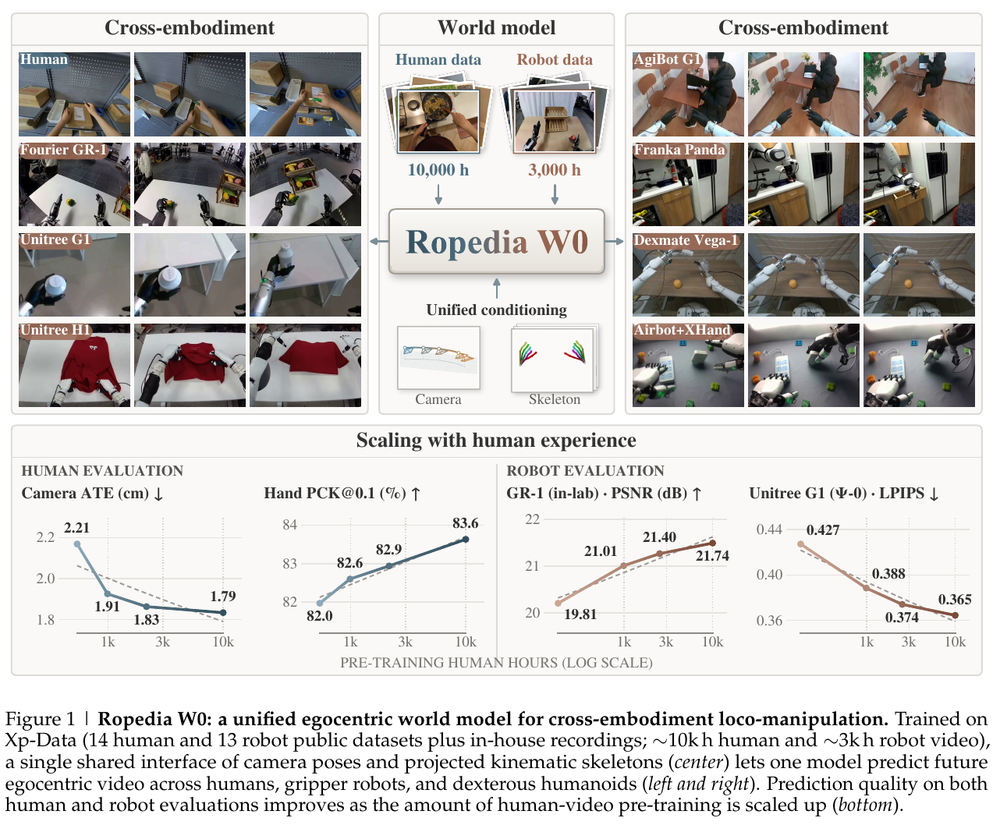
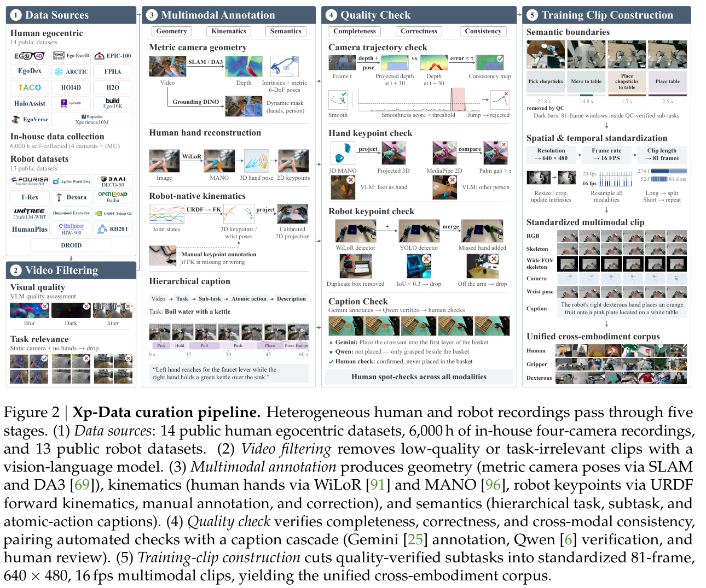
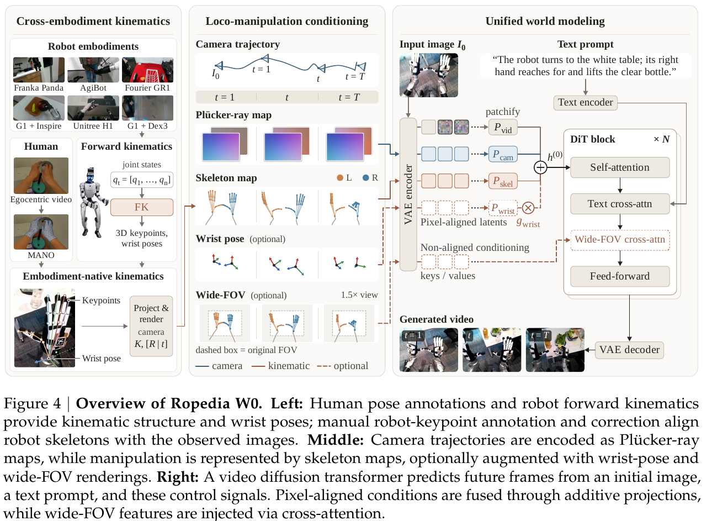
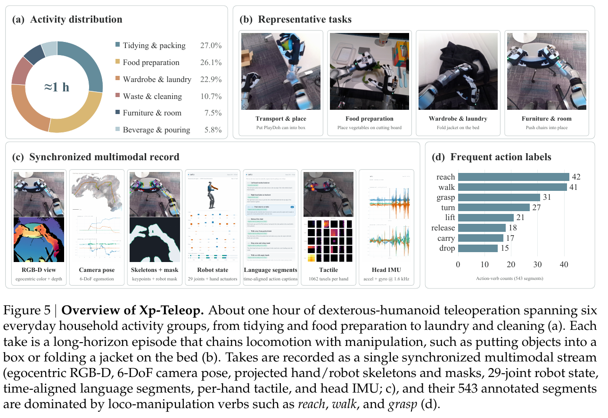
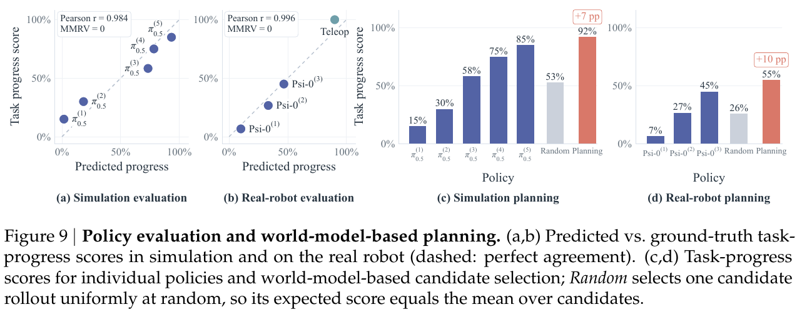

# 028 · Ropedia W0

## 基本信息

- **完整标题**：Ropedia W0: Scaling Loco-Manipulation World Models across Embodiments with Human Experience。
- **作者 / 机构**：Tianqi Liu、Hanfei Zhao、Qifeng Liang 等，Ziwei Liu；南洋理工大学、Ropedia、杜克大学、加州大学圣迭戈分校、清华大学。
- **版本 / 状态**：arXiv:2610.26855v1，2026-10-19；预印本。本笔记固定该版本，未复现。
- **来源**：[论文 v1](https://arxiv.org/abs/2610.26855v1) · [项目主页](https://ropedia.github.io/ropedia-w0/) · [官方代码](https://github.com/Ropedia/ropedia-w0) · [模型权重](https://huggingface.co/ropedia-ai/Ropedia-W0) · [Xp-Teleop 数据](https://huggingface.co/datasets/ropedia-ai/Xp-Teleop) · [原论文](https://arxiv.org/abs/2610.26855v1)。
- **阅读日期**：2026-10-22。
- **类目 / 主子类**：Wholebody Intelligence → 大脑模型与任务策略；关联数据、基准与综述。
- **归类依据**：主要贡献是跨具身、动作条件化的视频世界模型，能供规划与动作模型初始化使用；Xp-Data 和 Xp-Teleop 是重要支撑。这里归大脑侧世界模型，不把它等同于直接输出关节动作的 VLA。
- **标签**：world model、egocentric video、loco-manipulation、Xp-Data、Xp-Teleop、camera trajectory、projected skeleton、Wan2.2、flow matching、cross-embodiment、distillation。

## 一句话理解

**用约一万小时人类第一视角视频先学习“身体这样移动、手这样操作，眼前会发生什么”，再混合机器人数据适应不同机身；用相机轨迹与投影骨架作为共同接口，预测未来第一视角视频。**

核心映射是：**首帧图像＋文字＋未来相机 / 手部运动 → 未来 RGB 视频**。未来运动是模型的条件，主模型输出是视频；论文另行验证它如何帮助挑动作、评策略和训练 WAM。

## Motivation

1. **移动和操作需要一起预测。** 固定桌面机械臂的视频模型较少面对持续走动引起的视点变化，以及灵巧手与物体的细致交互。人形机器人走向桌子再拿杯子时，背景、手和物体同时变化，只生成“看起来像操作”的画面还不够。
2. **原始动作空间不通用。** 人手、平行夹爪和不同灵巧手的关节数量、语义不同，直接把各机器人的关节命令接入同一模型需要专门接口。作者希望使用共享的视觉几何格式，同时保留不同机身的原生结构。
3. **人类数据多，但几何监督不足。** 现有第一视角视频经常缺少米制相机轨迹、可靠手姿和统一描述，机器人标定 / 骨架投影也未必准确。仅汇总视频不等于得到了可训练的动作条件数据。

核心假设是：**人和机器人共享“视点怎样变化、操作者怎样接触场景”的视觉规律；将运动转成图像对齐的明确条件，可以让大规模人类经验迁移到机器人世界预测。**（§1、§3–4）

## 方法

### 1. Xp-Data：重新标注与质检后的训练池

论文报告约 **10,000 小时人类数据＋3,000 小时机器人数据**。人类部分结合 **14 个公开数据集**与四鱼眼相机装置自采的 **6,000 多小时多视角视频**；机器人部分来自 **13 个公开数据集**，覆盖平行夹爪与灵巧手。这里是视频训练时长，不将其另换算成独立演示数或机器人遥操作时长。

每段统一为同步的 **RGB、相机内外参 / 米制轨迹、操作者骨架和文字**；部分样本再带腕部姿态、宽视场骨架。处理分五步：

- **筛选视频**：VLM 排除严重模糊、曝光 / 光照问题、剧烈抖动，以及既没有相机运动也没有可见手的片段。
- **补几何**：优先使用已有标定，否则通过自研 SLAM 或 DA3 估计；相机一致性检查中排除人、手等动态区域。
- **补运动**：人手用 WiLoR 重建 MANO 后投影；机器人有可靠状态 / 标定时用 URDF 正向运动学初始化，再大量人工标关键点或纠正投影。不能理解为机器人 FK 自动生成了全部准确监督。
- **补语义与质检**：任务、子任务、原子动作三级描述；Gemini 生成、Qwen 验证，分歧交人工。用独立关键点检测器、重投影与时序检查交叉核验。
- **构造窗口**：论文流程图使用 **81 帧、640×480、16 fps** 的标准片段；窗口文字从关键帧描述合并而成。公开推理说明另对人类 / 机器人视频使用 16 / 30 的输出 fps 设置，不能把它们当作控制频率。

Xp-Data 是经过统一处理的训练池；**不等于公开数据集的原样拼接，也不等于完整 13,000 小时已经提供下载**。截至阅读日明确的独立数据发布入口是 Xp-Teleop。（§3、Fig. 2、官方 README）

### 2. 共同动作接口：相机管视点，骨架管操作

**相机轨迹表示移动。** 每帧相机位姿以第一帧为参考，平移采用米制。模型把它转换成每个像素的 **六通道 Plücker 射线图**：三维射线方向，加相机位置与方向的叉积。直观上，它告诉模型“这一帧从哪里、朝哪个方向看世界”，因此走近、转身、俯身等视点变化有明确条件。

**投影骨架表示操作。** 人类使用手部关键点；机器人使用本机身的 FK、关键点标注和修正。把关键点按各自的连接关系画进当前相机视图，保留夹爪开合、手指构型等结构。不同机身共用的是**骨架渲染这种格式**，不是强行共用完全相同的关节向量或骨架拓扑。

这两路是互补的：相机变化决定场景如何移动，骨架变化决定手 / 夹爪如何运动。需要时增加腕部姿态图和 **1.5 倍视场骨架**，补充画面外的手臂状态。相机姿态是视点运动的代理，不能据此声称模型输出了腿部关节轨迹、足地接触或完整全身运动。（§4.1、Appendix B.3）

### 3. 模型训练时的输入、监督和输出

**一个训练样本**包括原始视频、其首帧、文字、整段相机轨迹及骨架。目标是重建同一段后续真实视频，不需要“应该执行哪个机器人关节动作”作为主模型输出标签。

训练过程为：

1. 视频 VAE 将视频编码成时空 latent；**第一个时间 latent 保持干净，作为已知视觉上下文**。
2. 只给未来 latent 加噪，通过 latent flow matching 学习从噪声恢复未来视频所需的流场；损失只作用在未来 latent。
3. 相机射线图、骨架图编码后在时空上对齐，分别投影后与带噪视频 token **相加**；新增投影零初始化，起步时保留预训练视频模型行为。
4. 文字通过 cross-attention 输入。腕部图采用带可用性门控的相加分支；宽视场图与目标画面不逐像素对应，因此用另一条 cross-attention 分支。缺少相应标注时关闭可选分支。

因此，**训练网络即时预测的是去噪流场，完整生成流程输出未来 RGB**；相机与骨架是给定条件。推理时从未来噪声开始迭代生成，不输入后续真实 RGB。官方示例目录虽然保存整段 RGB，README 明确只有首帧被当作视觉条件，其余帧用于参考对比。

有两个规模：**Wan2.2-TI2V-5B 密集模型**，以及 **Wan2.2-I2V-A14B**。后者约 27B 总参数，由高噪 / 低噪两个专家组成，每次去噪激活约 14B；不是 14B 总参数的普通密集网络。（§4.2、Appendix B.1、官方 README）

### 4. 训练顺序：人类预训练 → 人机混合 → 可选目标域后训练

- **人类预训练**：从人类第一视角视频学习给定相机和手部运动后的视觉变化。
- **人机中训练**：继续学习机器人外观、运动几何和交互；按 **人类 / 机器人各 50% 的概率**采样，同时接入有标注的腕姿和宽视场条件。这个采样比例与 10k / 3k 的数据时长比例不同。
- **可选后训练**：在指定机器人数据集上适应，评估无后训练、few-shot 和 full-data。预训练 / 中训练始终采用同一种条件接口。

论文没有提供足以独立重建完整训练预算的统一学习率、batch、优化器与全部阶段步数。本笔记不补造这些配置。所谓 **zero-shot 指没有使用目标评估数据集训练**；中训练可能已在其他数据集中见过同一机身，不等于完全未见机器人或未见具身。（§4.3、§6.1）

### 5. 用一个拿杯子的例子理解推理

给模型一张 G1 面向桌子的照片，输入“走到桌边，拿起杯子”，再给出一个候选方案：相机未来向前移动多少、双手骨架每帧处于哪里。模型生成执行这个方案后，机器人眼前可能出现的视频。

**单独一句文字还不能替代未来动作条件。** 相机 / 骨架序列可以来自录制、遥操作或外部策略提出的候选动作；模型本身不负责从这句话自动产生整套可执行关节命令，也不要求先把人手运动重定向成某个固定机器人身体来训练视频预测。

若要挑选更好的行动，再让外部策略提出多个方案，Ropedia W0 分别预测，外部价值模型评分，选一个在真实环境执行。若要直接学输出动作的模型，论文用 Ropedia W0 初始化 **FastWAM 的视频骨干**，保留 FastWAM 的动作头及训练方式。这是另一个下游模型。（§6.4）

### 6. 蒸馏：让预测视频可以流式交互

先通过 Causal Forcing 得到 **4 步块因果自回归生成器**，再用非对称分布匹配蒸馏：冻结的双向教师与在线训练的 fake-score 模型共同指导学生；最后用 LongLive 的局部注意力窗口、attention sink 和有界 KV cache 延长视频。

报告 5B 学生在单 GPU、640×480 下达到 **21.3 fps**，50 步教师约 3 fps，端到端约 **7 倍**。125 帧约 2 秒生成，计入 VAE 解码约 6 秒，首块约 **1.4 秒**。这说明生成吞吐能跟上视频播放，**不表示 47 ms 的控制响应或高频机器人闭环**；该吞吐段未明确 GPU 型号。

公开 5B 推理 README 默认仍为 **50 步**，所列权重为 pretrain / midtrain，不能把论文蒸馏学生速度直接当作当前公开示例的运行速度。（§4.4、Appendix B.2、官方 README）

## Xp-Teleop：采集了什么、公开了什么

**采集平台**：G1 29 自由度机身、两只各 6 自由度的 Inspire 手、头部 Azure Kinect DK。附录称手型号为 RH56DFX，发布数据卡称 Inspire FTP，本笔记保留来源差异。G1 无主动颈关节，相机随腰部和底盘移动。

两位操作者同时工作：一位用 Quest 3 手部跟踪，经双臂 IK 与手部重定向控制操作；另一位用 R3 遥控器给底盘速度。所有信号共用时间基准，并利用标定与 FK 构造相机 / 骨架条件。

数据约 **1 小时、27 条长轨迹、543 个原子动作片段、30 类技能**；每条含 8–42 个片段，中位数 18，覆盖六类家务活动。保留失败抓取及恢复，以检查模型是否也能预测偏离正常执行的结果。它主要是**世界预测评测集**，不是大规模全身策略训练集。

截至 2026-10-22 的公开数据卡提供 **96,064 帧、30 fps、1280×720**，包括无标注覆盖的 RGB 视频、骨架覆盖视频、2D / 3D 关键点、相机位姿、关节数组、时间戳、机器人 mask、约 1.6 kHz 头部 IMU、每手 1,062 taxel 触觉和文字，许可证 CC BY 4.0。

**论文描述的采集模态与下载包必须区分**：数据卡明确说明原始 JPEG 和 depth 文件不在包内，时间戳保留的 depth_path 不能当成深度帧已公开。表 1 对模态的比较是论文分析口径，不能替代对当前下载文件的核查。（§5、Appendix A.2、公开数据卡）

## 总览图与方法图

保存作者 **Fig. 1 总览、Fig. 2 数据流程、Fig. 4 模型方法、Fig. 5 Xp-Teleop、Fig. 9 策略评估与规划结果**。分别来自 PDF 第 **1 / 5 / 8 / 11 / 17 页**。原 PDF 200 dpi 渲染裁剪，保留完整英文图注；页码、裁剪区域与 SHA-256 记录在[原图清单](../assets/028-ropedia-w0/manifest.json)，没有重绘。

## 实验

### 1. 主实验测的是预测，不是动作执行成功率

五组机器人评测包括：

- **DreamDojo / GR-1**：In-lab 100、EgoDex 65、DreamDojo-HV 68 个片段；目标数据后训练预算为 1%、10%、100%。
- **Ψ0**：100 个窗口，训练已见任务 / 留出任务各 50。
- **ω-HOME**：100 个窗口，24 类任务，已见 / 五个留出任务各 50。
- **Xp-Teleop**：100 个窗口，训练场景中的留出录制 / 新场景各 50。
- **AgiBot**：50 个留出夹爪窗口；所有比较模型都训练过 AgiBot 数据，属于分布内留出评测。

另用 **EgoSuite / OpenAoE 各 100，共 200 段人类视频**做未见数据集评测。主指标 PSNR / SSIM 越高、LPIPS 越低越好；有运动时增加相机轨迹误差和手关键点跟随。

人类协议固定 81 帧、640×480、16 fps、seed 0；相机误差由生成视频再经 DA3 估计，不是传感器真值。ATE 做 SE(3) 对齐但不拟合尺度。PCK 阈值是图像对角线的 10%，漏检计失败；PCKm 只计匹配成功的手，必须同时看检测率。验证集选 checkpoint，不在测试集选。（§6.1、Appendix C.1）

### 2. 预测结果：迁移强，但不同规模 / 阶段并非所有指标都最优

人类 200 段评测，**A14B 人类预训练**达到 **ATE 1.542 cm、PSNR 19.77 dB、LPIPS 0.2381**；Cosmos3-Nano 为 **1.931 cm、18.66 dB、0.2753**。5B 预训练的手 PCK 为 **83.63%**，Nano 为 78.94%。

人机中训练主要帮助机器人，不是所有人类指标都改善：A14B 中训练后 ATE 为 **1.750 cm**、PSNR 为 **19.34 dB**，略差于它自己的预训练版本。5B 的部分 FVD 也未超过所有基线，不将摘要里的领先概括为每个版本、每个指标都第一。（Table 2）

机器人 **A14B midtrain** 在无后训练 / few-shot / full-data 下的 PSNR 分别为：

- Ψ0：**17.36 / 18.28 / 19.07 dB**。
- ω-HOME：**19.55 / 20.71 / 21.77 dB**。
- Xp-Teleop：**16.42 / 18.25 / 18.74 dB**。

作参照，Cosmos3-Nano full-data 为 **16.55 / 18.84 / 14.98 dB**。因此这个 A14B 无目标域后训练版本，已超过该基线全量适应后的预测质量；这不是“零示范控制成功率更高”。（Table 4）

DreamDojo 的 **1% GR-1 后训练预算**下，In-lab PSNR：DreamDojo 14B **18.983**，Ropedia 5B **20.854**，A14B **23.028 dB**。同架构初始化控制实验中，5B 仅用 1% 后训练数据已优于公开基础视频模型用 100% 数据：三个测试集为 **20.85 / 20.57 / 19.05** 对 **19.41 / 18.87 / 17.48 dB**。这比只比较模型参数量更能说明额外预训练的价值。（Tables 3、S7）

### 3. 消融支持什么

在 **8 种具身、400 个窗口**的共同评测集，A14B 完整模型为 **21.98 dB**，去骨架降至 **18.17**，去相机射线降至 **21.65**；5B 对应为 **19.83 / 18.03 / 19.71 dB**。

相机条件平均收益较小，是因为八种具身中六种相机运动很少；移动视点子集去相机条件约降 **1.3 dB**。因此不能据总平均的 0.33 dB 就说相机不重要，也不能把投影骨架的贡献都归因于全身运动建模。（§6.3、Table S6）

人类数据 scaling 固定数据混合，取一个 epoch 内不同训练进度的 checkpoint，因此时长对应见过的独特人类视频，而非重复曝光。机器人迁移曲线在每个点做相同目标域后训练，例如 Ψ0 一段视频 50 步、Xp-Teleop 144 段五个 epoch。结果支持增加人类数据改善预测；但更多数据也伴随更多训练计算，并非严格固定算力的数据量因果实验。（Figs. 6–8、Appendix C.2）

### 4. 长视频与蒸馏：仍有累积漂移

ω-HOME 约 32 秒、12 段串联的零后训练预测中，A14B midtrain 平均 PSNR **16.48 dB**；DreamDojo 14B 为 14.17。但 A14B 第 1 / 6 / 12 段从 **29.33→15.20→12.35 dB**，不能把能连续生成解释成长期不漂移。

Xp-Teleop 约 30 秒、11 段串联中，A14B 手关键点漏检 **6.9%**，Cosmos3-Nano 为 50.9%；但 5B 为 **45.3%**，且其 PSNR **10.83**低于 Nano 的 11.10 dB。大模型长程收益不能无条件移到公开 5B。

GR-1 蒸馏对照中，4 步学生在 61 秒时 **13.98 dB / LPIPS 0.373**，50 步教师为 13.64 / 0.385，同时提升吞吐；没有给出随机重复的误差条。（Tables S1、S4–S5）

### 5. 下游：策略评估、候选规划、动作学习

**策略评估**：用生成 rollout 的 task-progress 评分比较 checkpoint，RoboTwin 2.0 的五个 π0.5 checkpoint 得 Pearson **r=0.984**；真机 G1 一个移动操作任务的三个 Ψ0 checkpoint 加专家参照为 **r=0.996**。均保留排序、MMRV=0。但相关系数只有五个 / 四个汇总点，不能当作大规模逐次成功率预测保证。

**模型辅助规划**：外部策略提出多个动作方案，世界模型展开，外部价值模型评分，再执行所选方案。固定视点操作实验中，仿真进度分数为 **92%**，随机选候选为 53%、最好固定 checkpoint 为 85%；真机为 **55% vs 26% / 45%**。分别比最好固定 checkpoint 增 **7 / 10 个百分点**。该实验不是所有移动操作任务统一验证。

**动作学习**：将 5B 视频骨干迁入 FastWAM，动作头和配方不变。全量 LIBERO 训练后，LIBERO-Plus 留出扰动集成功率 **50.06%→56.82%**，增加 **6.76 个百分点**；LIBERO 本身仅 **96.95%→97.00%**。10 / 3 示范每任务时，LIBERO-Plus 总体 **33.58→36.71% / 21.44→23.97%**，但部分扰动子集反而下降，不能称各子项全胜。

真机 G1 一个移动操作任务，FastWAM 初始化替换后进度 **33.3%→56.7%**，Ψ0 为 50.0%。这里仍是 **task progress，不是完整试验成功率**。§6.4 对真机 / 规划实验未充分报告逐条件试验次数、完整评分细则及置信区间，本笔记不根据百分数倒推样本量。（§6.4、Fig. 9–10、Table 6）

**VR 展示**：Quest 3 的头、手运动转换为相机与骨架条件，实时驱动生成画面。它展示交互式视频模拟，不能直接等同真实机器人获得了相同稳定性、接触或操作能力。

## 结论与边界

**作者结论**：明确、共享的运动学视觉接口，可让大规模人类视频经验迁移到跨具身移动操作世界预测；增加人类预训练数据、扩大模型及混入机器人数据均有帮助，模型也能用于规划、策略比较和动作模型初始化。

**证据支持的范围**：多个固定评测数据集上的视频质量 / 动作条件跟随，多种数据适应预算，有限真机下游实验，以及一分钟量级交互生成。

**主要边界**：

- 模型给定未来相机 / 操作骨架来预测图像，未解决一般场景里从单个 ego 视频恢复完整 body motion，也未直接从文字输出可执行全身关节运动。
- 运动学条件不含明确接触力、物体质量 / 摩擦和完整物理状态。作者也承认当前主要拟合视觉结果，未来需结合物理 3D 场景；逼真的视频不是动力学可执行性证明。
- 长程自回归有误差累积；作者提出更强记忆、周期性重新观测作为后续方向。
- zero-shot 以目标数据集为边界，同机身可能中训练已见；各任务 / 场景留出协议也不同。
- 主结果通常单 seed，缺少置信区间；一些下游真实实验样本量和细节不足。高相关、有限任务进度改善不等于普适闭环控制能力。
- Xp-Data 的规模与 Xp-Teleop 的公开文件范围不同；深度采集声明与当前下载包不同。

## 我的理解与研究启发

以下为阅读者判断。

**最有价值的是把跨具身迁移问题改写成可见几何条件下的视觉预测。** 人手与夹爪不必有相同关节，只需把它们各自的结构画在统一视图中。相较抽象 latent action，这种接口更容易检查生成画面究竟是否跟随给定运动，但监督准备依赖几何估计、标定和人工纠错。

**与 VioLA / EgoHumanoid-V2 可形成不同模块。** VioLA / EgoHumanoid-V2 解决从观测得到可执行动作及其监督对齐；Ropedia W0 解决已给定运动后如何预见视觉结果。可以研究让前者提出动作、后者筛选候选，但仍需验证候选转骨架 / 相机条件的精度、价值评估可靠性和在线时延，本文没有直接验证这组特定组合。

对“ego 视频＋motion 数据”方向，Xp-Data 更适合理解为**相机运动＋手 / 操作部件运动与视频的配对**，不是整套统一 SMPL 全身 mocap。Xp-Teleop 则提供机器人状态与第一视角视频，可研究动作条件预测、跨场景泛化和失败恢复；规模较小，不宜按大型策略训练集使用。

## 后续问题 / 关联论文

- 给定几何相近但接触结果不同的候选动作，世界模型能否区分成功 / 失败，而不仅是画出条件指定的手势？需要带真实反事实或配对干预的测试。
- 去掉未来真值轨迹，换成策略实际预测的相机 / 骨架后，质量和规划收益会下降多少？
- 在固定训练计算下扩数据，与固定数据下多训练，收益如何分解？
- 真机更多任务、更多 checkpoint、逐次试验评分及置信区间，是否仍支持世界模型作为可靠策略筛选器？
- [VioLA](025-viola.md)、[EgoHumanoid-V2](027-egohumanoid-v2.md)、[WholeBodyWAM](010-wholebodywam.md)：库内已总结，可比较世界预测、动作生成及动作对齐的不同接口。
- DreamDojo、Cosmos3、FastWAM、ω0 / ω-HOME：本文的重要对照 / 下游方法，尚未在本库单独完整总结。

## 来源与修订记录

- **2026-10-22 初稿**：基于 arXiv v1 全文与附录、官方项目、官方 GitHub、模型 / Xp-Teleop 数据卡；不混用后续版本。
- **方法定位**：§3 数据、§4 模型、§5 遥操作基准、Appendix A–C；原图 Fig. 1 / 2 / 4 / 5。
- **数值定位**：Tables 2–4、6、S1、S4–S7；下游 Fig. 9–10、§6.4；局限 Appendix F。
- **代码快照**：759b192fcb0aed48695ace42a4eb2fd7e48c12b9（2026-10-20）；截至阅读日已发布 5B 推理、pretrain / midtrain 权重与 Xp-Teleop。A14B、各基准后训练权重、评测代码 / 数据及后训练代码在 README 中仍为待发布。未运行作者代码，也未下载完整权重或数据。
- **许可证**：代码 Apache-2.0，模型权重 CC BY-NC 4.0，Xp-Teleop CC BY 4.0；来源数据仍受各自许可证约束。论文原图保留作者出处。
- [原图来源清单](../assets/028-ropedia-w0/manifest.json) · [来源记录](../assets/028-ropedia-w0/source-record.json)。原 PDF 只保存在本地归档，公开笔记链接至作者论文。
