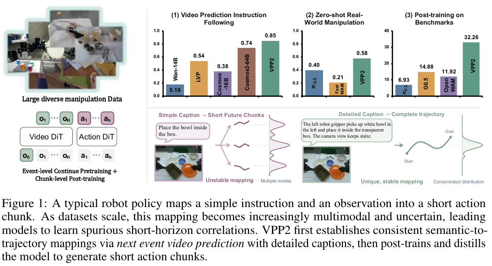
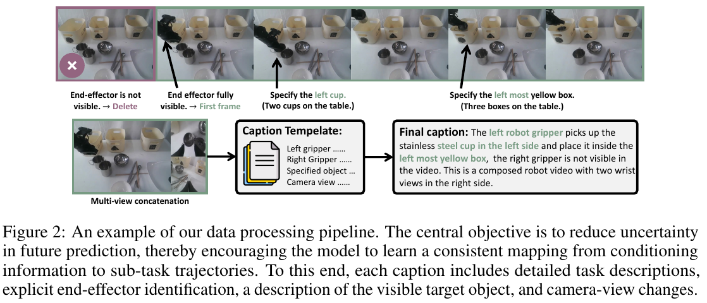
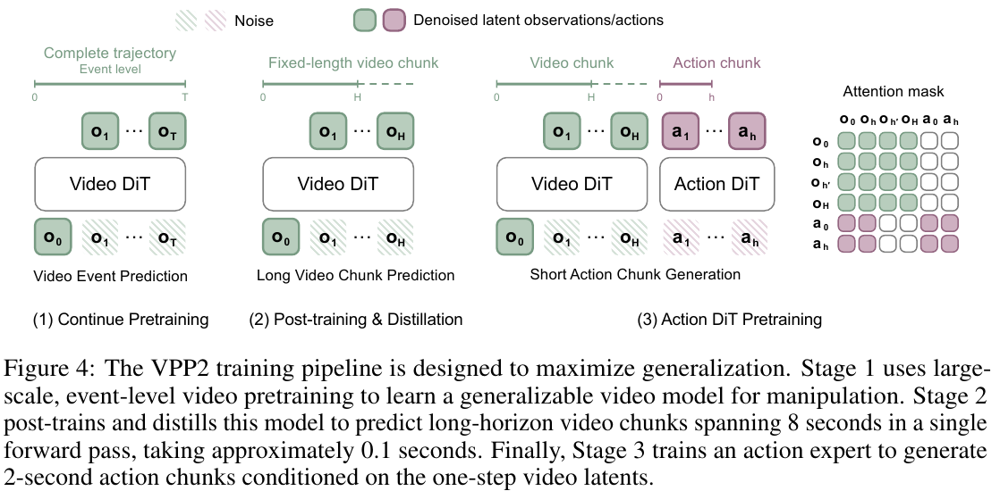
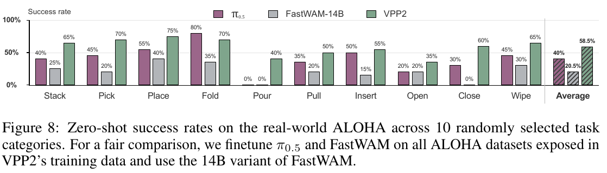
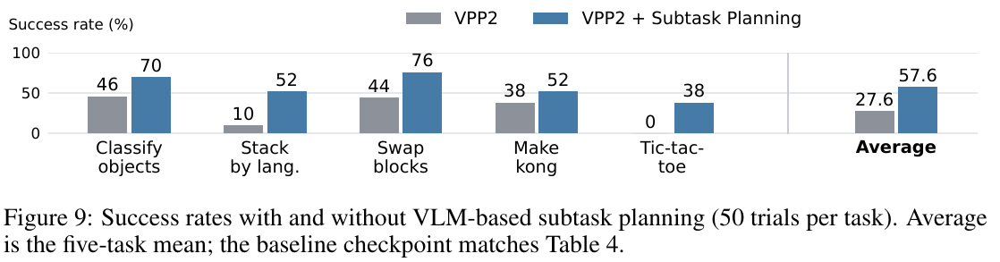

# 029 · VPP2

## 基本信息

- **完整标题**：Video Prediction Policy 2: Predict Better, Act Better。
- **作者 / 机构**：Yanjiang Guo、Haodong Yan、Zhide Zhong、Zhongru Zhang、Qingyuan Yang 等，Jianyu Chen；Robotera、清华大学、香港科技大学（广州）、加州大学伯克利分校、上海交通大学。
- **版本 / 状态**：arXiv:2610.10270v3，2026-10-13；首次提交 2026-10-07。采用截至阅读日的最新 v3，预印本，未复现。
- **来源**：[论文 v3](https://arxiv.org/abs/2610.10270v3) · [项目主页](https://robert-gyj.github.io/video-prediction-policy-2/) · [官方代码](https://github.com/roboterax/video-prediction-policy-2) · [模型](https://huggingface.co/Haodong082399/VPP2) · [原论文](https://arxiv.org/abs/2610.10270v3)。
- **阅读日期**：2026-10-22。
- **类目 / 主子类**：Wholebody Intelligence → 大脑模型与任务策略；关联数据、基准与综述。
- **归类依据**：主要贡献是利用未来视觉表征生成动作的 WAM。训练源包含人形 / 移动机器人，但核心真机定量证据是 ALOHA 双臂操作；将其收于大脑侧方法，不将其称为已经验证全身行走控制的人形策略。
- **标签**：WAM、video prediction policy、event-level pretraining、Wan2.1、consistency distillation、MoT、implicit inverse dynamics、KV cache、ALOHA、LIBERO-Pro、LIBERO-OOD、RoboDojo。

## 一句话理解

**先学会根据当前画面和详细指令，想象一个完整操作事件如何完成；再把预测压缩成一次前向，并训练动作专家读取视频模型内部特征，把“想象中的未来”变成短期机器人动作。**

整体流程是：**当前图像＋明确子任务 → 一步视频模型及其 KV 特征 → 动作专家 → 动作块 → 执行并重新观测**。与 Ropedia W0 给定未来运动、预测其视觉后果不同，VPP2 的视频分支从图像和语言提出未来视觉演化，动作分支再生成控制动作。

## Motivation

1. **视频好看不等于操作正确。** 通用视频模型偏重内容生成与画面质量，面对“拿左数第二个瓶子，放到最左瓶子前面”这类精确指令，可能预测错误目标、错误手臂或凭空改变场景。依赖这些预测的动作也会错。
2. **短动作块配短指令，监督可能很模糊。** 一句“把碗放进盒子”，对应的短片段可能是伸手、抓取、抬起或放下，完整事件的中间阶段不确定。作者希望让一段清楚的描述对应完整子任务过程，减少语义与轨迹之间的歧义。
3. **接动作头可能破坏视频先验。** 随机初始化的动作模块和较窄的机器人监督可能改变原有视频模型，造成域外预测退化。需要既快又尽量保留预测泛化的动作学习方式。

作者的核心假设是：**先建立指令到完整视觉轨迹的可靠映射，再学动作，能比直接在短时监督上学习更好地泛化。** 本文用事件级 / 固定时长对照和域外策略评测支持这一路线，但未把所有设计逐项做完整因果消融。（§1）

## 方法

### 1. 数据：机器人、人类和一般视频共同训练视觉预测

训练视频有三类：

- **机器人操作**：单臂的 OXE、RoboMIND、DROID、RH20T、MolmoAct；双臂的 AgiBot World-Beta、RoboCOIN、RDT、GM-100、ABC-130K、自采 ALOHA；以及 InternData-A1、Galaxea Open-World、自采灵巧手数据。
- **人类操作**：EgoDex、Ego4D、EPIC-KITCHENS、Something-Something V2、VITRA-1M 和自采第一视角数据。
- **一般视频**：OpenVid、Panda-70M，经筛选只保留操作相关片段。

论文称覆盖 **20 多种机器人具身**，第一视角双臂结构的数据占总数据 **80% 以上**。但未公开可复核的最终总小时数、唯一片段数、逐源过滤后规模和采样权重；不能把源数据集的名义规模直接加总成 VPP2 实际训练量。

人类与互联网视频可用于学习未来视觉演化；**不意味着每段都有机器人关节动作标签**。动作专家需要相应运动监督，论文没有逐源列明人类视频如何进入动作训练、哪些动作字段可用。因此不将本文描述为从任意 RGB 视频自动恢复完整人体 motion 再重定向的系统。（§2、Tables 1 / 5）

### 2. 事件切分和详细描述：减少“未来可能有很多种”的歧义

先排除相机损坏、明显轨迹跳变等坏数据，把演示切成 **1–12 秒、语义连续**的子任务事件。候选边界参考手 / 末端速度局部极小、夹爪或手指开合；VLM 再合并片段、修正起止点。

描述明确四件事：**如何完成任务、哪只手操作、具体哪个物体、视角怎样变化**。手和目标物体需在第一帧可见；若手开始时不可见，就从首次可见处裁起。对相似物体使用颜色、空间关系等消歧。光流剔除过大视点变化，中等相机运动写入文字。

例如将“放杯子”写成“左夹爪拿起左侧不锈钢杯，放到中间黄色盒子内；右夹爪保持不动；固定斜侧视角”。这比一句泛化动作词更能约束训练目标。

### 3. 图像与动作坐标统一

**多视角图像**：通用数据流程将主视角放左侧、最多两个辅助视角在右侧上下排列，形成 T 形复合图；缺少辅助相机时填黑图。视频模型一起预测多个视角。

**动作坐标**：不同数据的“向左移动”可能对应不同坐标轴。作者先变换工作空间，再统一末端局部原点和轴向，写作 **T_aligned = A_d · T_d · B_d**。A_d 对齐世界 / 工作空间，B_d 对齐末端坐标；不是逐关节的全身重定向。

这是通用配方。公开 LIBERO 适配版使用头部与腕部图像**水平拼接**，不应把 T 形排列当作所有发布模型的固定输入。（§2、Appendix A.2、官方 LIBERO 文档）

### 4. Stage 1：先学完整事件，而非固定几秒的片段

基础模型为 **Wan2.1-I2V-14B**。每个样本覆盖完整子任务，从开头到完成均匀取样，形成 **49 帧、416×240** 的事件视频表示。事件长短可不同，因此相邻采样帧间隔也可不同。

**训练输入**：初始观测 o0、详细子任务描述 c、加入噪声的事件视频 latent x_s 和流时间 s。**监督来源**：同一真实事件的视频，经编码得到 x1。

论文定义 **x_s = (1−s)·ε + s·x1**，s=0 为噪声、s=1 为数据；网络预测流速度，监督为 **x1−ε**。完整采样过程才生成视频，不能把网络每次训练前向的输出直接等同 RGB。

继续预训练 **30,000 步、batch 1,024、学习率 1e−5**。这相当于很多样本曝光，但不能据步数乘 batch 就推断唯一演示数量。（§3.1、Eqs. 1–3）

### 5. Stage 2：固定物理时长，再蒸馏成一步视觉规划

完整事件有利于语义映射，但动作学习需要知道“未来第几秒”。因此继续后训练固定时长窗口：**人类手部预测 2 秒，机器人预测 8 秒**，仍用图像＋子任务条件和视频 flow matching 目标；越过演示末尾的采样索引封顶。

随后做 **consistency distillation**：冻结教师把带噪样本推进到相邻流时间，EMA 学生提供停止梯度的终点预测，学生学习不同流时间通往一致的干净结果。以 50% 概率令较后流时间直接为终点，强化一步生成。

推理直接从噪声调用 **F(ε,0,c)**，一次前向得到视频预测所需的 latent。后训练时压缩到 **17 帧、416×240**。这里“一步”指视频生成前向次数，不是一个控制动作，也不是只预测下一帧。

### 6. Stage 3：动作专家读取视频模型内部的未来表征

论文通用配方的动作专家为 **0.9B DiT**，通过 **Mixture-of-Transformers（MoT）** 接入 14B 视频骨干。视频与动作各自保留处理模块，通过注意力交换所需信息。

Fig. 4 的注意力 mask 表达：**视频 token 相互读取；动作 token 读取允许的前段视频特征与动作 token，后段视频被直接遮蔽**。这让较短动作块对应较长视觉规划中的前段；视频内部的双向注意力仍能把长未来信息融入这些前段特征。因此可以先计算视频分支 KV cache，再在动作去噪过程中反复复用。

更精确地说，动作专家读取的是这次视频前向的内部缓存，不必把最终干净 latent 再解码成 RGB。它学习的“隐式逆动力学”是从当前状态与预测未来表征推断动作，**不需要先解码整段 RGB，再额外跑视频到关节的 IK**。

**动作训练输入**：观测 / 描述构成的视频条件与 KV、带噪动作块、动作去噪时间；公开实现还显式输入机器人本体状态。**监督**来自真实动作块与噪声构造的流 / 去噪目标；完整去噪后才得到可执行动作块。不能将未来真实动作当成推理时需要用户提供的条件。

由于动作专家是新初始化的，论文在早期动作训练冻结视频 DiT 的基础参数，仅用 LoRA 适配，以减少破坏。论文未给出完整的早期 / 后期解冻时刻、通用动作向量全部维度和全部阶段预算；发布的 LIBERO / RoboDojo 配方需分别读，不能混成同一套配置。

### 7. 实际执行：想象较长未来，只输出短期动作

按 Fig. 4，机器人视频规划覆盖 **8 秒**，动作专家生成 **2 秒动作块**。可以理解为：先看较长的操作趋势，再决定眼前短时间怎样动；执行后重新观测、继续预测。具体执行块长度和去噪步数在基准适配中另有配置，不把它固定套到所有实验。

论文报告 bfloat16＋torch.compile 下：视频一次前向约 **0.12 秒**，动作专家 **五步**去噪约 **0.10 秒**，合计约 **0.22 秒 / 动作块**。正文没有明确这项计时的 GPU 型号，也没有列入高层 VLM 调用、传感 / 通信和物理动作时长，不能直接当作全系统闭环延迟或底层控制频率。

举例：当前图像里有三个杯子，指令是“拿左边第二个放进碗”。视频分支想象伸手、抓取、移向碗的未来；动作专家用这些内部特征及机器人当前状态，产生接下来一小段末端 / 夹爪动作。接近目标后，下一轮再根据实际图像修正。

### 8. 高层 VLM：可选任务分解与描述增强

VLM 将开放指令分解成明确子任务，并把描述增强到接近训练 caption 模板。它负责语义推理、记忆与下一子任务选择，VPP2 负责子任务到动作。

这不是所有主表成绩都加入 VLM 规划：**RoboDojo 主表明确使用完整任务指令、没有子任务规划**；另一个五任务实验才单独测试规划配置。后者还为子任务条件策略重新切分并标注训练演示，不是给同一冻结策略临时加一句提示。（§3.3、§4.2）

## 总览图与方法图

保存 **Fig. 1 总览、Fig. 2 数据处理、Fig. 4 训练方法与 mask、Fig. 8 ALOHA 实验、Fig. 9 子任务规划**，来自 PDF 第 **1 / 3 / 5 / 8 / 9 页**。200 dpi 原 PDF 渲染裁剪，保留完整原英文图注。[来源、裁剪与校验记录](../assets/029-vpp2/manifest.json)。

## 实验

### 1. 视频是否遵循指令：100 个图像—指令对

人手和机器人各 **50 对**，由 GPT 类评估器判断生成视频是否完成指令。VPP2 为 **80% / 90%**，Cosmos3-64B 为 **70% / 78%**；两组等量平均即 **85% vs 74%**，增加 **11 个百分点**，不是相对提升 11%。

Wan2.1-14B 为 **32% / 4%**，LVP 为 **62% / 46%**，Cosmos3-16B 为 **44% / 32%**。这测的是生成视频的指令跟随，不是真机任务成功。

固定时间窗口预训练变体 VPP2-Fixed-Step 为 **48% / 42%**，低于完整事件版本，支持完整事件目标更适合该测试。但没有独立的详细 / 简短 caption、LoRA 开关、不同动作头等全部受控消融，不能把策略最终收益全归给单个设计。

另有人类成对比较胜率（Fig. 6）。论文未充分列明 GPT 评估器精确版本、完整提示、人工人数 / 一致性与多 seed 误差条，保留小规模语义评估的边界。（§4.1、Table 2、Fig. 6）

### 2. 真机 ALOHA：已见机身上的无任务专门微调

作者在训练见过的 ALOHA 机身直接部署，**没有对评估任务专门 fine-tune**。π0.5 和 Fast-WAM-14B 使用 VPP2 接触过的 ALOHA 数据训练作对照，不是拿完全未适应 ALOHA 的基线来比较。

十类任务平均成功率：**VPP2 58.5%，π0.5 40.0%，Fast-WAM 20.5%**，领先最强对照 **18.5 个百分点**。Fig. 8 中 VPP2 / π0.5 的各类成功率为：

- 堆叠 **65 / 40%**，抓取 **70 / 45%**，放置 **75 / 55%**。
- 折叠 **70 / 80%**，倒液体 **40 / 0%**，拉动 **50 / 35%**。
- 插入 **55 / 50%**，打开 **35 / 20%**，关闭 **60 / 30%**，擦拭 **65 / 45%**。

VPP2 在九类最好，折叠低于 π0.5。正文与图注未充分报告每类尝试次数、精确训练 / 测试任务重叠和完整失败判据，不根据 5% 的刻度自行倒推试验数。zero-shot 也不表示新机身或所有技能从未在训练出现。（§4.2、Fig. 8）

### 3. LIBERO：标准分布高分与域外泛化分别看

基准专用训练只使用四套标准 LIBERO；Pro / OOD 评估任务不追加训练。主表基线引用原论文及既有评测，不能将其描述为本文重新统一全部预训练数据和算力的严格控制实验。

- **LIBERO-ID**：VPP2 **98.8%**，DiT4DiT 98.6%，Cosmos-Policy 98.5%。分布内已接近饱和，差距较小；VPP2 各套 Spatial / Object / Goal / Long 为 **99.2 / 99.8 / 98.2 / 98.0%**。
- **LIBERO-Pro**：只测 Position / Task 两种扰动，分别 **42.3 / 47.8%**，总计 **45.0%**；π0.5 总计 11.0%。Appendix C.2 明确 VPP2 **八列各 100，共 800 次**。部分子项也有例外，例如 Goal 的 position swap 为 VPP2 37%、π0.5 38%。
- **LIBERO-OOD**：Spatial / Object / Goal 为 **59.3 / 44.5 / 87.7%**，平均 **63.9%**；Temporal Ratio 59.4%，Fast-WAM 9.4%。它相对最强总体对照的增益是 **4.5 个百分点**，不只挑低分视频基线比较。

官方发布文档补充同一 LIBERO checkpoint 的计数：ID **1,976 / 2,000**，OOD **2,877 / 4,500**，Pro **360 / 800**；Pro 为不加规划器等辅助模块的 direct-policy 配置。这些具体运行约定来自当前固定代码版本，不把它们说成论文每一项都充分交代。（Tables 3、6–8，官方 LIBERO 文档）

### 4. RoboDojo：42 项双臂仿真任务，五维宏平均

主结果 **成功率 32.26%，平均进度分数 39.26**；对照 GPT-6-Astra 为 **22.48% / 28.97**。这组是**仿真**，即使基准整体名为 sim-and-real，也不能把主表解释为 42 项真机已验证。

为处理记忆，输入增加 **episode 初始帧及过去八帧，按一秒间隔采样**。因为结构变化，从 **Stage 2 尚未蒸馏的 checkpoint**开始基准专用后训练，先视频单训 **10,000 步**，再联合视频与动作训练。视频噪声固定最大值，动作 flow 时间随机；推理仍只做一次视频前向。这是适配支路，不等于所有实验都直接使用同一个已蒸馏通用模型。

成功率按五维等权，Generalization 再取标准 / 随机化的平均。VPP2 为：**Generalization 46.44 / 12.56%，Precision 35.17%，Long-Horizon 37.00%，Memory 55.56%，Open 4.08%**。

因此优势集中在精度、长程和记忆；**Open 仍很弱**，低于 GPT-6-Astra 的 31.00%，随机化泛化也低于其 28.33%。不能把总体领先说成每一能力维度都领先。

Appendix C.4 的榜单快照日期为 **2026-10-12**，正文脚注仍写 September 2026，存在日期文字不一致。本笔记采用 v3 的表中分数与附录口径，不声称这些排名永远有效。（§4.2、Tables 4 / 9 / 10）

### 5. VLM 子任务规划：五任务子集，不与 42 项主表混算

五组各 **50 次**、共 250 次：分类、按语言堆块、交换积木、麻将做杠、井字棋。baseline / 规划配置分别为：**46→70%、10→52%、44→76%、38→52%、0→38%**，均值 **27.6→57.6%**。

这是五项选择子集，并采用子任务描述训练的策略与测试时 VLM 反馈规划；不是 RoboDojo 全部 42 项达到 57.6%，也不能据此将 30 个百分点增益完全归因于“只在推理时加 VLM”。（§4.2、Fig. 9）

## 公开实现与复现边界

截至 2026-10-22，官方代码核对至 **a103a1e1784d3e45014549a82238894d3ed85959**。已提供 Stage 1 的 49 帧 / Stage 2 的 17 帧视频权重、视频推理、RoboDojo 和 LIBERO 专项训练及评估入口，以及相应模型文件。

**发布配置与论文通用配方不同，需分别记录**：

- **LIBERO**：视频 10k＋动作 30k；动作专家约 1B，动作阶段完全冻结视频、VAE、CLIP 与文字编码器，只训动作和本体投影。训练动作目标 **32×7**，本体状态 **1×8**；两视角各 224×224，水平拼为 224×448。VAE 产生五个时间 latent，动作 query 直接读取前三个，视频内部仍能处理全部五个。
- **LIBERO 推理**：动作 horizon 32，**10 步** Euler 去噪，执行前 10 步后重规划；不是正文通用计时的五步。
- **RoboDojo**：发布的是 **joint Video＋Action2B 100k** 配对权重，动作专家 2B；推理 **10 步**、horizon 32 / execute 24、历史 8 帧 / stride 25。训练中的 joint 与推理时先视频 cache、再动作去噪需区分。
- 动作 query 可读取视频缓存与动作 token，控制不必解码预测 RGB；LIBERO 输入合同还明确动作阶段只编码首帧图像，未来视频 latent 从纯噪声构建，避免把未来真值帧误当推理输入。

这些来自固定版本的 README、docs/libero.md、docs/robodojo.md、MoT 与 LIBERO 动作实现。没有运行作者代码或下载完整权重 / 数据；未见同等完整的自采 ALOHA 通用策略权重与全量事件级训练数据发布入口，不将部分基准复现栈说成整套通用预训练已经完全可复现。

## 结论与边界

**作者结论**：操作领域的完整事件视觉预训练、固定时长后训练 / 一步蒸馏及尽量保留视频先验的动作学习，能同时改善指令跟随视频预测与域外动作泛化。

**证据支持**：100 个图像—指令对的视频语义评估，训练见过的 ALOHA 机身上十类操作，标准 LIBERO 训练后的 Pro / OOD 留出泛化，以及 RoboDojo 专用适配与五任务规划子集。

**尚未充分支持**：通用人形全身运动控制、单纯 ego RGB 到完整 body motion、未见机身的可靠零示范动作执行、固定同算力 / 同数据下每个设计的独立贡献。训练数据规模与各源动作标签覆盖也不够透明。

论文未提供大规模多 seed 误差条；视频评估依赖语义判分，真机尝试数 / 重叠细节不足；RoboDojo Open 只有 4.08%。本体更换、强视点变化、长程物理接触等仍需额外验证。详细 caption 的训练可见性要求也意味着复杂遮挡和大幅走动不在最直接的证据范围。

## 我的理解与研究启发

以下为阅读者判断。

**“先完整事件，后固定窗口”是最值得关注的训练顺序。** 第一阶段让语义对应从开始到完成的过程，第二阶段恢复物理时间尺度，最后动作专家只需解决短期怎样动。它把语义歧义、时间对齐和控制效率分别处理，而非要求同一个短动作损失一次解决全部问题。

**动作专家实际使用的是预测性内部表征。** 人类视频帮助建立操作未来的视觉先验，机器人动作监督把这套表征接到执行空间；不要求每段人类视频都有精确的全身 mocap。代价是运动可执行性和接触并没有仅靠视频预测自动解决。

**与 Ropedia W0 可做互补比较。** Ropedia W0 的未来相机 / 骨架是输入条件，适合模拟候选动作后果；VPP2 从图像和语言形成未来表征并输出动作，更接近策略。前者有明确几何运动接口，后者在事件语义和逆动力学上发力。两者的“预测更好”不能直接用不同视频指标或不同平台成功率横向排名。

## 后续问题 / 关联论文

- 固定数据量与计算，分别去掉详细 caption、完整事件、LoRA、蒸馏、MoT，域外动作成绩各下降多少？
- 将视频预测与动作执行结果逐例配对，视频看似正确但动作失败的比例是多少？能否区分表征收益与“幻觉未来”带来的错误？
- 面对腿部运动和大幅视点变化时，VPP2 的语义规划能否结合显式相机 / 身体条件？当前过滤强视点变化后的证据不能直接外推。
- 统一坐标对齐前后，在同视觉 / 同动作数据预算下的跨机身迁移差别多大？
- [Ropedia W0](028-ropedia-w0.md)、[WholeBodyWAM](010-wholebodywam.md)、[Being-M0.7](024-being-m07.md)：库内已读，可比较视频条件、动作表征及部署路径。
- 原版 VPP、Fast-WAM、LVP、Temporal Ratio：重要前作 / 对照，尚未在本库分别完整总结。

## 来源与修订记录

- **2026-10-22 初稿**：固定 arXiv v3（2026-10-13），21 页；RoboDojo 使用本版的 32.26% / 39.26，不混用早期版本数值。
- **方法定位**：§2、Appendix A 数据；§3 与 Fig. 4 三阶段、MoT 和延迟；§3.3 高层规划。
- **实验定位**：Table 2 视频；Fig. 8 ALOHA；Tables 3 / 6–8 LIBERO；Tables 4 / 9 / 10 RoboDojo；Fig. 9 五任务规划。
- **发布配置**：官方 GitHub 固定提交 a103a1e1784d3e45014549a82238894d3ed85959；模型清单与版本见[来源记录](../assets/029-vpp2/source-record.json)。源代码 MIT，模型与来源数据另有条款，不把代码许可证套给全部数据 / 权重。
- **原图与版本**：[原图清单](../assets/029-vpp2/manifest.json)。原 PDF 保持不变，只存本地；公开笔记通过作者论文链接访问全文。
