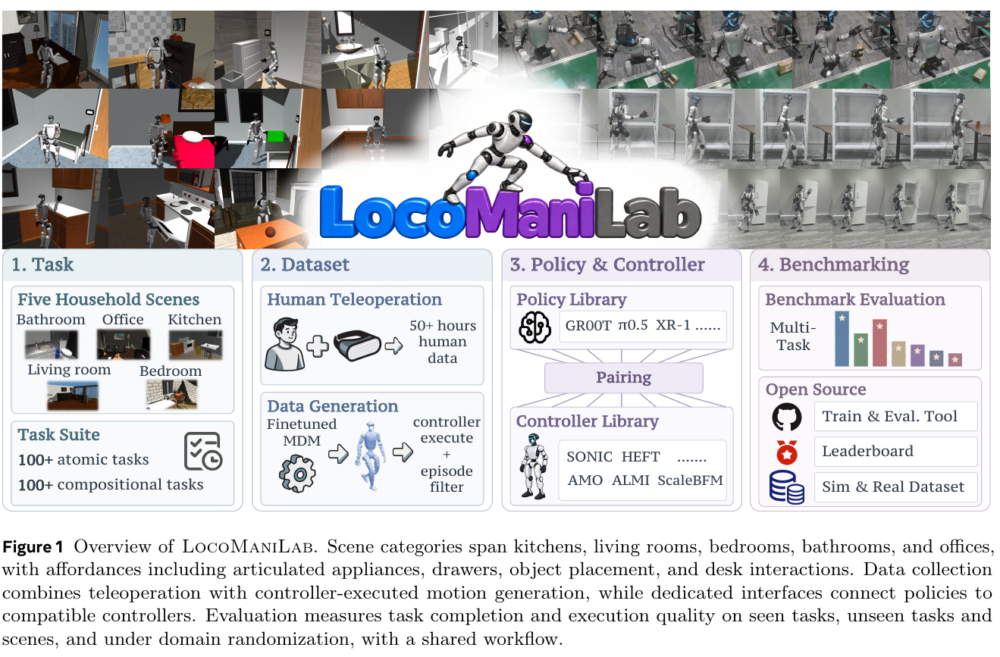
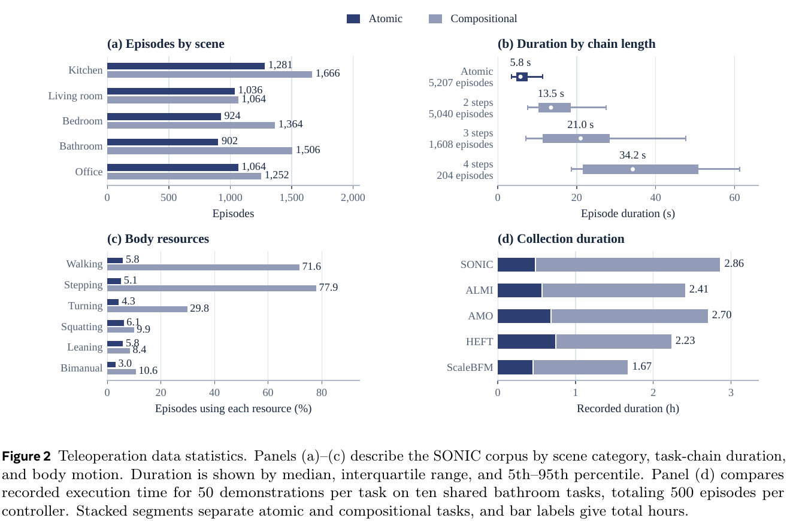
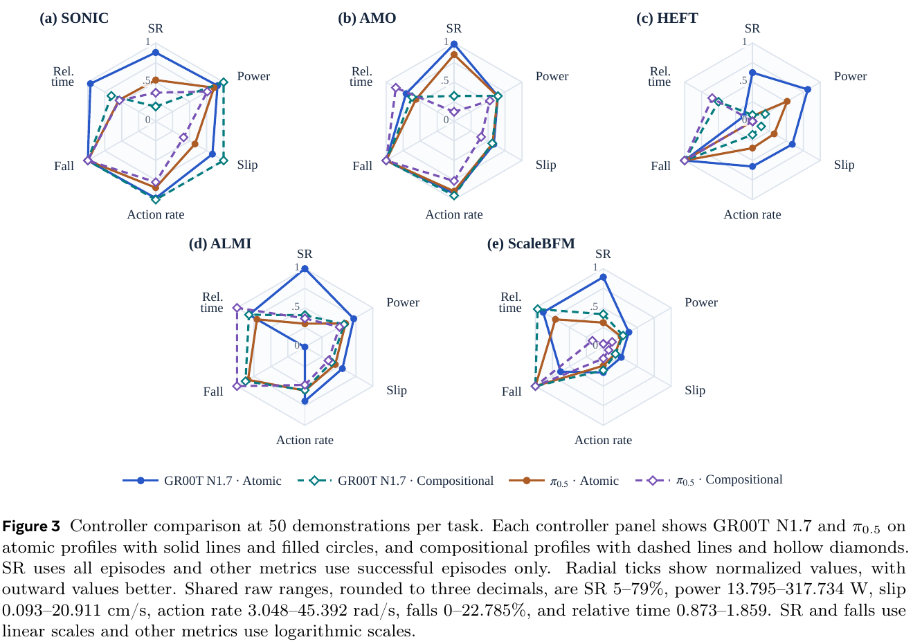
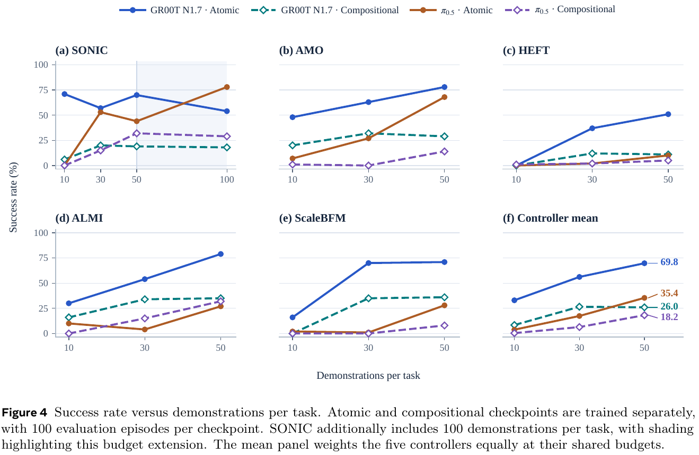
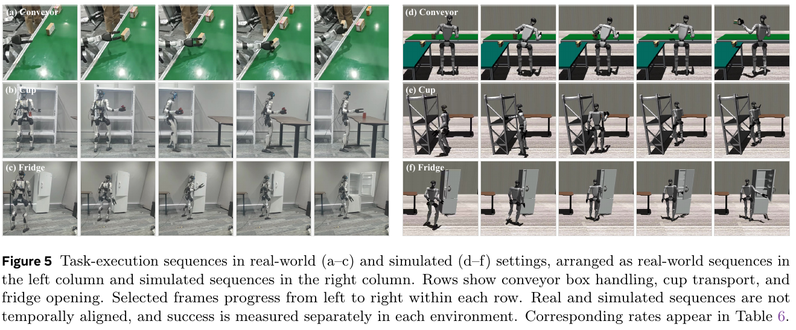

# 030 · LocoManiLab

## 基本信息

- **完整标题**：LocoManiLab: A Unified Testbed for Data, Policies, Controllers, and Deployment in Humanoid Loco-Manipulation。
- **作者 / 机构**：Dewei Wang、Jinrui Han、Jiyuan Shi 等，Chenjia Bai、Xuelong Li；TeleAI / 中国电信人工智能研究院、Gamma Robotics、中国科学技术大学、香港大学、浙江大学、上海交通大学、上海科技大学。
- **版本 / 状态**：arXiv:2610.30876v2，2026-10-23；首次提交 2026-10-22。按截至阅读日的最新 v2 总结，27 页，预印本，未复现。
- **来源**：[论文 v2](https://arxiv.org/abs/2610.30876v2) · [作者项目页](https://locomanilab.github.io/) · [作者发布页](https://baichenjia.cn/publication/locomanilab/) · [原论文](https://arxiv.org/abs/2610.30876v2)。
- **阅读日期**：2026-10-26。
- **类目 / 主子类**：Wholebody Intelligence → 数据、基准与综述；关联大脑模型与任务策略、运动控制与重定向。
- **归类依据**：核心贡献是把场景、示范、不同策略与控制器、泛化评测和真机验证统一起来的试验台；Kimodo 适配是其中的数据生成研究，不将整篇归成一个新 VLA。
- **标签**：benchmark、MuJoCo、G1、loco-manipulation、SONIC、controller interface、teleoperation、Kimodo、motion synthesis、domain randomization、real-to-sim evaluation。

## 一句话理解

**为人形移动操作建立一套共同“考场”：既比较大脑策略，也检查它配什么底层控制器、吃什么训练数据，以及熟悉任务高分能否转化成新任务和真机能力。**

它包含 **234 项任务、13 个室内场景、12 种策略、5 种全身控制器**；提供采集 / 生成示范、训练策略、执行控制、统计任务与运动质量的共同流程。主要结论是：**高成功率、域外泛化、动作质量和生成数据价值，需要分别测。**

## Motivation

1. **测到的是整条策略—控制链。** 同样的“大脑”接不同控制器，输出可能是底盘速度、身体参考或 motion token，执行精度与稳定性也不同。只看最终成功率，很难知道差别来自策略、接口还是运控。
2. **单技能不代表长程协调。** “走到抽屉旁”即使成功，站位也可能不利于后续伸手开抽屉；组合任务检验的是动作衔接后留下的物理状态是否合适。
3. **熟悉任务不能代表泛化，成功不能代表动作好。** 新任务、新场景、视觉干扰分别考验不同能力。成功执行仍可能伴随滑脚、大功率、命令跳变或跌倒 / 恢复。
4. **数据更多或生成得出来，不一定更容易学。** 作者希望在同一平台研究示范数量、遥操作 / 合成 / 增强混合，以及运动生成器的任务适配收益。（§1）

## 方法

### 1. 场景与任务：原子技能加多阶段组合

基于 **MuJoCo 和 Unitree G1**，使用 RoboCasa / Objaverse 的物体，以及 MolmoSpaces 的 iTHOR 场景和 Holodeck 办公室布局。场景分厨房、客厅、卧室、浴室、办公室五类，共 13 个实例。

**102 项原子任务**覆盖导航、开关关节物体、拿取、放置、物体重定向；**132 项组合任务**通常包含 2–4 个有序技能，例如“走过去→开抽屉→放入苹果→关抽屉”。原子任务也可能包含多个运动阶段，分类依据目标语义，不是只按动作帧数。

主实验对每种策略分别训练两套模型：**50 项原子任务一套，50 项组合任务一套**，每份训练清单各覆盖五类场景。全库任务不是全部训练给每个模型，而是用于熟悉与留出评测。（§3.1、§3.3、Appendix A）

### 2. 统一接口：策略决定参考，控制器实现全身运动

主比较固定 **SONIC**，让十二种策略都预测相同外部动作布局，但保留各自的模型、预处理、动作块长度和优化配方。

- **观测 / 条件**：一个头部 RGB 视角、任务文字、模型支持的机器人本体状态。仿真原始图像 320×240，硬件采集 640×480。
- **主状态**：43 个身体与手部关节位置；GR00T N1.7 再加三维重力投影，为 46 维；StarVLA-α 不使用本体状态。各模型内部可再 padding。
- **训练监督 / 策略输出**：未来动作块，每步 **64 维 SONIC motion token＋14 维绝对手指目标，共 78 维**。真值来自该控制接口下的示范命令，不能简单称为直接预测 78 个机器人关节。
- **执行**：SONIC 接参考 token 和机器人状态产生全身控制，手指目标另行下发。驱动按 **50 Hz**供给命令。

主评测每 **20 个控制步**同步查询一次大脑，名义仿真时标为 0.4 秒。长动作块只执行前段；短于 20 步的动作块保持最后一个动作到下次查询。因此 50 Hz 是命令交付节拍，**不是所有 VLA 每秒重新推理 50 次**；论文也未将其换算成包含推理 / 通信的真实时间延迟。

训练时是“图像 / 文字 / 状态 → 示范中的未来控制命令”；部署时用策略生成的命令闭环执行。LocoManiLab 不额外提出一套统一新网络，而是通过 adapter 对齐现有模型的数据、归一化和输出接口。（§3.2、Appendix A / B）

### 3. 五种控制器：对应五套动作布局

支持 **AMO、SONIC、HEFT、ALMI、ScaleBFM**。动作值分别为 **36、78、50、52、50 维**：

- AMO：22 个身体命令＋14 个手指目标。
- SONIC：64 个 motion token＋14 个手指目标。
- HEFT / ScaleBFM：根位姿＋29 个身体关节目标＋14 个手指目标。
- ALMI：四个底盘命令＋34 个上身值＋14 个手指目标。

SONIC / HEFT / ALMI / ScaleBFM 的记录状态为 43 个实测关节位置；AMO 使用 32 个值，包含 28 个实测手臂 / 手部关节和上一步四个躯干命令。AMO 这 32 维不是全部实测关节。

跨控制器实验只选 **GR00T N1.7 与 π0.5**，为每种控制器使用对应示范、动作布局重新训练。比较的是**训练后的策略—控制器配对系统**，不等于同一个冻结策略可以无重训替换底层，也不能把全部差异归因于控制器算法本身。（§4.3、Appendix B-B）

### 4. 遥操作数据：同步记录视觉、状态和实际命令

通过 VR 头显和手持控制器遥操作 G1，记录 RGB、机器人测量状态、控制器命令等。仿真达到任务的物理成功谓词后结束；真机由操作者判断结束。仿真初始位置对机器人 / 可移动物体分别扰动到名义位置附近 **5 cm / 2 cm** 范围。

数据包含 **14,160 条仿真遥操作、51.5 小时**，以及 **567 条真机演示、约 9.0 小时**。仿真主体 SONIC 记录为 **5,207 原子＋6,852 组合**；其余四种控制器贡献 2,101 条，用于共同的十项浴室任务研究。主策略训练选用的原子 / 组合清单分别为 **2,546 / 2,558 条**，不把全部 51.5 小时说成每个主模型的训练量。

Fig. 2 中同样每任务选 50 条、十任务共 500 条时，五种控制器的录制执行时长不同。这说明相同条数不等于相同小时数；统计只覆盖录制执行时间，不能直接当成包括标定、复位和人员等待的总采集成本。

### 5. 运动生成：Kimodo 负责参考，冻结 SONIC 负责执行

这一支路用于**生成更多训练示范**，不是十二种视觉策略共用的新大脑。Kimodo 的输入是 **动作文字＋已执行运动前缀＋根位置 / 手腕目标**，输出 **3 秒、30 Hz 的 G1 全身运动参考**；冻结 SONIC 在仿真中以 50 Hz 跟踪，下一段再用实际执行的运动作前缀，并平滑分段边界。

任务中的空间目标由已知任务定义与场景几何产生：

- 导航用考虑身体 / 手臂净空的占据图和 **A*** 规划站位路径，转换为根轨迹 waypoint；偏移或停滞时重规划。
- 操作用对象位置 / 形状或人工任务标注，构造接近、接触 / 抓取、移动、释放的腕部目标序列；接触 / 抓取反馈决定阶段切换和手指开合。
- LLM 可辅助选操作手和交互位置，但实际生成 rollout 使用预先确定的手与几何目标，**不在 rollout 中持续调用 LLM**。

因此这里利用了场景几何与任务阶段信息，不是只看一段 ego RGB 就端到端生成可执行动作；手指开合也有阶段逻辑支持。只保留任务成功的 rollout，部分采集阶段再筛物理有效性和运动质量。（§3.4.2）

### 6. 为什么还要适配运动生成器

Kimodo 原有动作先验不一定能在冻结运控下精确到达任务要求的位置。作者把每次扩散去噪的随机转移作为 Gaussian 策略，用执行后的奖励做 PPO 类优化：**奖励由运动执行结果得到，梯度更新去噪器，不穿过仿真器和 SONIC**。

每批 **64 组条件，每组四条候选运动**，一半随机空间约束、一半任务阶段约束。奖励包括根 / 掌心接近目标和躯干倾斜惩罚；执行奖励按同条件候选归一化为 advantage。

比较完整去噪器更新 **Full，学习率 1e−7** 与 **LoRA，rank 16、scale 32、学习率 1e−5**，保持控制器、文字编码器和非去噪模块冻结。六次去噪中的四个随机转移参与策略梯度。用 64 个固定验证条件每 25 轮评估，按最高验证奖励选模型；Full / LoRA 选中轮次分别 **3,075 / 1,225**，各一次训练、seed 0，不能称等训练步数的容量对照。

适配奖励先在无杂乱环境中计算，再放入场景做分段生成；这两步验证的内容不同。（§3.4.2、Appendix D-C）

### 7. 轨迹增强：围绕一条成功示范做局部变化

数据源实验为每项任务取一条遥操作轨迹，同步改变身体 token 和手指命令的时序，整体时长变化最多 **4%**，并扰动机器人 / 物体初始位置；在 SONIC 下重放后筛成功和物理有效性。**1,606 次尝试得到 1,000 条接受轨迹**。

框架描述允许 LLM 根据偏差与失败反馈提出修正，但本文混合数据实验使用固定增强程序，没有在线 LLM 规划。不能把可选模块的能力当成该实验实际条件。（§3.4.2、Appendix D-C）

## 总览图与方法图

保存 **Fig. 1 总览 / 框架方法、Fig. 2 数据统计、Fig. 3 控制器比较、Fig. 4 示范数量、Fig. 5 仿真与真机执行**，来自 PDF 第 **2 / 7 / 10 / 11 / 14 页**。作者没有另画完整的 Kimodo 优化网络图，本笔记通过正文和附录说明，不用自绘图替代原图。200 dpi 原 PDF 裁剪，完整英文图注、页码、裁剪参数及 SHA-256 见[原图清单](../assets/030-locomanilab/manifest.json)。

## 实验

### 1. 评测协议：拆分、预算和成功定义

十二种策略为 **XR-1、DM0.5、π0.5、GR00T N1.7、InternVLA-A1.5、SmolVLA、PRTS、Ψ0、X-VLA、StarVLA-α、Fast-WAM、Diffusion Policy**，主要比较全部固定 SONIC。

- **Seen**：100 项，原子 / 组合各 50，每任务 20 次。
- **Unseen task**：123 项，原子 46、组合 77，每任务 10 次；任务定义新，场景熟悉。
- **Unseen scene**：11 项，原子 6、组合 5，每任务 10 次；**新任务与新场景同时变化**，不能解释为只换背景的纯场景实验。

每策略共 **3,340 次**无 DR 评测，按任务等权，不按所有 rollout 简单合池。Overall 对 234 项任务等权，三拆分贡献为 **100 / 123 / 11**，不是三个拆分各占三分之一。

任务限时从示范平均 / 最长长度推导，并至少 300 个控制步。成功或超时结束，**不因跌倒提前终止**。每配置只训练一次，主实验用训练预算结束时的模型，没有基于测试分数挑 checkpoint。

训练保留原始模型配方：按模型特定采样单位规划约两遍数据，GR00T 用完整动作窗起点，其余多用帧起点，**不等同同优化步数、同样本曝光或同算力**。不同数据增强、观测和动作块也保留差异。结果是这批具体适配配置的比较，不是所有架构在完全相同资源下的能力上限。（§4.1、Appendix A–C）

### 2. 主结果：熟悉任务成绩不能代替泛化

Table 2 按 **Seen / Unseen task / Unseen scene / Overall** 的任务平均成功率：

- **XR-1**：**80.2 / 25.2 / 8.2 / 47.9%**。
- **DM0.5**：**77.9 / 16.6 / 15.5 / 42.7%**。
- **π0.5**：**67.7 / 13.3 / 11.8 / 36.5%**。
- **GR00T N1.7**：**68.2 / 11.5 / 6.4 / 35.5%**。
- **Fast-WAM**：**40.7 / 5.5 / 2.7 / 20.4%**；**Diffusion Policy**：**14.7 / 1.5 / 0 / 7.1%**。

XR-1 在已见任务 80.2%，新任务降到 25.2%，新任务＋新场景仅 8.2%；DM0.5 在新场景拆分的 15.5% 最好，但绝对成功率仍低。

组合任务也改变排序：Seen 原子任务 DM0.5 **90.1%**高于 XR-1 的 85.2%，Seen 组合 XR-1 **75.1%**高于 DM0.5 的 65.7%。SmolVLA 的 Seen 均值 **45.7%**高于 PRTS 35.7%，到了 Unseen task 则为 **4.1% vs 5.7%**。

因此作者关于熟悉任务排序“大体保持”的概括只能作粗略趋势理解，**不能写成排序不变**；新场景、任务复杂度和部分策略均有逆转。各配置一次训练，无多训练 seed 置信区间，不据小差距宣称稳定优胜。（§4.2.1、Table 2）

### 3. 视觉扰动：单独测稳健性，不等于训练时随机化收益

对 Seen 100 项任务、每项 20 次，分别施加 Low / Mid / High；每策略共 **6,000 次**。各等级和任务等权。Low 变纹理 / 光照，Mid 加相机 / 材质，High 再加畸变、机器人颜色与干扰物。High 干扰物在有空间的 **38 项**出现；这些是多因素预设，不是独立动力学扰动等级。

保持对应 reset 及随机种子一致，测的是**评估时抗干扰能力**，不是新增一组用 DR 训练的模型。

DM0.5 三等级总体均值 **70.2%**，XR-1 为 **69.0%**，π0.5 60.5%，GR00T 54.2%。XR-1 在 Low 的原子 / 组合任务最好，DM0.5 在 Mid / High 领先。High 原子任务 π0.5 **78.8%**也超过 XR-1 的 70.5%。视觉压力下总体排序会变，不能从无扰动分数直接推断鲁棒性。（§4.2.2、Table 3、Appendix A-A）

### 4. 控制器比较：成功、功率和稳定性不是同一件事

两策略×五控制器，五原子＋五组合浴室任务，每任务训练 **50 条**、评估 **20 次**；每个策略 / 控制器 / 任务类别 profile 为 100 次，共 **20 个 profile**。

SR 用全部试验；**功率、滑脚、动作变化、跌倒和相对时间只用成功 episode**，每 profile 实际只包含 5–79 条成功样本。不同控制器的成功任务集合也可能不同。

SONIC 在成功执行中的机械输出功率最低，但不总有最高 SR；GR00T 原子任务中 ALMI 成功率最高，却比 SONIC 有更多“成功 episode 内的跌倒标记”。这种标记按根高相对起始下降超过 0.30 m 判定，而评测不因跌倒立即终止，故允许跌倒后恢复再完成。

功率统计绝对机械功率，不含电气损耗；动作变化率基于 29 个身体关节目标，不是 VLA token 的变化率。相对时间以同任务 / 同策略跨控制器成功样本中位数作基准，不能跨模型直接当绝对速度比较。雷达图对 SR / 跌倒线性、其他指标对数归一化，越外越好；**多边形面积不是综合分数**。

因此不能将“SONIC 成功样本更省机械功率”说成它对所有尝试总体最省能或最安全。（§4.3、Fig. 3、Appendix C）

### 5. 示范规模：10→50 多数改善，50→100 不保证继续提升

同十项浴室任务、各控制器使用嵌套的 **10 / 30 / 50 条示范每任务**，各类别模型单独训练；SONIC 另测 100 条。每配置各任务 20 次。更新次数随示范数增长，故同时增加了数据和优化预算。

GR00T 的五控制器原子均值从 **33.0%→69.8%**（10→50），但组合任务 30→50 已趋于平台。SONIC 到 100 条时，GR00T 原子 / 组合为 **54 / 18%**，π0.5 为 **78 / 29%**；相对 50 条，只有 π0.5 原子进一步提升。不能概括为“数据越多每种配置都更好”，也不能把收益当固定算力的数据 scaling。（§4.4、Fig. 4、Appendix D-A）

### 6. 数据源混合：成功生成的示范不一定提高策略

在 **16 原子＋4 组合，共 20 项训练已见任务**比较遥操作 T、运动合成 S、轨迹增强 A 及混合。数据直接拼接，**不匹配总条数，也不平衡采样概率**；较长轨迹可贡献更多帧 / 动作窗。这里不是等量数据源质量的纯消融。

GR00T 总体：**T 82.0%，S 37.2%，A 58.2%，T＋S 71.8%，T＋A 82.5%，三者全加 46.2%**。T＋A 的组合任务从 56.2→68.8%，但原子任务从 88.4→85.9%，所以总体只增 0.5 个百分点。

π0.5 总体：**T 89.2%，S 41.5%，A 51.7%，T＋S 85.2%，T＋A 85.0%，三者全加 84.5%**，均未超过只用 T。

这说明生成数据的“能成功回放”和“有助策略学习”是不同判据；数据混合对具体模型和任务结构有依赖。但由于规模 / 时长 / 采样曝光未平衡，不能仅据此判定某种数据源普遍有害。（§4.5.1、Table 4、Appendix D-B）

### 7. Kimodo 适配：执行精度和任务成功均改善，范围需看清

**30 个任务—场景配对，每模型每对 10 次**，整体等权；其中 **13 对与任务条件适配集合重叠**。预训练 / LoRA / Full 总体成功率为 **39.7 / 71.3 / 90.7%**。三组 Approach、组合 Approach、Close，Full 分别 **99 / 100 / 82%**；原模型为 9 / 2 / 72.7%。这里不是在全部 234 项任务上达到 90.7%。

另有 **198 个固定目标条件**：54 导航、72 原地操作、72 边走边够取，各执行 3 秒。组合情况下原模型→Full：根位置误差 **0.578→0.080 m**，掌心 **0.650→0.099 m**。原地操作时掌心 **0.168→0.077 m**，但根误差 **0.014→0.051 m**；小幅移基座可能帮助伸手，所以不能把每个误差都说成下降。

这些目标范围和提示与适配分布重叠，属于相关 / 分布内条件精度测试。标准差来自目标条件而非重复训练；Full 与 LoRA 又按各自最高验证奖励选不同训练轮次，不能当多 seed、等预算泛化结论。（§4.5.2、Table 5、Appendix D-C / D-D）

### 8. 仿真与真机：总体排序一致，成功定义并不完全相同

三任务为**开冰箱、从架子搬杯到桌面、传送带搬箱**；比较 XR-1、GR00T N1.7、Fast-WAM。每个模型每任务独立训练，仿真用 50 条仿真示范、硬件用 **50 条真实示范**，均 10k 更新；每模型每任务 **20 次仿真、10 次真机**。

真机 Fridge / Cup / Conveyor 成功次数：**XR-1 8 / 7 / 6，GR00T 5 / 6 / 5，Fast-WAM 4 / 5 / 5**，分母每项均为 10。三任务平均仿真 / 真机：**XR-1 76.7 / 70.0%，GR00T 53.3 / 53.3%，Fast-WAM 50.0 / 46.7%**。

总体顺序一致，但杯子任务 Fast-WAM 在仿真 85%高于 GR00T 80%，到真机变成 **50%低于60%**；传送带真机两者同为50%。场景只是近似对应，仿真传送带要求**三个箱子全部放到桌上**，真机只要求**从传送带拿起一个箱子**，成功谓词不同。

因此支持的结论是：三个模型在三个特定任务上的总体相对趋势相近。**不是纯仿真训练的零样本迁移证明，也不是绝对成功率可直接校准，更不是所有任务排序都保持。** 真机总共 90 次，且每配置一次训练，范围有限。

真机使用 G1 头部 ZED Mini 的左 RGB，仿真只用头部视角，无腕部相机；评估不额外随机化初始机器人 / 物体位置。（§4.6、Table 6、Fig. 5、Appendix E）

## 结论与边界

**作者结论**：统一任务与接口可以联合研究策略、控制器和数据；人形移动操作在未见任务 / 场景仍有较大缺口，动作质量与成功率应分别报告，运动生成器的执行反馈适配能改善目标跟随。

**实验支持的范围**：单一 G1 形态、室内家庭 / 办公任务、这十二种具体模型适配配方；固定 SONIC 的主评测、两模型的五控制器再训练研究，以及有限的真机相对比较。

**关键边界**：不同策略没有统一算力 / 观测增强；各训练一次；未见场景同时改变任务；运动质量只统计成功样本；混合数据不匹配量与采样；运动生成测试部分训练条件重叠；真机重新用真实示范训练且成功标准与仿真有差异。上述边界都影响对排序、泛化和数据收益的解释。

## 我的理解与研究启发

以下为阅读者判断。

**最有价值的是把“大脑好不好”拆成可追问的系统条件。** 如果一个 VLA 分数高，需要同时知道其控制命令、查询节奏、状态信息、示范来源及底层跟踪器。LocoManiLab 把这些暴露出来，适合分析系统失败位置，而非只引用一张总榜。

**与 KODA / HumanoidArena 的关联很直接。** KODA 关注如何构造控制器匹配的监督，LocoManiLab 反映匹配后的策略—控制器配对如何影响成功和运动质量。本文跨控制器研究仍重新训练，不能替代控制器间监督复用或无重训迁移实验。

**对合成数据研究，策略效用比回放成功更重要。** Kimodo 适配后可以更准确地够到目标，但合成数据加入视觉策略训练仍可能降分。下一步应匹配采样预算、任务覆盖和执行噪声，再区分画面 / 轨迹分布偏移与监督可学习性。

## 后续问题 / 关联论文

- 固定训练计算、动作 horizon、数据增强和状态信息后，主策略排序会怎样变化？哪些差别来自 adapter？
- 对控制器成功样本做同任务 / 同难度匹配，并计入失败轨迹后，功率与安全性结论是否仍保持？
- 合成 / 遥操作在等条数、等时长或等动作窗预算下，哪种组合才提高未见任务表现？
- 使用完全相同的成功谓词和更大真机任务集，仿真排序与真机排序的相关性是否稳定？
- [KODA](002-koda.md)、[HumanoidArena](004-humanoidarena.md)、[OpenHLM](006-openhlm.md)、[SIMPLE](007-simple.md)、[SONIC](003-sonic.md)：库内已总结，可比较监督对齐、控制接口与评测覆盖。

## 来源与修订记录

- **2026-10-26 初稿**：基于 arXiv v2 全文、附录与原图，固定 2026-10-23 版本。事实与阅读者判断分开。
- **方法 / 协议**：§3、Appendix A–C；生成器 / 数据源研究见 §4.5、Appendix D；硬件见 §4.6、Appendix E。
- **数值证据**：Tables 2–6，Figs. 2–5；未将网页简介或第三方自动评审当作实验依据。
- **发布状态核查**：2026-10-26 作者项目源仓库仍标记 **Code Coming soon、Dataset Coming soon**。公开站点与 [policy-rollouts](https://github.com/LocoManiLab/policy-rollouts) 提供的展示录像，不能等同完整训练代码、任务环境和状态—动作数据集已经开放。
- **网页快照**：作者 Pages 仓库提交 **0b98b98facb35fde098bf279143e11253e5d9b9e**；rollouts 仓库 **bd2592fe63434e387f72442924919ea43b235405**。项目站直连超时，发布状态从其官方 Pages 源 HTML 核对；未运行框架代码或下载全量数据。
- [来源记录](../assets/030-locomanilab/source-record.json) · [原图清单](../assets/030-locomanilab/manifest.json)。原 PDF 保持不变，只存本地归档，公开笔记使用作者论文链接。
