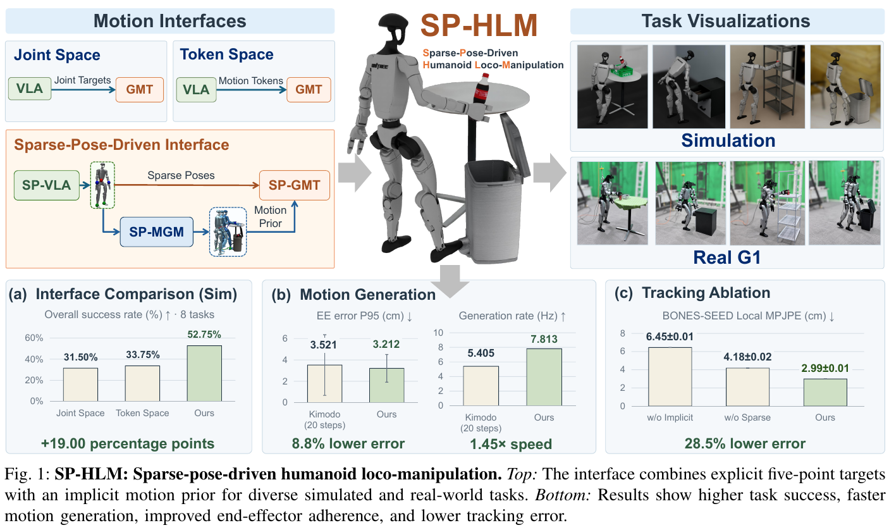
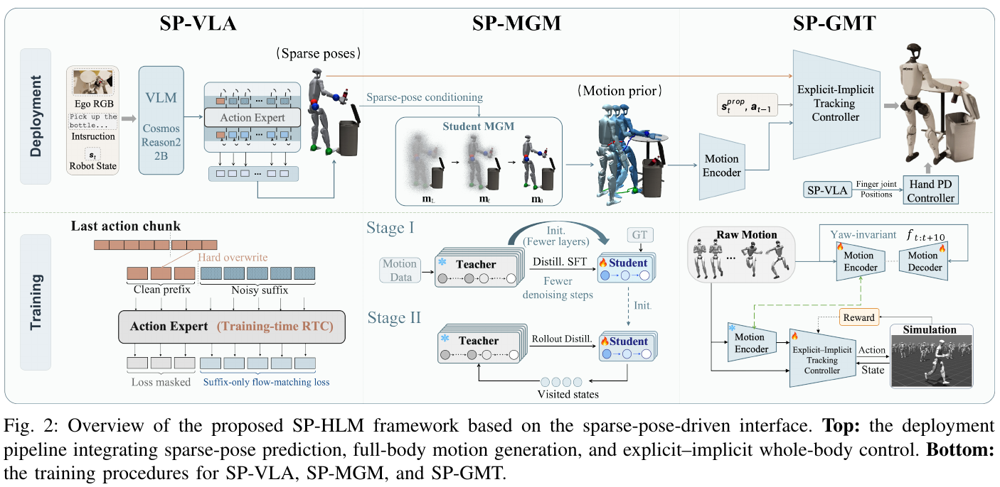
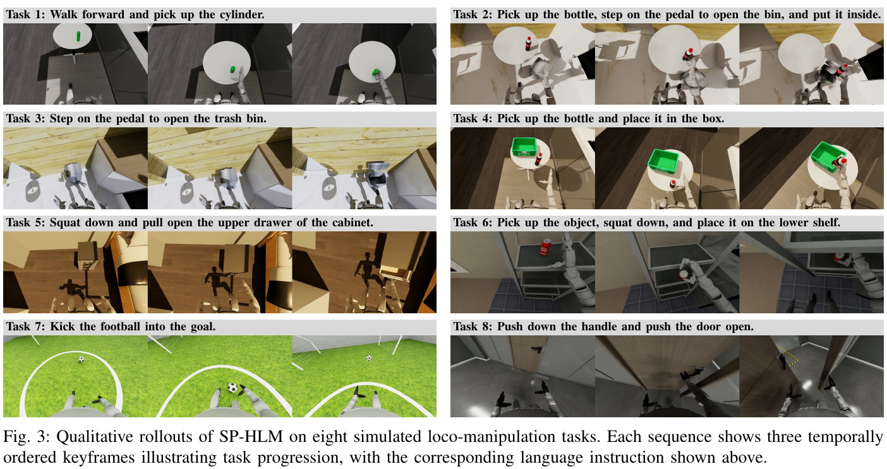
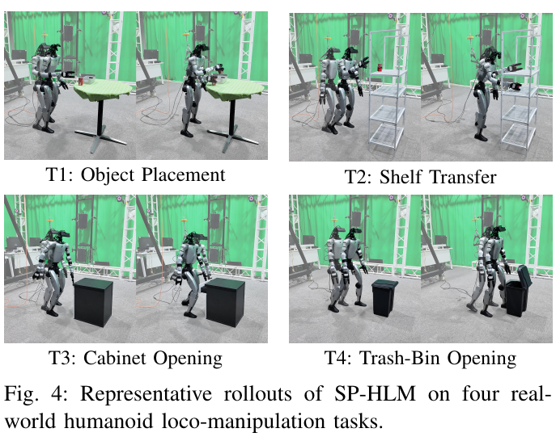

# 031 · SP-HLM

## 基本信息

- **完整标题**：SP-HLM: Sparse-Pose-Driven Motion Generation and Whole-Body Control for Humanoid Loco-Manipulation。
- **作者 / 机构**：Zhaohui Yang、Quanbao Lin、Chengqi Shi 等，Xiaokang Yang、Yao Mu；上海交通大学、摩尔线程、香港大学。
- **版本 / 状态**：arXiv:2610.30044v1，2026-10-21；截至阅读日 arXiv 仅列 v1，9 页，预印本，已总结未复现。
- **来源**：[论文 v1](https://arxiv.org/abs/2610.30044v1) · [作者项目页](https://sp-hlm.github.io/) · [原论文](https://arxiv.org/abs/2610.30044v1)。
- **阅读日期**：2026-10-26。
- **类目 / 主子类**：Wholebody Intelligence → 运动控制与重定向；关联大脑模型与任务策略、数据 / 评测。
- **归类依据**：核心是显式五点目标与隐式运动先验结合的控制接口，以及 SP-GMT 跟踪器和 SP-MGM 生成器；SP-VLA 是基于 GR00T 的上层适配。这里按主要贡献归运控侧，关联方向不重复计数。
- **标签**：sparse pose、task-space interface、motion prior、motion VAE、Kimodo、distillation、PPO、GR00T N1.7、RTC、Unitree G1。

## 一句话理解

**让 VLA 说明“骨盆、双腕、双踝要去哪”，让运动生成器补全“全身怎样配合”，再让跟踪器同时看目标和运动先验来控制机器人。**

它把任务空间几何意图与全身协调分开表达：显式五点目标负责准确到位，隐式 motion latent 负责运动协调。整个链路由 **SP-VLA → SP-MGM → 冻结 motion encoder → SP-GMT**构成；五点目标另有直达 SP-GMT 的支路，手指目标直达手部 PD。

## Motivation

1. **直接预测全部关节，任务和协调都压在大脑上。** “手到把手附近”是任务意图，但每个髋、膝、躯干关节如何配合保持平衡又是另一类问题。
2. **只有稀疏末端目标，剩余身体动作欠约束。** 手腕和脚踝到位并不唯一决定肘、膝、躯干怎样动，也不能保证自然协调。
3. **只有 latent / token，关键接触位置可能不够明确。** 运动模式能被压缩，但“脚必须踩在这块窄踏板上”需要准确空间约束。
4. **完整生成模型太慢或压缩后不稳。** 生成器要跟上闭环规划，压缩又容易带来去噪误差累积和高频抖动。（§I–II）

## 方法

### 1. 先看部署时的一条完整数据流

以“拿起瓶子，踩踏板打开垃圾桶，再放进去”为例，下面是对原文接口的通俗解释：

- **SP-VLA**看当前 ego RGB、任务文字和机器人状态，预测未来五个部位的位姿序列，以及双手手指目标。例如右手接近瓶子、一个脚踝移向踏板，同时给骨盆和另一只脚安排位置。
- **SP-MGM**在这些五点约束下生成完整身体运动。五点没直接说明的躯干、肘、膝等协调，由生成先验补全；此处不是简单逐帧 IK。
- **motion encoder**把完整运动的短窗口编码为 latent，传递局部协调模式。
- **SP-GMT**同时接收“五点实际要到哪”和“全身建议怎么配合”，结合当前状态与上一动作，输出身体关节位置目标；手指目标独立交给手部 PD。

五点是**骨盆、左右手腕、左右脚踝**，每点 **3D 位置＋6D 旋转表示＝9 个值**，在高层输出中采用世界坐标。五点共 **45D**，加双手 **14D**，SP-VLA 每步输出为 **59D**。这不是 59 个机器人关节。

五点既经过生成器构造 latent，也直接送给 tracker。生成先验不能替代显式目标支路；否则编码时去掉的全局位置 / 朝向信息会使任务几何意图变弱。（§III-A、Fig. 2、Appendix C）

### 2. SP-VLA：训练输入输出与异步动作块

**初始化与训练范围**：基于 **GR00T N1.7**，冻结视觉语言 backbone，只微调 flow-matching action head。输入为单个 ego RGB、语言指令和机器人状态；状态包含身体关节位置、世界坐标骨盆位姿和双手手指位置。

**监督 / 输出**：由示范构成 **40 步×59D** 的未来目标块。身体监督是五点位姿，手部监督是关节目标；本体状态是当前输入，不是要求策略预测的下一状态。

**训练时 RTC**：随机取 **0–8 步**延迟，把动作块前缀保留为干净已承诺动作，只对后缀加噪，并仅在后缀计算 flow-matching loss。模型因此学会在已经决定的动作之后续写。

**推理时**：当前块还在执行时，用更新后的观测预测下一块。每次执行前 **34 步**，余下 **6 步**作为下一预测的 clean prefix，减少切块等待和不连续；每次生成用 **4 次 flow 推理步**。

训练配置为 **160k 更新、global batch 32、学习率 1e−4**。原文没有展开全部训练数据分源、每个实验是否独立训练任务策略，以及随机划分细节；不据此扩写为未见任务或零样本语言泛化。（§III-D、Appendix C）

### 3. motion VAE：把协调模式压缩，但去掉全局摆放

使用约 **190 小时 motion**预训练 skip-connected Transformer VAE。每帧表示为：关节位置 / 速度、骨盆 6D 旋转、骨盆线速度 / 角速度，共 **2J＋12D**；编码未来 **10 帧**的短运动窗口。

骨盆量在与当前 yaw 对齐的坐标系中表达，移除全局水平平移和 heading，保留姿态、躯干倾斜与局部根运动。训练用重建损失加 KL，之后**冻结 encoder，使用后验均值作为确定性 latent**。

这里的 10 帧是 VAE 编码窗口，40 步是 VLA 动作块，不能因为主文都使用 H 符号而混为同一长度。论文没有给出足够信息把它们统一换算成几秒，也没有报告 latent 维度和 190 小时的完整分源清单。（§III-B1）

### 4. SP-GMT：同时利用显式几何与隐式运动

**Actor 输入**：冻结 encoder 给出的运动 latent；由世界坐标转换到**当前机器人骨盆坐标**的五点目标；本体状态；上一动作。SP-GMT 状态比 SP-VLA 更丰富，包括身体关节位置 / 速度、世界骨盆位姿、根线速度 / 角速度和重力投影。

**Actor 输出**：身体关节位置目标，交给低层执行。隐式分支描述局部协调，显式分支通过当前机器人位姿不断转换目标，提供全局偏差的闭环纠正。

**训练**：仿真中用 PPO 和 asymmetric actor–critic，critic 额外看训练特权全身状态。命令来自参考 motion：一支抽取五点，一支经冻结 VAE 编码。奖励包含五点全局位置 / 旋转、全身姿态 / 速度跟踪，以及动作变化、越限、滑脚、自碰撞等约束。结合均匀和失败感知采样，并随机化电机、接触、外力、延迟和命令滤波。

因此 **SP-GMT 训练时有完整参考 motion，部署时由 SP-MGM 在线补出 motion**；它不是仅靠五点监督就训练出了全部全身协调。移除骨盆位姿的消融仅说明该测试条件下退化有限，不能推出部署完全不需要定位。（§III-B、Appendix A）

### 5. SP-MGM：两阶段蒸馏，补全五点之间的运动

从预训练 **Kimodo** 压缩学生，root / body Transformer 各 **8 层**，hidden 1024、FFN 2048、8 heads；扩散训练时间步为 1000，DDIM 推理用 **20 步**。

**Stage I：离线学习基础能力。** 从真实配对 motion 加噪，在同一噪声水平、同一五点条件下让教师和学生预测干净 motion。监督同时来自冻结教师预测与 GT，损失覆盖根 / 关节运动、足接触和 FK 一致性。训练 10k 步、batch 128、学习率 2e−5，教师 / GT 权重前 8k 步从 0.9 / 0.1 线性变到 0.3 / 0.7。

**Stage II：在学生自己会走到的去噪状态上纠错。** 让学生执行自身去噪过程，从访问到的中间噪声状态取样，请冻结教师重新给干净运动目标。这样教师能纠正学生误差造成的分布偏移。加上关节运动、骨盆位移 / heading 的有限差分时间平滑项。

训练 100k 步、rollout batch 16、每 rollout 采 3 个中间状态；Appendix B 还列教师 / GT 权重 0.7 / 0.3，学习率从 2e−5 cosine 衰减到 2e−6，自身 / root / heading 平滑权重为 5 / 1 / 1。

这里 **rollout-aware / on-policy 指生成器自身去噪轨迹**，不是在机器人环境中用任务奖励训练生成器的 RL。SP-GMT 的 PPO 是另一套独立训练流程。整套系统也没有报告把 VLA、生成器、tracker 用一项损失端到端联合训练。（§III-C、Appendix B）

### 6. 数据来源与控制器转换

仿真自建 T1–T6 各采 **120 条 SONIC 遥操作**，沿用 SIMPLE 式离线回放 / 渲染，扰动物体、机器人初始位置和光照；T7–T8 使用 HumanoidArena 任务和对应示范。正文没有给出增强后总条数，也没有完整报告八任务全部数据量。

真机四任务各采 **80 条 SONIC 遥操作**，评估则由 **SP-GMT**执行。五点位姿是连接两套控制器的接口，避免上层必须直接复制 SONIC token；但真机实验有任务示范，不能称无需目标任务数据的零样本执行。

motion VAE 的约 190 小时、Kimodo 原始预训练、VLA 的机器人示范是不同数据来源，不合并为一个新采集的人类视频数据集。论文也不研究“从人类 ego RGB 恢复全身 motion”的感知问题。（§III-B、§IV-C）

## 总览图与方法图

保存 **Fig. 1 总览、Fig. 2 方法 / 训练部署、Fig. 3 仿真任务、Fig. 4 真机任务**，对应 PDF 第 **1 / 4 / 5 / 7 页**。均为 200 dpi 原 PDF 裁剪，保留完整英文图注；来源版本、页码、坐标、尺寸与 SHA-256 见[原图清单](../assets/031-sp-hlm/manifest.json)。

## 实验

### 1. 全系统：八项仿真任务，每方法 400 次

覆盖向前走取圆柱、拿瓶踩桶再投放、单独踩踏板、拿瓶放箱、蹲下拉抽屉、取物后蹲放低架、踢球、压把手推门。每任务 **50 次**，每次独立重采物体位置、机器人起点和光照。

Table I 总体为：

- **SP-HLM：211 / 400＝52.75%**。
- **GR00T＋Token Space：135 / 400＝33.75%**。
- **GR00T＋Joint Space：126 / 400＝31.50%**。
- **SP-HLM Direct Latent Prediction：93 / 400＝23.25%**。

完整系统相对 token baseline 增加 **19 个百分点**。八任务成功数依次为 **26、13、39、24、19、26、28、36 / 50**；最长的“拿瓶→踩踏板→投放”仍仅 26%，说明精确接触与多阶段衔接仍难。

两个 GR00T baseline 共用 SONIC；完整 SP-HLM 使用 SP-MGM＋SP-GMT，**比较同时涉及接口与下游模块变化**。不能把全系统 19 个百分点增益全部归因于动作维度或某一表示。

Direct Latent 消融是在五点 / 手指之外，让 VLA 额外直接预测 latent，取消由生成器恢复协调的路径。它支持当前配置下分工更有效，但不证明所有模型都不适合直接预测 latent。这里也没有独立的未见任务 / 新场景拆分或多次 VLA 训练 seed 置信区间。（§IV-C、Table I）

### 2. SP-GMT：全局跟踪更准确，其他指标各有取舍

在 **Filtered CLOT-500、BONES-SEED Diverse-500** 各 500 条 motion 上测试，每套做 **10 次带轨迹观测噪声的 seeded runs**。两套 motion 均未用于 SP-GMT 训练；BONES-SEED Diverse-500 出现在 SONIC 训练中。这里的十次是评估扰动随机种子，不是十次独立训练。

按 CLOT / BONES 顺序，SP-GMT 的 **Global MPJPE 为 0.0676 / 0.0797 m**，SONIC 为 **0.4177 / 0.3181 m**，Humanoid-GPT 为 **0.4742 / 0.5972 m**。SP-GMT 的全局末端误差同样最低。

但 motion progress 为 **99.83 / 92.24%**，低于 SONIC 的 **100.00 / 93.84%**；Humanoid-GPT 的局部 MPJPE 与关节误差均更低。因此不能概括为所有跟踪指标全面超过基线。

作者报告 SP-GMT 训练约 **192 GPU-hours**，SONIC / Humanoid-GPT 为 21k / 15k。该数字不是整个 SP-HLM 的训练成本，VAE、Kimodo / GR00T 预训练和生成器蒸馏也不能视为免费；不同预训练数据、输入与硬件条件下，不作统一总成本结论。（§IV-A、Table II）

### 3. 显式 / 隐式消融：两支分别解决什么

在 CLOT，完整模型 Global / Local MPJPE 为 **0.0676 / 0.0278 m**：

- **去显式五点，只留 latent**：变成 **0.4436 / 0.0390 m**，全局位置误差大幅增加。
- **去隐式 latent，只留五点**：变成 **0.1303 / 0.0659 m**，局部全身姿态更差。
- **用关节参考替代 latent**：变成 **0.0812 / 0.0305 m**，也弱于完整模型。
- **去机器人骨盆位姿**：变成 **0.0753 / 0.0356 m**，有所退化，但没有前两种那么大。

这与设计意图一致：显式支路提供任务几何，latent 提供五点没完全约束的协调信息。其证据是跟踪指标，不能把该消融直接等同于真机任务成功率的分解。（Table II）

### 4. SP-MGM：更快、更贴目标，但并非比教师更平滑

从 BONES-SEED 选 **600 条 motion**，测生成运动相对稀疏约束的末端误差和 jerk，而非机器人执行后的接触成功。

相同 **20 步**推理下，Kimodo（16 层）→SP-MGM（8 层）：

- EE 平均误差 **1.941→1.812 cm**；P95 **3.521→3.212 cm**。
- 生成调用率 **5.405→7.813 Hz，约 1.45×**。
- EE jerk P95 **450.768→514.337 m/s³**；body jerk P95 **370.225→416.945 m/s³**，均比教师更高。

所以速度和目标遵循有收益，但不应说平滑性全面超过 Kimodo。只保留 Stage I 时，EE P95 为 **12.772 cm**；去时间损失为 **3.420 cm**，完整为 **3.212 cm**。去时间损失后 EE / body jerk 增加 **27.8 / 37.0%**，说明第二阶段负责较大纠偏，时间损失主要压制抖动。

作者概述同时压缩网络与采样步数，但主比较双方均用 20 步，不能从这张表拆出减少采样步数的独立收益。**11.494 Hz**还叠加无文本推理与 TensorRT；正文另报部署组件 SP-VLA 25 Hz、SP-MGM 约 10 Hz。它们是组件吞吐，未报告统一端到端延迟、身体控制频率或真实闭环截止时间。（§IV-B、Table III）

### 5. 真机：四任务、每项 20 次，有真实示范

G1 配 ZED 2i 相机，四任务成功次数 / 成功率：

- 物体放置：**13 / 20，65%**。
- 架间转移：**11 / 20，55%**。
- 开柜：**5 / 20，25%**。
- 开垃圾桶：**8 / 20，40%**。

合计 **37 / 80＝46.25%** 是本笔记由等量试验计算的汇总，论文 Table IV 只逐任务报告。真机表仅评估 SP-HLM，没有相同协议下的真机 baseline 成功率，不能把仿真的相对提升直接搬到硬件。

作者将主要失败归因于单腿蹲下够小把手、抬脚踩窄踏板时的身体晃动，使末端偏离接触点。这是作者观察性解释，不是接触误差的独立因果消融。真机训练含每任务 80 条真实示范，不能称纯仿真策略零样本迁移。（§IV-C、Table IV）

## 结论与边界

**作者结论**：五点显式约束与隐式全身先验互补；配合两阶段运动蒸馏和异步 VLA，改善测试任务中的全局跟踪、生成效率与移动操作成功率。

**证据支持的范围**：G1 的两个跟踪数据集、600 条约束生成 motion、八项仿真任务和四项有真实示范的硬件任务。跟踪 progress / 局部误差与生成平滑性并非所有项目最好。

**未覆盖 / 未充分报告**：独立未见任务 / 场景泛化、任务策略多训练 seed、真机基线、完整数据构成、latent 维度、全部模块总训练成本与端到端延迟；世界位姿估计的硬件来源和定位误差的系统评估也未展开。手部只用关节位置目标，作者未研究其他手部接口或灵巧操作。

## 我的理解与研究启发

以下为阅读者判断。

**关键是保留任务几何的直达路径。** motion encoder 为跨地点复用去掉全局摆放信息，因此单靠 latent 很难同时提供准确世界目标。SP-HLM 用显式目标直接进 tracker，避免大脑既记运动模式又隐含编码精确接触位置。

**与 LocoManiLab 的 Kimodo 适配应区分。** LocoManiLab 用执行奖励适配生成器并收集示范；SP-HLM 的 SP-MGM 在线补全 VLA 五点目标，训练是教师 / GT 蒸馏。两篇都用 Kimodo，但优化信号和部署位置不同。

**与 VioLA / SONIC 的比较问题是“哪些量显式交给大脑”。** VioLA / SONIC 的 latent 接口强调可复用协调；这里额外保留五点任务空间约束。下一步值得在同一个 tracker、相同数据与预算下改变接口，拆开表示收益和执行器能力收益。

## 后续问题 / 关联论文

- 若固定底层 tracker 和训练配方，五点、joint、latent 三种高层接口的差距还剩多少？
- 世界坐标五点如何适应定位漂移、目标移动及不同控制器执行误差？可否把失败反馈纳入运动生成？
- 五点条件和生成 latent 冲突时，SP-GMT 如何取舍？接触容差、碰撞和抓取约束是否需要额外显式通道？
- [SONIC](003-sonic.md)、[HumanoidArena](004-humanoidarena.md)、[SIMPLE](007-simple.md)、[VioLA](025-viola.md)、[LocoManiLab](030-locomanilab.md)：比较动作接口、数据来源和评测条件。

## 来源与修订记录

- **2026-10-26 初稿**：阅读 arXiv v1 全文、Appendix A–C 与原始图表；版本、原图注、数值与证据范围均固定。
- **方法 / 配置**：§III、Fig. 2、Appendix A–C；Table V 奖励、Table VI 蒸馏参数；不使用第三方自动总结作为事实依据。
- **实验**：§IV、Tables I–IV；真机总成功率 46.25%为笔记计算值，其余百分比沿用原文。
- **公开状态核查**：2026-10-26 官方组织公开仓库列表仅见 [项目站点源仓库](https://github.com/SP-HLM/SP-HLM.github.io)，固定提交 **88d27bec126cdd5879553e2e6b6428810f1613dd**；该 HTML 提供视频 / 方法 / 结果，没有明确实现、权重或完整训练数据下载入口。本次未核实可运行框架已经公开，不据此断言全网不存在其他发布。
- **访问说明**：项目站直连超时，采用官方 Pages 源 HTML 核对；未运行作者代码或下载模型 / 全量数据。原 PDF 保持不变，本地保存；公开库使用原论文链接。
- [来源记录](../assets/031-sp-hlm/source-record.json) · [原图清单](../assets/031-sp-hlm/manifest.json)。
