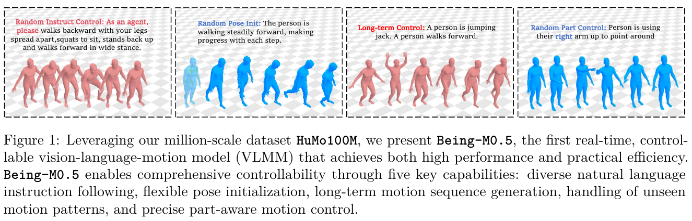
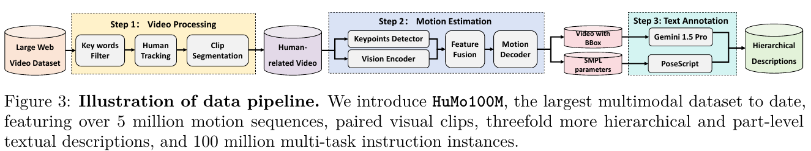
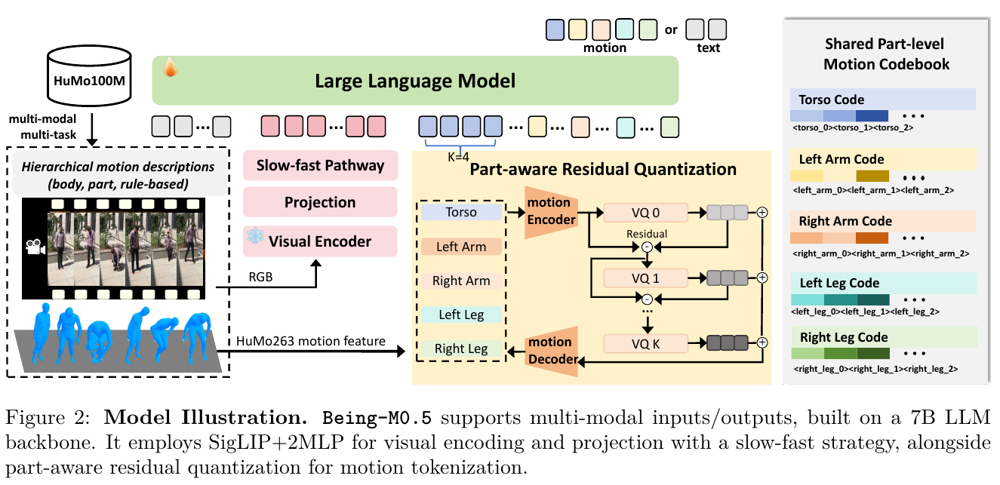
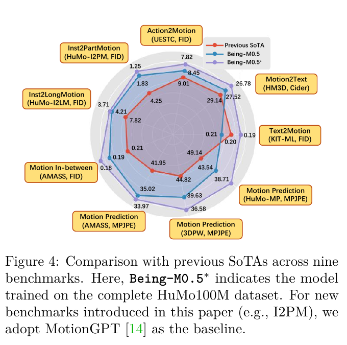
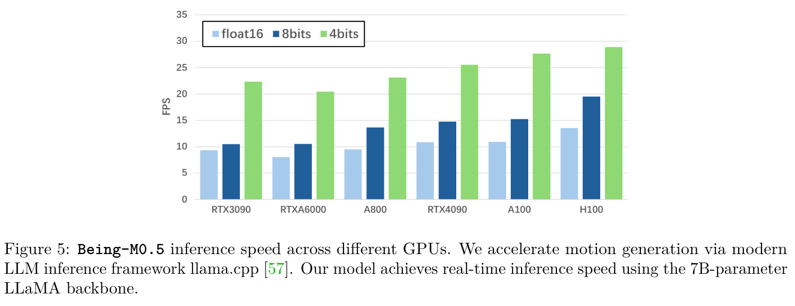
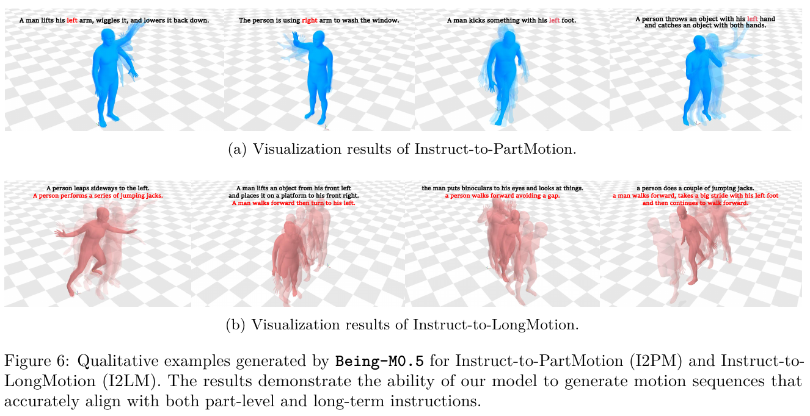

# 032 · Being-M0.5

## 基本信息

- **完整标题**：Being-M0.5: A Real-Time Controllable Vision-Language-Motion Model。
- **会议版名称**：同作者、同一工作的 ICCV 2025 正式题名为 **MotionCtrl: A Real-time Controllable Vision-Language-Motion Model**，pp. 12253–12262；不是库内 Being-M0.7，也不与其他同名 MotionCtrl 工作混用。
- **作者 / 机构**：Bin Cao、Sipeng Zheng、Ye Wang、Lujie Xia、Qianshan Wei、Qin Jin、Jing Liu、Zongqing Lu；中科院自动化所、国科大、智源、北京大学、中国人民大学、东南大学、BeingBeyond。
- **版本 / 状态**：主要依据 arXiv:2508.07863v1，2025-08-11；正文 16 页，包含参考文献 / 附录的实际 PDF 为 **25 页**。另核对 ICCV 10 页会议版的名称和主要结果，原图均来自上述 arXiv v1。已总结，未复现。
- **来源**：[论文 v1](https://arxiv.org/abs/2508.07863v1) · [ICCV 会议页](https://openaccess.thecvf.com/content/ICCV2025/html/Cao_MotionCtrl_A_Real-time_Controllable_Vision-Language-Motion_Model_ICCV_2025_paper.html) · [作者项目页](https://beingbeyond.github.io/Being-M0.5/) · [官方仓库](https://github.com/BeingBeyond/Being-M0.5) · [原论文](https://arxiv.org/abs/2508.07863v1)。
- **阅读日期**：2026-10-27。
- **类目 / 主子类**：Wholebody Intelligence → 大脑模型与任务策略；关联数据、基准与综述。
- **归类依据**：主要贡献是可控人体 motion 生成模型与 part-aware tokenizer，属于大脑侧运动生成；HuMo100M 是关键数据贡献。本文没有机器人关节策略 / 跟踪器的真机任务实验。
- **标签**：VLMM、human motion generation、HuMo100M、PRQ、part control、long motion、SMPL、WHAM、PHC、LLaMA-2、streaming generation。

## 一句话理解

**把人体动作拆成“躯干、左右臂、左右腿”的离散运动语言，用大量视频提取的 motion 和细粒度指令训练 7B 模型，使它能按部位、初始姿态和多阶段要求逐步生成动作。**

它的输出是**人体三维运动**，可以作为动画或后续机器人系统的运动来源；论文评测的是生成质量、语义符合度、局部控制和吞吐，没有直接验证机器人操作成功率。

## Motivation

1. **普通动作描述不等于用户指令。** 模型会根据“一个人在走路”生成动作，并不意味着能理解“请先后退、蹲下、再站起来向前走”。
2. **控制不仅是动作类别。** 实用生成还需要从给定姿态继续、连接多个动作、区分左右肢体，以及覆盖训练外 motion。
3. **全身只有一组整体 code，部位难单独指挥。** 如果所有动作因素都混在一起，修改左臂容易影响其他部位；只有结构拆分、没有对应细粒度语言监督也不够。
4. **重建精度与响应速度存在取舍。** 更多残差量化层改善重建，却增加 LLM 要预测的 token；按整段逐层生成，还会推迟第一段可用 motion 的出现。（§1、§3）

## 方法

### 1. HuMo100M：先从视频得到 motion，再用这些数据训练生成器

论文报告从 **超过 2,000 万个视频**出发，结合现有公开数据和网络视频，得到约 **500 万条 motion、1 亿条多任务指令实例**。这三个量不是同一种计数：视频是来源，motion 是提取 / 整合后的运动片段，指令实例由任务构造扩展；不是 1 亿条独立采集的 motion。

数据流水线为：

1. **筛人和切段**：视频描述关键词过滤；YOLO 跟踪人，再按连续轨迹切片。
2. **筛质量**：利用高置信 2D 关键点数量过滤严重遮挡，并去除过短片段。
3. **恢复运动**：使用 **WHAM** 从视频估计世界坐标的 **SMPL 参数**；之后通过 **PHC** 的物理跟踪 / 精化改善 motion 质量。
4. **生成分层描述**：Gemini-1.5-Pro 从视频生成全身 / 部位动作说明；PoseScript 和 posecodes 补充“左手低于右手”等关节几何关系。
5. **构造不同任务**：把配对视频、文本、motion 组织成指令跟随、局部控制、续写、补间和长动作训练例。

因此，人类视频在这里有两个用途：**作为离线 motion 提取来源，以及视觉—文本—motion 对齐材料**。不能把 WHAM＋PHC 数据制作管线与 Being-M0.5 的生成网络当成同一个模型。视频估计结果属于伪标签，不是全部来自同步 MoCap 真值。

附录还列 Motion-X、3DPW、MSCOCO、PoseTrack、PROX、BEHAVE、WebVid 等来源，包含现有数据整合；“500 万”不应扩写为全部新动捕采集。本文没有给出全量可下载状态和各来源授权统一结论。（§4、Appendix A）

### 2. PRQ：每个部位有自己的残差 code，身体连接仍共享

**Part-aware Residual Quantization** 将 motion 拆成五组：躯干、左臂、右臂、左腿、右腿。各组通过共享编码器获得 latent，再使用共享 codebook 做多层残差量化：第一层编码主要信息，之后逐层补前一层没表示好的残差。

采用 **4 倍时间下采样、4 层量化、1,024 个 codebook entries、512D embedding**。部位特征包含相对关节旋转、位置、根运动和足接触；脊柱等关节跨组共享，重建时对共享关节特征取平均，以保留部位之间的连接。

训练 tokenizer 使用部位重建、全身重建和 latent embedding 目标；配置为 **batch 256、学习率 1e−4、300k 更新**。tokenizer 学到的离散 motion code 随后进入 LLM 词表，作为运动的符号表示。

通俗地说，模型不再只输出一个“全身正在挥手”的整体符号，而能分别组织“右臂上抬”“躯干配合”“两腿保持支撑”等代码，再合成完整运动。**部位可以分开指挥，但共享骨架仍需协调**；这不等于未指定部位必然完全静止，也不是逐关节硬约束控制器。（§3.2.2、§5.1.3、Appendix B）

### 3. VLMM：训练输入输出是什么

作者报告采用 **400M SigLIP＋两层 MLP 投影＋LLaMA-2-chat 7B**；视觉使用 slow-fast 路径，输入 **224×224、最多 64 帧**。Fig. 2 展示视觉、文字和 motion 接入共同语言模型。

**按任务选择输入**：自然语言指令、视觉片段、已有运动 / 初始姿态或缺失运动的可见片段。不是每个任务都必须提供全部三种模态。例如 text-to-motion 可以只给文字，motion prediction 则带已有 motion。

**训练监督**：将连续 GT motion 经 PRQ 转成 code，以 `<MOT>` 和 `</MOT>` 标记运动区间。模型根据输入和已生成 token，用 **next-token cross-entropy** 预测后续文字或 motion code。生成任务的主要输出是 motion code，经 PRQ decoder 恢复连续人体运动；motion-to-text 则输出描述。

**三阶段训练**：

- **motion—text 对齐**：先使新增运动 token 与语言空间建立联系；作者报告全参微调、16×A800、batch 2,048、50 epochs、学习率 2e−5。
- **vision—text—motion 对齐**：增加视觉语义监督，batch 128、5 epochs。
- **motion instruction tuning**：训练多种任务和用户指令，batch 128、1 epoch。

这套流程不同于预测机器人动作的 VLA：监督是人体 motion code / 文本，没有把关节电机命令、机器人本体状态和任务奖励统一作为输出。（§3.1、§5.1.3）

### 4. 五种可控能力怎样训练出来

- **指令控制 I2M**：将 caption 改写为不同用户指令模板，例如“请演示如何……”，提高指令格式适应性。
- **任意姿态起步 / MPI**：遮住部分 motion，让模型根据前、中、后已知片段预测 / 补间；通过多样起始状态学习继续运动。
- **长动作 I2LM**：先将短片段对齐朝向、平移全局坐标，再通过中立站姿和 Slerp 插值建立过渡；训练的 in-between 模型进一步细化连接。多阶段连续性也有数据构造贡献，不全由 LLM 自发获得。
- **未见 motion / I2U**：扩大数据覆盖，并在排除训练的 motion 实例上评估泛化。
- **部位控制 I2PM**：同时使用 PRQ 结构和“左臂 / 右腿”等部位级文字监督。

初始任务采样比为 **T2M : I2M : MPI : I2PM : I2LM＝5 : 5 : 3 : 2 : 1**。例如“先左手敬礼，再向前走”由部位语义、运动续写和拼接长序列共同支持。本文不提供环境碰撞、物体抓取或真实接触闭环的完成保证。（§3.2、§4.2.2、§5.4.3）

### 5. 为什么能更早出 motion

标准整段逐层解码需等待其他时间位置 / 残差层完成；作者采用 **frame-by-frame motion code 解码**，让已经生成的时间块尽早恢复为连续动作。采用 PRQ4，兼顾重建与 token 数量。

按本文配置，**5 部位×4 层＝20 tokens / 4 原始帧**，约每帧 5 tokens；要达到 20 motion FPS，约需 100 tokens/s。这是论文配置下的吞吐换算，不是机器人每秒重新规划 20 次。

采用直接保留 SMPL 旋转的 **HuMo263**，目的是减少作者所述 HM3D263 恢复旋转时的 IK 开销。**规格核对注**：v1 §3.3 枚举的维度为 126 旋转＋4 根状态＋63 位置＋4 接触，合计 **197**，与“263”名称不一致。没有公开实现可核对，本笔记不自行补上未列出的 66 维，复现时需向作者确认实际特征布局。（§3.3、§5.3.2）

## 总览图与方法图

保存 v1 **Fig. 1 总览、Fig. 2 模型 / PRQ、Fig. 3 数据管线、Fig. 4 多任务结果、Fig. 5 速度、Fig. 6 部位 / 长动作案例**，分别来自 PDF 第 **2 / 4 / 7 / 11 / 13 / 16 页**。200 dpi 原 PDF 裁剪，保留完整英文图注；版本、坐标、尺寸、SHA-256 见[原图清单](../assets/032-being-m05/manifest.json)。

## 实验

### 1. 协议和指标：生成 / 对齐，不是物理任务成功

标准数据包括 HumanML3D、KIT-ML、AMASS、3DPW、UESTC；另从 HuMo100M 构建 HuMo-T2M、I2M、I2PM、I2LM、Unseen、MPI 等 testbeds。

作者报告 HumanML3D / KIT-ML 按 **80 / 5 / 15%**划分。HuMo-I2M 是 100 万配对实例、相同比例；I2PM 为 20 万评估实例，其中 15 万测试、5 万验证；I2LM 为 50 万拼接序列；HuMo-Unseen 为 20 万留出 motion。

**FID 越低**表示生成分布更接近参考，**R-Precision 越高**表示文本—motion 检索对齐更好，**MMDist 越低**表示语义特征更近，**MPJPE（mm）越低**表示关节位置更准确。不同 testbed 的 FID 不直接互比，也不将这些指标叫作任务成功率。

Table 1 的模型均按 HumanML3D 训练；主比较各基准使用相同基准数据，**Fig. 4 带星号的 Being-M0.5* 才另用完整 HuMo100M**。不能把所有表格都理解成 500 万 motion 预训练后统一零样本测试。（§5.1–5.2）

### 2. 标准 text-to-motion：语义对齐更好，FID 仍有取舍

HumanML3D，按 FID / R@1 / R@3 / MMDist：

- **Being-M0.5-PRQ4：0.056 / 0.535 / 0.821 / 2.865**。
- **MoMask-RQ6：0.045 / 0.521 / 0.807 / 2.958**。
- **Being-M0.5-VQ1：0.141 / 0.528 / 0.815 / 2.953**。

PRQ4 相对同系 VQ1 的 FID 从 0.141 降到 0.056；相对 MoMask，R-Precision / MMDist 更好，但 FID 更高。因此不概括为所有质量指标都最优。tokenizer 重建 FID 与该生成 FID 也须区分。（Table 1、§5.4.4）

### 3. 指令与未见 motion：数据规模有帮助，泛化仍需看定义

HuMo-I2M：Being-M0.5 的 **FID 0.148、R@1 0.428、R@3 0.625**；MoMask 为 **0.324 / 0.325 / 0.382**。说明该 testbed 中，自然指令理解与运动表示的组合有效。Table 2 图注误写 “Image-to-Motion”，但正文、任务定义和数据名称均指 **Instruct-to-Motion**，不据图注将它当成视频重建评测。

HuMo-Unseen 按训练数据 HumanML3D / MotionX / HuMo100M：**FID 65.04 / 43.28 / 8.65，R@1 0.068 / 0.092 / 0.136**。大数据明显改善分布与检索指标，但留出的是 motion 序列；论文未给出足够的源视频去重、人物或动作类别拆分细节，不能进一步宣称严格新类别或新人物泛化。（Tables 2–3）

### 4. 部位控制：结构与标签共同有效

HuMo-I2PM 的 FID：

- RQ6 无部位文字：**4.025**；PRQ4 无部位文字：**4.281**。
- RQ6 有部位文字：**3.752**；PRQ4 有部位文字但不共享关节：**2.471**。
- **完整 PRQ4＋部位文字：1.831**；加深到 PRQ6 为 **2.357**。

因此仅拆部位不够；标签和共享关节均重要。更深的 PRQ 虽改善重建，却让生成变差，说明“tokenizer 更精确”不自动等于“LLM 更好预测”。

另在 **50 条左右交换指令**的 part-awareness 测试中，作者报告 **76%**，ParCo 为 64%，T2M 为 46%。这是小规模部位语义符合度测试，不是 76%的机器人动作成功率。（Tables 4、6、§5.3.3）

### 5. 视觉与多任务训练：作用在对齐和可控生成

HuMo-T2M 中，去掉第二阶段视觉对齐→完整模型，**FID 7.053→5.791，R@3 0.418→0.445**。视觉对齐在 noisy web motion 上提供补充语义信号。

多任务完整配置 FID **5.791**，只用 T2M 为 **7.152**，双倍 T2M 为 **7.058**；但去掉 I2LM 时 T2M FID 为 **5.765**，略低于完整配置。多任务收益要按目标能力解释，不是所有指标随任务数量单调改善。

§5.4.2 提到模型可扩展到视觉动作估计，同时将全面探索留作未来工作；本文没有给出标准视频→全身 motion 的 MPJPE 恢复表。不能把数据管线使用 WHAM，或 Table 7 视觉对齐收益，算成 Being-M0.5 本身完成了精确视频 motion 重建。（Tables 7–8）

### 6. 实时性与长动作证据

通过 **llama.cpp＋4-bit 量化**，作者报告所测 RTX3090、RTXA6000、A800、RTX4090、A100、H100 均达到至少 **20 motion FPS**，H100 最高 **28.9 FPS**。FP16 / 8-bit 吞吐低于 4-bit；这套速度结果不是所有精度模式都达到实时。

这里的 FPS 是生成的人体运动帧率，未给出包含全部视觉处理的统一首帧延迟、机器人控制周期或真机闭环任务结果。长动作训练主要依靠拼接序列和补间细化；Fig. 6 展示部位与连续动作案例，不能据此推断无限长无漂移生成或真实物体交互成功。（§5.3.2、Fig. 5–6）

## 结论与边界

**作者结论**：大规模多模态、多任务和细粒度部位标注，结合 PRQ 与流式解码，可以兼顾指令响应、初始姿态适应、部位控制和实时人体 motion 生成。

**证据支持的范围**：人体运动生成 / 理解的离线基准和可视化，指定硬件 / 精度下的生成吞吐。语义对齐、生成分布质量与重建误差互有取舍；HumanML3D 的 FID 并非最优。

**关键边界**：网络 motion 包含伪标签；1 亿是任务实例而非独立 motion；新基准主要由作者构建；无机器人跟踪 / 操作实验；视频重建能力未全面定量验证；实际特征布局、完整代码和数据公开尚无法核实。未见 motion 不直接等于严格语义新类别，实时生成也不等于实时物理控制。

## 我的理解与研究启发

以下为阅读者判断。

**这篇的价值是把“哪一部分怎么动”变得可学习、可命名。** 部位标签给语义，PRQ 给可操作的分解，shared joints 给协调；任何一项单独存在都难以保证好的部位生成。

**它适合放在人形控制之前作为运动来源。** 如果用于机器人，还需要形态重定向、动力学可执行性和接触 / 跟踪反馈。PHC 出现在数据精化阶段，不应因此给生成模型附上已验证的机器人控制能力。

**与 [Being-M0.7](024-being-m07.md) 的位置不同。** M0.5 本文围绕人体 motion 语言与可控生成；M0.7 的库内 10 月版本进一步研究面向机器人动作的 latent world-action model。两篇分别编号，不把前者的生成 FPS 或 HuMo100M 规模当成后者的机器人评测。

## 后续问题 / 关联论文

- 如果给定真实机器人状态，人体部位 token 如何重定向，怎样保证共享根运动不会与机器人接触约束冲突？
- 等量训练下，部位文字标注、部位 tokenizer 和训练任务多样性分别贡献多少？
- 对网络来源做严格源视频 / 人物 / 类别去重后，HuMo-Unseen 的改进是否保持？
- HuMo263 的实际维度布局与解码代码是什么，模型和配对视频 / motion 何时能复核？
- [Being-M0.7](024-being-m07.md)、[TextOp](018-textop.md)、[SP-HLM](031-sp-hlm.md)、[LocoManiLab](030-locomanilab.md)：比较人体动作生成、运动条件、执行反馈和机器人闭环验证。

## 来源与修订记录

- **2026-10-27 初稿**：读取 arXiv v1 全文及附录，保存实际 25 页 PDF；与 ICCV 会议版同作者、同核心方法和主要结果核对，会议名 MotionCtrl 单列，不覆盖 Being-M0.5 的原版本。
- **方法 / 数据**：§3–4、Appendix A–B；参数与训练见 §5.1.3，关键结果为 Tables 1–8、Figs. 4–6。
- **实现歧义**：保留 HuMo263 枚举维度合计 197 与名称 263 的不一致；Table 2 “Image-to-Motion”按上下文作为图注笔误处理，不写成视觉重建实验。
- **公开状态**：2026-10-27 官方仓库固定提交 **67dec3c506f47b050f1faed46559df7bf609500f**，README 仍称将发布代码和部分数据；文件树主要是 README、文档站和图片，没有核实到可运行训练 / 推理代码、权重或完整数据集。README 的 MIT 图标不单独作为数据 / 权重许可依据。
- **访问 / 操作**：项目站直连超时，核对其官方仓库 README 和文件树；未运行作者代码、下载权重或全量视频数据。论文与会议版 PDF 保持原样，只留本地；公开笔记使用论文链接。
- [来源记录](../assets/032-being-m05/source-record.json) · [原图清单](../assets/032-being-m05/manifest.json)。
