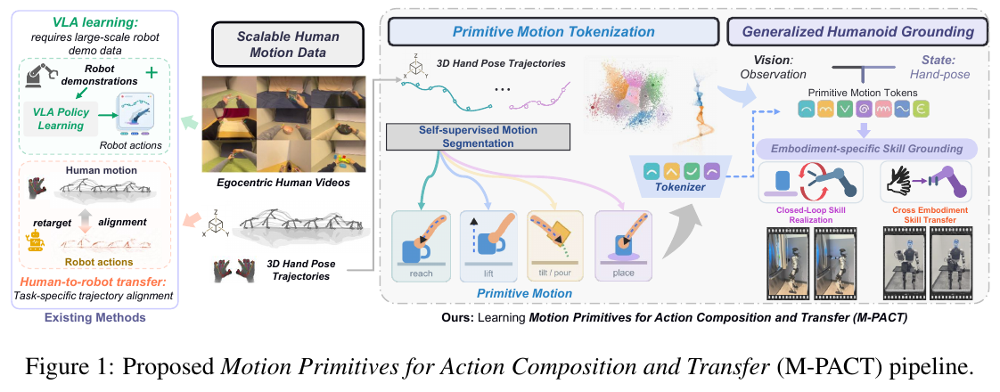
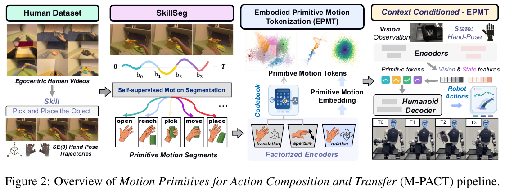

# 033 · Tokens of Motion / M-PACT

## 基本信息

- **完整标题**：Tokens of Motion: Primitive Motion Learning for Human-Humanoid Skill Transfer。
- **方法名称**：Motion Primitives for Action Composition and Transfer，简称 **M-PACT**。
- **作者 / 机构**：Hanwen Ren、Meng Zheng、Wenzhe Cui、Benjamin Planche、Zhongpai Gao、Anwesa Choudhuri、Terrence Chen、Ziyan Wu；United Imaging Intelligence、Purdue University。
- **版本**：arXiv:2610.37330v1，2026-10-27，12 页。按预印本记录；演示站域名包含 ICLR 2027 不代表会议录用。
- **来源**：[论文 v1](https://arxiv.org/abs/2610.37330v1) · [论文全文 HTML](https://arxiv.org/html/2610.37330v1) · [作者演示站](https://iclr2027website.github.io/paper_demo_website/) · [演示站源码](https://github.com/iclr2027website/paper_demo_website) · [原论文](https://arxiv.org/abs/2610.37330v1)。
- **阅读日期 / 状态**：2026-10-28；已核对正文、表格和演示站源码，未复现。
- **类目**：Wholebody Intelligence → 大脑模型与任务策略；关联运动控制与重定向。归类依据是动作表示与上下文原语选择，不能因此称它为通用全身 VLA 或 GMT。
- **来源异常**：核对当日 arXiv 摘要页显示了另一方法 AFIL 的摘要，但 PDF 与 HTML 正文均为本篇 M-PACT。本笔记依据后两者，不采用错误摘要。

## 一句话理解

**从大量人类三维手部轨迹中学一本小型“动作字典”，机器人保留这本字典，只学习怎样把字典中的动作在自己的身体上实现；另一个预测器根据当前状态、图像和任务选择下一步动作。**

这里的 motion 具体指**手腕位置、手腕朝向与手部开合**。论文并未学习腿部、平衡和全身关节控制器。定量证据主要是运动表示重建、跨数据集复用和原语预测；真机部分为定性演示。

## Motivation

1. **人类数据多，机器人动作标签少。** 人类视频没有现成的机器人关节命令，而且手臂长度、关节结构与可达空间不同。
2. **整条轨迹一起学，容易把动作、场景与任务顺序混在一起。** 取杯子和收拾桌子都可能包含伸手、合拢、抬起；若每个任务都独立学习整段动作，公共局部运动难以复用。
3. **希望迁移“怎样运动”的结构，而非为每种机器人重学全部表示。** 将共享原语表示与机器人专属解码器分开，降低适配成本。（§1–3）

## 方法

### 1. 统一表示：先把人和机器人的手部数据放到可比较的坐标约定中

每帧表示为 `(p, R, α)`：三维手腕位置、三维旋转、标量开合度。人的开合度是拇指与食指指尖距离；使用头部相机坐标约定。机器人通过正运动学得到手腕运动，再做坐标变换、臂长缩放、手腕朝向对齐和开合度仿射标定。

**输入训练器的是三维轨迹，不是仅凭 RGB 就自动获得一切监督。** 本文使用 EgoDex 等已有手部轨迹的数据，核心贡献不在视频到三维人体 motion 的重建。几何对齐让数据可比较，但不保证每条人类动作都在机器人可达范围内。（§3.2）

### 2. SkillSeg：自动决定一条轨迹在哪里切段

输入是平滑后的速度、速率、开合度及其变化、旋转表示的变化等运动学特征。时序网络逐帧预测一个 0–1 增量，静止帧由 motion gate 抑制；增量累加后每跨过一个整数就产生新边界。

训练时用可微的软分段，将每段特征聚合后经过辅助 VQ 编码和解码，重建该段加权速度积分；同时约束分段数量，并用熵项避免增量过早饱和。最终推理融合 **7 个独立训练网络**，相邻边界不足 **8 帧**的 crossing 被跳过。

这一步没有人工“抓取 / 放下”边界标签。图中的 open、reach、pick 等是直观解释，不能理解为作者预先指定了这几类语义技能。SkillSeg 的辅助码本也不是后续 EPMT 的动作码本。（§3.3）

### 3. EPMT：把每段轨迹编码为两个离散 token 与一个连续旋转量

每段重采样为 **8 个时间点**，拆成三个通道：

- **平移**：相对该段起点的位置，8×3＝24 维；编码到 **16 项码本**。
- **旋转**：相对该段起始手腕朝向的 6D 旋转表示，8×6＝48 维；编码为 **连续 3 维 latent**。
- **开合**：保留对齐后的绝对开合度，8 维；编码到 **4 项码本**。

因此，一个原语是 `Z = (平移编号, 连续旋转 latent, 开合编号)`。平移和开合的码本向量各 32 维，查表后得到 **32＋3＋32＝67 维**。只有两个离散编号合计占 6 bit，不能说整个动作仅需 6 bit，也不是所有 motion 都离散化了。

编码器虽然看了整段轨迹，**训练目标只要求重建首尾之间的净变化**：三维位移、三维旋转向量、一个开合变化，合计 **7 维**。初始手部状态是位置 3＋朝向 6＋开合 1＝**10 维**，与 67 维原语一起输入解码器：

`Decoder(当前手部状态 10D, 原语 embedding 67D) → 这一段的末端净变化 7D`

这个解码器输入 77 维，共 **27,399 个参数**。训练采用各通道平衡的归一化重建损失，加量化 commitment loss；码本以 EMA 更新。模型没有显式要求保留段内每一个中间姿态，因此“重建准确”主要指端点效果，不等于完整路径、接触和避障都准确。（§3.4–3.5）

### 4. 机器人适配：冻结字典，学习新的实现方式

将机器人示范做上述对齐后，送入冻结的 SkillSeg 与 EPMT，得到每段的 `(机器人初始手部状态, 原语, 真实末端变化)`；只训练机器人专属解码器。分段网络、编码器、码本以及源域 motion 特征归一化全部保留；机器人解码器自己的状态和输出归一化从机器人训练集估计。

人和机器人的示范**无需逐条配对**。但这仍然用到了机器人示范，不是完全零机器人数据迁移。

作者另定义可选的 **human-to-humanoid grounding**：继续用对齐后的人类片段更新机器人解码器，输入和目标都来自人类数据，保留机器人归一化及原语表示。其目标是适应“人类产生的原语＋初始状态”分布，同时研究是否损伤原本的机器人重建；这一阶段不是用真人—机器人配对动作监督，也不自动保证物理可执行性。（§3.5）

### 5. CC-EPMT：从“看过动作再压缩”变为“动作发生前预测”

EPMT 是事后编码器：要先看到一段轨迹。机器人自主执行则需要 **CC-EPMT**，根据片段开始时的信息预测下一段：

- 输入可为当前手部状态；完整变体还加入当前图像与任务名称的**冻结 CLIP 特征**。
- 共享网络分别输出：16 类平移概率、4 类开合概率、连续 3D 旋转 latent。
- 标签来自冻结的 EPMT 编码器。训练使用两个分类损失、旋转 latent 回归，以及通过冻结解码器得到的 motion effect 损失。
- 为让 effect loss 可微，训练时用概率加权的码本向量；推理时使用实际离散 code 的查表向量。
- 表示和解码器冻结，仅更新上下文预测器。

闭环执行为：**观察 → 预测原语 → 用机器人当前状态解码末端目标 → 执行栈实现动作 → 重新观察**。低层关节命令、路径插值、IK、执行时序仍属于后续实现；公开正文没有给出完整可复现细节。不能把 7D 末端效果直接等同于机器人全身电机控制量。（§3.6–3.7）

### 用“拿起物体放进袋子”理解训练和部署

这是解释性例子，具体 token 编号由模型学习，并非人为指定。

1. 人的手先伸向物体、合拢、抬起、移动、张开。SkillSeg 在运动发生变化的位置切段。
2. EPMT 看每一小段真实轨迹，生成平移和开合编号、旋转 latent；解码器学习“从这一起始姿态执行该原语，应产生什么末端变化”。
3. 机器人示范也经过同一本字典编码；机器人解码器学会在自己的臂长和初始姿态下解释原语。
4. 自主执行时，不再输入未来的真实轨迹。CC-EPMT 从当前图像、任务与手部状态猜下一原语，再交给解码器与执行栈。
5. **复用人类录制好的原语序列**与**自主预测下一原语**是两种模式，前者不能替代后者的泛化评测。

## 实验

### 数据和评测协议

- **EgoDex**：27,411 episodes、约 292 万保留片段；训练共享表示，episode 按 90/10 划分，测试 292,806 段。
- **HoloAssist**：35,087 episodes、约 80 万片段；不适配源解码器，检查跨人类数据集复用。
- **HumanoidEveryday**：4,064 episodes、96,241 段，用于 G1 适配。解码器评测按 85/15 划分，测试 14,754 段；机器人预测按 70/30，测试 28,871 段。
- 去除长度不在 5–90 帧内及所有因素变化都可忽略的片段。标准化仅使用训练数据。
- 未见任务实验留出 124 个任务名中的 37 个，使用 3 个随机种子并与匹配的 episode 划分比较。
- 误差为**端点平移、旋转和开合的中位数**；机器人平移按论文 σ＝0.561 的约定转为 human-equivalent 单位，不能直接当作原生机器人空间定位精度。

摘要称约 **100 条机器人示范**即可较好适配，但已获得的 12 页正文没有给出对应详细数据量曲线；不能将 Table 1 的结果归因于恰好 100 条训练示范。（§4、摘要）

### 1. 字典能够复用，但重建各通道的效果不同

Table 1：

| 数据 / 解码器 | 平移 cm ↓ | 旋转 ° ↓ | 开合 cm ↓ |
|---|---:|---:|---:|
| EgoDex / 源解码器 | 2.658（0.532） | 0.931（0.041） | 0.439（0.493） |
| HoloAssist / 完全冻结 | 3.123（0.811） | 2.732（0.152） | 0.454（0.525） |
| HumanoidEveryday / 只重训解码器 | 3.442（0.454） | 0.901（0.062） | 0.229（1.388） |

括号是误差除以该通道运动幅度中位数；小于 1 表示超过“保持不动”参考。所有 16 个平移码和 4 个开合码都被使用，但不意味着利用率均匀：有效平移词汇量为 10.23、8.63、13.19。

机器人开合的绝对误差虽小，归一化误差 **1.388 > 1**，尚未超过不动参考。论文解释为数据中开合变化幅度小。不能概括为所有因素都迁移成功。

### 2. 自动切段有帮助，但不是相同测试目标上的纯切段对照

Table 2 的平移误差：19 帧固定窗口 **3.451 cm**、既有启发式 **3.188 cm**、学习式候选 **3.022 cm**；开合误差分别 4.655、5.220、4.514 mm。

各切段方法定义的测试片段不同，因此这是完整“切段＋tokenizer”管线比较；学习式一行为最终 SkillSeg 之前的单种子候选。不能当作相同片段上最终 7 网络集成的严格消融。

### 3. 预测下一原语比重建已有原语困难得多

Table 3a，人类测试集、一个种子：

| 输入 / 模式 | 平移 cm ↓ | 旋转 ° ↓ | 开合 mm ↓ | 平移 top-1 ↑ |
|---|---:|---:|---:|---:|
| 已知真实片段的 EPMT 表示 | 2.658 | 0.93 | 4.39 | 不适用 |
| 仅状态预测 | 5.307 | 21.65 | 9.19 | 36.37% |
| 上下文预测 | 4.952 | 20.28 | 8.46 | 40.42% |

视觉和语言上下文带来改善，但预测旋转误差从重建时约 **0.93°** 增至 **20.28°**，说明表示能压缩动作不等于策略能选对动作。去掉 effect loss 后结果仅有很小变化：平移 4.960 cm、旋转 20.25°、top-1 40.29%；单种子不足以证明该辅助损失稳定有效。

### 4. 机器人侧需要预测器适配，不能只迁移人类预测器

Table 3b 专门训练**机器人平移分类器**，不使用图像，不预测旋转或开合，也不执行解码器。平移 top-1：

- 冻结的人类“文本＋状态”预测器：**7.48%**。
- 机器人状态：**30.64%**；机器人文本：22.83%。
- 机器人文本＋状态：**33.98%**；多数类基线：22.56%。

因此，**共享动作词汇能迁移，决策器仍需适应机器人上下文分布**。约 90% coverage 时，平均候选平移码数量从 13.25 降到 8.35（总共 16 个）；coverage 指候选集合包含录制标签，不是动作可执行率或任务成功率。候选集统计平均 3 个划分，top-1 是一个种子。未见任务中加入文本反而降低 0.8 个百分点，未能支持更强语言任务泛化的结论。

### 5. 真机展示了四种模式，公开证据为定性结果

§4.3 与作者演示站将实验分为：

1. **EPMT 重建**：提供由真实机器人轨迹编码得到的原语序列，再解码回放。
2. **Human2Robot**：提供人类示范的原语序列，由机器人解码器实现。
3. **CC-EPMT State-Only**：只靠当前手部状态，自主选择并执行下一原语。
4. **CC-EPMT Full**：增加视觉上下文；正文还描述任务指令条件。

核对的演示站源码列出四组 **10 / 3 / 7 / 2 个视频条目**，例如关笔记本、按按钮、码方块、人类到机器人的食物取放，以及带视觉的关冰箱门。它们是展示条目数，不是实验试验次数或独立任务成功统计。没有公开表格报告各模式的多次试验成功率、方差及相同任务基线对比。

页面默认 **4× 播放**，并将手部相机画面按外部相机时长缩放以同步首尾，不能用网页播放时间推断控制频率或真实执行耗时。这里核对的是作者发布的页面配置与实验说明，未对视频进行独立成功率评测。

## 结论与局限

**最有价值的贡献是将“可复用的运动字典、基于上下文的原语选择、机器人专属实现”拆开。** 16 类平移与 4 类开合就能覆盖不少局部动作变化，27,399 参数解码器提供了轻量跨具身适配接口。

证据最强的是离线重建与表示复用。仍需注意：

- 净效果监督无法保证段内路径、碰撞、接触或复杂操作动力学；相同首尾可能对应完全不同的运动过程。
- 原语编码器需要三维手部轨迹。不能由此得出“任意 ego RGB 视频直接生成可执行全身动作”。
- 自主预测是明显瓶颈；机器人平移预测的 33.98% 不能解释为任务成功率。
- 真机是定性展示，未验证大规模、未见环境的稳健闭环操作，也没有行走与全身平衡评测。
- 正文多次指向 Appendix / supplement，但归档的 12 页 PDF 和公开 TeX 包均未包含附录。训练超参数、IK 与低层执行细节、少样本曲线及 grounding 权衡尚不能完整核查。
- 截至阅读日，核实到的是演示站源码、图片与视频条目；没有核实可运行的训练实现、模型权重或新增数据集发布。

## 与笔记库中相关工作的关系

- **VioLA**：以冻结 body / hand 控制模块提供的运动接口训练视觉策略，并为人类示范补仿真机器人状态。M-PACT 的核心是人类手部局部运动码本与状态条件末端效果解码，不具备相同全身控制含义。
- **Being-M0.5**：将五个身体部位的运动量化交给 7B 模型生成人体 motion。M-PACT 的表示规模小得多，针对手腕与开合，旋转保留连续 latent，并为机器人单独学习解码器。
- **SP-HLM / SONIC**：处理全身参考与物理跟踪的接口；本篇的 7D 输出仍需执行栈实现。若将二者结合，需要额外设计从手部目标到全身稳定运动的映射，论文没有完成该组合验证。

上述比较用于解释研究定位，不是统一基准下的性能排名。

## 原图、来源与后续关注

已保存原文 **Figure 1 总览**、**Figure 2 方法图**，均保留完整英文图注。[图像记录](../assets/033-tokens-of-motion/manifest.json)包含来源版本、页码、裁剪区域与 SHA-256；[来源核查记录](../assets/033-tokens-of-motion/source-record.json)记录元数据异常及补充资料边界。

后续值得核查：补充材料和代码是否发布；约 100 条机器人示范对应的适配曲线；未见任务的闭环成功率；段内路径与接触约束；连续旋转 latent 是否成为迁移或预测的主要瓶颈。
