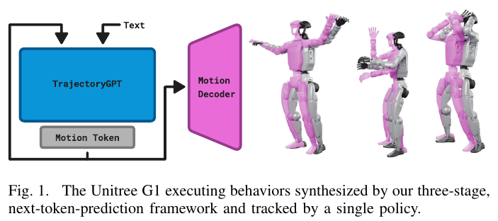
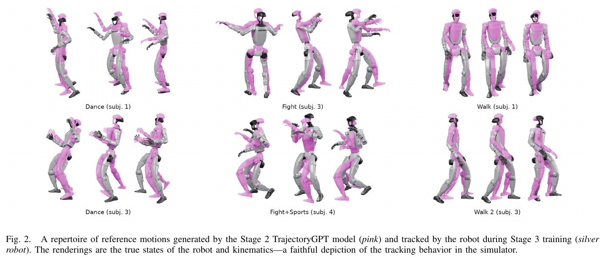
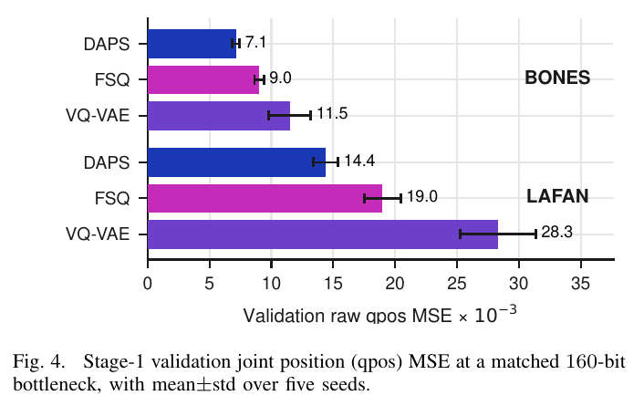
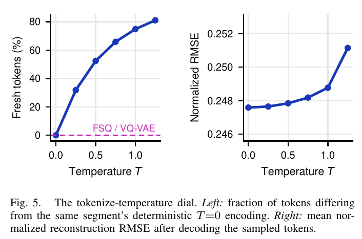
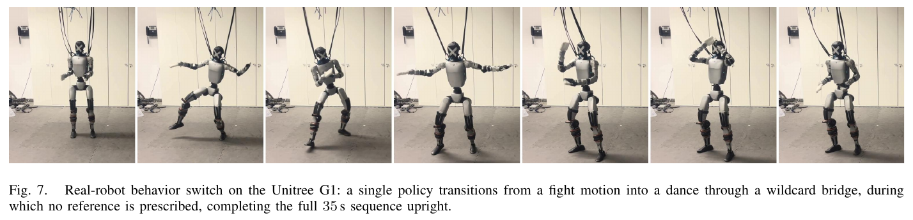
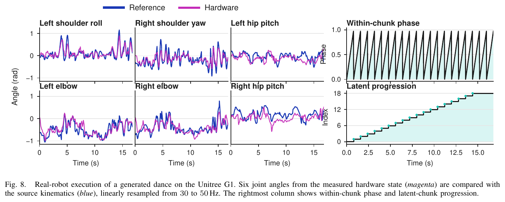

# 034 · Stochastic Motion Tokenization

## 基本信息

- **完整标题**：Whole-Body Humanoid Control via Stochastic Motion Tokenization。
- **作者 / 机构**：Michael Drolet、Oleg Arenz、Jan Peters；TU Darmstadt、DFKI、hessian.AI、Robotics Institute Germany。
- **版本 / 会议**：arXiv:2610.36452v1，2026-10-27，实际 PDF **8 页**；arXiv 与作者所在机构列为 **Humanoids 2026**。
- **来源**：[论文 v1](https://arxiv.org/abs/2610.36452v1) · [全文 HTML](https://arxiv.org/html/2610.36452v1) · [机构书目](https://www.ias.informatik.tu-darmstadt.de/Publications/BibTex?id=12053) · [原论文](https://arxiv.org/abs/2610.36452v1)。
- **相关基础工作**：[DAPS 原方法项目](https://www.drolet.io/daps/) · [DAPS ICLR 2026 代码分支](https://github.com/mdrolet01/jadex/tree/daps-iclr2026)。这些资料对应前作，不能直接视为本篇三阶段人形控制系统的完整开源。
- **阅读日期 / 状态**：2026-10-29；已阅读全文、核对关键实验与原图，未复现。
- **类目**：Wholebody Intelligence → **运动控制与重定向**；关联大脑模型与任务策略。主要关注生成器与全身控制器共享的离散接口及物理执行，包含高层 motion 生成。
- **标签**：DAPS、stochastic tokenizer、TrajectoryGPT、motion generation、PPO、latent-conditioned tracking、wildcard transition、Unitree G1。

## 一句话理解

**把 0.8 秒全身动作压缩成 16 个离散 token，让 Transformer 接着生成下一段，再让能看到未来 token 的 RL 控制器把它变成真实运动。**

其中“随机”指同一段动作可以对应多个可采样的编码，而这些编码仍能重建相近的动作；不是让机器人关节随机运动。最明确的证据是同容量 tokenizer 重建对比，以及预生成动作在 G1 上的执行。真机实验中高层没有在线重规划。

## Motivation

1. **速度指令不足以表达复杂全身行为。** “向前走多快”无法完整描述跳舞、格斗动作或从一种行为切换到另一种行为。
2. **逐帧或短视野参考限制提前准备。** 控制器若不知道后面将改变动作，就难在当前阶段主动调整姿态和重心。
3. **连续高维姿态不便于高层组合。** 希望用紧凑的离散表示同时支持生成、多种动作风格和较长时间的控制预览。
4. **确定性量化只给一种编码，随机表示可提供更多等价训练目标。** 本文采用已有 DAPS 的自回归分类分布与显式熵控制，研究它是否比 FSQ / VQ-VAE 更适合构建这种动作接口。（§I–II）

## 方法：三阶段顺序训练

总体数据流是：

`已重定向到 G1 的 motion → DAPS 学习编码 / 重建 → 冻结 tokenizer → TrajectoryGPT 学习下一段 token → 离线生成参考动作库 → PPO 学习直接读 token 的物理控制器`

前一阶段训练完成后冻结，再开始下一阶段；不是端到端联合训练。

### 1. 数据：处理的是 G1 运动，不是直接从视频恢复人体姿态

使用 **LAFAN1** 与 **BONES-SEED** 中已重定向到 **29-DoF Unitree G1** 的运动。统一到 **30 Hz**，每个窗口 **24 帧＝0.8 秒**。

每帧机器人构型 `q` 为 **36 维**：根部位置 / 朝向及 29 个关节角；再用正运动学计算 14 个身体 site 相对 root 的位置与 6D 旋转，共 `14×(3+6)=126` 维。最终每帧 **162 维**，一个输入窗口为 `24×162`。

这些 site 特征使损失关注身体几何关系，避免只用逐关节角度误差。输入数据已经完成运动重定向，本文没有提出 ego / exo 视频到 motion 的恢复网络。（§III）

### 2. Stage 1：DAPS 随机离散运动编码器

**训练输入**：真实 G1 运动窗口 `24×162`。

**编码输出**：**16 个 token，每个有 1024 种取值**，名义容量为 `16×log₂(1024)=160 bit`。这里是整个 0.8 秒片段的编码，不是一个 token 对应一个关节或一帧。

编码器和解码器均为时序 Transformer。编码器按自回归分布依次产生 token，后面的 token 可以依赖前面的 token；解码器先预测全部 24 帧的 36D 构型，再用**可微正运动学**计算 site 特征。

训练最大化“重建对数似然 − β×编码分布相对均匀先验的 KL”。可微正运动学使输出的关节与身体几何保持一致，但**运动学一致不保证动态稳定、无碰撞或接触合理**，物理执行由 Stage 3 解决。

#### 离散采样不能直接反传，DAPS 怎么训练？

可以把编码器理解成“给同一段动作试几种编码”的策略：

1. 从当前编码分布采样若干 token 序列。
2. 将每个序列解码，用重建对数似然给它打分，并减去 Monte Carlo baseline 得到 advantage。
3. 在“不要离旧编码分布太远”的 KL trust region 内，提高较好编码的概率，同时保留熵 / 先验正则。
4. 用重要性权重做**加权最大似然**，把新的目标分布拟合回编码器。
5. 解码器用当前采样编码做常规最大似然更新；通过 ESS 自动调节分布更新步长。

这不需要通过离散采样路径求梯度，也不使用 straight-through estimator。**DAPS 的 policy search 在这里优化的是编码分布，重建质量是其回报；它与 Stage 3 在物理环境中训练机器人 PPO 是两件事。** DAPS 来自作者此前的工作，本篇贡献是其在人形 motion 接口中的应用与验证。（§III-A）

#### 温度到底控制什么？

对同一动作窗口，低温时编码接近确定性选择；升温后更容易采到不同的 token 序列。期望是这些替代编码仍重建出相近运动，从而给下一阶段提供更多有效目标。

这是**动作的编码多样性**，并不等同于机器人行为多样性，也不是给电机加噪声。token 索引本身同样不意味着人工命名的“抬腿”“出拳”等语义技能。

### 3. Stage 2：TrajectoryGPT 生成下一段全身 motion token

- **模型**：encoder–decoder Transformer，**12 层、embedding 384**。
- **输入**：行为条件＋过去 **8 个 chunk**，即 6.4 秒的 token 历史。
- **条件**：LAFAN1 用 one-hot 行为标签，BONES-SEED 用文本 embedding。
- **输出**：下一段的 **16 个 motion token**，对应未来 0.8 秒。
- **监督**：冻结 DAPS 对真实下一运动窗口给出的编码分布；优化该分布与预测分布之间的 KL / 交叉熵。冻结编码器的熵项对 Stage 2 梯度是常数。

它学习的是 tokenizer 的后验分布，而不是只拟合一个固定硬标签。训练中以小概率把部分历史替换成 start token，因此推理可从真实 motion 前缀继续，也可只给 start token 和行为条件开始生成。新生成的 chunk 会加入下一次历史，原则上可不断续写。

要区分**架构可不断续写**和**实验证明无限长稳定运行**。本文通过生成参考库供 Stage 3 使用，没有给出足以证明开放式长程生成质量、强文本泛化的系统评测。低交叉熵也可能来自记忆训练续写，作者明确不把它单独当作 motion 质量指标。（§III-B、IV-B）

### 4. Stage 3：PPO 控制器直接读 token，解码器负责离线参考构建

actor 输入：

- 当前机器人本体感知；
- 当前 chunk 内的 phase；
- 长度 **3 个 chunk** 的滚动 token 缓冲：当前段 0.8 秒＋未来两段 1.6 秒。

所以控制器能看到 **2.4 秒动作意图**，名义编码容量 **480 bit**。这表示离散编号的信息容量，不是神经网络展开后的实际浮点输入或内存大小。

**训练时**，DAPS 解码出的参考运动用于奖励计算。奖励比较关节位置 / 速度、root-relative site 位置 / 朝向 / 速度、平面 root 速度等，使用 DeepMimic 风格的指数误差项。没有专门的平面 root 位置跟踪项，因此不是严格沿世界坐标路径导航。

**执行时**，actor 根据当前状态、phase 和 token 输出机器人控制动作，论文没有完整说明底层动作参数化，不能自行补成“直接输出 29 维力矩”或“必然输出 PD 关节目标”。但有一点明确：**actor 不接收逐帧参考关节姿态，DAPS 解码器和 TrajectoryGPT 都不在真机 50 Hz 控制循环中运行。**

训练采用 JAX / XLA、2048 个并行 MuJoCo 环境；对执行器增益、连杆质量、摩擦和外部推力做随机化，并加入动作变化率、关节加速度与力矩惩罚以减小抖动。Figure 6 的拼接策略训练到 **20 亿环境步**，这与 tokenizer 的 25 万训练更新不是同一个计数。（§III-C、IV-D–E、V）

### 5. Wildcard：留出一段没有指定姿态参考的过渡时间

设要从格斗动作切到舞蹈。直接拼接两个独立生成片段时，身体状态可能接不上。作者在中间放入 **2 个 wildcard chunk，共 1.6 秒**：

`格斗 21 段（16.8 s）→ wildcard 2 段（1.6 s）→ 舞蹈 21 段（16.8 s）`

总计 **35.2 秒**，正文摘要与图注取整为约 35 秒。

Wildcard 期间**移除参考跟踪目标，保留稳定性相关正则惩罚**。控制器仍感知真实身体状态，并能通过未来 token 看到即将开始的动作，因此可以自行完成姿态衔接，再恢复参考跟踪。

这既不是关掉控制器，也不是人为提供一条平滑插值轨迹。例如它可以在过渡中调整身体以便接入舞蹈，但具体调整由策略学习，论文没有把某一种“收拳 / 换脚”操作写死。成功示范证明这种接口有用，尚不能证明任意两类未见动作都能顺畅衔接。

### 训练与部署输入输出速查

| 模块 | 输入 | 输出 / 监督 | 训练中更新什么 |
|---|---|---|---|
| DAPS tokenizer | 已知 24 帧 G1 motion | 16 个离散 token；重建 24 帧构型与 FK 特征 | 编码器、解码器 |
| TrajectoryGPT | 行为条件＋8 段历史 token | 下一段 token 分布；目标来自冻结 DAPS | 高层 Transformer |
| PPO tracker | 本体感知＋phase＋3 段 token | 机器人控制动作；物理 rollout 的跟踪奖励与正则 | 低层 actor / critic |
| 本文真机部署 | 预先计算的 token 序列＋实时机器人状态 | 50 Hz 低层控制 | 不在线训练；不在线调用生成器或 DAPS 解码器 |

## 实验

### 1. 相近压缩容量下，DAPS 重建更好

DAPS、FSQ、VQ-VAE 使用匹配架构、embedding 128、16 个 token、约 1024 项词表，训练 **250k steps、5 个种子**。FSQ 使用 `[8,5,5,5]` levels，实际乘积为 1000，论文按约 1024 项 / 160-bit 进行容量匹配。

验证集 **raw qpos MSE ×10⁻³，均值±标准差**：

| 数据集 | DAPS ↓ | FSQ ↓ | VQ-VAE ↓ |
|---|---:|---:|---:|
| BONES-SEED | **7.1±0.3** | 9.0±0.4 | 11.5±1.7 |
| LAFAN1 | **14.4±1.0** | 19.0±1.5 | 28.3±3.0 |

相对 FSQ 分别降低约 **21.1% / 24.2%**，相对 VQ-VAE 降低约 38.3% / 49.1%（均为按论文均值计算）。qpos 含根部构型及关节分量，这不是以米计的 MPJPE，也不是机器人任务成功率。

验证条件对数似然同样更高：BONES-SEED 为 −910.4±1.3，对比 FSQ −919.0±1.8、VQ-VAE −930.6±7.7；LAFAN1 为 −936.7±4.6，对比 −949.3±4.0、−994.7±16.7。

**此处只证明 tokenizer 重建优势。后续没有分别以 FSQ / VQ-VAE 重训整套控制系统作同条件真机比较，不能推出 DAPS 必然提高任务成功率。**（§IV-A、Fig. 4）

### 2. 很多 token 可以变，重建动作仍几乎不变

在 BONES-SEED 验证集 **558 万个 segments** 上，同一片段用不同温度编码，相对确定性 `T=0` 的 token 位置变化比例：

- `T=0.25`：31.8%；`T=0.5`：52.4%。
- `T=1`：**74.8%**；`T=1.25`：81.0%。

对应 normalized reconstruction RMSE 从 `T=0` 的 **0.2476**，到 `T=1` 的 **0.2488**，再到 `T=1.25` 的 **0.2512**；相对增加约 0.5% / 1.4%。这支持“存在大量重建效果相近的替代编码”。558 万计的是窗口片段，不能解释为 558 万条独立采集动作。

Figure 3 中约 0.20 的 standardized RMSE 是一个示例窗口的重建曲线；不要和 Figure 5 的验证集均值混作同一统计量。（§IV-A、Fig. 3、5）

### 3. 物理跟踪实验不是一个覆盖所有动作的大型通用控制器

论文训练了 **3 个不同 PPO 策略**：

1. 训练于 25 条不同生成 motion 的策略；Figure 2 展示其中 6 个例子。
2. 训练于 3 条基础生成 motion 及所有 9 种转移配对的拼接策略，包含同风格转移。
3. 训练于 5 条 motion 的较小策略。

Stage 3 的参考库取自 **LAFAN1 训练的 TrajectoryGPT**。因此，虽然框架支持 BONES-SEED 文本 embedding，不能将这组真机试验描述为任意自然语言指令的在线泛化评测。

G1 上，五动作策略完成了 dance、fight、walk，各 **16.8 秒**，并保持站立、推进完整 token 序列；拼接策略完成约 **35 秒 fight→dance**，包含 wildcard 过渡。

本文没有提供多次试验成功率、置信区间、各种动作的系统汇总误差，或未见 token 排列的保持集泛化测试。作者也明确把“区分运动技能复用与已见完整时间表记忆”列为下一步。（§IV-C、V）

Figure 8 将 30 Hz 参考线性重采样到 50 Hz，与测得的 6 个关节角比较。两者有可见偏差；这些残差包含低层跟踪和 sim-to-real 误差。由于参考库固定、离线产生，不能归为在线生成延迟造成的误差。

### 4. 训练和运行参数

- 数据：30 Hz，24 帧 / 0.8 s 一段，每帧 162D。
- Stage 1：16 tokens，1024 类，embedding 128，batch 256，250k 更新；MC 采样数 16，ESS target 0.5；β 从 0.3 退火到 BONES-SEED 的 0.01、LAFAN1 的 0.003。
- Stage 2：12 层，embedding 384，8 段历史；具体模型训练总步数与文本编码器型号在本文中没有完整给出。
- Stage 3：2048 环境、rollout 50、γ＝0.99、GAE λ＝0.95、desired KL 0.01–0.02、3 段 latent buffer，报告训练到 2B 环境步。
- 所有阶段用 JAX / XLA；每阶段单 GPU，显存范围 24–80 GB。没有给出可直接比较的完整端到端训练时间。
- 部署 50 Hz；每 0.8 秒推进一个 chunk，chunk 内 phase 固定速率前进。按时间计算每段约 40 个低层控制周期，并不是把原 24 帧加速播放。

## 结论与局限

**本文的价值是验证：一个随机离散运动表示，可以同时充当生成模型的词汇，以及物理控制器能够直接读取的未来动作接口。** 数据支持 DAPS 在匹配容量下的重建优势；真机展示说明有限动作库中的生成动作与行为切换能够落地。

需要保留的边界：

1. **预览不等于高低层闭环重规划。** 当前 TrajectoryGPT 使用之前生成的历史，未以机器人实际运动状态为条件；真机直接消费离线 token。低层会根据状态反应，但高层计划不会因执行偏差自动重算。
2. **实时生成尚未验证。** 50 Hz 是低层控制，不含 TrajectoryGPT 延迟；论文讨论了异步补充 token 的可能性，但没有将其作为已实现系统报告。
3. **控制器泛化不等于 tokenizer 泛化。** 保持集动作序列、未见拼接方式、动作库扩展后性能，以及 memory / skill reuse 的区分均缺少系统实验。
4. **编码多样性不等于任务多样性。** token 改变 74.8% 仍重建近似动作，反而说明索引改变不能直接作为行为差异指标。
5. **运动意图不包含完整导航目标。** 平面 root 位置未被显式跟踪；路径 / 目标条件导航属于后续扩展。本文也没有物体操作与接触任务评测。
6. **缺少部分控制实现细节与全系统对照。** 文中未完整展开底层 action 参数化、所有训练配置，亦未给出换 tokenizer 后控制成功率的因果消融。

## 与前一篇 Tokens of Motion 的区别

- **Tokens of Motion / M-PACT**：手腕平移、旋转、开合；自动变长切段；16 类平移＋4 类开合＋连续旋转；小解码器预测段末净效果，研究人到机器人的操作表示迁移。
- **本篇**：整个 G1 身体；固定 0.8 秒窗口；16 个 1024 类离散 token；运动解码器重建完整 24 帧构型，PPO 控制器直接读 token 执行全身运动。
- 两者都把“表示、预测、实现”分开，但这里的 **16 个 token** 与 M-PACT 的 **16 类平移码**不是同一个含义，不能拿来直接比较容量或能力。

## 开源状态与原图

截至 2026-10-29，已核实作者基础 DAPS 的 [JADEX 分支](https://github.com/mdrolet01/jadex/tree/daps-iclr2026)，README 明确对应 ICLR 2026 前作，并将 LAFAN 标为 TODO release。尚未核实本篇 **TrajectoryGPT＋PPO tracker＋真机部署权重**的完整公开发布。

前作 DAPS 项目页还描述过仿真中的 COM / goal-conditioned 控制示例；本笔记不把前作页面能力并入本篇的真机实验结论。

已保存 **6 张原图**：Fig. 1 总览、Fig. 2 生成与跟踪、Fig. 4 tokenizer 对比、Fig. 5 温度实验、Fig. 7 真机过渡、Fig. 8 真机测量。均保留完整英文图注；[原图记录](../assets/034-stochastic-motion-tokenization/manifest.json)与[来源记录](../assets/034-stochastic-motion-tokenization/source-record.json)记录版本、页码与校验值。
