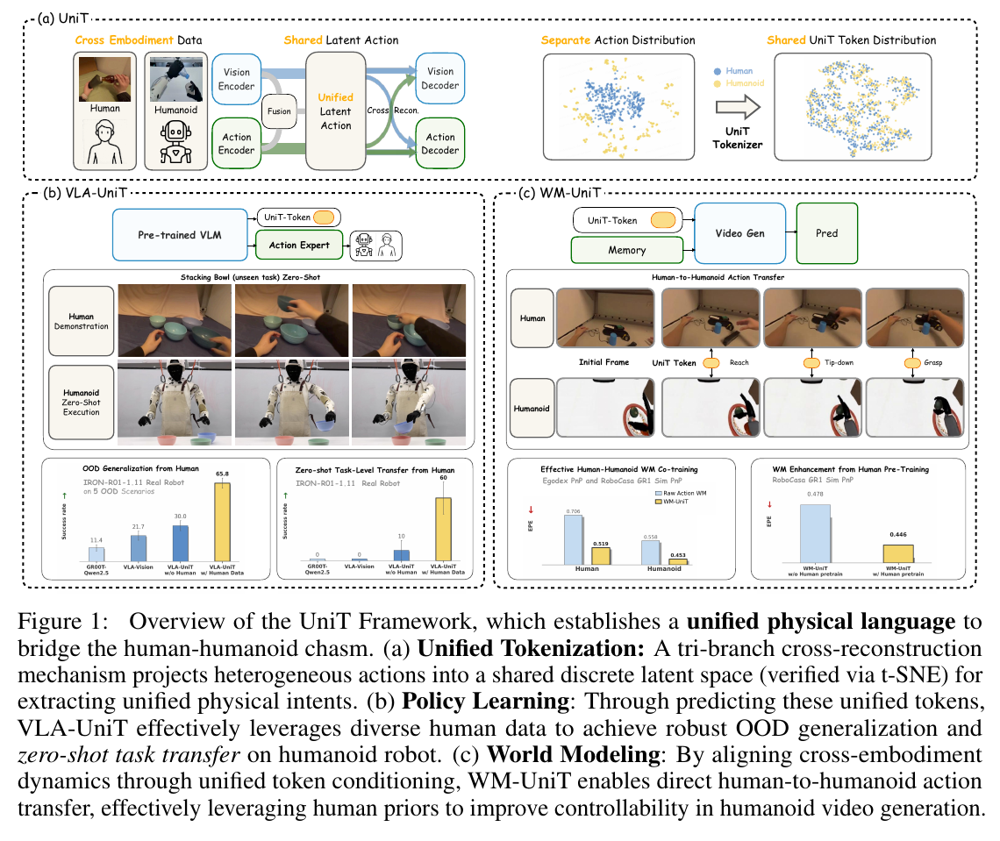
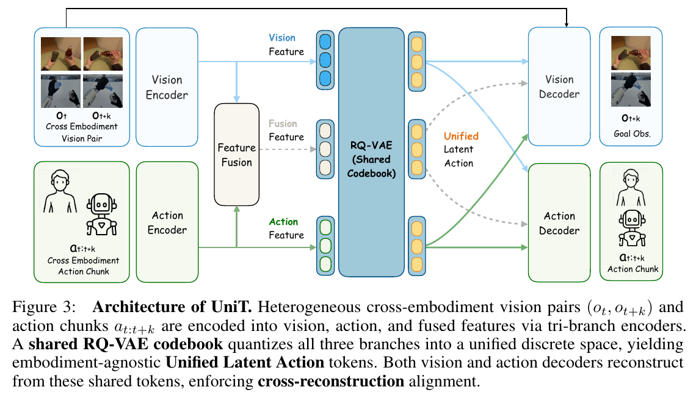
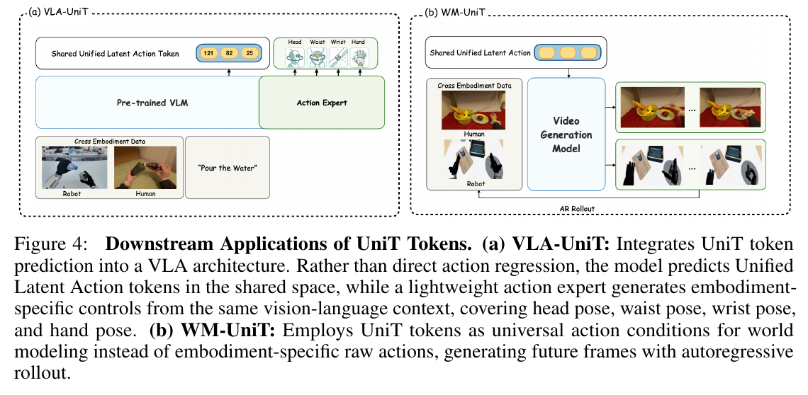
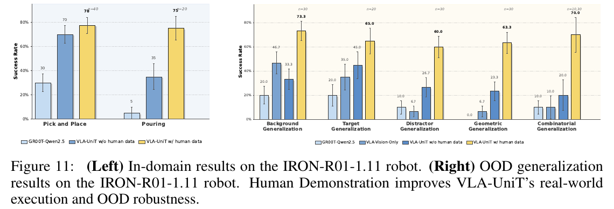
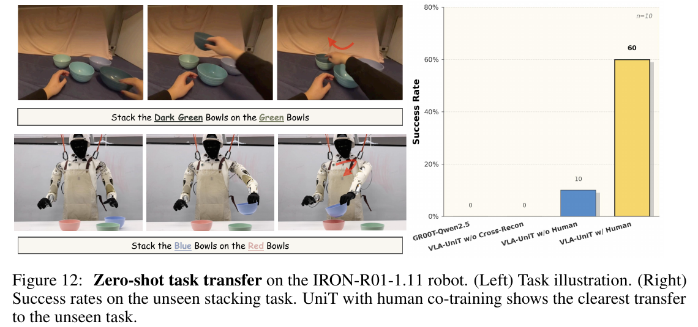
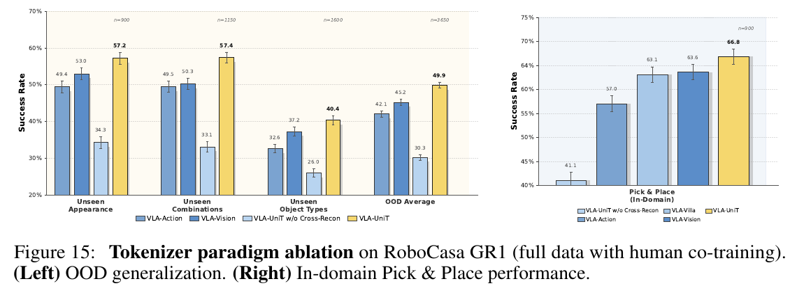

# 035 · UniT

## 基本信息

- **完整标题**：UniT: Toward a Unified Physical Language for Human-to-Humanoid Policy Learning and World Modeling。
- **作者 / 机构**：Boyu Chen、Yi Chen、Lu Qiu、Jerry Bai、Yuying Ge、Yixiao Ge；XPENG Robotics、清华大学、香港大学。
- **版本**：arXiv:2604.19734v2，2026-10-11，PDF **21 页**；初版 2026-04-21。arXiv 注明 v2 只增加引用附件，正文不变。本笔记固定 v2，不混入后续 Fe₀ 的结果。
- **来源**：[论文 v2](https://arxiv.org/abs/2604.19734v2) · [官方项目](https://xpeng-robotics.github.io/unit/) · [代码](https://github.com/xpeng-robotics/UniT) · [权重](https://huggingface.co/xpeng-robotics/VLA-UniT-checkpoints) · [原论文](https://arxiv.org/abs/2604.19734v2)。
- **阅读日期 / 状态**：2026-10-30；已阅读全文、核对官方代码接口与原图，未复现。
- **类目**：Wholebody Intelligence → **大脑模型与任务策略**。主要贡献是跨人类 / 人形机器人的动作表示，以及 VLA 和世界模型中的利用；没有提出新的步行稳定控制器。
- **标签**：human-to-humanoid、visual anchoring、cross-reconstruction、RQ-VAE、VLA、world model、EgoDex、GR1、IRON。

## 一句话理解

**人和机器人关节不同，但“把杯子拿起来”造成的视觉变化有相似性。UniT 用这种视觉变化，把各自的动作压缩进共享表示，再用这个表示教 VLA 做动作、教世界模型预测动作后的视频。**

核心是“视觉与动作相互监督的表示学习”。VLA 的离散 token 是训练目标，动作专家读取共享上下文；WM 则直接使用动作编码器的连续特征。不能把两个下游都画成“生成 token → 同一个解码器 → 机器人”。

## Motivation

1. **机器人数据少，人类数据多，但关节空间不兼容。** 人的手腕与手指轨迹、GR1 的关节角、IRON 的控制量维数与定义不同。直接混合回归，模型容易按机身分别记忆。
2. **只编码动作，缺少共同参照。** 相似物理效果在人和机器人上可能对应完全不同的数值动作。
3. **只编码图像变化，容易把外观混进动作。** 光照、背景、皮肤 / 机械手外观也会变化；只看视频可能忽视精细手部运动。
4. **同时输入两种模态也不保证对齐。** 如果各自用独立词表、只重建自己，模型仍可能保留两套互不相通的表示。

作者提出的共同参照是**动作对应的视觉后果**：让动作表示解释画面变化，同时让视觉表示能解释运动学信息。（§1–3）

## 方法：先学共享表示，再分别训练策略与世界模型

### 1. 数据是什么：视频与动作标注成对，而非只给任意人类视频

一个训练片段包含：当前图像 `o_t`、未来图像 `o_{t+k}`、当前状态 `s_t` 和这段时间的动作 `a_{t:t+k}`。人的数据使用 EgoDex 的视觉和运动标注；机器人的数据使用各自的状态与动作。

它不要求把人的动作先用 IK 重定向为机器人关节角，也没有要求人和机器人逐条同步演同一动作。但**每个自身片段的图像和动作必须对应**。本文主要实验并不是从无动作标签的互联网视频直接学会机器人控制；纯视频扩展写在讨论中。

### 2. Tokenizer：三个分支，共享量化空间

- **视觉分支**：冻结 DINOv2 提取当前 / 未来图像特征，Transformer 与可学习 query 汇聚两帧变化，得到 `z_v`。这是 inverse dynamics 思路：从前后变化推断发生了什么。
- **动作分支**：当前状态＋动作 chunk，先 padding，再通过不同 embodiment 的 MLP 和编码器，得到 `z_a`。padding 只统一张量形状，不会自动统一关节含义。
- **融合分支**：融合视觉和动作特征，得到 `z_m`，同时利用两者的信息。
- **共享 RQ-VAE**：三个分支使用共享的残差量化模块 / 词表。多级量化逐级编码剩余误差，得到离散编号和相应量化向量。

共享词表不表示所有分支必须对每条样本输出完全相同的编号，也不意味着一个编号被人工定义为“抓取”或“抬手”；这种语义是训练产生的。

### 3. 为什么要 cross-reconstruction？

对每个分支的量化结果，都要求完成两项任务：

`量化表示 + 当前图像特征 → 预测未来图像的 DINO 特征`

`量化表示 + 当前状态 → 重建该 embodiment 的动作 chunk`

也就是说，**视觉分支不能只重建视觉，动作分支不能只重建动作；三个分支都要同时解释两种模态。** 视觉 decoder 共享，动作 decoder 按 embodiment 适配。

视觉监督实际是 **DINO 特征的 cosine loss**，不是在 tokenizer 阶段逐像素生成未来 RGB。动作项监督重建，另加残差量化的 commitment loss：

`L_tokenizer = Σ分支 [λ_v × L_visual + λ_a × L_action + L_RQ]`。

直观上，“人把杯子抬高”和“机器人把杯子抬高”虽然关节不同，但都要解释杯子上升的视觉后果，因而有机会学到接近的表示。反过来，单纯桌面纹理变化无法解释手部动作，会受到动作重建约束。

这是训练设计与作者的解释，**不是数学上保证所有背景因素都被消除、所有人机动作严格一一对应**。t-SNE 的混合分布是辅助观察，性能与消融才提供进一步证据。（§3.2、5.1）

### 4. VLA-UniT：token 监督“理解”，flow matching 生成实际动作

以 GR00T N1.5 框架和 Qwen2.5-VL 为基础，先训练 tokenizer，然后冻结它。

**训练标签怎么得到？** 将真实的当前图像、未来图像、状态和动作送进冻结 tokenizer，用融合分支产生目标离散 code。

**策略看到什么？** VLM 读取当前图像、语言指令与可学习 query，预测这些 code，优化交叉熵。未来图像和真实未来动作只用于标签，不是执行时的输入。

**机器人动作怎么出来？** 另一条 flow-matching action expert 分支读取 VLM 最后一层上下文、当前视觉编码，输出连续动作 chunk。公开实现还显式编码当前本体状态和 embodiment ID。训练时把真实动作与噪声混合，预测从噪声到动作的速度场；推理时从噪声逐步积分得到动作。

论文的总体损失是 `L_VLA = L_token + λ_fm × L_fm`。token 预测与动作预测共同使用视觉语言表示，从而让动作专家受益于被 token 任务塑造的共享特征。

**关键区分：这里并非“先 argmax 出离散编号，再送 tokenizer 的动作 decoder 执行”。** 论文 §3.3 的公式和公开实现均显示，action expert 的输入是上下文特征。默认 `vision_lang_obs` 配置甚至把 query / bridge 段从动作上下文中分离，保留视觉语言 token 与当前图像 embedding；离散预测头主要提供 CE 监督。不能把它类比成前一篇 Stochastic Motion Tokenization 的“PPO actor 直接读取 motion token”。

### 5. WM-UniT：给动作，预测未来视频

WM-UniT 采用 Cosmos Predict 2.5。此时输入是当前 / 初始图像，以及**已给定的状态和动作序列**，输出未来视频。

因为未来图像正是待预测对象，不能再将它送进视觉或融合分支。因此使用：

`当前状态 + 动作 chunk → UniT 动作分支 → 量化之前的连续特征 → MLP → 视频模型 cross-attention → 未来视频`。

注意正文 §3.4 明确为 **pre-quantization continuous features**。项目总图虽统称 UniT token，不能据此写成 WM 实际只接收离散编号。视频模型同样用 flow matching，在未来帧的 latent 空间训练；长序列将生成帧反馈给后续步骤。

跨 embodiment 时，可以用“人类动作编码＋机器人初始画面”生成机器人执行相似动作的视频。**这是条件视频迁移，不是世界模型直接发出电机指令，也不等于机器人已物理完成这个动作。** 本文没有把 VLA 与 WM 联成在线规划、搜索或强化学习的闭环；这属于后续方向。（§3.4、6）

### 6. 用“把碗叠起来”串起流程

以下是依据方法的通俗解释，不额外假定人工语义标签：

1. 人类示范记录了拿碗、移动、放到另一个碗上的画面与手部运动。
2. Tokenizer 同时学习“运动是什么”和“画面怎么变”，将这段变化编码进共享表示。
3. 训练 VLA 时，只给当前画面和“叠碗”指令，让它预测示范对应的 token；动作专家同时学习相应 embodiment 的动作。
4. 机器人执行时，依据当前自己的画面、本体状态和指令，由 action expert 生成机器人控制量。它利用人类数据补充的任务知识，以及机器人数据学到的执行能力。
5. 若做 WM 实验，则给定这段人类动作和机器人画面，生成“机器人叠碗”的未来影像；这与第 4 步的真机策略实验分别评估。

### 7. 公开代码补充的具体参数

以下是截至 2026-10-30 的官方提交 `800c0a428d431964dad4e7adc9c667d639432249` 的配置，不将其冒充论文所有实验的统一设置：

- 默认 Qwen2.5-VL-3B-Instruct；tokenizer 用 DINOv2-large。
- 动作 horizon **16 步**；状态和动作 padding 到 **128 维**。128 是存储上限，不等于机器人 128 个真实自由度。
- **8 个 latent query × 2 级 RQ**，每级 **128 项、32D code embedding**，相当于每 chunk 16 个 code index。名义索引容量 `8×2×log₂128=112 bit`，并非网络张量的实际存储量。
- VLA 默认动作 flow 推理 **4 步**。没有据此推算真机控制 Hz 或端到端延迟。
- full-data 脚本：tokenizer **80k** 更新 → VLA **160k** 更新。
- few-shot＋EgoDex 脚本：tokenizer **80k** → 混合预训练 **20k** → 仅 GR1 微调 **20k**。
- 示例默认 8 GPU；README 称训练默认超参数面向每设备 120+ GB 显存，仿真 rollout 测过 RTX 4090 24 GB。这是官方运行说明，并非本文全部实验的完整算力报告。

[Tokenizer 配置](https://github.com/xpeng-robotics/UniT/blob/800c0a428d431964dad4e7adc9c667d639432249/gr00t/model/configs/shared_tokenizer/gr00t_tokenizer_mix_unified_eef_dino.json) · [VLA 配置](https://github.com/xpeng-robotics/UniT/blob/800c0a428d431964dad4e7adc9c667d639432249/gr00t/model/configs/shared_dual_system/gr00t_n1.5_unit_tokenizer.json) · [策略接口](https://github.com/xpeng-robotics/UniT/blob/800c0a428d431964dad4e7adc9c667d639432249/gr00t/model/gr00t_n1_unit.py) · [动作专家](https://github.com/xpeng-robotics/UniT/blob/800c0a428d431964dad4e7adc9c667d639432249/gr00t/model/action_head/flow_matching_action_head_unit.py)。

## 实验

### 1. 仿真策略：24 项任务，数据效率更高

RoboCasa GR1 桌面操作包含 **18 项 pick-and-place、6 项 articulated**（如放入物体后关闭抽屉 / 微波炉），每项 **50 次测试**，共 **1200 次**。

Full-data 为 24,000 条机器人轨迹、每任务 1000 条；few-shot 为 2400 条、每任务 100 条。

- Full-data：UniT 总成功率 **66.7%**，PnP **67.3%**，articulated **64.7%**。
- 对比 FLARE **55.0%**，提高 **11.7 个百分点**；同架构无 UniT token 监督的 GR00T-Qwen2.5 为 **47.8%**，差 **18.9 个百分点**。
- 仅 10% 训练数据时，UniT **45.5%**，接近全数据 GR00T 的 47.8%；同少量数据的 GR00T 为 **21.3%**。

因此“约 10 倍数据效率”指该基准上以十分之一机器人数据接近特定 baseline 的全数据成绩，不能理解为任何任务都减少 90% 数据且性能不降。Fig. 9 中不同 baseline 还涉及不同 backbone；最直接的同架构控制实验是 Fig. 10 的 GR00T-Qwen2.5。（§4.1、5.2.1）

### 2. 人类数据迁移：有收益，也有任务取舍

使用 EgoDex `basic_pick_place` 的 **27,419 条**轨迹，与少量 GR1 数据混合训练，再仅用机器人数据微调。

- ID 总体：**45.5 → 50.0%**；PnP **41.7 → 49.4%**。
- Articulated：**56.7 → 51.7%**，此子类下降，不能写成所有 ID 任务都有提升。
- OOD 新外观：**37.0 → 42.7%**；新组合：**40.7 → 43.0%**；新物体类型：**29.0 → 33.0%**。
- OOD 汇总：**34.7 → 38.5%**。三组共 18 / 23 / 32 项任务，各 50 次，总 **3650 次**，不是三个百分数的简单平均。

这表明与人类数据内容更接近的 PnP 获益最大，也提醒共训练不一定让每一类任务同时变好。（Fig. 10）

### 3. 真机：IRON 操作、OOD 与叠碗

平台为 **IRON-R01-1.11**，**50D 动作**涵盖手臂、手、腰、头与手腕位姿。论文为 pick-and-place 和 pouring 各采集 **120 条机器人示范**；对应人类子集分别为 27,419 和 3205 条。

**数据口径需保留：** §4.1.3 写所有模型先在 **32k 私有机器人轨迹＋30k EgoDex** 上预训练，再任务微调；结果图又标注 “w/o human” 与 “w/ human”。因此图中“无 human”不宜自行解释为整个训练历史完全没有人类数据；两个阶段的人类样本具体构成与各 ablation 的预训练继承关系，正文没有充分展开。

| 真机任务 | GR00T-Qwen2.5 | UniT w/o human | UniT w/ human |
|---|---:|---:|---:|
| Pick-and-place | 30% | 70% | **78%** |
| Pouring | 5% | 35% | **75%** |

Fig. 11 标注 PnP `n=40`、pouring `n=20`；78% 为图中取整结果。原图带误差条，正文未清楚定义其统计计算方法，不能自行称为跨种子标准差或 95% 置信区间。

五种 OOD 包括背景、目标、干扰物、几何形状以及多物体指令辨别。前四项的机器人训练只覆盖部分变化，**人类数据补充对应变化**，再测试这种人类引入的条件；不是对所有训练来源都未见。

- 背景：UniT **33.3 → 73.3%**；目标 **45.0 → 65.0%**。
- 干扰物：**26.7 → 60.0%**；几何 **23.3 → 63.3%**。
- 多物体组合辨别：**20.0 → 70.0%**，按 Fig. 11 同一 UniT 的两根柱子。

**原文数字冲突：** §5.2.3 将最后一项写成 10→70%，但 Fig. 11 中 UniT w/o human 柱为 20%，10% 对应其他 baseline。本笔记保留原图口径，不把冲突抹平。该图前四组标注 n＝30 / 20 / 30 / 30，最后一组标注 n＝10,30，未给出足够清楚的逐模型映射。

### 4. “零样本叠碗”到底零在哪里？

机器人数据有单个碗的拿放，但没有叠碗示范；人类数据包含叠碗。测试结果，**每模型 n＝10**：

- GR00T：0%；UniT 去交叉重建：0%。
- UniT 无该人类共训练：10%。
- UniT 加人类数据：**60%，即 6/10 次**。

展示中出现转腰、转头调整视角等上半身协同。这个结果支持**任务知识从人迁移到机器人**，但并非零机器人数据、零目标机身适配，或从未见过叠碗的任务。样本量较小，不能直接外推到复杂接触、走动操作或任意新任务。（Fig. 12、§5.2.3）

### 5. 世界模型：改善条件视频预测

所有 WM 实验评估 **10 步自回归、共 10 秒视频**；DROID 分辨率 192×320，EgoDex / RoboCasa 为 192×336。EPE 是**光流 End-Point Error**，不是机器人末端执行器轨迹误差。

| 条件 / 数据 | 指标 | Raw Action / 不用人类预训练 | UniT |
|---|---|---:|---:|
| DROID | PSNR ↑ | 21.02 | 21.32 |
| DROID | FVD ↓ | **76.38** | 76.44 |
| DROID | 光流 EPE ↓ | 0.2662 | **0.2588** |
| 人机共训练，EgoDex 侧 | EPE ↓ | 0.706 | **0.519** |
| 人机共训练，GR1 侧 | EPE ↓ | 0.558 | **0.453** |
| 人类预训练后 GR1 微调 | EPE ↓ | 0.478 | **0.446** |

DROID 的 FVD 略逊 Raw Action；不能说所有指标全面领先。人机共训练下收益更明显：GR1 的 PSNR **13.45→17.66**、FVD **237.13→166.50**；人类预训练后，GR1 FVD **180.51→153.31**。（Table 1–2）

跨 embodiment 条件生成用 Gemini-3-Pro 自动评分，语义 / 时间 / 几何三轴各 1–5 分。总分 robot→human **2.92→3.84**，human→robot **2.95→3.27**。它衡量生成视频与源动作的感知一致性，不是物理可行性验证或机器人成功率；正文未充分给出评分样本数量与裁判稳定性统计。（Table 3）

### 6. 消融与去噪：什么设计真的有用？

在**全量机器人数据＋人类共训练**配置，OOD 汇总成功率：

- action-only：**42.1%**；vision-only：**45.2%**。
- 两模态但无交叉重建：**30.3%**。
- 完整 UniT：**49.9%**，比无交叉重建高 **19.6 个百分点**。

ID PnP 中，双向交叉重建 UniT **66.8%**，作者重实现的单向 V2A / VLA-Villa 为 **63.1%**。不是直接拿原始 Villa-X 发布模型在各自配置下比较。49.9% 的消融使用 full-data，不能与前述 few-shot 的 38.5% 当成同一条件。

在 EgoDex 动作上加入高斯噪声，`σ=0.2` 表示噪声标准差为全局动作标准差的 0.2 倍。重建 MSE 相对干净输入退化：FAST **10.7 倍**、action-only **2.7 倍**、UniT **1.7 倍**。这是动作重建抗噪实验，不是受扰机器人稳定性或实际传感器故障恢复测试。（Fig. 8、15）

## 结论与边界

**最有价值的结论是：以共同视觉后果约束不同动作空间，可以形成比动作单模态或视觉单模态更有用的迁移监督；它既改善策略学习，也改善动作条件视频预测。**

需要保留的边界：

1. **动作标注仍然重要。** 本文利用 EgoDex 成对视觉 / 动作数据；纯互联网视频扩展是讨论方向。
2. **主要是操作和上半身协同。** 没有提供通用双足 locomotion、复杂地形稳定性或 GMT 类全身跟踪基准。
3. **策略与世界模型分别训练验证。** 未实现本文讨论的 latent 空间规划、WM 奖励回流或策略—世界模型闭环共同进化。
4. **共享表示不等于严格不变性。** t-SNE 混合、去噪和下游提升提供经验支持，不保证消除了所有机身与外观信息。
5. **泛化范围有条件。** human-introduced OOD、机器人未见但人类已见叠碗、全新机身零适配，是三种不同问题；本文主要支持前两种。
6. **真实数据与细节开放不完整。** 真机预训练使用私有数据，WM 和真机部署代码仍待发布。小样本真机结果、阶段数据口径及个别图文冲突需要复现时进一步确认。

## 与近期几篇笔记的关系：个人判断

- **Stochastic Motion Tokenization** 学 G1 的运动压缩、续写和物理跟踪；本篇学人机操作的共享表示，token 主要监督视觉语言上下文，WM 用连续动作特征。两者都叫 tokenizer，但处在不同接口。
- **Tokens of Motion / M-PACT** 从手部运动原语与小解码器适配切入；UniT 用视觉后果锚定动作，另外接 VLA 和世界模型。不能把两者的离散容量或不同任务指标直接排名。
- 对关注 **ego 数据 → humanoid** 的研究，本篇值得学习的是“用视觉后果帮助对齐异构动作监督”，而不是一个新的 ego 视频恢复全身 motion 算法。
- 后续最值得验证：保留模型规模与训练预算，只改变对齐目标；用真正未见的任务 / 物体组合、多次真机试验，检验是否仍有迁移收益；再考虑和全身运控接口连接。

## 开源状态、原图与修订记录

截至 **2026-10-30**，官方代码已发布数据处理、UniT tokenizer、VLA-UniT 训练与 RoboCasa GR1 评测。Hugging Face 可见 **3B few-shot / full-data** 策略及 tokenizer 的 safetensors 分片。官方 README 仍列 **WM-UniT、真机部署栈待发布**；本次未运行训练、未下载权重或完整数据。

代码核查固定提交 `800c0a428d431964dad4e7adc9c667d639432249`；权重库元数据提交 `64029aff5548ee1ebc37c44c8990320ca98fa87f`。README 提到后续 Fe₀，但该工作的规模和结果没有并入 UniT。

保存 **6 张作者原图**及完整英文图注：Fig. 1 总览、Fig. 3 tokenizer、Fig. 4 下游接口、Fig. 11 真机结果、Fig. 12 零样本叠碗、Fig. 15 消融。[原图清单](../assets/035-unit/manifest.json)与[来源记录](../assets/035-unit/source-record.json)保留页码、裁切范围和 SHA-256。

- **2026-10-30**：首次总结；固定 v2；区分 VLA 的 token 监督与 action expert 输入、WM 连续特征与离散 token；记录 articulated 负迁移和真机组合泛化图文差异。
