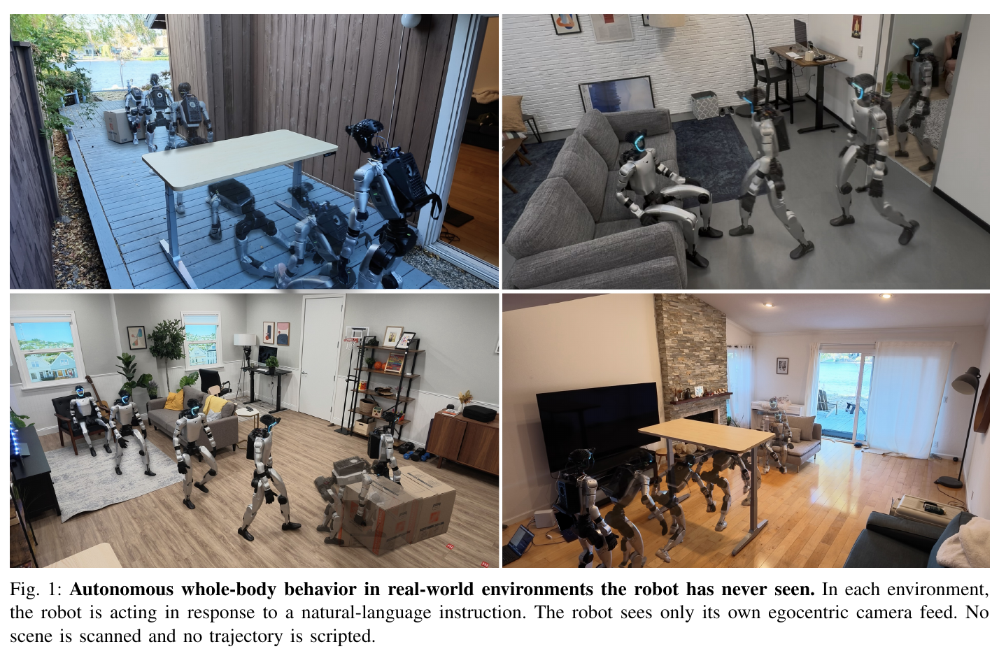
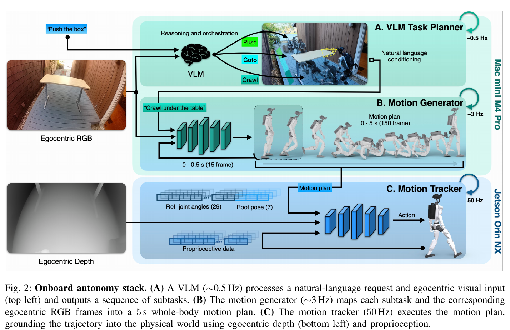
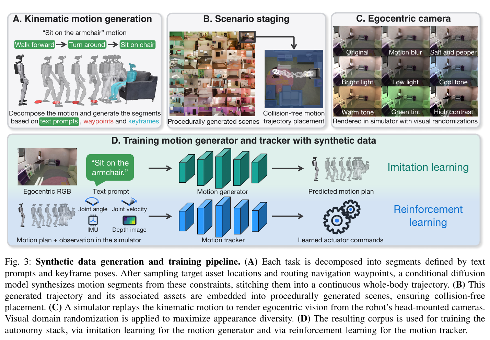
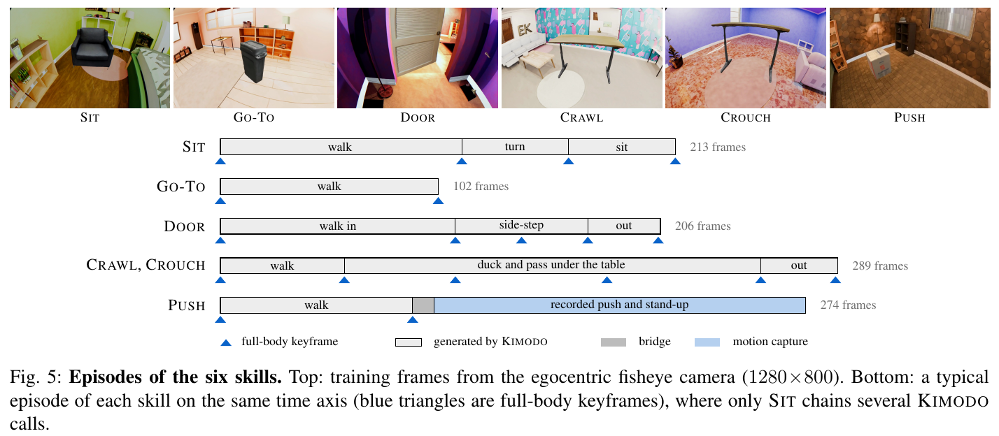
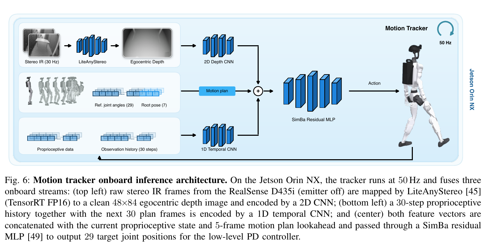
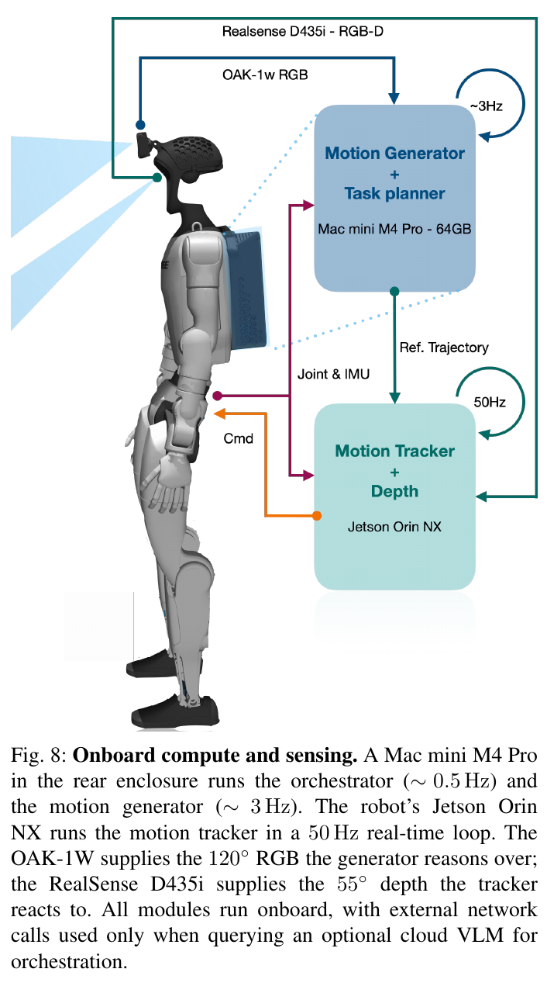

# 036 · HALO · Perceptive Humanoid Motion from Simulation

## 基本信息

- **完整标题**：Perceptive Humanoid Motion from Simulation。
- **系统名**：HALO，Humanoid Autonomy, Learned in simulation, running Onboard。
- **作者 / 机构**：Siyuan Hu、Abulikemu Abuduweili、Yue Meng、Shipeng Liu、Quentin Leboutet、Chen Chen、Matthias Müller、Vladlen Koltun；Apple。
- **版本**：arXiv:2611.06908v1，2026-11-04，实际 PDF **20 页，包含附录**。截至阅读日未见更新版本。
- **来源**：[论文 v1](https://arxiv.org/abs/2611.06908v1) · [官方项目 / 视频](https://apple-aiml-research.github.io/ml-halo/) · [官方代码](https://github.com/apple-aiml-research/ml-halo) · [原论文](https://arxiv.org/abs/2611.06908v1)。
- **阅读日期 / 状态**：2026-11-06；已阅读正文与附录、核对官方代码发布范围，未复现。
- **类目**：Wholebody Intelligence → **大脑模型与任务策略**；关联运动控制与重定向、数据与评测。主要研究从视觉 / 语言到全身运动的完整自主系统，同时贡献合成数据流水线与感知 tracker。
- **标签**：simulation data、vision-language-motion、Kimodo、Infinigen、flow matching、training-time chunking、depth-conditioned tracking、multi-critic PPO、Unitree G1、onboard autonomy。

## 一句话理解

**先在大量虚拟房间里自动生成“机器人看到什么、收到什么指令、该怎么动”的配对数据，训练一个在线全身动作生成器，再让带深度感知的低层控制器把动作在真实房间里执行出来。**

它不是只生成好看的 motion，也不是只跟踪离线动作：高层判断任务，中层根据当前画面不断重规划，低层根据真实几何与身体状态执行。最强证据是六种技能在六个未扫描真实环境的 **360 次试验，平均成功率约 91%**。这个数字对应单技能测试；多任务串联是另一组较小的实验。

## Motivation

1. **会跳舞、会翻跟头，不代表能看见椅子并坐下。** 后者既需要理解“坐哪把椅子”，又需要精确感知座面、接触和重心变化。
2. **视觉—语言—全身运动的配对数据难规模化。** 每条遥操作或穿戴采集示范都需要人实际执行，数据产量与人工时间绑定。
3. **预先扫描目标房间会限制部署泛化。** 作者希望训练和部署空间分离，不为每个新家庭先重建地图。
4. **只靠本体感知的 tracker 不知道附近有什么。** 上层生成的轨迹与真实几何稍有偏差时，低层需要看见桌沿、座面和障碍。
5. **在线换动作不能产生跳变。** 机器人不会在模型推理时暂停物理运动，新规划必须和已经确定要执行的轨迹接起来。

因此本文同时处理数据规模、异步规划连续性和环境感知控制，而不是将问题全部交给一个端到端网络。（§I–III）

## 方法总览：三个频率、两种视觉输入

| 层级 | 输入 | 输出 | 运行频率 |
|---|---|---|---|
| Orchestrator | 用户指令、当前第一视角 RGB、任务执行状态 | 有序子任务、完成 / 重试 / 插入步骤等决策 | 约 0.5 Hz |
| Motion generator | 当前 RGB、当前子任务指令、已确定的运动前缀 | 未来 5 秒全身运动，150×36 | 约 3 Hz |
| Motion tracker | 运动参考、本体状态与历史、IMU、第一视角深度 | 29 个关节位置目标，由 PD 执行 | 50 Hz |

RGB 主要帮助识别对象和任务，深度直接提供低层的近场几何。**30 Hz 是生成轨迹的采样率，3 Hz 是重新规划频率，50 Hz 是 tracker 控制频率**，不能混为一谈。

## 数据流水线：训练参考 motion 从哪里来？

### 1. 人设计任务模板，Kimodo 批量补成完整运动

以“坐到扶手椅上”为例，预先写好：

`走到椅子前 → 转身 → 坐下`

每段配置文字描述、根部路径 / waypoint，以及必要的全身关键帧。根据机器人与目标物的位置，用 unicycle 路径规划器产生导航约束，再调用 **Kimodo** 生成稠密 G1 motion。相邻段以前一段末帧作为下一段起点，坐椅子任务还在接缝两侧各用三帧 cross-fade 平滑。

这里有两个不同的生成器：**Kimodo 是离线造数据的生成器；部署时的 HALO generator 是在这些配对数据上另外训练的 Qwen＋DiT。** 真机不是每次直接调用 Kimodo。

### 2. “不用遥操作逐条采集”不等于没有人类运动来源

附录 A / Table IV 明确列出不同技能的种子：

- **SIT**：坐姿关键帧来自真实 G1 的关节日志。
- **GO-TO**：站立姿态与目标路径。
- **DOOR**：人工编辑姿态，五个关键帧。
- **CRAWL / CROUCH**：手机拍人的钻桌视频，经 **GVHMR 恢复 3D → GMR 重定向到 G1 → 人工编辑六个关键帧**。
- **PUSH**：生成的走路段连接一段**真实人体动捕的推箱子动作**，中间有 9–11 帧 bridge。
- Tracker 的训练还使用重定向的 **LAFAN1** 人体运动。

因此，论文去掉的是“为了每一条新训练 episode 都需要一个人去演”的环节。任务定义、初始动作材料、已有 motion 模型的人体先验仍来自人。不能写成“所有动作都完全从零凭空生成”或“全流程从未接触真实数据”。

### 3. 质量控制是几何检查，不是所有参考都经过物理验证

Kimodo 是运动学生成器，可能产生滑脚、穿地、腾空或关节越界。流水线采多个候选，用正运动学指标打分，选择较好的轨迹。

但不同技能采用不同策略，不能笼统说“数据中全是通过验证的物理可行动作”：

- SIT 有 33 个检查、其中 23 个 hard checks；走路 best-of-16，失败后有限次数重试。
- 重试耗尽会保留最佳链，即使仍不通过。50,000 条生成 SIT 中 **77% 通过全部 hard checks**；最终选入的 25,349 条按全体序列均匀抽取，论文没有说只抽通过者。
- CRAWL / CROUCH 为 best-of-20，若无候选过检则丢弃。
- Table IV 中 DOOR 没有额外 motion filter；PUSH 按步态接近度筛选。

所以几何检查是降低伪影的启发式质量控制，真正的动力学可执行性还要依靠物理仿真中的 RL tracker。（附录 A）

### 4. 把动作和目标物一起放进程序生成的房间

使用 **Infinigen** 生成客厅、办公室、卧室，尺寸、家具密度、材质和布局不同。场景生成尝试 1200 个，完成 **1178 个**；其中 **1000 个训练、178 个留出**，单技能仿真测试从留出部分取 100 个。DOOR 另使用同一生成器的 **966 个双房间 / 多房间场景**；“千个家庭”是总体概述，不等于每项技能共用恰好同一千个场景。

将已生成轨迹和目标物作为整体，通过 **SE(2) 平移 / 旋转**放进场景。具体实现搜索 10 cm 占据网格上的位置及朝向，检查路径与家具的空间关系；DOOR 对齐门口，并移除机器人路径上的家具。该 staging 也不是完整的动态接触验证。

每个 episode 用随机 seed 和 placement record 确定，运动与渲染解耦。换相机、分辨率或渲染器时可以重新渲染，不必重新生成动作。

### 5. 运动学回放产生 ego 视觉监督

在场景中**运动学回放**轨迹，用匹配真实 OAK-1W 的相机渲染 RGB，得到配对数据：

`当前机器人第一视角图像 + 指令 → 接下来的机器人全身 motion`

主要在 Isaac Sim 渲染，PUSH 用 MuJoCo。场景光照先烘焙进纹理，避免对每一帧重新做昂贵的路径追踪；另用曝光、颜色、模糊、噪声或 dome light 随机化扩展外观。

最终是 **162,698 条 episode、296.3 小时、30 Hz**，正文约称 300 小时。训练语料只有 **10 条固定技能 / 目标指令**：每技能固定一句，GO-TO 对五种目标各一句。自由自然语言主要由上层 orchestrator 转成技能指令，不应把 generator 的训练语料理解为开放式海量指令集。（Table IV、附录 A）

## Motion generator：训练输入、输出与异步接续

### 网络和训练目标

- **视觉语言编码器**：冻结 **Qwen3.5-2B**，输入 224×224 RGB 和子任务文字；取最后层 64 个图像 token 与文本 token。
- **运动解码器**：从头训练的 DiT，8 blocks、width 512、8 heads；投影层和 decoder 共 **49.3M 可训练参数**。
- **输出**：150 帧，即 30 Hz 下未来 5 秒。每帧 **36 维＝29 关节角＋3D 骨盆平移＋4D 骨盆四元数**；根部位姿相对当前骨盆坐标系表示。
- **监督数据**：合成数据中的真实参考 motion，而非真机在线奖励。
- **损失**：flow matching。真实 motion 为 `x₁`，高斯噪声为 `x₀`，插值 `x_s=s·x₁+(1−s)·x₀`，网络预测速度 `x₁−x₀`，用 MSE 训练。

每个运动帧先线性映射成一个 Transformer token；这里是**连续运动特征**，没有像 UniT / DAPS 那样的离散 codebook。训练只更新投影和 DiT，主设置不微调 VLM。

训练配置为 31.0M samples、50 epochs、64 B200、global batch 5120，AdamW；flow time 采样 Beta(1.5,1)。推理用 **15 个 Euler steps**。（§III-B、附录 B、Table V）

### 为什么不是每 5 秒算一次？

机器人执行时，环境和视角不断变化，所以每约 1/3 秒重新规划一次，但每次都看未来 5 秒。只执行当前规划的前部，其余部分会被新规划替换。

问题是模型推理需要时间：当新规划算出来时，机器人已经按旧规划继续运动。若两条轨迹直接替换，姿态目标会跳变。

### Training-time prefix conditioning 怎么做？

固定新计划的前 **15 帧＝0.5 秒**为已经确定要执行的前缀，仅生成后 **135 帧＝4.5 秒**：

1. **训练时**：前 15 帧保留干净参考，flow time 标为 1；后 135 帧加噪。
2. Decoder 同时看到前缀和带噪后缀，学习“接着这一小段继续”。损失只计算后缀。
3. **部署时**：前缀取自当前计划尚待执行的接续段；后缀从噪声开始生成。
4. 每个 Euler step 后，把前 15 帧重新覆盖成固定前缀，保证计划接续处共享同一段目标。

这给出的是**参考序列接续约束**，不等于对真实机器人稳定性、加速度或接触安全的数学保证；后者仍由控制器和物理执行决定。执行期间 tracker 继续运行，不等待生成器暂停身体。（§III-B、附录 B）

## Motion tracker：为什么还需要深度？

上层生成的是运动学参考，它可能把座面高度或桌子位置估得不够准确。低层若只跟踪关节角，不知道身体附近的障碍，就难以补偿。HALO 让 tracker 直接读取深度，而不只是让 VLM 看图。

### 三阶段训练

**Phase 1：带特权观测的 PPO 专家。** 按技能家族训练专家：移动 / 穿越、推物体、坐下接触。它们读取精确仿真状态、局部 height map、参考 motion 等。奖励包括 14 个身体 link 的姿态 / 速度跟踪，以及必要的物体位姿 / 位移奖励。推箱子不能只奖励手臂摆出了推的姿势，还必须让箱子真的移动。

**Phase 2：蒸馏为统一学生。** 学生只使用可部署观测：本体状态、IMU、motion 参考和深度。每个环境由其当前技能对应的专家给标签，不平均多个专家的动作。使用 DAgger / behavior cloning，**20% teacher rollout＋80% student rollout**，回归专家动作均值。

**Phase 3：multi-critic PPO 微调。** 所有技能共享 actor，但每个技能家族保留独立 critic，并在各自数据内单独标准化 advantage，避免不同量级的奖励压过其他技能。学生直接在深度输入和更广的随机化下继续 RL。

正文概述写“每种技能一个专家”，附录与发布代码进一步按技能家族 / motion dataset 管理；不能凭六种测试任务直接断言恰好六个教师网络。（§III-C、附录 C）

### 部署输入和输出

学生用 1D CNN 编码 **30 步状态历史**，2D CNN 编码 **48×84 深度图**，结合当前状态与短时参考送入 SimBa residual MLP。

论文部署输入列出 5-frame / 0.1 秒参考窗口、未来 30 个 plan frames 和 30-step / 0.6 秒状态历史。教师使用更长的 10-frame / 0.2 秒短时参考。这里的控制时间窗口不能直接拿上层 30 Hz motion 的帧数机械换算。

输出为 **29D 归一化动作，经缩放 / 偏置变成关节位置目标**，再交给 PD；不是直接输出电机力矩。策略 50 Hz，仿真 PD / physics 为 200 Hz，真机由底层电机控制器执行。

### 深度和 sim-to-real 的实际处理

- 仿真深度同时查询环境和机器人自身 mesh，保留手臂 / 腿造成的自遮挡，而不是“透过自身身体”看环境。
- 真机关闭 D435i 主动 IR 投射器，取左右 IR 图，由 **LiteAnyStereo** 在 Jetson 上估计深度；处理为 48×84，范围 0.2–2.5 m，再用 `log(1+d)` 编码。
- 先在真实 G1 上做**系统辨识**，拟合有效刚度、阻尼、惯量、力矩限幅与延迟；所有训练阶段用该模型。
- Phase 3 扩大执行器、质量、相机、摩擦、地面柔顺性和 15–40 ms 命令延迟随机化；动作变化率、足部滑动、膝关节过大负机械功等正则促进真机稳定。

所以“zero-shot sim-to-real”在这里是**不为新房间采集示范、扫描地图或做任务微调**，不是机器人动力学完全未经真实硬件标定。（附录 C、G）

## Orchestrator 与机载执行

默认上层用 **Qwen3.6-35B-A3B，4-bit、MLX**，与 generator 在 Mac mini M4 Pro 64 GB 上共享调度；tracker 在 Jetson Orin NX 上运行。允许选择云端 VLM，但本地配置可离线工作。

Orchestrator 从有限技能表中编排最多八步，周期性看图判断完成、重试、插入子任务、改计划或询问操作者。`stand / hold` 使用当前参考构造姿态，不运行 generator。实验验证的是两到三步组合，不是八步任务成功率。

实测 generator 单独 / 与 orchestrator 共服务的**模型推理**延迟约 **152 / 155 ms**；orchestrator 单次转移决策约 **0.72 / 1.46 s**。这些是具体机载平台上的测量，不是所有硬件的性能保证，也不是端到端感知到电机的总延迟。（Table IX）

### 举例：钻过桌子后坐椅子

1. 上层把用户请求拆成“弯腰穿桌下 → 走近椅子 → 坐下”。
2. 中层看当前 RGB，为当前子任务预测未来五秒全身动作；每约三分之一秒更新，并保留已确定前缀。
3. 低层每 20 ms 根据深度、本体状态和参考调整关节目标，处理桌沿、平衡与接触。
4. 上层检查是否穿过桌子且恢复稳定，满足后才切到走近椅子。

这个例子也说明失效点：如果钻出来时头朝向别处，椅子不在视野内，即使每个单技能都不错，整个串联仍可能失败。

## 实验

### 1. 单技能：六个真实环境，360 次测试

每项技能在 **100 个未见仿真环境＋6 个未见真实环境**中测试，每环境 10 次。因此仿真 6000 次、真机 360 次；每项真机任务 60 次。真机环境未扫描、未重建、未用于训练。

| 技能 | 仿真成功率 | 真机成功率 |
|---|---:|---:|
| GO-TO：走到指定物体 | 98% | 92% |
| SIT：坐椅子 | 84% | 85% |
| DOOR：侧身穿半开门 | 91% | 93% |
| CROUCH：弯腰 / 屈膝过桌下 | 95% | 100% |
| CRAWL：手膝爬过桌下 | 84% | 90% |
| PUSH：推箱子 | 93% | 88% |
| **均值，按论文取整** | **91%** | **91%** |

成功要求完成任务且不跌倒、不困住。附录给出仿真具体判据：例如 PUSH 移动箱子至少 0.3 m，GO-TO 停在目标 1 m 内，穿桌 / 穿门必须实际从指定通道经过，不能绕开。不能把 GO-TO 的指标解释为精确末端到位或抓取成功。（Table II、附录 F）

### 2. 多任务：平均 70%，只有一个真实测试环境

多任务在 **50 个仿真环境、1 个真实环境**中测试，每条序列每环境 10 次。即仿真 1500 次、真机 **30 次**；全序列所有子任务都成功才算成功。

| 多任务序列 | 仿真 | 真机 |
|---|---:|---:|
| DOOR → GO-TO | 71% | 100%（10/10） |
| CROUCH → SIT | 73% | 60%（6/10） |
| CROUCH → GO-TO → PUSH | 64% | 50%（5/10） |
| **均值** | **69%** | **70%（21/30）** |

单技能的 360 次不能当作多任务证据。单技能成功率也不能直接相乘预测链式成功：前一个动作的结束位置 / 朝向，会改变下一个动作的输入分布。

三段真机任务五次失败中，有三次钻桌后头朝向远离箱子，后续始终没把目标带回视野；另有 CROUCH→SIT 试验误坐右边沙发。作者建议补充搜索、原地转向等恢复行为。（§IV-D）

### 3. 消融：环境多样性、接续训练、flow matching 与深度

以下都在 **SIT、100 个未见仿真环境、每环境 10 次**评估，不是全部真机技能的消融：

| 改变项 | 配置 | SIT 成功率 |
|---|---|---:|
| 训练场景数 | 1 / 10 / 100 / 1000 | 43 / 64 / 81 / **84%** |
| 规划接续 | 无 RTC / 推理时 RTC / 训练时前缀条件 | 24 / 66 / **84%** |
| Decoder | regression / flow matching | 19 / **84%** |
| Tracker | 无深度 / 有深度 | 74 / **84%** |

场景数量实验旨在固定其他环节，区分环境多样性与动作数量。100→1000 个场景仅提升 3 个百分点，边际收益已减小。

回归 decoder 的 19% 不宜简单解释为“任何 diffusion 都比 regression 高 65 个百分点”：作者指出换成回归后也失去了当前 flow-based RTC 接续机制，并伴随 OOD 关节细节丢失，因此差异包含生成分布与异步接续能力两方面。（Table III、§IV-E）

### 4. 数据与算力成本

- 配对数据 162,698 episodes、296.3 h，约 3200 万帧；训练样本量 31.0M 与原始帧数不是完全相同计数。
- 正文称合成语料需要 **250 H100 × 48 小时**。附录另外列出生成 1178 场景约 26 小时、最多 300 GPUs，50k SIT 的生成 / 渲染 / 特征缓存约 9 小时、250 H100。不同阶段可能有重叠或不同统计口径，不能直接累加成精确总成本。
- Generator 用 **64 B200**，tracker 最终阶段 **4 H100、16,384 并行环境**。
- Tracker 三阶段配置为 50k / 30k / 50k 训练 iterations；这里是更新迭代数，不是环境步数。

可扩展的含义是无需按 episode 增加等量操作员时间，仍需要大量计算资源。（§IV-A、Table IV–VI）

## 结论与局限

**本文最值得关注的是：丰富的合成场景可以训练视觉条件全身运动，而低层环境感知和训练时规划接续，是把这种生成运动稳定落到新真实空间的重要组成。**

应保留以下边界：

1. **纯仿真任务训练不等于零真实信息。** 动作种子、LAFAN1、预训练模型与硬件系统辨识都含真实来源；部署新环境没有扫描 / 示范适配。
2. **动作生成数据不是全部物理可行。** 主要用运动学 replay，几何筛选也不一律丢弃失败样本；RL tracker 承担物理执行。
3. **有限技能、有限语言监督。** 六种训练技能和十条数据指令；开放式语言由现成 VLM 映射到已有技能。增加新技能仍要人工写 prompt / keyframe。
4. **91% 的范围是单技能。** 多任务真机只有一个环境和 30 次试验，无法据此证明任意长任务、任意家庭的可靠自主行为。
5. **感知仍有盲区。** 目标离开视野、接触被遮挡后缺少直接触觉反馈；低层只拿 motion，不知道任务希望世界发生什么变化。
6. **消融集中于坐下。** 深度收益、生成器替换与场景规模的结论需要更多任务复验；Table I 是不同论文的能力 / 协议对照，不是同条件 baseline 对战。

附录 G 还记录了非系统性观察：微调 VLM 可提升跟人时的响应，但只用单一人物模型会损伤新人物泛化；渲染更多人物后可改善。图像与任务过于关联时，微调模型会忽略文字，作者用 30% 黑图训练缓解。它们是有价值的工程观察，**不是与主实验同等完整的定量消融**。

## 与已有笔记的关系：个人判断

- 相比 **Stochastic Motion Tokenization** 的离线 token 库与本体 tracker，HALO 在执行中根据 RGB 在线重新规划，还让低层读取真实深度，重点从运动复现推进到场景交互。
- 相比 **UniT** 的人机动作表示对齐，HALO 主要通过直接生成机器人在仿真中的视觉—语言—运动对，获得监督；它没有训练离散 motion tokenizer。
- 对“ego 视频出 motion”的研究，HALO 是**机器人当前 ego RGB＋指令 → 未来机器人 motion**，不是从记录的人类 ego 视频恢复人体运动。GVHMR / GMR 只用于部分离线关键帧准备。
- 最值得借鉴的组合是：合成数据的动作 / 场景 / 渲染解耦，带固定前缀的异步 receding-horizon 生成，以及技能教师蒸馏后保留深度输入的统一控制器。

## 开源状态与复现边界

截至 **2026-11-06**，已核对官方仓库提交 `35d8334e9f7dc3e2b7a7737a9a3ec34f170c809f`：

- 已公开 `datagen/`、`generator/`、`tracker/`、`orchestrator/`、`system/` 的代码、训练说明和仿真 / 真机运行入口。
- **没有随仓库提供训练好的 HALO generator、tracker 权重或完整训练数据集**。下载现成 Qwen / Kimodo 权重不等于拿到了训练好的 HALO。
- 发布的 datagen 流程主要覆盖 **sit-on-chair**；system README 明确其他任务所需训练数据未包含；tracker README 提醒推箱子还需要物体轨迹，现有工具不生成该数据。
- 发布的 `multi_task/door_then_sit.yaml` 默认是 **proprio tracker**、`gen_interval: 0.4`；论文主要描述带深度、约 3 Hz 的系统。该示例的任务和参数不应直接等同 Table II 的完整评测配方。
- 代码采用仓库内 Apple LICENSE，第三方组件另有声明；本次只阅读资料，没有运行作者训练或机器人控制代码。

[Generator 发布说明](https://github.com/apple-aiml-research/ml-halo/blob/35d8334e9f7dc3e2b7a7737a9a3ec34f170c809f/generator/README.md) · [Tracker 发布说明](https://github.com/apple-aiml-research/ml-halo/blob/35d8334e9f7dc3e2b7a7737a9a3ec34f170c809f/tracker/README.md) · [系统说明](https://github.com/apple-aiml-research/ml-halo/blob/35d8334e9f7dc3e2b7a7737a9a3ec34f170c809f/system/README.md) · [多任务示例配置](https://github.com/apple-aiml-research/ml-halo/blob/35d8334e9f7dc3e2b7a7737a9a3ec34f170c809f/system/halo_system/scripts/configs/multi_task/door_then_sit.yaml)。

## 原图与修订记录

保存 **6 张作者原图和完整英文图注**：Fig. 1 真机总览、Fig. 2 三层系统、Fig. 3 数据与训练、Fig. 5 技能动作来源、Fig. 6 感知 tracker、Fig. 8 硬件。未重新绘制或改写原图。

[原图清单](../assets/036-halo/manifest.json) · [来源记录](../assets/036-halo/source-record.json)。

- **2026-11-06**：首次总结；固定 v1；单列人工动作来源、SIT 过滤保留失败候选、真实硬件标定、单 / 多任务测试范围及公开代码与论文配方差异。
