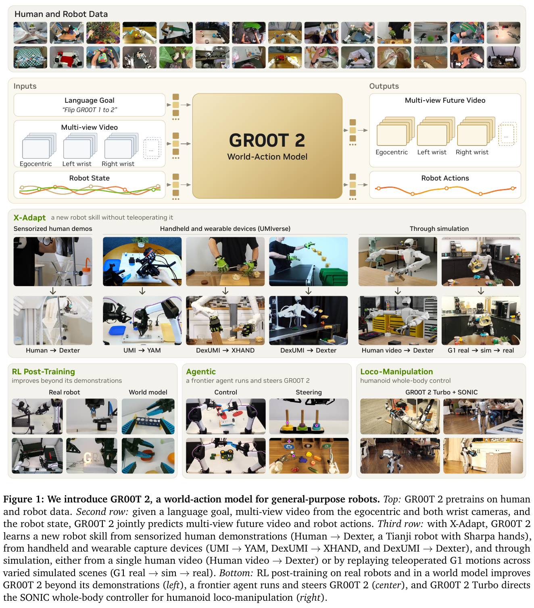
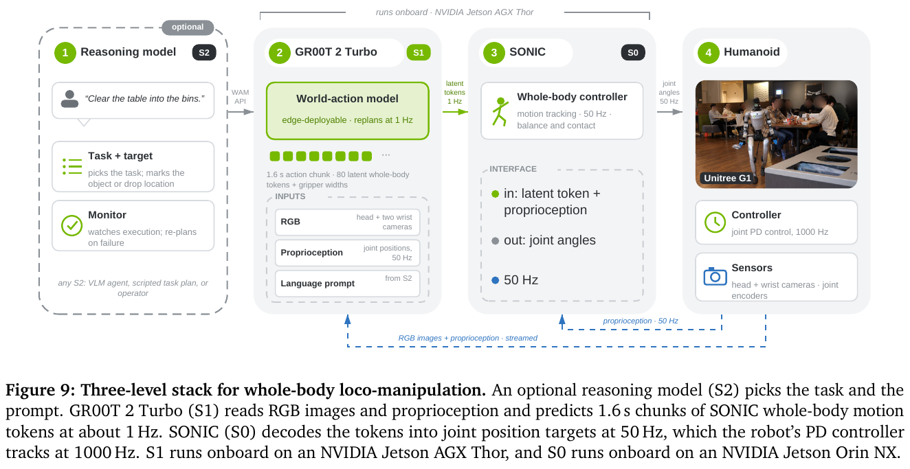
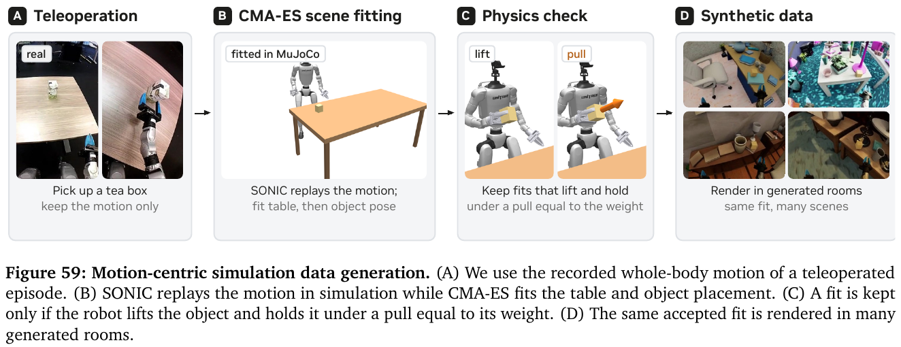
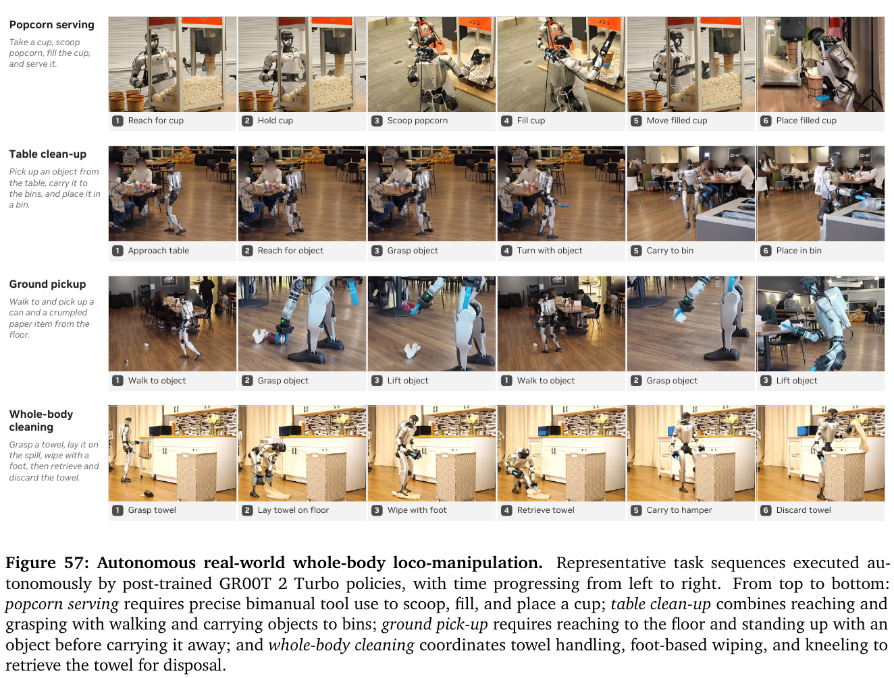

# 037 · GR00T 2 · Whole-Body Loco-Manipulation 专题

## 基本信息

- **完整标题**：GR00T 2: Scaling Robot Foundation Models for Generalization, Dexterity, and Adaptation。
- **作者 / 机构**：NVIDIA。
- **版本**：2026 年 11 月官方白皮书，135 页；2026-11-10 下载快照。官方 PDF 使用可更新的固定网址，本笔记以归档 PDF 的 SHA-256 固定版本，不虚构 arXiv 编号。
- **来源**：[官方项目](https://research.nvidia.com/labs/gear/gr00t-2/) · [官方报告](https://research.nvidia.com/labs/gear/gr00t-2/assets/gr00t2_whitepaper.pdf) · [原论文](https://research.nvidia.com/labs/gear/gr00t-2/assets/gr00t2_whitepaper.pdf)。
- **阅读范围**：重点 §3.5、附录 H（pp.109–112）、Fig.9、Tables 25–27；结合 §2、§4.1、附录 I 的架构与部署，以及附录 J.3 的 G1 Factory。不是全报告逐项总结。
- **阅读日期 / 状态**：2026-11-10；已核对原文和原图，未复现。
- **类目**：Wholebody Intelligence → **大脑模型与任务策略**；关联运动控制、数据与评测。
- **发布状态**：阅读时官方项目注明代码将在 12 月提供；已有 SONIC / GR00T-WholeBodyControl 代码不能视为 GR00T 2 的完整训练与部署发布。

## 一句话理解

**让一个能同时预测“接下来会看到什么”和“应该怎么动”的世界—动作模型，输出 SONIC 能执行的全身动作 latent，再由 SONIC 高频处理平衡和关节控制。**

G1 真机主角是 **GR00T 2 Turbo**。贡献集中在：把 WAM 接到全身动作接口、压缩视觉计算以支持机载推理、复用真实动作生成多场景仿真训练数据。

## Motivation：为什么要这么做？

1. **机械臂操作和双足全身操作的难点不同。** 走到桌边、弯腰拿东西、搬运、用脚擦地都要求手、腰、腿和接触协调；视觉策略推理期间机器人仍要保持平衡。
2. **WAM 的视频预测很贵。** 多相机未来视频占据大量 token；机载算力比工作站有限，需要减少视频建模成本。
3. **全身遥操作难规模化。** 示范不仅包括抓取，还包括整个身体在环境中的移动；希望一条已有动作能提供更多场景与物体变化。
4. **只会在采集场景中完成任务不够。** Table 26 中，只有真实数据时，Turbo 的未见场景桌面拾取只有 6.7%，是非常直接的泛化瓶颈。

## 方法一：三层分工，谁输入什么、输出什么？

| 层级 | 输入 | 输出 | 频率与设备 |
|---|---|---|---|
| S2：可选任务层 | 用户任务、观察与执行进度 | 子任务 / 语言提示，可带目标标记 | 可以是推理模型、脚本或操作者；不要求一定用 LLM |
| S1：GR00T 2 Turbo | 头部与双腕 RGB 历史、本体状态、语言指令 | 预测未来视频 + 未来 1.6 秒 SONIC motion latent 序列及夹爪宽度 | 约 1 Hz 重规划，Jetson AGX Thor |
| S0：SONIC | 当前时刻 motion latent + 当前机器人状态 | 身体关节位置目标 | 50 Hz，Jetson Orin NX |
| 关节 PD | 目标关节位置与测量反馈 | 跟踪执行 | Fig.9 标注 1000 Hz |

**一次预测包含 80 个动作时刻，因为 1.6 秒 × 50 Hz = 80。** 每个时刻的低维 motion token 送入 SONIC，夹爪宽度命令走独立通路，不经过 SONIC。80 是时间序列长度，不是 token 维度或码本大小。附录 H 没有给出本次 G1 token 的具体维数，不能直接套用旧版 SONIC+GR00T 的手部维度。

这里的“token”是低层运动表示；不能把它理解为自然语言单词，也不能因为用了 token 就认为 Turbo 是自回归文本模型。GR00T 2 的动作通过 **flow matching 联合去噪**生成。

**S1 和 S0 都机载，但分属 Thor 与 Orin NX。** 官网明确说推理模型除外；不能把整个 S2/S1/S0 系统一概描述为全机载推理。

### 举例：把桌上的瓶子送进垃圾桶

1. S2 给出“收走这个瓶子”，需要时标出目标。
2. Turbo 看到当前头部 / 手腕画面及身体状态，同时预测未来画面与一段动作：靠近、伸手、抓握、开始转身。
3. SONIC 每 20 ms 取下一份 latent，并结合机器人当下状态输出关节目标；夹爪单独开合。
4. 约 1 秒后，Turbo 根据新观察更新接下来 1.6 秒的计划，继续搬运与投放。

上面是理解分工的示例，不表示论文给 latent 人工规定了“走路 token”“抓瓶 token”这样的语义标签。它也不是先生成完整任务视频，再把视频通过姿态估计转换成动作：**视频与动作在同一个模型中联合预测。**

## 方法二：WAM 如何训练？Turbo 为什么更快？

### 1. 共享视频—动作模型

§2 的基础架构从 **Cosmos-Predict2.5-2B** 初始化。图像经冻结的视频 VAE 编码，指令经冻结 Cosmos-Reason1 编码；机器人状态和动作通过 embodiment-specific MLP 接入同一 Transformer。动作 token 可以关注正在预测的未来视觉 token。

训练时，输入观察历史、指令与本体状态；对真实未来视频 latent 和未来动作加噪，学习各自的 flow-matching 目标。部署时从噪声生成两者。高层 G1 动作监督就是已记录的 SONIC latent 与夹爪命令；未来画面来自对应机器人相机记录。

附录 I 的 G1 部署输入是 **3 个视角、每视角 5 帧、224×320**；通用设置以 5 fps 覆盖 0.8 秒历史。G1 动作输出 horizon 是 80，而其他 embodiment 的 48-action horizon 不应移植到这里。

### 2. 人类视频和 G1 遥操作的角色不同

§4.1 的通用预训练分三段：单视角视频预测 → 多视角视频与动作联合训练 → 提高机器人数据占比继续训练。有有效动作标注才计算动作损失；人类数据的动作监督来自跟踪出的手部姿态。

全模型预训练混合了约 **402,730 小时人类 ego 视频、10,184 小时 UMI、23,500 小时机器人遥操作**。这是整个 GR00T 2 的数据规模，不是本文 G1 实验的数据量。

**附录 H 的全身任务后训练主要来自全身遥操作，再用仿真扩增。** 操作者戴头显和身体追踪设备，动作编码为 SONIC latent，SONIC 在真机执行；同时记录相机、状态和命令。因此这部分实验并未证明“只凭人类视频，无 G1 任务示范，就学会全身清洁”。全报告其他 embodiment 的零遥操作结果不能挪用到 G1。

### 3. Turbo 的核心改动是视频压缩

白皮书 §2 写明：Turbo **保留 2B 联合 Transformer**，把 Wan 2.1 VAE 换成 Wan 2.2 VAE，空间每维压缩从 8 倍增至 16 倍，空间 latent 网格缩为原来的 1/4，并适配输入输出投影。动作 horizon 保持不变。

官网概述称其采用更小 Transformer，但同报告 §2 和附录 I 的比较配置均为 2B。故本笔记不将“相对报告中的 GR00T 2 缩小主干参数量”作为已被明确验证的加速原因；可核实的结构变化是**更高视觉压缩率**。

G1 的实际推理还用了 TensorRT、CUDA graphs、FP8 混合精度，以及从 2 次视频 / 4 次动作去噪减少为 **1 次视频 / 2 次动作去噪**。Table 27：

- Thor 120 W：模型预测中位延迟 **720.41 → 123.97 ms**，约 5.81 倍。
- RTX 5090：**224.73 → 38.40 ms**，约 5.85 倍。

这对比的是同一 checkpoint 的执行配置优化，不能全归因于 VAE。G1 延迟包含 VAE 编码，但仍是**模型预测延迟**，不是完整的“拍照到关节执行”端到端延迟；124 ms 也不等于机器人以 8 Hz 重规划，报告的实际高层是约 1 Hz。

## 方法三：固定动作，反过来找能完成动作的场景

不是先随便摆一个场景、再求一条新动作，而是：

1. 拿出真实 G1 遥操作中一条成功拾取运动，保留其动作序列。
2. 用头部画面估计桌子和物体的初始位置。
3. 在 MuJoCo 或 Isaac Lab 中用同一个 SONIC 回放动作。**动作固定，CMA-ES 搜索场景参数**：先桌子位置 / 高度 / 朝向，再物体类型 / 位置 / 朝向，每代并行 48 个候选。
4. 只接受能双指夹住、提起物体，并扛住相当于物体重力的 30 帧拉力、之后再保持 100 帧的结果。
5. 将通过检查的动作与物体配置放进程序生成的房间，随机灯光与相机位置，渲染新的视觉示范，保留同一动作格式。

产出 **250,000 episodes、1,000 小时**合成数据。这样扩展视觉、场景和物体变化，同时保留真机控制接口；它不意味着凭空获得 25 万种新的运动技能。

例子：已有“伸手到某处夹住茶盒”的动作，系统调整仿真桌高、盒子位置，让盒子刚好处于该动作可成功抓取的位置，再把这一组合渲染到不同房间。新样本教模型在不同画面中识别何时应该使用这类动作。

## 实验一：G1 真机到底做成了什么？

### 任务数据与训练方式

- 爆米花：**1,500 episodes、17 小时**。
- 收桌：**3,995 episodes**，报告分为 1,105 general、375 room、2,515 ground；保留作者分组名，不把它们改写为不同互斥技能总量。
- 地面拾取：**3,402 episodes**；桌面拾取：**3,292 episodes**。
- 清理洒漏：**292 episodes、3 小时**。

所有示范经过人工审查评分。数据组是否重叠没有完整说明，因此不简单相加声称唯一总量。

爆米花和清理洒漏分别是**单任务后训练策略**；拾放是混合桌面拾取、地面拾取、放入垃圾桶与清洁片段的**多任务策略**，并用十字标记提示目标。标记先由 VLM 对每段标一次，再用点跟踪器传播。因而“同一人形平台完成四类任务”不等于“一份统一 checkpoint 零样本完成四类任务”。

对照 DP、π0.5、GR00T 1.7 使用同一任务示范、相机和 SONIC token 动作空间；低层控制器保持 SONIC。（H.2）

### Table 25：完整任务二值成功率

| 真机任务 | 试验数 | DP | π0.5 | GR00T 1.7 | GR00T 2 Turbo |
|---|---:|---:|---:|---:|---:|
| 舀取并供应爆米花 | 48 | 27.1% | 0.0% | 83.3% | **100.0%（48/48）** |
| 收走桌上多样物体 | 30 | 0.0% | 0.0% | 73.3% | **93.3%（28/30）** |
| 地面物体拾取 | 30 | 36.7% | 30.0% | 50.0% | **83.3%（25/30）** |
| 全身清理洒漏 | 30 | 10.0% | 0.0% | 43.3% | **46.7%（14/30）** |
| 四任务等权平均 | — | 18.5% | 7.5% | 62.5% | **80.8%** |

- 爆米花每次必须完成**两满杯**，Turbo 约 41 秒，GR00T 1.7 约 48 秒。
- 收桌每次必须把 **6 个物体全部**放进桶，一个抓取或投放失败即整次失败。
- 地面拾取测试 30 种家居物体。
- 清理洒漏要求拿毛巾、捡杯子、用脚擦拭，再把毛巾与杯子投入桶，评估完整序列。
- 常见失败是纸巾 / 薯片袋等薄平物抓空，或碰到物体导致其离开可达范围。

80.8% 是四任务等权均值，不是 138 次试验的合并成功率。特别要注意：复杂清洁只比 GR00T 1.7 多成功一次，不能只展示爆米花 100% 就认为各种全身技能都可靠。

## 实验二：仿真数据能改善未见场景吗？

Table 26 是**另外的桌面 pick-and-place 实验**。每个条件 30 次，真实数据保持一致；增加合成数据后，在真实机器人上测 ID / OOD。OOD 是未见场景与位置，不能扩大解释成未见任意任务。

| 模型 | ID：仅真实 | ID：真实＋仿真 | OOD：仅真实 | OOD：真实＋仿真 |
|---|---:|---:|---:|---:|
| π0.5 | 40.0% | 16.7% | 0.0% | 13.3% |
| GR00T 1.7 | 46.7% | 66.7% | 6.7% | 40.0% |
| GR00T 2 Turbo | 73.3% | 83.3% | 6.7% | **63.3%** |

Turbo 的 OOD 从 **2/30 → 19/30**，表明这条 real-to-sim 流水线对该设置很有价值。

但“WAM 比 VLA 更能利用仿真”目前是**有方向性证据、非普遍定论**：混合训练后 Turbo 对 GR00T 1.7 是 19 对 12 次成功，作者自己给出双侧 Fisher 检验 **p≈0.12**，样本不足以做强统计结论。视频预测帮助对齐仿真与真实动态，是作者提出的解释，本文没有用完全匹配的去视频目标消融在 G1 上隔离这个因果因素。

## 补充：G1 Factory 仿真评测使用另一个控制接口

附录 J.3 / Table 34 另有 **9 个 G1 Factory 任务**，源于 HumanoidMimicGen，在 Isaac Lab-Arena 测试：搬箱、上架、取放电钻、按按钮、推架子等。每任务用 100 条示范训练，再评估 100 次，共 900 次。

GR00T 2 总成功率 **84.7%**，GR00T 1.7 为 **69.4%**，九项任务均提升。这里机器人为 43-DoF G1，高层输出手臂、手、腰及基座高度 / 导航命令，由下半身控制器执行。**这不是前述 Turbo→SONIC latent 的真机 Table 25，也不是新的 900 次真机实验。**

## 结论：这部分工作想说明什么？

作者最有说服力的结果是：**世界—动作模型可以作为已有全身控制器的视觉任务层，在机载预算下完成走动、够取、搬运和工具使用；与真实动作匹配的合成数据能明显改善未见场景表现。**

它没有重新从零解决所有双足平衡问题，而是复用 SONIC；没有把大规模人类视频直接等同于 G1 全身动作监督，而是用通用预训练加任务遥操作；没有证明所有复杂全身任务已稳定解决，清理洒漏仍不到一半成功。

我的判断：对全身智能研究最值得借鉴的是 **“统一低层动作接口 → 真实示范直接记录该接口 → 同一控制器做仿真扩增 → 视觉模型预测该接口”**。数据生成、训练标签和部署动作的语义一致，可以少掉一层事后重定向或接口转换误差。这个收益是系统设计层面的理解，论文未单独量化每一环的贡献。

## 与库内工作怎么联系？

- [SONIC](003-sonic.md)：提供全身动作表示与低层执行。GR00T 2 Turbo 在这一层之上增加视觉任务策略。
- [VioLA](025-viola.md)：同样需要把高层监督与可执行控制接口对齐；本篇 G1 样本在遥操作时就记录 SONIC latent，而非仅凭人类视频补出整套 G1 监督。
- [HALO](036-halo.md)：同样分层执行，但 HALO 在线生成显式运动参考、低层加入深度；GR00T 2 Turbo 预测 SONIC latent，并联合预测未来视频。
- [WholeBodyWAM](010-wholebodywam.md)：都值得从视频—动作联合建模视角比较；需继续核对动作接口、控制频率与任务数据，不能只比较 WAM 名称。

## 来源、原图与证据边界

- 架构 / 通用训练：§2、§4.1，PDF pp.5–6、14。
- 全身主结果：§3.5、Fig.9，p.13；附录 H，pp.109–112，Tables 25–26。
- 部署：附录 I，pp.113–115，Table 27；124 ms 为模型预测中位延迟。
- G1 Factory：附录 J.3 / Table 34，p.126，仅仿真。
- 保存 Fig.1、9、57、59 四张原图，含完整英文图注。[原图与校验记录](../assets/037-gr00t2/manifest.json) · [版本记录](../assets/037-gr00t2/source-record.json)。
- 本页是 **whole-body loco-manipulation 专题**；报告其他平台的 5-shot 95%、DexUMI 灵巧手技能、真实 RL 或 Agentic 组装成功率不作为 G1 全身任务证据。
- 2026-11-10：依据官方 135 页 PDF 快照建立笔记；未执行作者训练 / 推理代码，未复现。
