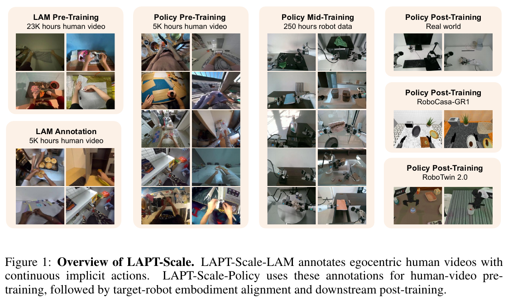
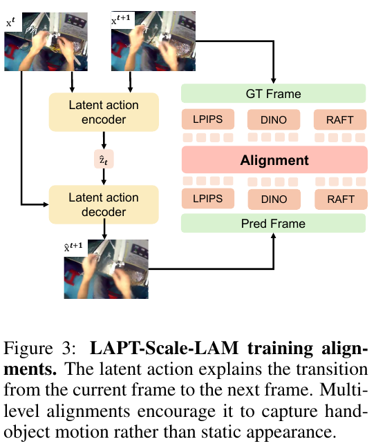
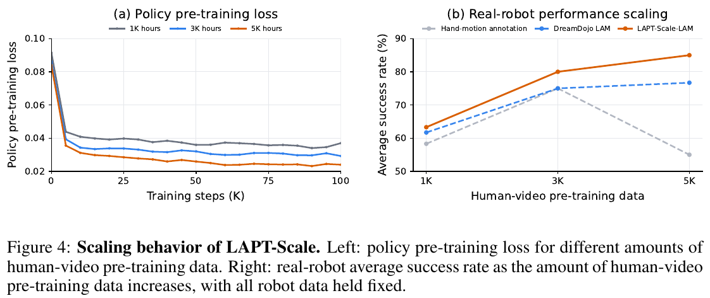
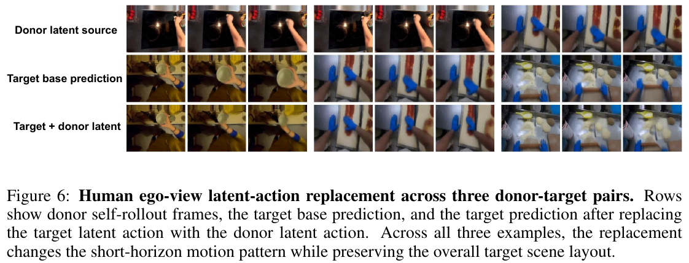

# 038 · LAPT-Scale

## 基本信息

- **完整标题**：LAPT-Scale: Scaling Embodied Policies with Latent Action Pre-Training on Human Videos。
- **作者**：Zhiyuan Xiang、Peidong Liu、Mingyang Li、Jiawei Li、Wenhow Li、Wenbo Ding、Xiang Deng。
- **机构**：京东 Joy Future Academy、哈尔滨工业大学（深圳）、清华 SIGS、香港科技大学（广州）。
- **版本 / 会议**：arXiv:2610.13732v1，2026-10-09；CoRL 2026；PDF 共 24 页，含附录。阅读时 arXiv 仅列 v1。
- **来源**：[论文页面](https://arxiv.org/abs/2610.13732v1) · [官方 PDF](https://arxiv.org/pdf/2610.13732v1) · [HTML 全文](https://arxiv.org/html/2610.13732v1) · [原论文](https://arxiv.org/abs/2610.13732v1)。
- **阅读日期 / 状态**：2026-11-12；核对正文、附录和原图，未复现。
- **类目**：Wholebody Intelligence → **大脑模型与任务策略**；关联数据与评测。收录理由是人类视频预训练与动作表示；本文实验聚焦操作，不能作为全身行走控制证据。
- **代码状态**：截至阅读日，在论文链接与专项检索中未核实到独立的官方 LAPT-Scale 代码 / 权重发布；不把 JoyAI-RA 或 DreamDojo 的发布视为本方法的完整发布。

## 一句话理解

**先让一个模型看“动作前后两张图”，把图像变化压成连续的隐式动作标签；再用大量这种标签预训练 VLA，最后用机器人数据把同一个动作预测器训练成输出真实机器人命令。**

关键不是从人类视频恢复精确人体骨架，也不是在部署时把 human motion 重定向到机器人，而是把没有动作标签的视频转成一种有用的预训练监督。

## Motivation

1. **机器人交互数据昂贵，人类 ego 视频多但没有机器人动作标签。** 直接监督“图像→关节命令”需要配对机器人数据。
2. **显式手部姿态估计会出错。** 遮挡、模糊、视角变化和相机运动容易产生看似合理但错误的伪动作，数据加得越多不一定越好。
3. **离散动作码本可能丢失细小变化。** 作者希望连续 latent 能保留手—物交互中细粒度的变化。
4. **只重建像素可能学偏。** 背景占据大部分图像，即使手的位置和接触不准确，整体重建误差也可能很小。

因此本文把问题拆成：怎样提取更好的隐式动作，以及怎样把隐式动作预训练迁移到实际机器人策略。

## 方法一：LAM 怎样从视频得到 latent action？

### 1. 两帧输入，32 维连续表示

输入同一片段的两个时间点画面 `x_t` 与 `x_(t+1)`。实际训练随机采样 1–4 帧间隔，不能把符号“相邻”理解为只允许原视频紧邻两帧。

两帧切成 patch，前面放一个可学习的 action query，经 Transformer encoder 后，用 query 输出高斯后验的均值和方差：

`两帧图像 → 编码器 → μ、σ → 采样 32 维 z`

这是 **VAE 的连续高斯潜变量**，没有 VQ 离散码本，也不是先用人体姿态检测器估计 32 个物理关节。

### 2. 当前图像与 latent 一起重建未来图像

decoder 另外拿到当前图像 patch，并把 `z` 投影后加到每个当前 patch 的表示上，输出预测的下一帧：

`当前画面 x_t + z → decoder → 预测画面 x̂_(t+1)`

因为当前画面已经提供背景与物体外观，低维 `z` 被鼓励编码“发生了什么变化”。这是结构上的归纳偏置，**不保证 latent 完全剥离相机运动或外观，更不保证每一维对应独立可控自由度**。

### 3. 损失函数不只看像素

- **MSE**：预测与真实下一帧的像素接近。
- **LPIPS**：保留局部视觉结构，减少手部和接触区域的模糊。
- **DINOv2**：用冻结特征网络比较 pooled patch 和 CLS 特征，约束语义结构。
- **RAFT 光流**：比较“当前帧→预测下一帧”与“当前帧→真实下一帧”的光流，使运动方向与幅度更一致；真实光流分支停止梯度。
- **KL**：约束连续后验与先验的差异。

需要区分：RAFT 提供训练时的运动一致性损失，**光流不是最终给机器人的控制命令**；DINO、RAFT 冻结的是权重，并不意味着预测图像一侧不能通过它们向 LAM 传递梯度。

### 4. 训练完，冻结 LAM 做离线标签

对保留的视频逐段编码，存储每次转移的后验均值 `z̄=μ`，得到确定性 latent 标签。训练 LAM 时会采样，**离线标签使用均值**。同时保存视觉上下文、可用的语言 / 片段文本、有效位置 mask；损坏帧和跨片段无效转移不计算策略损失。

LAM 使用 23.3K 小时视频训练；为策略实际标注的是清洗后 5.1K 小时子集。

## 方法二：VLA 的三个阶段，输出空间会改变

策略采用 **JoyAI-RA 架构：VLM backbone + Perceiver 风格 action expert**，用 conditional flow matching 学习动作 chunk。核心是**三个阶段沿用同一个 action expert，不另加人类动作头，不在换阶段时重新初始化动作头**。

| 阶段 | 数据 / 条件 | 监督输出 | 作用 |
|---|---|---|---|
| Stage 1：人类视频预训练 | 人类视频视觉上下文，可用的语言或片段文本 | LAM 离线产生的连续 latent action chunk | 学习从场景与任务条件预测交互变化 |
| Stage 2：embodiment alignment | 250 小时目标机器人数据及对应策略上下文 | 真实机器人 action chunk | 将同一预测器适配到机器人动作空间 |
| Stage 3：任务后训练 | 下游任务机器人示范 | 该任务的真实机器人 action chunk | 提高任务成功率 |

动作专家最多支持 32 维，chunk horizon 为 **30**；不足维数补齐并在 loss 中屏蔽。32 维 latent 与某种机器人动作都能放进同样形状的张量，但**数值维度相同不代表语义天然相同**，所以 Stage 2 必不可少。

给目标 chunk `y` 加噪，构造 `y_τ = τy + (1−τ)ξ`；动作专家根据上下文、噪声 chunk 和 flow time 预测 `y−ξ`。Stage 1 的 `y` 是 latent，Stages 2–3 的 `y` 是机器人动作。

Table 10：Stage 1 不冻结模块；Stage 2 冻结 Qwen-VL 语言模型 backbone，继续训练接口和动作模块。两阶段各 100K steps，分别约 43 / 50 小时。三个原始真机任务的 Stage 3 分别全量微调 30K steps，约 7 / 7 / 8 小时。

论文把 policy context 统一写作 `c`，没有在本文完整列出每个数据源的状态输入字段、具体 Qwen-VL checkpoint、每个 embodiment 的动作坐标定义及部署控制频率；不从引用模型中猜测补齐。**30 是动作步数，本文未给出足够信息把它统一换算成秒。**

### 推理时究竟用不用 LAM？

最终部署链路是：

`机器人观察 / 指令等上下文 → 完成 Stage 2–3 的 VLA → 真实机器人动作`

**不是** `VLA → latent → LAM 图像解码器 → 机器人关节`。LAM 的主要作用在离线标注；附录 G 将 Stage-1 预测 latent 送入 LAM decoder 生成视频，是诊断预训练是否学到动作信息，并非最终控制链路。

## 一个简单例子：学会拿杯子

人类视频里，第一帧手在杯子旁，稍后手向杯子靠近并开始提起。

1. LAM 同时看两帧，压缩出一个 32 维数字向量。decoder 结合第一帧和向量重建第二帧；重建、语义和光流损失共同检查“手和杯子是不是按正确方式变化”。
2. 这些向量成为离线标签。Stage-1 VLA 只看允许的上下文和任务文本，学习预测未来 latent chunk，**不会把作为标签来源的未来画面当作部署时可见输入**。
3. 给它真实机器人操作杯子的示范，Stage 2–3 让同一个动作专家改为预测该机器人的执行命令。

可把它理解为“先利用人类视频练习预判交互，再通过机器人数据学会用自己的身体执行”。这不意味着某个 latent 维度有人工命名的“抓杯子”含义。

## 数据：三个规模不能混为一谈

| 来源 | LAM 原始语料 | Stage-1 清洗后语料 |
|---|---:|---:|
| Egocentric-10K | 10.0K 小时 | 0 |
| EgoDex | 0.7K | 0.5K |
| Ego4D，经 EgoVid 风格过滤 | 1.8K | 0.8K |
| Xperience | 1.1K | 0.4K |
| EgoVerse | 1.2K | 0.5K |
| 自采人类视频 | 8.5K | 2.9K |
| 合计 | **23.3K** | **5.1K** |

Egocentric-10K 没进入 Stage-1 scaling pool，是因为要与需要手部姿态标注的 baseline 使用可比数据源；**不是因为 LAPT-Scale 自身要求手部姿态标签**。

策略语料额外排除严重模糊、强烈相机运动、缺手、长静止、严重遮挡或弱操作片段，并去除近重复。1K / 3K / 5K scaling subsets 尽量嵌套、对大来源做限制或重平衡；附录措辞为 manifests 允许时嵌套，不把它写成完全无条件嵌套。

Stage 2 为 **250 小时、162,767 episodes、26.7M frames** 的异质机器人对齐数据，不是每项任务 250 小时。Stage 3 另外使用原始真机任务每项 50 条示范、四项较难任务每项 200 条示范；RoboTwin 每项 50 条 clean + 500 条 randomized，RoboCasa 每项 1,000 条。

成本方面，LAM 一次训练约 **4,938 H200 GPU-hours**，给 5.1K 小时视频离线标注再用约 **1,700 H200 GPU-hours**。这是一种可规模化的自动监督方案，但不是无计算成本的数据来源。（Tables 8–11，附录 D）

## 实验一：主要策略结果

### 仿真

- **RoboTwin 2.0**：Easy / Hard 为 **90.0% / 89.3%**；JoyAI-RA 为 88.6% / 87.2%，Motus 为 88.7% / 87.0%。提升存在但幅度较小。论文未完整列出该表的总 rollout 数和独立种子数，不补写默认值。
- **RoboCasa-GR1 Tabletop**：24 任务 × 50 rollouts，共 1,200 次；**64.8%**，JoyAI-RA 为 63.2%，GR00T-N1.6 为 47.6%。这是桌面操作，不能解释为全身 loco-manipulation。

### 三项原始真机任务

平台是 **AgiBot G1**，不要与 Unitree G1 混淆。Mouse Pad、Headphones、Cup 每项 20 次，共 60 次 / 方法；任务分别后训练，不等于一份 checkpoint 同时测三项。

| 方法 | Mouse Pad | Headphones | Cup | 三任务平均 |
|---|---:|---:|---:|---:|
| Diffusion Policy | 50.0% | 40.0% | 45.0% | 45.0% |
| π0.5 | 55.0% | 40.0% | 75.0% | 56.7% |
| JoyAI-RA | 80.0% | 95.0% | 65.0% | 80.0% |
| LAPT-Scale | **85.0%** | **95.0%** | **75.0%** | **85.0%** |

附录对这三项任务的最终成功状态描述较概括，因此不补写具体摆放位置、距离阈值或执行时限。论文主结果的 JoyAI-RA 80% 与下文移除 Stage 1 的 55% 是**不同对照设置**，不能当成同一条 baseline。

## 实验二：扩大的是策略预训练数据，不是重新训练更大 LAM

固定 LAM 在 23.3K 小时上训练后的版本，也固定 VLA 结构、机器人数据、Stages 2–3 与评测；改变 Stage-1 人类视频量及监督类型。主模型用 5.1K 小时，规模曲线用 1K / 3K / 5K 小时。

| Stage-1 监督 | 0 小时 | 1K 小时 | 3K 小时 | 5K 小时 |
|---|---:|---:|---:|---:|
| 显式 hand-motion | 55.0% | 58.3% | 75.0% | 55.0% |
| 官方预训练 DreamDojo LAM | 55.0% | 61.7% | 75.0% | 76.7% |
| LAPT-Scale-LAM | 55.0% | **63.3%** | **80.0%** | **85.0%** |

每个点是三任务、每任务 20 次的均值。0 小时列是共享的同一个 robot-only 对照。

这支持“动作式监督的质量影响扩大视频数据后的收益”。不过需要同时看到：

- **单任务不一定单调**：LAPT-Scale 的 Cup 从 1K / 3K / 5K 的 70 / 95 / 75% 变化，平均上涨并不代表所有任务都上涨。
- 显式 hand-motion 在 5K 时下降，作者将其与姿态噪声联系起来，但没有逐来源定量测出噪声增长来完成因果证明。
- 这只检验了该模型和数据范围内的 scaling 趋势，没有拟合普遍 scaling law，也没有同时扩模型参数和机器人示范规模。

### 对照：是否仅因为训练得更久？

同一策略初始化与机器人数据下，移除 Stage 1 得 **55.0%**；把 Stage 2 延长到计算量匹配得 **53.3%**；完整 5K 小时 Stage 1 得 **85.0%**。这个对照比“和另一种架构比较”更直接支持人类视频监督的价值，但结果仍限于三项任务的 60 次评估。（Tables 4、14–16）

## 实验三：哪些 LAM 损失有用？

作者移除不同损失后，重新训练从标注到策略的流水线，得到 RoboTwin Hard：

- 仅 reconstruction + KL：**74.2%**。
- 去掉 LPIPS：**82.5%**。
- 去掉 DINO：**84.1%**。
- 去掉 optical flow：**77.8%**。
- 完整目标：**89.3%**。

光流消融下降 **11.5 个百分点**，尽管 PSNR 仍较高。这说明“画面重建分数好”不足以代表 latent 对控制学习有用。（Table 5）

LAM 独立诊断中，完整模型 PSNR / LARY 线性探测准确率为 **34.4217 / 0.713**；连续 MSE-only 为 33.9844 / 0.675；VQ-LAM 为 18.3416 / 0.232。后两种是本语料上的控制诊断；**scaling 曲线中的官方 DreamDojo checkpoint 与这里重新训练的 MSE-only checkpoint 不是同一个**。

VQ 对照支持本实现中连续瓶颈更有效，但码本容量与优化等细节不充分，不能推广为所有离散 tokenizer 都不适合操作。LARY 是人类动作识别探测，也不是机器人执行成功率。

## 实验四：换位置、光照、背景还能做吗？

另增四个较难任务：扔纸团、抓细笔、在自身遮挡下抓小橡皮、推书边后抓起转向并入架。**四任务共同训练一份策略**，每项 200 条示范；π0.5 使用同一批下游示范。

每任务每域 20 次，4 任务 × 4 域 × 20 = **320 次 / 方法**。

| 方法 | 已见条件 | 新位置 | 新光照 | 新背景 | 四域平均 |
|---|---:|---:|---:|---:|---:|
| Diffusion Policy | 60.0% | 20.0% | 15.0% | 15.0% | 27.5% |
| π0.5 | 85.0% | 50.0% | 45.0% | 40.0% | 55.0% |
| LAPT-Scale | **85.0%** | **75.0%** | **70.0%** | **70.0%** | **75.0%** |

这组比较的主要价值是分布变化下下降较小；已见条件下双方都是 85%。75% 是包含已见域在内的四域均值，不是纯 OOD 平均；同样不是“未见新任务”测试。（Tables 6、19）

## latent 是否真的包含可迁移运动？

作者把 donor 片段的 latent 放到 target 场景中，观察生成的短视频：运动趋势改变，而大体场景仍保留 target 外观。还有跨场景近邻检索与聚类，展示相似短时运动在表示空间中靠近。

这些是**支持转移信息与场景信息部分分离的定性诊断**，没有证明每个 latent 都可物理执行，也没有证明已完成无需机器人数据的人到机器人零样本迁移。附录 G 的 Stage-1 latent rollout 也只是生成视频诊断。

## 结论与边界

最扎实的结论是：**连续视觉转移表示可以作为人类视频的可扩展动作监督；经过机器人对齐与任务后训练，它能帮助真实操作，且监督质量比单纯增加视频小时数更关键。**

边界包括：

- 仍依赖 250 小时机器人对齐数据和任务示范，不是纯人类视频训练后直接执行。
- latent 来自视觉变化，不是人体全身 3D motion、关节角或具备物理单位的控制量。
- 强相机运动、弱交互、严重遮挡和大 embodiment gap 仍可能导致失败。
- 真机仅一个平台、七项任务、每条件每任务 20 次；未报告足够独立训练种子与区间支持很强的泛化结论。
- RoboCasa-GR1 是 tabletop，真机结果同样不能当作 walking / balance / whole-body loco-manipulation 验证。
- 自采人类与机器人数据占重要部分；未核实官方代码、权重和完整数据发布，复现可获得性有限。

## 与笔记库其他工作怎么比较？

- [GR00T 2](037-gr00t2.md)：GR00T 2 在任务策略中联合预测未来视频与动作；LAPT-Scale 主要用 LAM 生成离线预训练标签，最终机器人策略不需要 LAM 图像 decoder。
- [UniT](035-unit.md)：都研究可跨数据源利用的动作表示；应比较表示如何训练、训练阶段如何切换和最终动作头如何使用，而非把所有 latent/token 都视作同一种接口。
- [SONIC](003-sonic.md)：SONIC latent 是部署时给全身控制器的动作接口；LAPT-Scale 的人类 latent 主要是预训练目标，Stage 2 后动作专家直接学习机器人动作，两者位置不同。
- [VioLA](025-viola.md)：关注人类示范向控制监督的转换；本篇通过隐式视觉转移标签避开显式人体重建，但仍需目标机器人数据对齐。

## 来源与原图记录

- 方法：§3，PDF pp.3–5；数据与训练：附录 A–B，pp.14–17。
- 主要实验：§4，pp.6–9；评测口径和 scaling：附录 C–E，pp.17–19。
- LAM / Stage-1 诊断及泛化：附录 F–H，pp.19–24。
- 保存 Fig.1、3、4、6，保留完整英文图注：[原图记录](../assets/038-lapt-scale/manifest.json) · [来源与版本记录](../assets/038-lapt-scale/source-record.json)。
- 2026-11-12：以 arXiv v1 建立笔记；区分 LAM 学习、离线标签、三阶段策略训练和最终部署，未复现。
