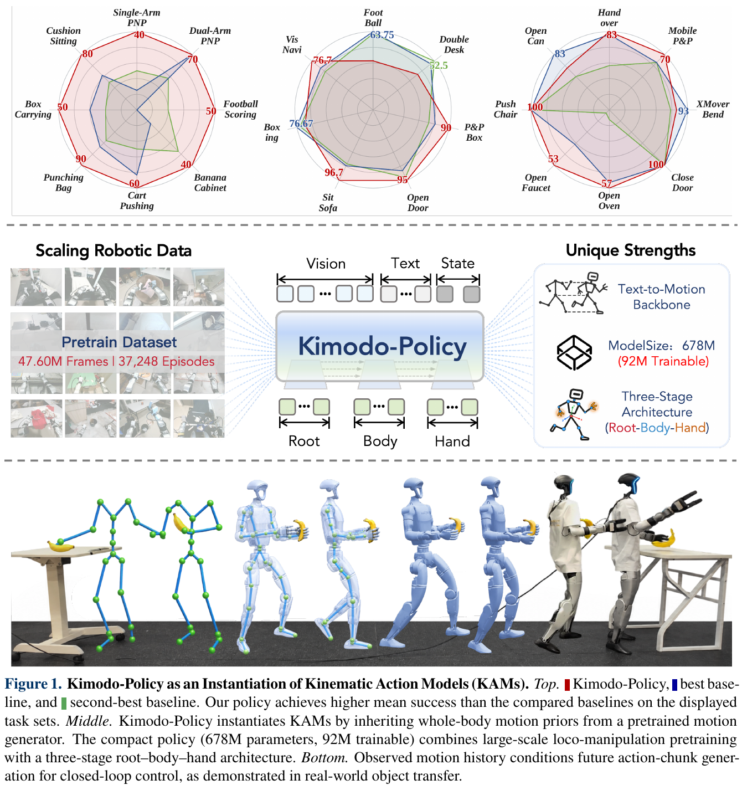
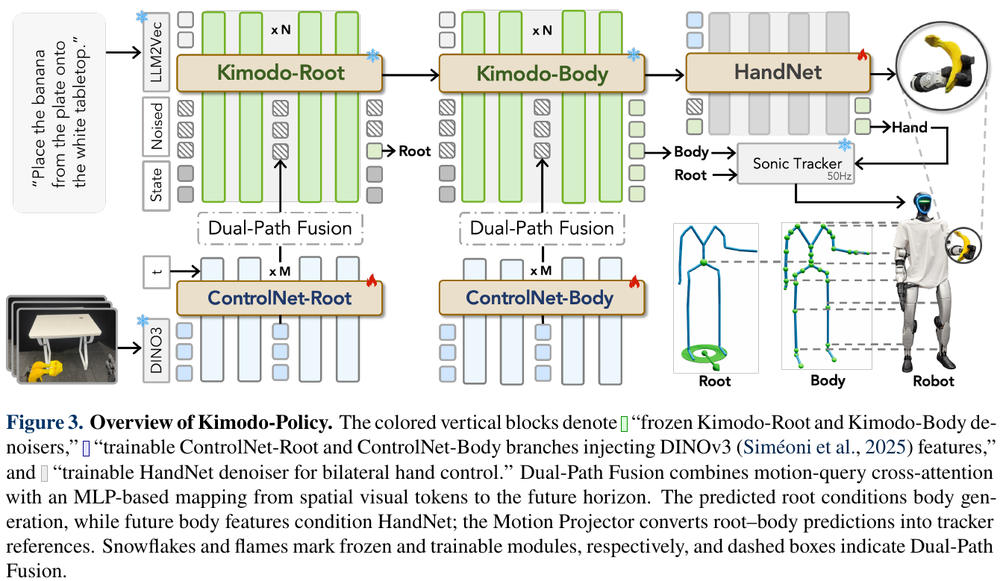
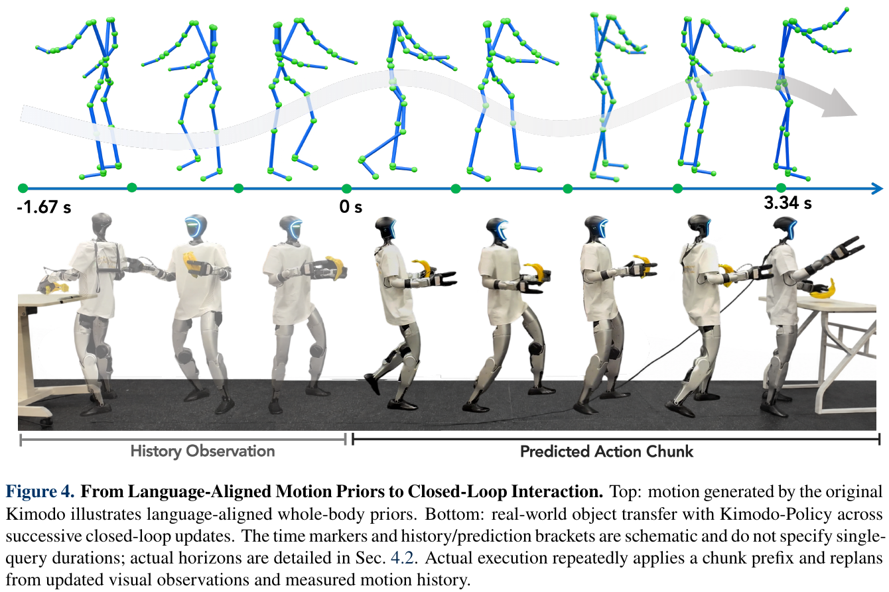
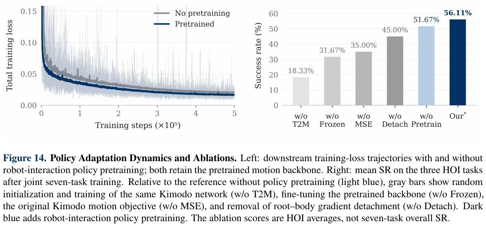

# 039 · Kimodo-Policy

## 基本信息

- **完整标题**：Kimodo-Policy: Learning Kinematic Action Models for Humanoid Loco-Manipulation。
- **作者 / 机构**：Yunheng Wang、Jiaxi Zhang、Wei Lu 等；HKUST(GZ)、JD Explore Academy、北京工业大学、剑桥大学。
- **版本**：arXiv:2611.11554v1，2026-11-08；23 页、14 图、4 表。阅读日期 2026-11-13；未复现。
- **来源**：[论文](https://arxiv.org/abs/2611.11554v1) · [HTML 全文](https://arxiv.org/html/2611.11554v1) · [官方项目](https://kimodo-policy.github.io/) · [官方代码](https://github.com/kimodo-policy/kimodo-policy) · [权重](https://huggingface.co/YunhengWang/kimodo-policy/tree/main) · [数据](https://huggingface.co/datasets/YunhengWang/kimodo-policy/tree/main) · [原论文](https://arxiv.org/abs/2611.11554v1)。项目页本次未成功加载，正文依据官方论文、代码仓库和发布入口核对。
- **分类**：Wholebody Intelligence → **大脑模型与任务策略**；关联运动控制、数据与评测。
- **证据**：HumanoidArena、SIMPLE 仿真定量，G1 八任务真机定量；本文不是新低层平衡控制器。

## 一句话理解

**先保留一个已经会生成协调全身动作的 Kimodo，再教它根据相机画面和机器人刚刚实际做出的动作，持续调整下一段运动，最后交给 SONIC 执行。**

作者称这个方向为 **Kinematic Action Models（KAM）**：以预训练运动生成模型作为动作生成主干。VLA 主要继承视觉语言语义，WAM 主要继承视频动态，KAM 则直接继承“身体怎样连续、协调地运动”的先验；三者可以互补。从输入输出看它仍是视觉语言动作策略；KAM 强调的是其动作主干来自运动生成器，不能把这些标签理解成完全互斥的能力分类。

## Motivation：为什么已有 VLA / WAM 还不够？

“看懂要拿哪个东西”与“边走、边弯腰、边伸手，同时协调全身”是不同能力。高层语义和视觉未来预测很有价值，但它们不天然给出高维身体关节的时序协调。

运动生成器已经从大规模运动中学习了步态、身体部位协同和时间连续性。问题是原始 text-to-motion 通常只按文本生成一段运动，缺少当前物体位置、真实执行偏差和接触结果的反馈。本文希望**把开放式运动生成器改成能看环境、能纠错的闭环策略**，而不从零重学运动结构。

## 方法：把 Kimodo 变成视觉闭环策略

### 1. 输入与输出

一次策略查询的条件是：**语言指令 + 当前第一视角 RGB + 已观测运动历史 + 当前双手状态**。

训练还输入带噪声的未来运动 / 手部序列及扩散时间步，监督恢复示范中的干净未来序列。推理时未来部分从噪声开始，条件保持可观测，逐步去噪。

输出一段未来运动，分成三个层次：

- **Root**：全局身体根部平移和朝向，决定人形整体往哪里走、怎样转身。
- **Body**：在 root 条件下生成躯干、四肢的协调运动；采用 Kimodo 的运动特征，包括关节位置、速度、朝向和脚接触等信息。
- **Hand**：专门的 HandNet 预测左右手开合控制。它是两路手部控制，并不是生成完整高自由度手指姿态。

Motion Projector 将生成的运动表示还原为跟踪器可用的运动学参考，身体由 **SONIC** 跟踪，手部命令配套执行。**模型预测运动参考，不直接输出电机力矩；物理执行与平衡仍依赖低层控制器。**

### 2. 哪些冻结，哪些训练？

冻结预训练 **Kimodo-G1-RP-v1** 的 root / body 去噪主干，也冻结 **DINOv3** 视觉编码器。语言经 LLM2Vec 编码。新增并训练 root / body 视觉 ControlNet 和 HandNet。

视觉接入有两个并行路径：未来运动特征通过 cross-attention 读取 DINOv3 空间特征；同时用 token 维 MLP 将空间 token 映射到未来时间长度。两条路径相加，经零初始化投影，以残差注入冻结主干的指定层。视觉修改作用于未来 token，历史约束保留。

主配置使用四层 ControlNet。论文报告策略总量 **678M**、可训练约 **92M**；这个口径不要直接当作包含离线语言编码、SONIC 和所有系统组件的完整部署参数量。

Root → Body、Body / 视觉特征 → Hand 的条件传递使用 **detach**：后一级仍能使用前一级的输出，但梯度不会通过这些条件反过来改动前一级，减少训练干扰。

### 3. 为什么它能闭环，而不只是播放 text-to-motion？

每轮把**实际测得的已执行运动**写入历史，而不是把上一轮计划当作已经发生的事实。在每个去噪步骤前，使用逐特征 mask 将已知历史恢复到观测值，然后预测未来。

主配置最多使用 **100 帧历史**，生成 **50 帧未来**，运动采样率 **30 Hz**。在 HumanoidArena 与真机中，先执行前 **15 帧**，即约 0.5 秒，再刷新图像和实际历史、重预测。50 帧规划约覆盖 1.67 秒；不是一次把这段开环播完。SIMPLE 的执行长度随配置为 15 或 50 帧。Fig.4 的时间标记是跨轮交互示意，不代表单次策略查询的实际 horizon。

SONIC 控制频率 50 Hz。论文推理配置为单张 RTX 4090、10 步 DDIM；不据此推断端到端延迟或声称完全机载。真机启用 RTC，两个仿真基准关闭；论文没有单独量化 RTC 的贡献。

### 4. 训练目标与两个“预训练”

训练从示范抽取历史与未来窗口，对未来 root、body、hand 目标加噪，再学习恢复干净特征。历史、padding 和无标签位置由 mask 处理。

总损失写作：`L = 4 L_root + L_body + L_hand + 0.2 L_delta`。Root / body 为未来有效位置的 MSE；手部有预测 MSE 和连续手部变化的 L1 约束。二值手状态映射到 [-1,1]；连续手数据学习相对最近有效手状态的残差，并在恢复闭合度后计算变化约束。

要分清两个阶段：

1. **Kimodo 本身的运动预训练**：提供被冻结的运动主干；有星号、无星号策略都继承它。
2. **419 小时机器人交互策略预训练**：在该主干周围训练视觉 ControlNet 与 HandNet，然后做下游示范微调。论文记为 **Kimodo-Policy***。

419 小时来自 HIW-500、UniFoLM-WBT 的 14 个 G1 子集、HumanoidEveryday。不能因为数据集名叫 HIW-500 就认为全部 500 小时都被使用。预训练 1M steps，16 张 H200 约 60 小时。

无星号策略直接进行下游训练。文中的 scratch 条件指没有上述交互策略预训练，**不等于 Kimodo 运动主干也从随机初始化开始**；真正移除运动预训练是另一个消融。

## 用“走到箱子前，双手搬起来”理解

以下是方法机制的示意，不是新增实验结果。

机器人看到箱子在左前方。Root 决定先向左前方接近；Body 生成相应的迈步、转身、弯腰与双臂配合；HandNet 决定何时张手和闭合。SONIC 将运动学参考变成实际机器人动作。

约半秒后，机器人可能比计划少走了一点。这时策略重新读取画面和实际身体历史，下一段会从实际位置出发调整，而不是继续假设自己已经到了原计划的位置。

Kimodo 提供“怎样让身体协调地动”的基础，视觉条件提供“眼前目标在哪里、现在该怎样调整”，执行历史则提供“身体实际上走到了哪一步”。

## 实验：效果与边界

### HumanoidArena：7 个任务，区分单任务和多任务

每任务 100 条成功示范，共 700 条。单任务设置每个任务训练独立策略，多任务设置由一个策略覆盖全部七任务。官方评估流程用 3 个评估 seed，每 seed 每任务 20 次；不能据此宣称有三个独立训练种子。

- **单任务**：Kimodo-Policy **69.76%**，带 419h 预训练为 **67.14%**，Diffusion Policy 为 **60%**。交互预训练没有提升单任务均值。
- **多任务**：Kimodo-Policy **67.63%**，预训练后 **72.14%**；比较表中 GR00T N1.7 为 **69.70%**、GigaWorld **68.39%**。
- 预训练多任务策略在 HSI 类均值 **84.17%**，HOI 类 **56.11%**；后者仍低于表中 GR00T N1.7 的 **62.22%**。因此优势主要体现在综合表现与身体—环境交互，不能说每种精细物体操作都领先。
- 部分基线成绩引用其他论文 / 官方报告，预训练数据与训练配置不同，不能当作严格相同数据预算下的架构对照。

### SIMPLE：8 个任务，3 级条件

每个任务每级 10 次，论文 Table 3 合计 **182/240 = 75.83%**，对照 Ψ0 为 **181/240 = 75.42%**。差距仅一个成功试验，适合称“有竞争力”，不足以证明显著领先。

L0 / L1 / L2 平均分别 **87.5% / 71.25% / 68.75%**。关门和推办公椅在论文表中均为 30/30；移动取放从 L0 的 90% 降到 L2 的 40%，说明更难条件仍存在明显性能下降。

**发布版本差异**：固定代码提交的 README 将 Push Office Chair 列为 80%，而论文 Table 3 为 100%。本笔记保留论文汇总口径，不把当前发布评估链接与论文成绩混为一组，也不自行推断差异原因。

### 真机：8 个任务，每任务 10 次

任务覆盖取放、搬运、开合柜体相关操作、足球、拳击、坐下、推车等；每任务分别微调策略，不是一个统一 checkpoint 完成全部八任务。

无 419h 交互预训练均值 **45% = 36/80**，预训练后 **60% = 48/80**。Punching Bag 达 90%，Cushion Sitting 80%，Dual-Arm Pick-and-Place 70%。Football 从 20% 到 50%；Cart Pushing 两种设置都是 60%。七个任务提升，一个持平。

每任务仅 10 次，一次成功就对应 10 个百分点。结果支持迁移收益，但样本量与统一策略能力仍有限。真实部署还使用 RTC，不能把全套系统收益全部归因于一个模块。

论文描述每任务约 25–30 条示范；**当前官方发布是 236 条、各任务 24–38 条**，并提供任务专属 checkpoint。两者单独记录，不将发布计数倒填成论文实验计数。

### 最有说服力的消融：运动先验是否重要？

这组模型均在七任务上联合训练，但图中汇总的是 **三个 HOI 任务平均**，不能与七任务总均值直接横比：

- 冻结预训练运动主干，未做 419h 交互预训练：**51.67%**。
- 运动主干随机初始化并训练：**18.33%**。
- 使用预训练主干但允许更新：**31.67%**。
- 换回原运动生成目标的 Smooth L1 + FK 配方：**35%**。
- 去掉条件 detach：**45%**。
- 再加 419h 交互预训练：**56.11%**。

它支持“已有运动结构值得保留，冻结主干加视觉条件比在当前小规模任务数据上改动整个主干更有效”。损失消融同时改变损失形式和权重，不是单一变量的 MSE 普适优越性证明。

其他扩展结果：同为 282M 的 Kimodo-SEED / RP 主干对应七任务均值 64.29% / 67.63%；两者语料大小和内容均不同。419h 策略数据从 105 → 210 → 419h 时均值 68.10 → 69.05 → 72.14%。扩大可训练模块从 53.6 → 91.7 → 158.9M，对应 61.43 → 67.63 → 68.57%；数据与容量是分开的实验，不能拼成统一缩放曲线。

## 与笔记库已有工作的关系

- **[HALO](036-halo.md)**：借 Kimodo 生成运动、构造训练数据，再训练感知策略；Kimodo-Policy 则保留运动生成器作为在线策略主干。数据工具与部署主干的角色不同。
- **[GR00T 2](037-gr00t2.md)**：同样关注大脑与全身控制接口；本文的核心证据是运动生成先验作为策略基础，而不是训练一个新的视觉语言大模型。
- **[LAPT-Scale](038-lapt-scale.md)**：LAM 从视频转移中提取隐式动作标签，主要服务策略预训练；Kimodo 的先验来自显式全身运动，且在部署时仍参与动作生成。不要把 KAM 与 LAM 当成同一个模块。
- **[SONIC](003-sonic.md)**：是这里的低层执行基础。本文没有证明生成运动脱离特定跟踪器后仍能稳定执行。

## 结论与阅读判断

论文最想说明：**通用人形策略的基础可以是“已学会身体运动结构的模型”，而不必完全从视觉语义或视频预测主干出发。**

初步证据比较扎实的是：冻结运动先验、用轻量视觉条件做任务适配，在有限下游示范下有价值；再增加机器人交互预训练可以提高多任务和真机结果。

边界也很明确：仍需要交互示范与任务微调；运动学合理不自动保证接触与动力学可行；依赖 SONIC；不是开放词汇任意指令的零样本通用机器人，也未验证对多种跟踪器和运动生成主干的普适迁移。论文只给出 KAM 的一个实例。

## 复现入口与来源记录

截至 2026-11-13，官方仓库提供训练、HumanoidArena / SIMPLE 评估、真机数据采集与部署流程；Hugging Face 提供运动 / 视觉依赖、419h 预训练及任务 checkpoint、训练数据和评估输出入口。本次只核对发布内容，没有安装模型或运行机器人实验。

代码阅读固定于提交 `32129c968d62a1eac78b9800916703f377a558a2`：[固定 README](https://github.com/kimodo-policy/kimodo-policy/blob/32129c968d62a1eac78b9800916703f377a558a2/README.md)。仓库仍在更新，论文与发布差异已在对应结果旁注明。

保存作者原图 Fig.1、Fig.3、Fig.4、Fig.14，保留完整英文图注；[图像清单](../assets/039-kimodo-policy/manifest.json)与[来源记录](../assets/039-kimodo-policy/source-record.json)记录版本、页码、裁剪和校验值。
