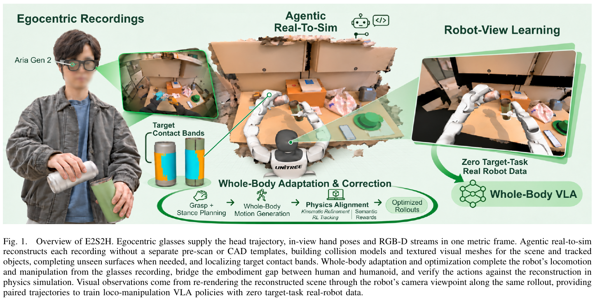
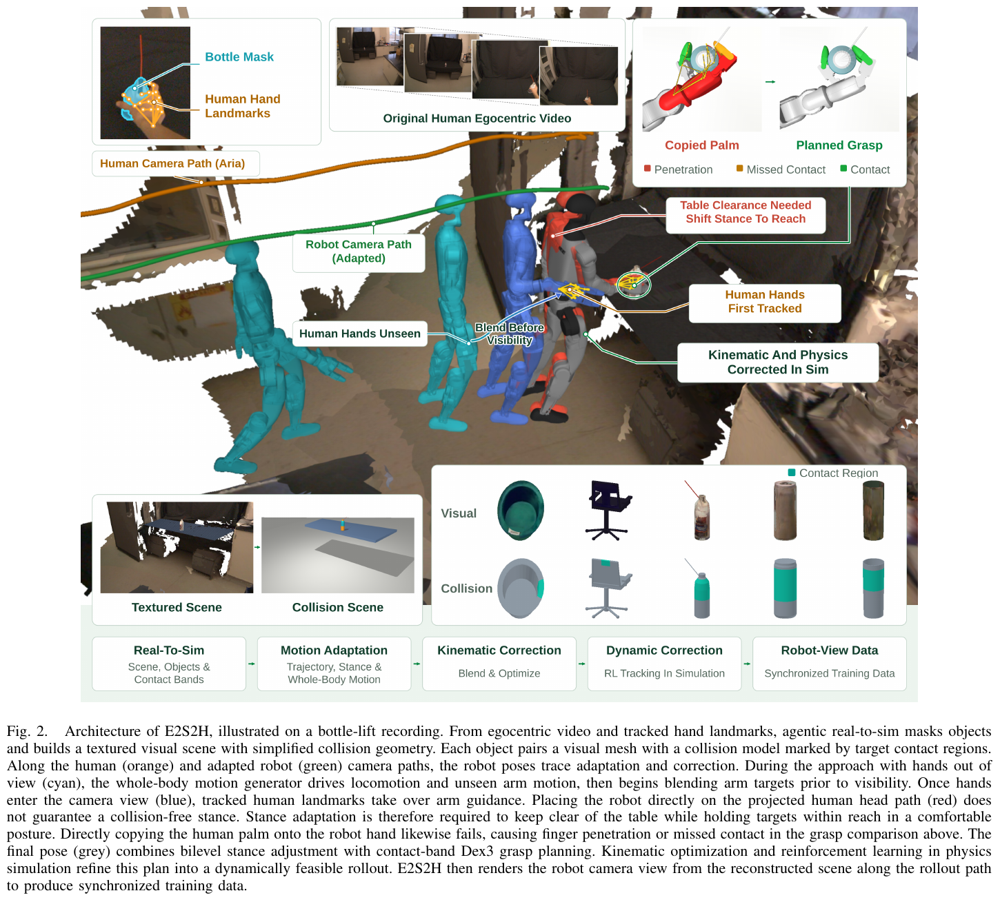
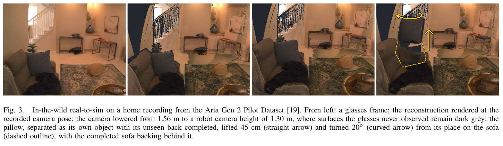
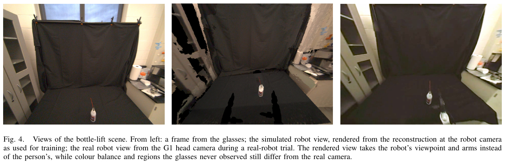
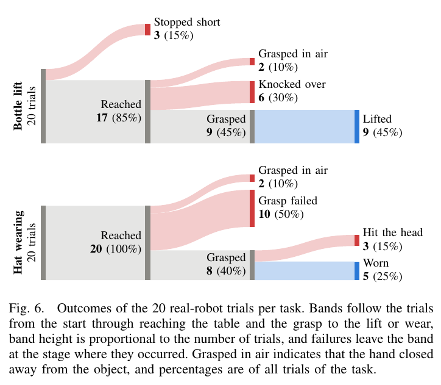

# 040 · Ego2Sim2Humanoid

## 基本信息

- **标题**：Ego2Sim2Humanoid: Agentic Real-to-Sim for Learning Loco-Manipulation VLAs without Robot Demonstrations
- **作者**：Chen Liu、Nikolaus Correll（University of Notre Dame）
- **版本**：arXiv:2611.19196v1，2026-11-14，13 页。2026-11-18 阅读，未复现。
- **分类**：Wholebody Intelligence → 数据、基准与综述。关联任务策略、运动控制与重定向。主要贡献是从人类记录构造机器人的训练数据。
- **来源**：[论文页面](https://arxiv.org/abs/2611.19196v1) · [HTML 全文](https://arxiv.org/html/2611.19196v1) · [项目页](https://robonana.github.io/ego2sim2humanoid/) · [原论文](https://arxiv.org/abs/2611.19196v1)
- **发布状态**：项目页和[作者仓库](https://github.com/robonana/ego2sim2humanoid)标示代码即将发布。本次未核实到该方法的完整代码、训练数据或权重。

## 一句话理解

**戴眼镜示范一遍，系统从头手观测和环境几何生成一条 G1 能执行的全身参考，再在仿真里检查它是否真的抓住物体、完成任务。最终用同一次成功回放的画面、状态和动作微调 GR00T。**

## Motivation

纯人类眼镜采集比逐条操作机器人轻便，但眼镜只记录头部轨迹和视野内的手，看不到腿或出画的手臂。同时，由于真人和 G1 的身高、伸手距离和手型不同，照着人手掌的位置做，三指 Dex3 可能抓空、穿模，或者在机器人站位下够不到物体。论文要解决的是，同一个人类交互能否变成**抓得住、站得稳、并且画面与动作一一对应**的机器人示范。

## 方法

### 1. 输入与场景重建

示范者只佩戴 **Aria Gen 2**，得到校准的 RGB-D、重力对齐的 6-DoF 头部轨迹、视野内 3D 手姿，另配任务指令。它需要深度和跟踪信号，输入条件比普通单目 ego 视频更丰富。

离线 coding agent 按每段记录执行并检查重建步骤。它从深度拟合地面、桌面等支撑，用简化碰撞几何建立物理场景，从轮廓匹配跟踪物体的 6-DoF 位姿，并用物体坐标系内的 TSDF 融合构建用于渲染的纹理网格。必要时补全看不到的表面，将推断几何单独记录。结合手和物体轨迹定位触碰、闭合、抬起和松手事件，并在物体表面确定**接触带**，如帽沿内外两侧的一段区域。

### 2. 怎样从不完整的人类观测得到全身动作？

- **Root**：把头部路径投影到地面并平滑水平朝向，得到机器人走路的初始路线。局部头部动作仍可作为姿态提示。
- **手部**：手在画面中且未接触时，跟随映射到机器人手掌坐标的观测。进入抓取后，用物体位姿与接触带求解机器人的腕姿和指关节闭合。求解器让 Dex3 对置指垫落在接触带两侧、限制穿入及碰撞，同时尽量保留示范中的接近方向。
- **站位**：外层搜索避碰且让抓取可达的平面站位和朝向，内层解腰和手臂的逆运动学。同一个参考场景里，机器人可以站得比人更靠前，或换一个朝向。
- **缺失的腿和手臂**：调整参考时间，使走路和伸手符合机器人速度限制。把根部路径、可见手部关键帧和规划站位交给 **Kimodo**，在重叠窗口中生成完整机器人运动参考。没有观测到的动作由模型在约束下补全。

### 3. 两次修正之后，什么进入训练集？

**运动学修正**让手进出视野时的生成姿态与跟踪姿态平滑衔接，优化足底接触、质心与支撑、手目标和避碰。运动学物理回放检查闭手前是否已经把自由物体推走。

**动力学修正**在重建场景里训练 RL 跟踪策略。它根据仿真状态和后续参考预测 **64 维 SONIC token**，冻结的 SONIC 解码器将其转换为身体关节目标，Dex3 手命令一同发送。奖励结合动作跟踪、接触、物体轨迹以及任务目标关系，例如把帽子放到头上时，即使帽子已离开相机视野，仿真仍能按帽子相对头部的位置提供奖励。仅保留符合任务和物理筛选条件的回放。

### 4. VLA 训练时的输入和输出

- **输入**：从成功回放沿 G1 相机轨迹重新渲染的 RGB、同一步机器人的本体状态（43 个关节位置及基座坐标系重力方向）、任务指令。渲染使用模拟物体的实际位置和机器人自己的手臂。
- **监督输出**：未来动作块，每步 **78 维**，由 64 维身体 SONIC token 与 14 维双手关节命令组成。
- **部署**：微调后的 **GR00T N1.7（3B）**读取真机观测并输出动作，身体仍由冻结 SONIC 解码器执行。场景重建、Kimodo 和特权 RL 策略用于离线造数据。

例如戴帽时，人手只在眼镜看到帽沿的阶段提供姿态；机器人需要找自己的站位和三指抓法，之后用仿真物体与头部的相对位置完成抬到头上的阶段。这解释了训练标签如何覆盖眼镜拍不到的部分。

## 实验

- **数据通过率**：举瓶采集 219 条，189 条进入训练集（约 86%）。戴帽采集 154 条，59 条通过（约 38%）。戴帽薄壁接触更难，很多记录在正式动力学 rollout 前就被淘汰。
- **真机自主执行**：举瓶 **9/20（45%）**，17 次到桌，9 次抓住且全部抬起。戴帽 **5/20（25%）**，20 次到桌，8 次抓住，3 次抓住后撞到头部而未完成。当前损失主要集中在抓取及其后续动作。
- **抓法对照**（表 I）：71 条戴帽记录使用相同的 RL 流程。接触带规划相较直接复制人掌，手部穿入中位数 **1.8 → 0.8 cm**。在两法均成功的 43 条中，手内滑移中位数 **6.6 → 3.7 cm**，转动 **33.0° → 22.9°**。总体成功计数为 53/71 与 56/71，改善更集中在接触质量。
- **与 EgoHumanoid / EgoHumanoid-V2 比较**（表 II）：E2S2H 在 71 条戴帽记录中得到 57 个可行的帽沿抓法，基线为 0。这里是重定向后的路径、接触距离和抓法可行性对照。完整版 EgoHumanoid-V2 的统计为其完成的 6/8 条留出记录，不能把所有列当作同样的样本量，也不能把该实验读成三种真机 VLA 的胜率对比。

## 结论

论文展示了在没有目标任务真机示范的情况下，可以从稀疏人类眼镜观测构造足以训练真机移动操作策略的样本。它提供的是**带场景、接触和时序对齐的机器人数据转换流程**。对你关心的「ego → motion」，这里真正测得的是头和视野内手，腿、出画手臂和机器人站姿由生成与优化补齐。

证据目前来自 G1 的两项任务、各 20 次试验。任务依赖已定义的交互语义与接触条件，物体质量、惯量和摩擦等由先验估计，当前场景模型主要覆盖刚体、参数形状与铰接物体。对重载和可变形物体的迁移仍待验证。GR00T、SONIC、Kimodo 都是已有模型，零目标任务真机示范描述的是本工作的数据转换与下游微调。

与 [DreamVLA](041-dreamvla.md) 对读：两篇都把参考动作经过仿真执行转换成 VLA 数据。E2S2H 的主要难点是把**真实示范**变成可执行 G1 动作并对齐视觉。DreamVLA 关注从**生成参考**获得纠错轨迹。与 [KODA](002-koda.md) 和 [EgoHumanoid-V2](027-egohumanoid-v2.md) 对读，可以比较采集信号、场景几何、动作监督以及接触筛选的差异。

[原图清单](../assets/040-ego2sim2humanoid/manifest.json) · [来源记录](../assets/040-ego2sim2humanoid/source-record.json)
