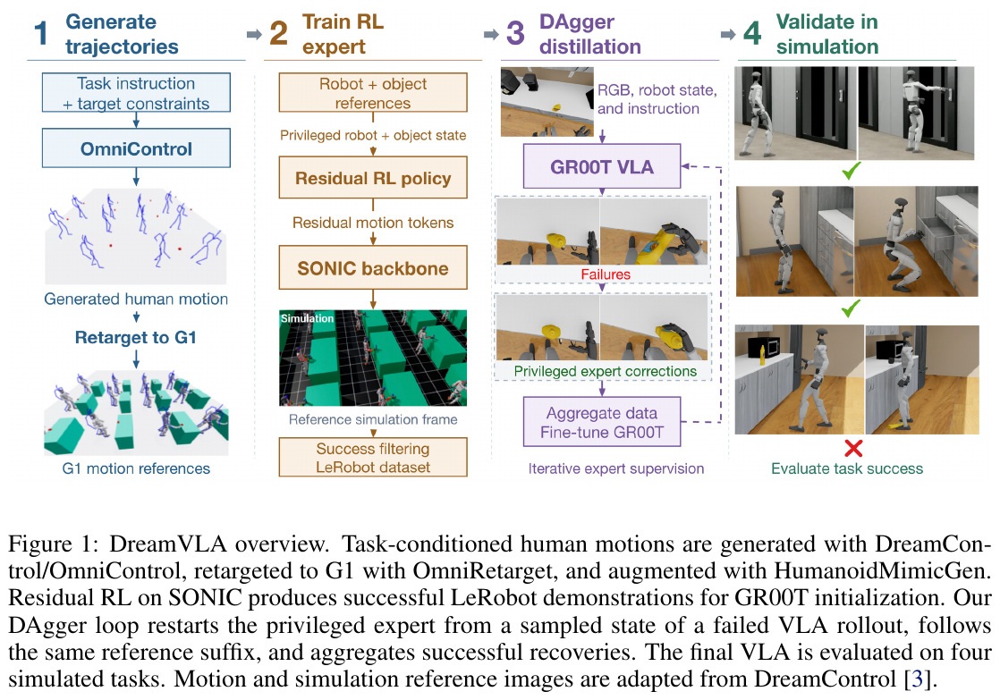
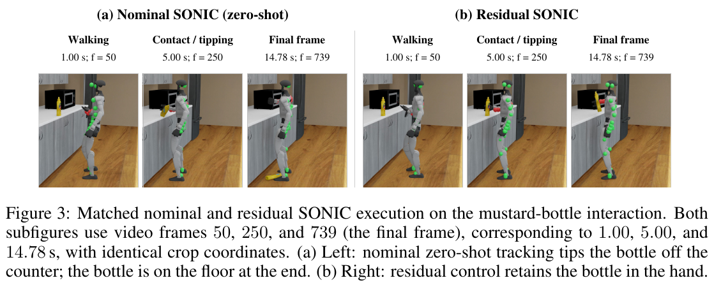
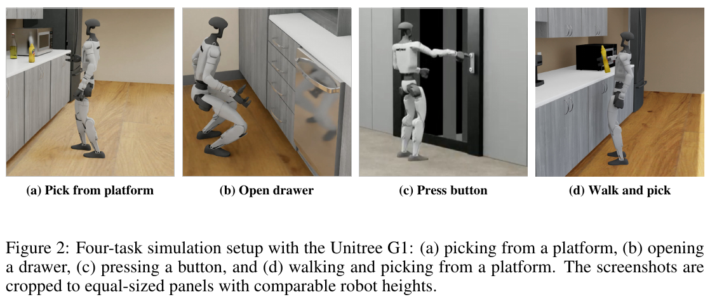

# 041 · DreamVLA

## 基本信息

- **标题**：DreamVLA: From Generated Human Motions to Humanoid Vision-Language-Action Policies
- **作者**：Kevin Park、Izat Rasyad、Dvij Kalaria、Shankar Sastry（Princeton University、UC Berkeley）
- **版本**：arXiv:2611.10872v1，2026-11-07 UTC（北京时间 11-08），13 页。收录于两个 CoRL 2026 workshop。2026-11-18 阅读，未复现。
- **分类**：Wholebody Intelligence → 数据、基准与综述。关联任务策略、运动控制。主要贡献是用生成运动建专家数据，并用学生触发的恢复数据改进蒸馏。
- **来源**：[论文页面](https://arxiv.org/abs/2611.10872v1) · [HTML 全文](https://arxiv.org/html/2611.10872v1) · [项目页](https://ember-center-berkeley.github.io/DreamVLA/) · [原论文](https://arxiv.org/abs/2611.10872v1)
- **发布状态**：项目页提供选出的仿真成功回放和成绩表。本次未核实到该方法的完整代码、训练数据或策略权重。

## 一句话理解

**用文生动作合成一条“该怎么做”的草稿，让仿真专家在接触中把它做成功，再训练 VLA。学生一旦做偏，就把仿真回到学生走过的某个状态，让专家沿着同一条参考接着做，并把成功的补救过程加进训练。**

## Motivation

人形双臂操作往往需要同时把站位、手腕、手指和步态对齐，逐条遥操作录制成本高。生成的人体动作能描述走近物体、什么时候伸哪只手，但直接重定向并跟踪时，轻微位置误差就可能把瓶子碰倒。另外，即使成功的专家轨迹很多，学生自己跑出来的状态也可能不同，尤其是手已经偏离目标、抓取时机错过时。论文分别用**残差专家**与**纠错轨迹蒸馏**处理这两类差距。

## 方法

### 1. 全身参考从哪里来？

DreamVLA 沿用 **DreamControl** 的生成阶段。给 **OmniControl** 任务文字和时空约束（哪个人体关节在何时靠近哪个坐标），采样多条人体运动。例如指定右手腕在某一时刻到达平台上的瓶子附近。用 **OmniRetarget** 将人体运动重定向给 G1，再用 **HumanoidMimicGen** 改变接触点做扩增。仿真场景对齐参考中的交互坐标。这个流程生成的是根姿态、身体关节和手状态参考，需要到仿真里检验接触。

### 2. 怎么把动作草稿变成可执行示范？

专家读取本体状态、模拟器中的物体状态、当前及未来的机器人参考、物体参考和任务指令。物体参考描述期望结果，如瓶的位姿、抽屉位移或按钮行程。

SONIC 编码器将参考映射到名义动作 token，RL 策略输出修正量。两者相加后交给 SONIC 解码器执行身体动作，手采用二值开合命令。训练奖励包括身体参考跟踪、任务奖励和控制正则项。专家训练随机化机器人和物体的物理参数。成功回放经任务判定筛选，导出同步机器人第一视角画面、本体状态、指令与实际执行命令，按 LeRobot 格式保存。

### 3. VLA 用什么训练？怎么加入 DAgger？

**学生输入**是机器人相机图像、本体状态和语言；**监督输出**是一段专家给出的完整 SONIC token 与手开合命令。完整 token 已包含专家的残差修正。GR00T 沿用原生动作训练损失。参考轨迹、仿真真实物体状态和残差专家在训练数据生产阶段使用，评估时学生直接给 SONIC 发动作。

先用成功专家示范离线初始化，再执行如下流程：

1. 从参考的初始场景启动 VLA，保存它自身执行产生的模拟器状态。
2. 对失败回放，均匀采样一个已访问时间点并恢复当时状态。专家接手，从**同一条参考在该时刻的后段**继续做，仍受原轨迹剩余时间约束。
3. 保留完成任务的专家续段，与原数据合并，进一步微调。后续观测来自专家接手后的回放，动作块也限定在原有轨迹或恢复片段内。

例如走近平台时，学生站得太远，继续照着初始示范伸手会抓空。仿真从学生实际站位恢复，专家使用同一参考意图，在剩余时间内尝试补步、重新够物。成功后，这一段新状态与新动作一起进入训练。失败状态是否可恢复由专家能力、采样时点和剩余参考共同限制。

## 实验

四任务依次为 **平台取物、拉抽屉、触按钮、行走后取物**。取物要求抬高至少 15 cm 且保持拿住，抽屉要求拉开超过 0.15 m，按钮最低成功判定是右食指接触。每项策略成功率使用 100 个随机环境设置评估，测试分布与生成参考时的目标位置分布一致。项目页明确视频来自分任务训练的策略。

- **DAgger**（表 2）：起始 200 条专家轨迹，四项成功率 **0 / 51 / 59 / 0%**。每轮加 200 条成功纠错续段，三轮后共 800 条，达到 **54 / 60 / 69 / 18%**。同为 800 条的纯离线对照为 **0 / 54 / 57 / 0%**。轨迹条数匹配，续段与完整离线轨迹的长度、总帧数和状态覆盖不能据此视为匹配。
- **残差专家**（表 3）：名义 SONIC 在平台取物和走后取物为 **0% / 17.30%**，增加残差后为 **88.6% / 75.95%**。在论文给定的 3,000 次 RL 迭代预算下，直接预测绝对 token 的对照四项均为 0%。专家残差版平均关节位置误差 **25.51 mm**，略高于名义跟踪的 **24.84 mm**，说明偏离运动参考可能有助于完成接触。结果是专家统计，最终 VLA 的对应成绩是 54% 和 18%。
- **纯离线数据扩张**（表 4）：10、50、200 条参考对应相同数量的成功示范。抽屉 **13 → 51 → 51%**，按钮 **0 → 14 → 59%**，两项取物全程为 0%。与表 2 合读，最明显的收益来自把监督放到学生容易出错的状态，而在当前实验规模内单纯增加成功示范没有解决取物难题。

**来源差异**：作者项目页的抽屉、按钮在部分 DAgger 和数据规模条件下给出不同数字，本笔记统一采用 arXiv v1 PDF 的表 2–4。项目页上的视频适合看执行过程，具体成功率按论文报告。

## 结论

最有代表性的结果是：**同样累计 800 条轨迹，加入学生出错后采集的恢复续段，走过去取物从 0% 到 18%，平台取物从 0% 到 54%**。这提供了从生成动作参考到闭环 VLA 的一种训练方法，也显示专家的任务能力仍未完全转移到视觉学生。

论文只评估仿真 G1 的四个任务，VLA 训练没有使用视觉域随机化，无法据此判断真机迁移。它依赖任务相关的约束、物体参考、奖励和筛选，以及上游已有的运动模型、SONIC 和 GR00T。论文方法仅称预训练 GR00T，未给出足以核实的精确 checkpoint 和动作块时域设置。无新增任务遥操作数据是本实验的结论。

与 [Ego2Sim2Humanoid](040-ego2sim2humanoid.md) 对读：它从真实眼镜示范重建每段场景，评估真机迁移。DreamVLA 从文本和时空约束生成动作，用失败重启来补充训练数据。与 [Kimodo-Policy](039-kimodo-policy.md) 对照，DreamVLA 的动作生成器离线生产参考，测试时由 GR00T 预测 SONIC 命令。与 [LAPT-Scale](038-lapt-scale.md) 对照，DreamVLA 学的是仿真专家实际执行的机器人控制 token。

[原图清单](../assets/041-dreamvla/manifest.json) · [来源记录](../assets/041-dreamvla/source-record.json)
