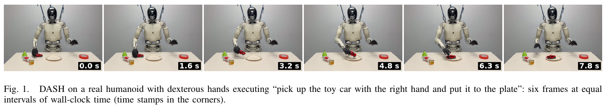
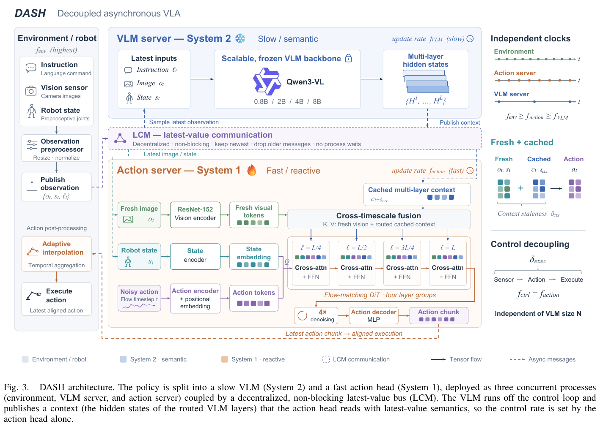
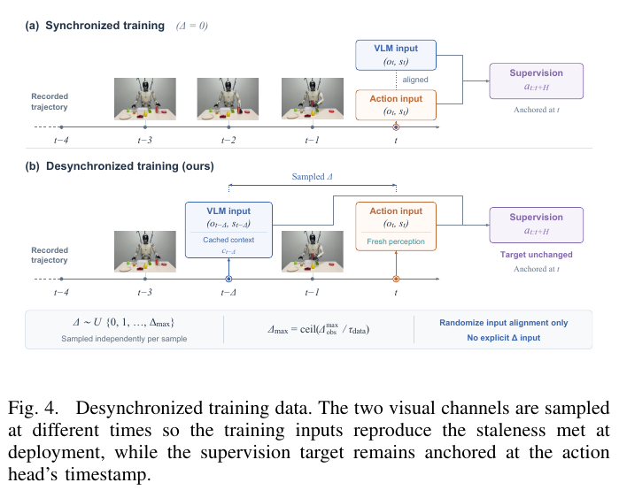
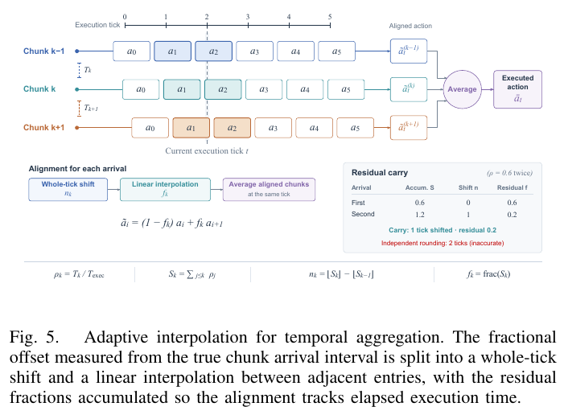
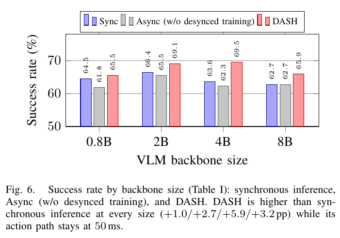

# 042 · DASH

## 基本信息

- **标题**：Decoupled Asynchronous System for Humanoids (DASH): Latency-Agnostic Scaling of Vision-Language-Action Models for Humanoid Manipulation
- **作者**：Bingzhang Wang、Nathan Zhao、Jialeng Ni、Jiayin Zheng、Yin Zhang、Kehua Chen、Jian Yao（XPENG Robotics、University of Washington）。姓名按 v2。
- **版本**：arXiv:2611.11854v2，2026-11-12；首版 2026-11-09。PDF 共 9 页，2026-11-18 阅读，未复现。
- **分类**：Wholebody Intelligence → 大脑模型与任务策略。关联运动控制。论文验证人形灵巧手桌面操作，适合研究高层模型和快速动作执行之间的接口。
- **来源**：[论文页面](https://arxiv.org/abs/2611.11854v2) · [HTML 全文](https://arxiv.org/html/2611.11854v2) · [原论文](https://arxiv.org/abs/2611.11854v2)
- **发布状态**：截至阅读日，从论文和定向检索未核实到对应的官方代码、权重或数据发布。

## 一句话理解

**大模型慢慢理解“用右手把玩具车放到盘子里”，小动作头一直看最新画面和关节状态，持续更新手应该怎么动。** 动作头复用最近一次算好的语义，训练时主动练习使用不同程度的旧语义。新动作块交接时按真实时间对齐，避免回放落后或突然跳步。

## Motivation

常见串行 VLA 在同一次查询里先等视觉语言主干算完，再让动作头生成整段动作。模型越大，从拍到画面到动作可用的时间越长。机器人继续执行上一段动作，等新动作到达时，手和物体相对位置可能已经变了。串行推理还会让机器人更常执行上一动作块的后半段，进一步降低更新频率。

DASH 把延迟拆成两件事：

- **动作延迟**：动作头读到当前观测后，需要多久交付可执行的动作块。
- **语义年龄**：动作头正在使用的 VLM 特征，它对应的原始观测距此刻已经过去多久。

将 VLM 移出动作推理的等待链路，能降低第一种延迟，但第二种仍存在。论文的训练与执行设计分别处理这两个问题。

## 方法

### 1. 部署时三个循环并行

- **环境进程**：持续发布图像、关节状态与指令，负责观测预处理、动作块对齐和实际执行。
- **慢路 VLM，System 2**：读取最近可用的图像、机器人状态和语言，算出多层 hidden states，发布为语义上下文。
- **快路动作头，System 1**：读取最新图像和本体状态，再拿最近一次完成的 VLM 上下文，生成一段未来动作。慢路下一次结果到来前，快路可以用同一份语义生成多个动作块。

进程使用 LCM 的 UDP 发布订阅。消费端取队列最新项，跳过较旧消息，避免读到一串积压观测。环境按动作块到达节奏滚动更新，并处理因推理用时而过期的开头。论文的 20 Hz 指快路动作更新口径，VLM 上下文依然以自己的速度更新。

### 2. 旧语义与新画面如何融合？

慢路使用冻结的 Qwen 系列 VLM。动作头是 **12 层、隐藏宽度 1024、8 个注意力头**的 flow-matching DiT，推理做 **4 步**积分，配有自己的 **ResNet-152** 图像编码器。

每次快路预测，ResNet 从当前画面提取视觉 token。DiT 的查询由当前机器人状态和按 flow time 加噪的未来动作序列提供。交叉注意力的 K/V 拼接**最近一次 VLM 的多层特征**和**当前帧的视觉特征**。12 层分四组，依次读取约在 VLM 深度 25%、50%、75% 和 100% 处的特征。动作头同时获得较稳定的任务语义和及时的空间证据。训练冻结 VLM，更新动作头及其视觉编码器等连接组件。冻结固定的是可训练部分的规模，较大 VLM 的特征提取开销仍需考虑。

### 3. 训练输入错开，动作标签对准当前

从一条示范选时刻 t，每个样本独立均匀抽一个延迟 Δ：

- 慢路读 t−Δ 时刻的图像和状态，并结合任务指令形成上下文。
- 快路读 t 时刻的图像和关节状态。
- **训练目标仍是从 t 开始的未来动作块**。Flow matching 学的是此刻应该怎么动。

Δ 用示范图像帧数计。上限用部署时测得的最大观测时间差除以数据采样周期并向上取整，包含零延迟。Δ 只用于取训练数据，模型没有额外的延迟输入或 gating 分支。

拿玩具车举例。慢路上一次已经算出任务语义，此时右手在执行中又往前移动了。快路用当前相机图像及本体状态重新判断手离车多远，再生成新的动作块。把慢路和快路的训练输入故意错开，可以让动作头见到这种部署时常有的组合。

### 4. 新旧动作块怎样接起来？

多个动作块会为相同执行时刻给出动作。DASH 先将它们对到同一个时刻，再聚合。它用相邻动作块到达间隔除以执行步周期，得到可能非整数的位移。整数部分移动缓冲区，剩下的小数在两个相邻动作间线性插值。**小数余量跨块累积**，所以两次各过了 0.6 步，累计就是 1.2 步。这能避免每次独立取整使动作执行进度逐渐跑快。

## 实验

### 异步 RoboTwin：快路更新频率与成功率

仿真使用 ALOHA embodiment，50 项任务、每项 5 个场景种子，每个配置 250 个预设回合；成功率按成功初始化的有效回合计算。仿真在推理期间继续推进，机器人继续执行已有动作块。这样延迟会反映到任务结果中。

- **0.8B / 2B / 4B / 8B** 同步动作更新时间分别为 **103 / 132 / 183 / 243 ms**，即 **9.7 / 7.6 / 5.5 / 4.1 Hz**。DASH 快路四档均为 **50 ms、20 Hz**。RTX 4090、480×640 测得预处理 **15 ms**、动作头 **35 ms**；VLM 自身耗时仍为 **53 / 82 / 133 / 193 ms**。
- 同步的成功率为 **64.5 / 66.4 / 63.6 / 62.7%**；同一异步运行时搭配对齐训练为 **61.8 / 65.5 / 62.3 / 62.7%**；DASH 为 **65.5 / 69.1 / 69.5 / 65.9%**。异步切换本身没有带来成功率提升；错时训练相对同一异步运行时提高 **3.2–7.2 个百分点**。
- **4B 的 DASH 在本协议下最高**，比同步 4B 高 **5.9 个百分点**。8B 的成功率低于 4B，而且 0.8B 属于 Qwen3.5、其余为 Qwen3-VL。这组结果证明的是测试范围内动作更新速率保持稳定，无法推出成功率随模型规模单调上升。
- 4B 下的进一步对照为 **冻结且无快路视觉 55.0%**、**全量微调且无快路视觉 62.6%**、**冻结加 ResNet-152 69.5%**。这个结果支持快路视觉的作用。该设计同时改变了视觉特征的实时性与可训练性，两种影响在表中未单独隔离。

### 真机：灵巧手桌面取放

双灵巧手人形接收含物体、使用哪只手、放到哪里的语言指令，执行饮料罐、薯片、玩具车和牛奶纸盒等取放。两个配置各 24 次。**同步＋固定偏移聚合为 16/24（66.7%），完整 DASH＋自适应聚合为 23/24（95.8%）**。两套部署配置同时改变了同步方式和聚合方式，表 III 给的是整套系统差异。论文未在此给出单独替换聚合器的真机量化对照。

## 结论

DASH 的可复用设计是，**高层语义可以低频更新，当前视觉和身体状态仍需高频进入动作预测。** 实验中快路提速后，只有让动作头在训练时见过慢路语义的滞后，才改善了闭环成功率。分数时间对齐解决的是动作交接节奏，和错时训练解决的语义输入问题不同。

与全身移动操作的关系在于部署架构。论文的仿真是 ALOHA，真机验证是准静态桌面取放，走动操作、动态接触及长时序任务仍待验证。20 Hz 也是特定模型和硬件设置下的动作更新结果，不能直接当成任意系统的关节伺服频率。可结合 [GR00T 2](037-gr00t2.md) 看高低频接口，或结合 [Kimodo-Policy](039-kimodo-policy.md) 比较闭环动作块更新方式。

[原图清单](../assets/042-dash/manifest.json) · [来源记录](../assets/042-dash/source-record.json)
