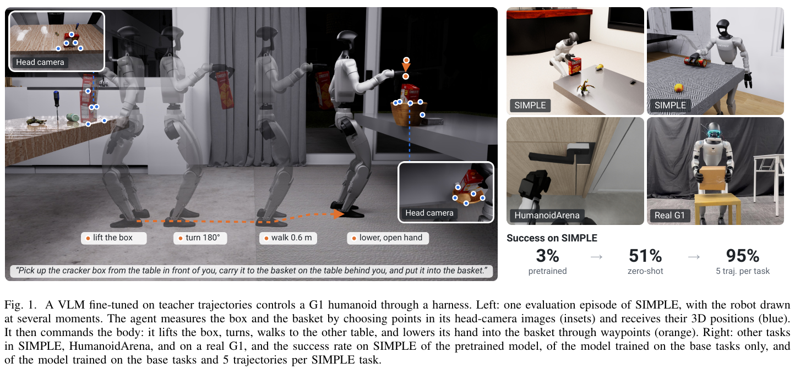
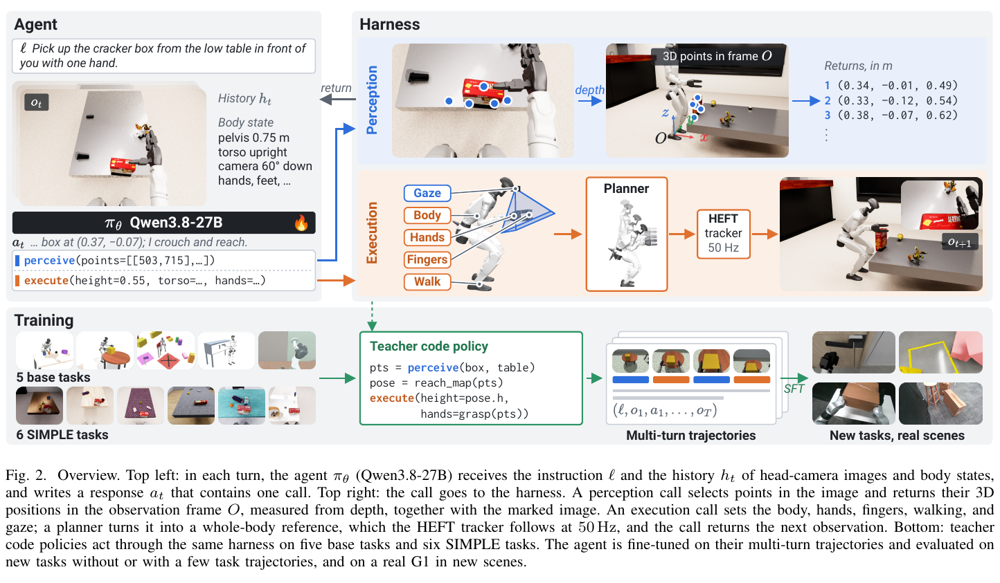
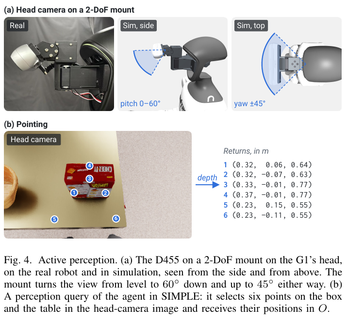
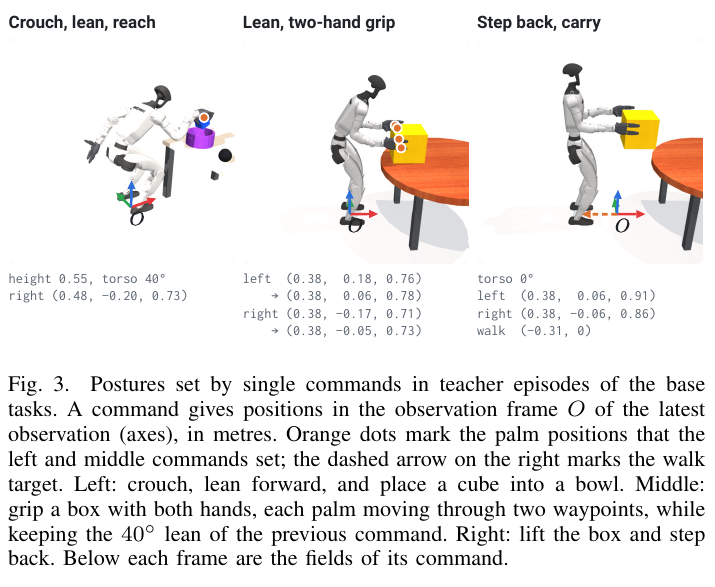
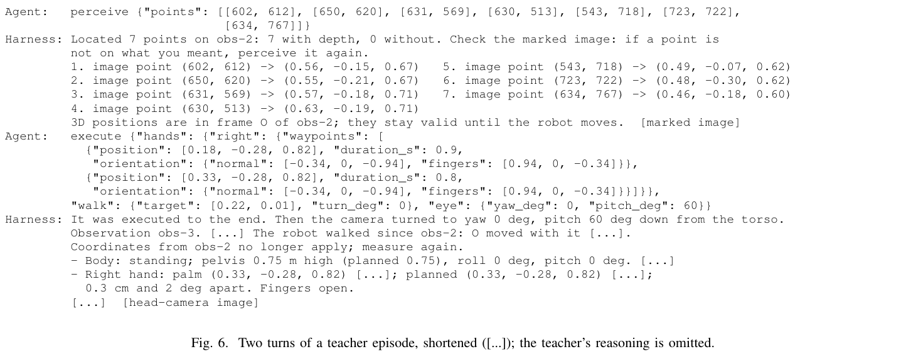
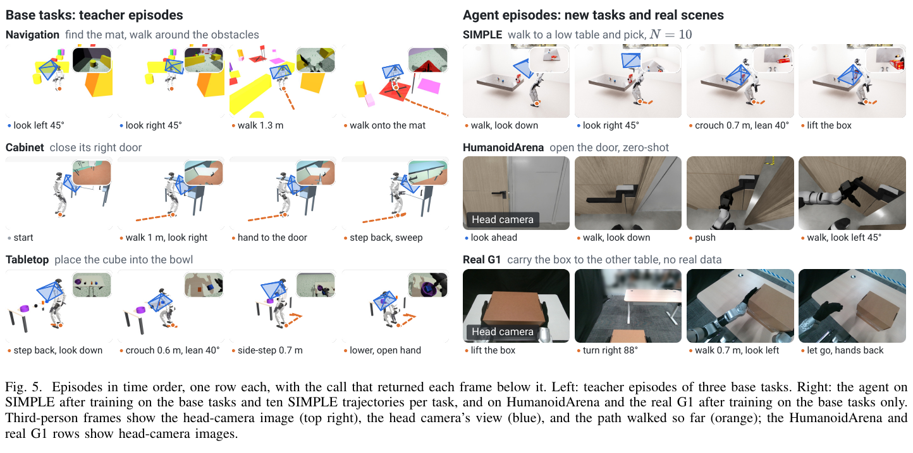

# 043 · HITCH

## 基本信息

- **标题**：HITCH: Teaching a Vision-Language Model to Operate a Humanoid through a Whole-Body Harness
- **作者**：Qingzhou Lu、Chenxin Liu、Xinming Wang、Liu Cao、Yanjiang Guo、Mengdi Xu、Jianyu Chen（清华大学、中国科学院自动化研究所、上海期智研究院）
- **版本**：arXiv:2611.08039v1，2026-11-05，13 页。2026-11-18 阅读，未复现。
- **分类**：Wholebody Intelligence → 大脑模型与任务策略。关联运动控制与数据。主要贡献是给高层 VLM 定义感知、执行接口，并训练它组合接口完成任务。
- **来源**：[论文页面](https://arxiv.org/abs/2611.08039v1) · [HTML 全文](https://arxiv.org/html/2611.08039v1) · [作者项目页](https://hitch.axell.top/) · [原论文](https://arxiv.org/abs/2611.08039v1)
- **发布状态**：本次未核实到 HITCH 的完整官方代码、教师轨迹或微调权重，项目页未能核实。论文附录给出了执行字段、教师对话与训练设置。

## 一句话理解

**VLM 每轮只做一件事：要么在图里点几个位置，请 RGB-D 相机量出三维坐标；要么发出走路、弯腰、伸手等目标，让规划器和 HEFT 完成整段动作。** 执行完再看一眼，决定下一步。

## Motivation

人形操作需要机器人判断三件事：目标在哪里、身体该站在哪里、哪些部位要协调。预训练 VLM 往往知道箱子应该放在哪类容器里，但单靠 RGB 容易估错厘米级距离，也不熟悉 G1 的伸手范围。直接调用一个「拿箱子」技能又很难显式调整蹲多低、身体怎么倾、两个手掌朝哪里。

HITCH 把这些能力拆成可直接调用的接口。机器人用深度量具体三维位置，把平衡、手脚协调和关节命令交给专门模块，再用示范教 VLM 在什么时候选择哪个调用。

## 方法

### 1. 感知接口：VLM 选点，深度负责量尺寸

- VLM 接收任务文本和到当前为止的交互历史，包含头部 RGB、身体状态、调用及返回值。每轮输出一个感知查询或执行命令，可选附带推理文本。
- 查询时，VLM 在最新图像上给出归一化到 [0, 1000] 的像素点。实际深度图由 harness 使用，并依据相机内外参反投影成米制三维点。缺深度的点记为无效，局部深度突变则标记边缘风险；返回的带标记图像方便检查点到了哪里。
- 坐标原点在骨盆正下方地面，前、左、上为三轴。坐标在一次动作内固定，下次观察重建。没有走动时可以转换此前的测量；走过之后位移估计不够可靠，通常需要重新测量。
- G1 的头上装有可转动的双轴 RealSense D455，左右约 ±45°、可向下看至 60°。试验中的真机深度另经 LingBot-Depth 补全。模型也可以用命令让相机先转向下一目标。

### 2. 执行接口：VLM 发目标，规划器出全身参考

一条结构化命令可包含骨盆高度、躯干俯仰和偏航、双手的位置与朝向路点、手指开合、行走目标或脚步，以及相机朝向。躯干与手可以共同完成下蹲、前倾与双手伸出。命令内按身体和手、手指、行走、视线的顺序执行。

规划器用逆运动学在关节、速度和自碰撞约束下生成目标姿态，加上脚步轨迹，拼成连续全身参考。**HEFT 跟踪器以 50 Hz 执行**。作者又用教师通过这套规划器生成的参考继续训练 HEFT，使其更适应侧步、后退和前倾等命令。VLM 等整条命令完成后才读取新相机画面和实际身体状态，属于命令之间闭环。

### 3. VLM 怎样学会用这套接口？

五类基础任务是单手取放、双手搬箱、绕障导航、抽屉或柜门操作、开房门。每类保留 **500 条成功教师轨迹，共 2,500 条**。教师是在仿真中编写的规则程序，通过同样的图像选点、深度查询、身体状态和执行接口行动。教师还用预先算好的机器人可达范围图决定站位和姿态。这个范围图基于机器人身体几何，学生通过示范学习教师怎样选择站位和姿态。

微调 **Qwen3.8-27B**。视觉编码器及其投影层冻结，语言模型权重更新，交叉熵只计算教师回复中的 token。每条完整轨迹作为多轮训练样本。输入是任务指令、图像、身体状态和之前调用的历史；**监督输出是下一次工具调用的内容**，部分设定也训练教师的文字推理。少样本实验把每个 SIMPLE 任务的几条教师轨迹与基础数据混合后做权重微调，或单用这些少量轨迹做对照。两组都从预训练 VLM 开始。附录 C 的模型分别训练 450 步（仅基础）、100 步（仅 SIMPLE）和 750 步（混合），全局 batch 为 16 条轨迹。少样本对照的训练步数不同，论文从所保存的多个 checkpoint 中按 SIMPLE 成功率选择报告项。

## 搬箱子例子

VLM 看见箱子，先在箱子两侧点几个像素，让深度接口回报具体三维位置。它据此决定靠近多少、需要弯腰多少，再发一条两只手掌朝内的伸手命令。规划器求出全身关节参考，HEFT 执行。确认夹住后，VLM 可以抬箱、转身、看另一张桌子，在新的观察坐标系里重测落点，再放下箱子。每个命令前能重新测量，命令执行中发生变化则要等下一轮。

## 实验

### 新任务迁移和少样本

- **只训练五类基础任务**，无对应基准任务轨迹。相比同接口的未微调 Qwen3.8-27B，SIMPLE 从 **3.3% → 51.1%**，HumanoidArena 从 **16.3% → 42.5%**。
- **SIMPLE 每任务加 5 条**，基础任务数据与少量目标任务数据共训练为 **95.0%**，只用五条为 **90.0%**。每任务加 10 条后，混合为 **98.9%**，但同一模型在 HumanoidArena 从只用基础任务的 **42.5% 降到 28.8%**。适配某个任务分布能够提高该分布成绩，同时可能改变跨任务泛化。
- SIMPLE 使用 6 项任务每项 30 次，共 **180 次**；HumanoidArena 使用 4 项任务每项 20 次，共 **80 次**。场景、物理和成功判定沿用基准，换用 HITCH 的相机、规划器和跟踪器，同时重写指令、补充所有回合共有的方向或目标信息。数字对应这套评估子集和设置。坐下、踢球和跨越类任务不在其覆盖内。

### 感知和执行消融

- **去掉 3D 测量**并重新训练，保留 RGB、相机转向和本体状态。只用基础任务训练的模型在 SIMPLE 从 **51.1% 降到 2.8%**，HumanoidArena 从 **42.5% 降到 27.5%**。
- 同一套程序教师在 **240 个仿真回合**中，使用适配 HEFT 成功 **97.9%**，未适配 HEFT **94.2%**，按本文接口接入 SONIC **27.9%**、AMO **12.9%**。这个对照测的是本文命令与参考分布下的执行准确性，不能直接推广成全身跟踪器的整体排名。
- 去掉躯干旋转与前倾、去掉手掌朝向，教师成功率分别为 **67.1%**、**18.8%**。适配 HEFT 的平均手位误差为 **0.6 / 0.7 cm**，行走位移相对误差为 **5% / 3%**（SIMPLE / HumanoidArena）。
- 基础任务微调模型在 SIMPLE 使用文字推理后为 **47.2%**，直接输出调用为 **51.1%**。主要问题包括测错点之后继续推理、算错偏移和串用其他任务步骤。其他设置下推理收益并不一致。

### G1 真机

用只见过仿真基础任务数据的模型，在配有橡胶掌的 G1 上测试。双掌跨桌夹搬箱子 **13/20**，绕障导航 **6/10**。模型在远端服务器运行，成功回合从首图到动作完成平均 **60.7 秒**与 **26.8 秒**。任务范围限于两项，不覆盖灵巧手在真实场景的抓握。

## 结论

HITCH 的贡献是**用度量感知和可组合身体命令，把 VLM 的任务判断接到全身执行**。它的关键证据是基础任务能力跨到未见基准任务，其贡献依赖真实深度、可组合动作字段和贴合参考分布的低层跟踪器。5 条轨迹的高成功率来自少量监督微调。闭环发生在调用与调用之间，规划器的动作覆盖和指令内容也会限制泛化。

与 [DASH](042-dash.md) 对读：HITCH 研究 VLM 怎样选下一条明确的工具调用；DASH 研究当前画面怎样高频进入连续动作预测。与 [DreamVLA](041-dreamvla.md) 对照，HITCH 学的是可读的测量与身体命令，DreamVLA 学的是专家执行的 SONIC token 和手命令。

[原图清单](../assets/043-hitch/manifest.json) · [来源记录](../assets/043-hitch/source-record.json)
