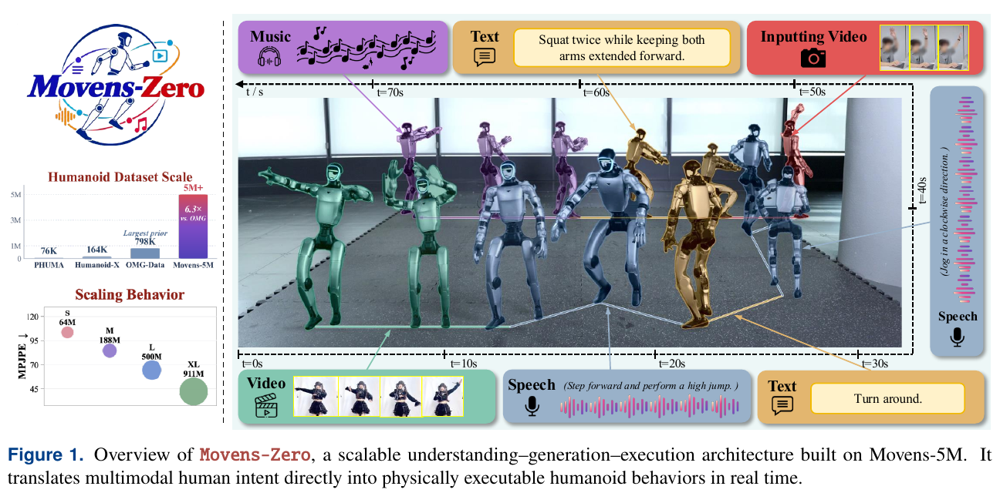
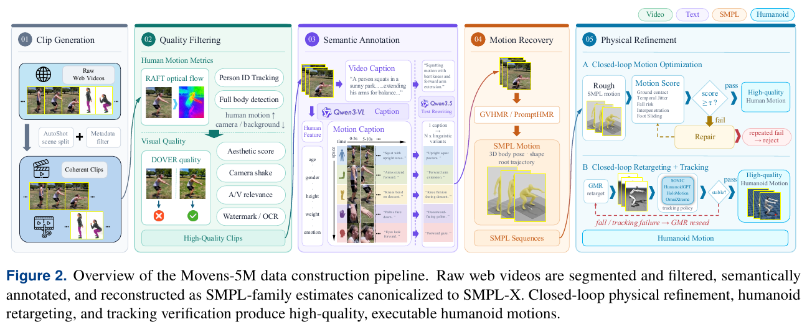
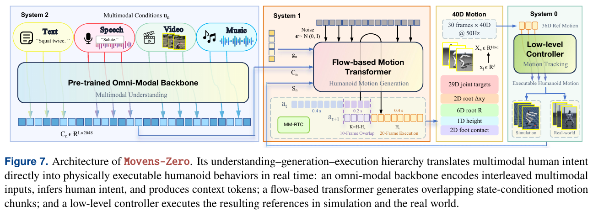
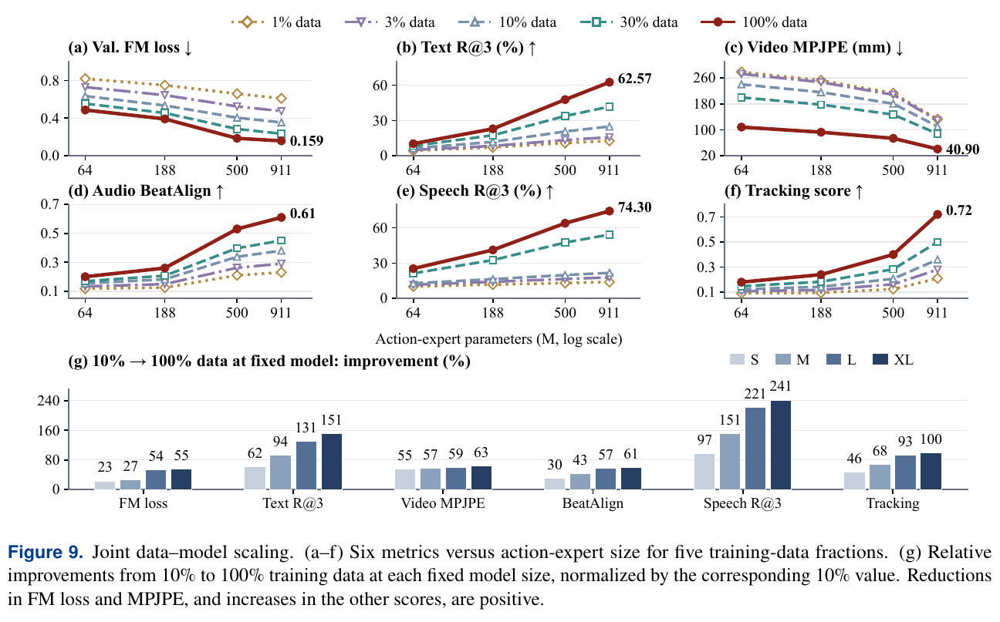
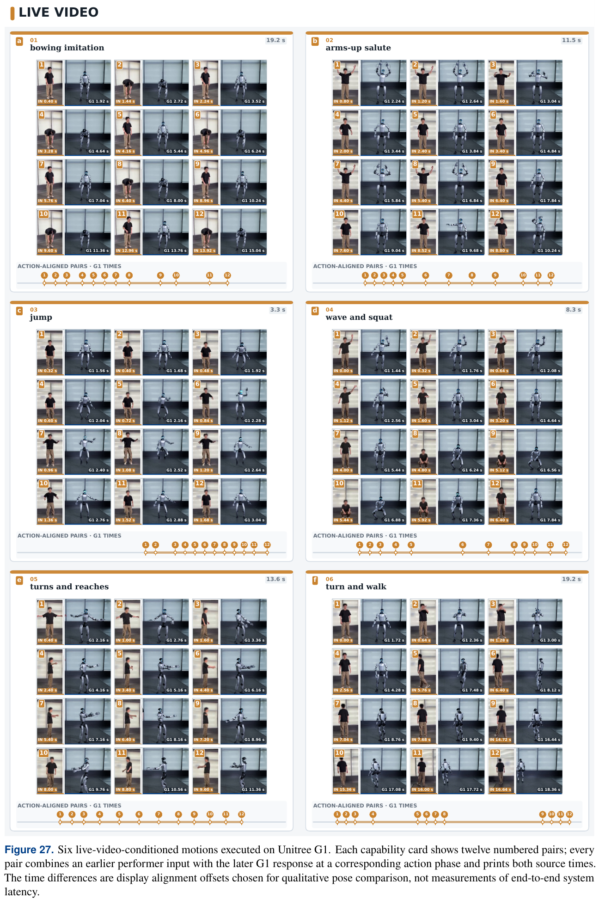

# 044 · Movens-Zero

## 基本信息

- **标题**：Movens-Zero: Scaling Humanoid Motion Foundation Models with Large-Scale Human Videos
- **作者与机构**：Wendong Bu、Tinghong Ye、Qizhou Wang 等，浙江大学、宇树科技、浙大—宇树具身智能联合实验室等。
- **版本**：arXiv:2610.41877v1，2026-10-30，86 页技术报告。2026-11-19 阅读，未复现。
- **分类**：Wholebody Intelligence → 大脑模型与任务策略。关联数据、基准与综述，以及运动控制。主要贡献包含运动生成模型、视频数据管线和评测基准。
- **来源**：[论文](https://arxiv.org/abs/2610.41877v1) · [正文](https://arxiv.org/html/2610.41877v1) · [项目页](https://movens-zero.github.io/) · [原论文](https://arxiv.org/abs/2610.41877v1)

## 一句话理解

**先从网上的人类视频提取动作，再筛出 G1 在仿真里能跟上的动作，用这些动作训练一个通用生成器。之后，给它一句指令、语音、一段音乐或一段示范视频，它就会根据 G1 当前状态生成下一小段全身参考，由低层跟踪器执行。**

## Motivation

互联网视频有大量舞蹈、运动、日常动作，但人类姿态估计会受遮挡、镜头运动和噪声干扰。即使人体动作恢复准确，G1 的关节范围、身体比例与人的也不同，直接搬过去可能滑脚、姿态超限，或者跟踪时跌倒。另一个挑战是，文字、语音、音乐与视觉示范的时间尺度不同，机器人还要持续接收新条件并把动作接顺。

论文分别建立 **Movens-5M** 数据管线、**Movens-Zero** 动作生成与执行系统，以及 **Movens-Intent** 评测基准。

## 数据方法：人类视频怎样变成 G1 的训练动作？

1. **剪片和筛选。** 按镜头切片、去重，剔除主体不清晰、运动不足或存在明显时间异常的片段。
2. **对齐语义。** 为片段生成整段和分时段的动作描述、动作与场景标签、物体信息，同时保留 RGB、语音、音乐和动作的时间关系。存在音频的样本才可提供相应音频条件。
3. **恢复人体三维动作。** 单人使用 **GVHMR**，多人使用 **PromptHMR**，统一规范到 **SMPL-X**。去掉全局根部位移和旋转后，再检查四肢本地动作幅度，避免把镜头运动或整体平移当成四肢动作。
4. **修补人体动作。** 以 **4 秒窗口、0.5 秒重叠**检查离地、抖动、跌倒风险、自穿模、足滑。只在坏段周围有可靠关键帧时，用 **Kimodo** 生成局部替代，多次采样并对拼接后的片段复检。
5. **重定向并做物理验收。** **GMR** 给 G1 初始参考，再联合优化根部和关节时间序列，约束关节角、速度、足接触与脚滑。候选参考在仿真重放，可由 SONIC、Humanoid-GPT、HoloMotion、OmniXtreme 中最多四种控制器试跟踪。至少一个被评估的 rollout 达到 `q ≥ 0.20` 即可保留。通过标准属于指定仿真和控制器设置。

论文报告 **1,500 万人体动作、500 万通过验证的机器人动作、超 1 万小时、297 类动作和 16 类场景**。这两个序列数对应流程中的两级产物，不能加成独立采集样本，也不能把 500 万解释为逐条真机采集。工业或日常物体动作能出现在素材里，仿真通过主要说明身体动作可跟踪。

另外，作者用文字重写与组合扩展长尾动作，调用 Movens-Zero 合成参考，再过跟踪和语义一致性筛选。论文的原始网络视频链路与这条文字扩增链路应分别理解，不能把所有生成扩增都解释成从新视频恢复。

## 模型方法：训练和部署的输入输出

**输入**有三部分：

- **条件**：文本、RGB 视频、语音、音乐。后一组三种各有「加任务文字」和「仅模态」版本，合计 **7 个训练任务**。冻结的 **Qwen2.5-Omni-3B** 把条件变成 2048 维上下文 token，训练前缓存。
- **本体**：最新一帧机器人 40 维状态，作为一个额外 token。模型也通过逐帧进度编码区分动作处于开始、进行或结束的阶段。
- **生成过程**：加噪的未来动作帧、flow time，以及已知时保留的一段干净动作前缀。共享动作专家用 joint attention 融合这些信息，学习 conditional flow matching。七种任务的数据按各自训练集样本量混合。

**输出**是 **30 帧 × 40 维**的 G1 参考序列。每帧由 **29 个关节角＋2 个根部平面位移增量＋6 个根部朝向分量＋1 个根部高度＋2 个足接触量**组成。每块的平面位移与朝向以当下根部航向为参照，后续解码成低层跟踪器可用的根部和关节轨迹。40 维是有物理含义的运动表示，与 SONIC latent 或电机力矩属于不同接口。

### MM-RTC 怎样让动作持续接上？

论文配置以 **50 Hz** 表示运动，预测 **30 帧（0.6 秒）**。每轮提交 **20 帧（0.4 秒）**执行，把剩下 **10 帧（0.2 秒）**在最新状态和坐标锚点下重新编码。下一轮生成时锁定这 10 帧，只新生成后缀。训练中随机保留 0–10 帧干净前缀，只对未知后缀计算损失。论文默认使用 10 步 Euler 积分。

举例，文字从「向前走」切换为「停下挥手」时，上一轮尚未执行的短尾巴仍负责衔接。生成器读取新指令和最新身体状态，生成尾巴之后的停止和挥手动作。50 Hz 表示参考帧率，0.4 秒是配置中的每次提交时长，论文所展示的真人与机器人截图时间差是定性对齐偏移。

**这里也有两种“视频出动作”**：造数据时，GVHMR / PromptHMR 先恢复人类身体，经过修补和 GMR 才得到 G1 参考。部署的视频模式则把可见人体动作当作视觉示范，模型从 RGB 条件直接生成 G1 的运动参考，可用于外部摄像机视频模仿。它与从穿戴者第一视角重建该人的不可见全身动作是不同问题。

## 实验

- **评测范围**：作者在 OMG、RICH、EMDB 和 Movens-Intent 测试。Movens-Intent 按原始视频来源与训练集隔离，覆盖文字、语音、音乐、视频，合计 **8,192 对**经人工核查的条件与动作。文本与语音的 R@3 是检索对齐指标；Tracking Score 来自仿真跟踪，不能看作真机任务成功率。
- **固定 XL，增加数据**：从 1% 到 100%（122 → 12,231 小时），文本 R@3 **12.72% → 62.57%**，视频 MPJPE **132.82 → 40.90 mm**，语音 R@3 **13.98% → 74.30%**，跟踪分数 **0.21 → 0.72**，音乐 BeatAlign **0.23 → 0.61**。这里的 40.90 mm 是缩放表中 Video MPJPE 口径，主对照表另报告对齐后 W-MPJPE₁₀₀ **49.1 mm**，两者指标不同。
- **固定全量数据，增大动作专家**：从 **64.2M → 910.5M**，文本 R@3 **10.30% → 62.57%**，语音 R@3 **25.37% → 74.30%**。参数量只指动作专家，整套模型另含冻结的理解主干。Fig.9 中除明确报告的 XL 数据扫点与全量模型对照外，仍有其他较小数据组合，阅读时以表 7、8 的明确数值为主。
- **同样本量与训练预算的数据消融**：原始恢复动作到完整管线，视频 MPJPE **126.82 → 40.90 mm**，Tracking Score **0.41 → 0.72**。表 9 逐层加入过滤、修补、跟踪筛选和分布平衡，反映各阶段在当前累积设置下的增益。
- **跨模态监督**：移除文本对齐，视频 MPJPE **40.90 → 56.84 mm**；移除视频对齐，Tracking Score **0.72 → 0.66**。意味着这些模态在当前训练配方下提供了可共享的运动监督。
- **真机**：Unitree G1 展示外部摄像机模仿、网络视频模仿、语音指令、音乐、文本动作，涵盖下蹲、步态和舞蹈等。附录给出案例快照；论文未给这些类别的总体真机成功率或实测端到端响应延迟。

## 结论与关联

论文最有力的证据来自两组比较：**同样训练量，更好的筛选与物理验证仍有收益；更大的动作专家能从更大规模的数据中获得更多提升。** Movens-Zero 适合用于研究多模态全身动作生成与运动先验。若任务要求根据机器人视角定位桌面物体、抓稳并搬走，仍需专门验证场景感知和接触操作。29 关节与足接触的输出也没有独立的手指或物体状态通道。

与 [Kimodo-Policy](039-kimodo-policy.md) 对读：Movens-Zero 的生成条件包括外部人类示范、语音和音乐，Kimodo 也用于离线修复部分样本。Kimodo-Policy 则把 Kimodo 接入第一视角视觉任务策略并量化取放等任务。与 [Ego2Sim2Humanoid](040-ego2sim2humanoid.md) 对读：后者从头手与 RGB-D 重建任务场景，对抓取、物体移动和机器人视觉施加明确约束。

## 发布情况

作者仓库列出离线生成、训练、评估、仿真和真机部署入口，公布 S/M/L/XL 四个权重入口。训练数据卡列出四个分片仓库作为完整发布入口，同时页面其他位置仍写“三个”；以数据卡逐项列出的链接为准。本次核对了入口，未下载完整分片、逐条核对 500 万记录或运行模型。数据卡许可栏为 other，仓库称项目代码和权重的具体许可尚未指定，公开可访问性与许可范围应分别判断。

[代码](https://github.com/wendell0218/Movens-Zero) · [XL 权重](https://huggingface.co/wendell0218/Movens-Zero-XL) · [Movens-5M](https://huggingface.co/datasets/wendell0218/Movens-5M) · [Movens-Intent](https://huggingface.co/datasets/wendell0218/Movens-Intent)

[原图清单](../assets/044-movens-zero/manifest.json) · [来源记录](../assets/044-movens-zero/source-record.json)
